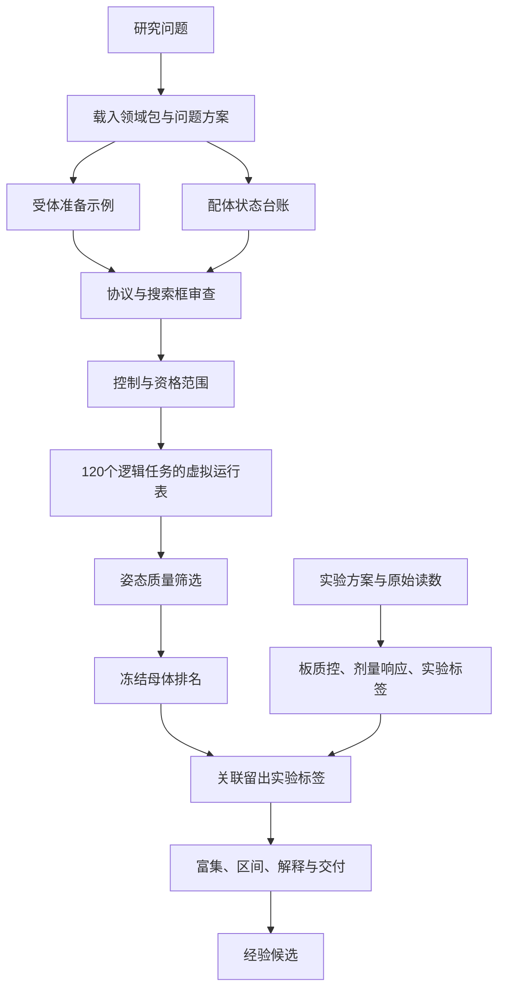
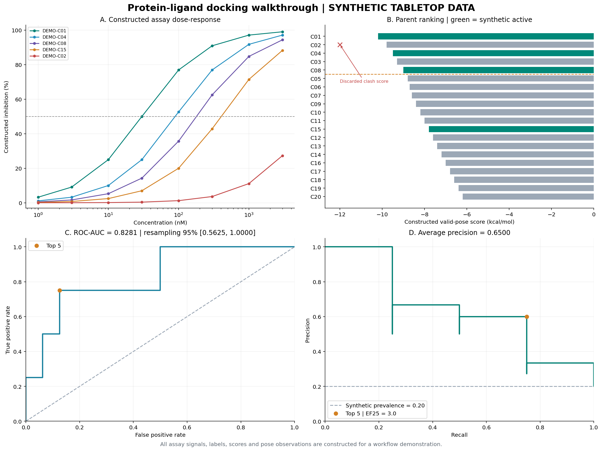

# 小分子对接全流程桌面演练

本次载入 small-molecule-docking 领域包，选择 virtual-screening 路线，以 ABL/1IEP 为方法背景，演练从实验设计、数据登记到对接结果分析的完整交接。日期为 2026-11-17。

**全部实验读数、活性标签、对接分数、RMSD 和姿态质量观察均为构造数据。** 本次实际完成了文档读取、工件生成和表格统计。科学工具调用数为 0。角色与独立审查记录由同一作者编写为职责示例，演练目录用 tabletop 标识其用途。

## 1. 研究者提出的问题

研究者希望用固定口袋的对接流程，对 20 个候选进行优先级排序，并用已有酶活数据做一次回顾性检查。当前任务关注姿态假设、排序富集和后续验证对象。

本轮补齐的案例假设包括一个受体构象、20 个匿名母体、24 个假定化学状态、每状态 5 个种子，以及用于对照的 5 次重对接。实验条件、搜索参数和验收阈值均作为演练选择登记。

| 项目 | 演练设定 | 落点 |
|---|---|---|
| 研究对象 | DEMO-C01–C20 与 ABL 口袋背景 | 输入母体清单 |
| 实验支持 | 两板构造酶活读数，8 个浓度、3 次重复 | 原始实验表 |
| 方法 | 刚性受体、柔性配体、Vina 评分 | 模型和任务配置 |
| 控制 | 独立开发控制的重对接摘要，留出集合标签后关联 | 资格与分析计划 |
| 交付 | 全量排名、覆盖、富集、区间、假阳性/假阴性、图表 | 分析与报告 |

实验计划和母体清单均可查看。[实验计划](inputs/experiment-plan.json) [母体清单](inputs/compound-inventory.csv)

## 2. 各模块怎样接起来

| 模块 | 本次接收 | 本次实际产物 | 用户看到的推进依据 |
|---|---|---|---|
| 领域包解析 | manifest、知识、检查、指标和任务 | 本地包快照与摘要 | 选定路线及资源可定位 |
| 实验数据接入 | 板布局、构造 RFU 读数 | 质控、浓度响应、标签及删失字段 | 实验来源到标签可追踪 |
| 知识取证 | 当前包的来源目录与说明 | 读取范围、原始链接和资料缺口 | 方法判断有明确来源类型 |
| 方案设计 | 目标、预算、指标 | 任务与分析计划 | 先固定输出和判据 |
| 模型/输入生产 | 受体与分子状态需求 | 准备台账、搜索配置 | 关键特征和输入身份可核对 |
| 审查 | 固定工件与检查规则 | 演练回执及问题记录 | 明确检查位置和修法 |
| 执行监督 | 状态×种子的任务矩阵 | 虚拟运行账本、一次失败与重试 | 逻辑任务、尝试和覆盖分别统计 |
| 分析 | 构造姿态观察和实验标签 | 有效姿态排名、EF/AUC/AP及区间 | 指标定义与数据分母一致 |
| 状态/恢复 | 演练事件与问题链 | 阶段轨迹及局部回退 | 改动只影响依赖它的部分 |
| 交付/经验 | 指标、图表、错误模式 | 报告与待审经验候选 | 数据、结论和知识状态可回查 |

这次冻结的是本地领域包文档内容，工具版本和真实结构仍列为待核。快照包含原 manifest、Schema、知识和检查文件，方便逐条对照。[包快照](source-pack/README.md) [来源锁定记录](source-lock.json) [会话范围](session.json)

## 3. 从实验设计到可用标签

### 3.1 实验人员交付什么

演练采用 2 块 384 孔板，每板安排 10 个母体。每个母体测试 1、3、10、30、100、300、1000、3000 nM 八个浓度，每浓度 3 孔。每板另外安排 8 个高活性溶剂对照和 8 个低活性对照，共使用 256 孔。原始表共 512 行。

实验条件假定 pH 7.4、ATP 10 μM、底物 1 μM、酶 5 nM、DMSO 0.5%、孵育 30 分钟。读出采用正向对应酶活的示意 RFU。实际实验需要针对检测体系确认这些条件与线性范围。

每行保留 plateId、wellId、parentId、浓度、重复编号、原始信号和 synthetic-tabletop 标记。[原始读数](inputs/synthetic-assay-raw.csv)

### 3.2 分析人员怎样处理

先从每板对照计算均值和样本标准差，再计算 Z′，公式为 `1−3(σ高+σ低)/|μ高−μ低|`。两板的构造数据均得到 **Z′=0.9377**，满足演练采用的 0.5 目标。

抑制率按 `1−(样品信号−低对照均值)/(高对照均值−低对照均值)` 计算。示例将 Hill 斜率固定为 1，上下界由板对照固定。浓度范围覆盖 50% 抑制时，由中间响应段回算 IC50。最高浓度仍达不到 50% 时记录 `IC50>3000 nM`，并保留删失标记。

标签规则在排序前登记为 IC50≤500 nM 活性，IC50≥1000 nM 或下界大于 3000 nM 为非活性，中间范围单列。这个构造集合得到 **4 个活性、16 个非活性**。真实曲线拟合还应处理拟合区间、异常孔、置信区间和实验重复。

| 母体 | 构造实验结果 | 进入标签 |
|---|---|---|
| DEMO-C01 | IC50约30 nM | active |
| DEMO-C04 | IC50约90 nM | active |
| DEMO-C08 | IC50约180 nM | active |
| DEMO-C15 | IC50约400 nM | active |
| DEMO-C02 | IC50>3000 nM | inactive，保留右删失 |

每个标签指向原始读数和计算规则。[板质控](analysis/assay-qc.json) [浓度响应表](analysis/synthetic-dose-response.csv) [实验标签](analysis/synthetic-experimental-labels.csv)

## 4. 方案与知识模块怎样工作

方案者读取领域包中的模型、Vina/Meeko 方法说明、检查和指标，把目标转换成任务字段。搜索配置采用 Å 单位的 20×20×20 box，位置沿用包中 1IEP 教程背景。选择 vina 评分、exhaustiveness=32、最多保留20个模式和5个预定种子。

母体层取所有有效姿态的最低分，状态数、运行数和失败完整披露。分析先冻结排名，再关联留出标签。协议作者与分析者的标签访问范围在实验计划中给出，演练文件展示这些职责应如何配置。

演练指标预先确定为 top5 至少命中3个活性、EF25至少为2、ROC-AUC点估计至少0.7、最终逻辑任务覆盖完整。AUC区间跨过0.7时记 borderline。重对接目标为 top1参考RMSD≤2 Å的种子至少4/5。这些阈值对应本演练的具体选择。

知识模块实际引用本地来源目录，外部网页沿用包中已有阅读状态。本次的文档读取记录与后续实际结构、全文或手册的读取记录分别定位。[任务配置](plan/task.json) [分析计划](plan/analysis-plan.json) [知识目录](source-pack/knowledge.json) [方案交接](stages/01-plan.json)

## 5. 准备阶段的交接

### 5.1 受体

生产者需要提交链选择、组装体、缺失/alternate location、质子化、关键水/离子/辅因子的决定，以及修改前后的坐标和残基映射。审查者按 receptor-quality 逐项核对，并绑定当前产物摘要。

本次用受体台账描述这些决定，台账中保留 actualCoordinates=unavailable。准备检查的演练观察采用“假定满足”。进入真实求解时，实际坐标与准备回执是这里需要补齐的工件。[受体台账](preparation/virtual-receptor.json) [受体交接](stages/02-receptor.json)

### 5.2 配体

20 个母体中，C02、C05、C08、C11 各假定两个状态，其余各一个，共24个状态。每状态保存 parentId、stateId、假定电荷和状态选择理由。真实准备还应产生 SDF/PDBQT、键级/立体核对及原子映射。

这里的状态数用于演练批量调度与分母，分子结构仍由实际案例提供。两个准备分支在 configure 汇合，上游分别审查后才进入统一搜索配置。[状态台账](preparation/virtual-ligand-states.csv) [配体交接](stages/03-ligands.json)

## 6. 第一次异常如何被发现和修复

第一版任务故意遗漏 `site.unit`。结构校验能够定位这个字段缺失，box-protocol 的单位前置处于 unknown。演练审查因此返回 BLOCKED。

生产者核对包中的单位定义，补入 angstrom，保存修订后的任务。再次校验通过后，演练进入资格阶段。修复链保留原版本、问题、依据和新版本，后续协议引用修订后的输入。

| 交接 | 记录 |
|---|---|
| 原输入 | task.attempt01.json，缺少site.unit |
| 审查问题 | configure / box-protocol / unknown |
| 修订 | site.unit补为angstrom |
| 影响范围 | 搜索协议及后续依赖 |
| 已完成的实验处理 | 标签与板质控继续复用 |

这项缺字段检查在本次确实执行，属于文档/配置校验。科学审查结果以演练回执展示。[初始任务](plan/task.attempt01.json) [修订任务](plan/task.json) [审查示例](reviews/illustrative-receipts.json)

## 7. 控制试验和执行阶段

### 7.1 资格阶段

五个种子的构造 top1 参考 RMSD 为1.4、1.6、1.3、1.8、2.4 Å，4/5达到演练目标。best-of-5均小于2 Å。资格记录允许继续演练留出排序，筛选区分能力待标签关联后的分析判断。

真实重对接需保存受体对齐、外部参考、对称重原子映射和实际姿态。这里的 RMSD 是构造摘要。[控制表](qualification/synthetic-redocking.csv) [资格范围](qualification/scope-decision.json) [资格交接](stages/05-qualify.json)

### 7.2 虚拟运行矩阵

一个受体×24个状态×5个种子得到120个逻辑生产任务。每个任务拥有稳定的状态、种子、runId和operationId。五个控制任务另计，案例上限为130次尝试。

演练账本中119个任务首尝试成功，C06-S1的一个种子出现“输出目录不可写”。修复目录配置后新建第二次尝试，原失败保留。最终120个逻辑任务可评价，共121次生产尝试，加控制为126次尝试。实际科学工具调用为0。

| 数字 | 含义 |
|---|---|
| 120 | 预定逻辑生产任务 |
| 119/120 | 演练首尝试成功覆盖 |
| 121 | 含一次失败重试的生产尝试数 |
| 120/120 | 演练最终逻辑任务覆盖 |
| 5 | 单列的资格控制 |
| 0 | 实际求解器调用 |

启动计划保存候选 argv、输入依赖和对账规则。演练中的失败已经确认，实际遇到未知提交状态时需先查回外部作业身份。[启动计划](execution/launch-plan.json) [虚拟运行账本](execution/virtual-run-ledger.csv) [执行交接](stages/06-dock.json)

## 8. 姿态质量怎样影响排名

观察表包含120条有效姿态摘要和1条额外低分冲突摘要。C02有一条−12.0 kcal/mol的构造记录，演练假定它与受体严重重叠。该记录保留 rejectionReason，排名选择其−9.8 kcal/mol有效姿态。

姿态表使用 demoGeometryValid 和 actualCoordinates 字段，明确区分本轮假定的几何观察和后续需要取得的坐标证据。真实分析需要从原子映射、恢复结构、距离/重叠和口袋位置计算这些检查。

母体排序先保存为盲标签表，随后关联实验标签。多状态母体额外搜索机会进入状态数披露和单状态敏感性对照。[姿态观察](execution/synthetic-pose-observations.csv) [冻结排名](analysis/ranking-blinded.csv) [姿态交接](stages/07-poses.json)

本轮将每个母体限制到S1后重算排名，20个母体的次序保持一致。这项对照核对了当前构造表格的聚合路径，实际多状态影响仍需由对应数据评估。[单状态敏感性对照](analysis/single-state-sensitivity.csv)

## 9. 从排名到实验解释

| 排名 | 母体 | 构造有效评分，kcal/mol | 构造实验标签 | 本轮解释 |
|---|---|---|---|---|
| 1 | DEMO-C01 | −10.2 | active | top5命中 |
| 2 | DEMO-C02 | −9.8 | inactive，IC50>3000 nM | 假阳性案例 |
| 3 | DEMO-C04 | −9.5 | active | top5命中 |
| 4 | DEMO-C03 | −9.3 | inactive，IC50>3000 nM | 假阳性案例 |
| 5 | DEMO-C08 | −9.0 | active | top5命中 |
| 12 | DEMO-C15 | −7.8 | active | top5漏检案例 |

C02的有效姿态仍排在第二位，同时构造实验标签为非活性。因此，几何质量通过之后还需要评估评分与实验的关系。后续需区分准备/状态、受体构象、溶剂和熵等模型因素，以及实验读出干扰、聚集和溶解度等因素。

C15展示漏检路径，检查其状态准备、搜索覆盖和评分偏差，再用独立资料决定是否修订方法。修订会形成新协议版本，原留出结果继续保留。

全量表保存20个母体、选中姿态/运行、状态数、成功分母和实验来源。[完整关联表](analysis/ranking-with-synthetic-labels.csv)

### 9.1 指标实际核算结果

以下数值由本次生成的构造表格统计得到。

| 指标 | 本次值 | 演练判据与结论 |
|---|---|---|
| 阳性比例 | 4/20=20% | 定义富集的分母 |
| top5命中 | 3/5 | 达到至少3个的演练目标 |
| Precision@5 | 0.60 | top5中活性占比 |
| Recall@5 | 0.75 | 找到4个活性中的3个 |
| EF25 | 3.00 | (3/5)/(4/20)，达到演练目标2 |
| ROC-AUC | 0.828125 | 点估计超过0.7，区间跨阈值，记borderline |
| Average precision | 0.65 | 明确采用sum(Δrecall×precision) |
| ROC-AUC重采样95%区间 | [0.5625, 1.0000] | 构造样本较少，区间较宽 |
| AP重采样95%区间 | [0.3372, 1.0000] | 描述当前构造表格的重采样波动 |

重采样按母体分层，固定4个阳性、16个阴性，有放回重复1000次，随机种子20261117。相同分数在ROC中按半胜处理，AP按分数阈值分组处理。

EF25描述这组构造集合的早期富集，跨靶标适用性和真实实验预测能力需要实际验证材料。指标JSON保留数据来源、方法、区间和分项结果。[指标结果](analysis/metrics.json) [分析交接](stages/08-analyze.json)

### 9.2 构造数据图

图中剂量曲线、排名及ROC/PR均来自本目录的构造表格。

## 10. 最终交付给研究者什么

研究者收到20个母体的完整排名、全部状态与运行分母、冲突姿态剔除原因、4个构造活性的检出/漏检，以及实际指标核算结果。C01、C04、C08用于展示命中后进入正交实验的交接，C02/C03用于假阳性复核，C15用于漏检诊断。

| 状态维度 | 本轮记录 |
|---|---|
| 桌面流程 | 已走完九个领域阶段及实验数据桥接 |
| 配置检查 | 缺单位被检出，修订版本通过Schema |
| 构造数据统计 | 已计算并核对 |
| 虚拟审查/运行 | 有完整例示回执与恢复记录 |
| 实验、受体准备和真实对接 | 待实际资料、工具与实验执行 |
| 独立科学审查 | 待实际执行 |
| 经验候选 | 已保存候选与构造来源 |

状态事件和问题链可按阶段回查。[事件记录](state/tabletop-events.json) [异常与恢复](state/issues-and-recovery.json) [经验候选](feedback/lesson-candidates.json)

## 11. 演练暴露的开发补充项

| 补充项 | 这次采用的落点 | 后续实现任务 |
|---|---|---|
| 实验数据到仿真标签 | 单独的实验计划、原始表、质控、标签映射 | 接入仪器/人工数据，保留删失、置信区间和来源 |
| 角色与数据访问 | 回执显式标注同一作者的职责示例 | 运行时绑定角色身份和标签访问范围 |
| 批量与重试分母 | logicalRunId与runId/attempt分开 | 将真实任务矩阵与作业账本对接 |
| 多状态聚合偏差 | 披露状态数和单状态敏感性 | 实现固定聚合规则及适用验证 |
| 质量筛选 | 先定义剔除规则，再冻结排名 | 接入坐标、原子映射和几何检查器 |
| 留出评价 | 先排序冻结，再关联标签 | 通过运行时权限和工件版本约束访问 |
| 实验条件字段 | 由experiment-plan连接仿真task | 扩展实验契约，同时保持任务Schema的职责 |

这些补充有各自工件，开发者可以从本次实例看到接口需要传递的具体内容。当前实验桥接通过 labelledSet 和数据来源关联对接任务，实际科学包继续由既有资源定义。

## 12. 文件导航

`source-pack/`保存读取的领域包快照。`inputs/`保存实验计划与构造原始表。`plan/`保存任务、修订和指标计划。`preparation/`保存准备台账。`qualification/`保存控制。`execution/`保存虚拟运行和姿态观察。`analysis/`保存实际表格计算。`stages/`保存九个内容工件。`reviews/`与`state/`保存职责示例和演练轨迹。`figures/`与`feedback/`保存图表及候选经验。

文档/表格一致性校验记录在 evidence 目录。[检查回执](evidence/validation.json)
