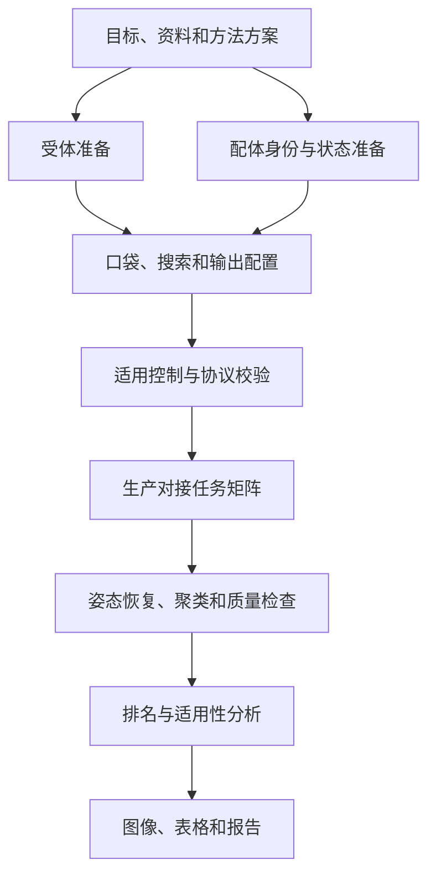

# 小分子对接领域工作流

包 ID 为 small-molecule-docking，版本 0.1.0-draft。任务对象采用蛋白质受体与有明确化学身份的小分子。首条路线采用刚性受体、柔性配体、已知口袋和非共价对接，支持多个受体构象和分子状态的显式枚举。

## 1. 用户输入与交付

最少输入包括受体结构与选择规则、配体 SDF 或带立体信息的 SMILES、位点依据、准备条件、搜索预算和交付目标。受体建议使用保留链和残基身份的 PDB/mmCIF，配体必须保留键级、形式电荷、立体化学和原子身份映射。

两条公开路线分别为 focused-docking 和 virtual-screening。前者解释少量候选的结合姿态假设，后者对固定受体与统一协议下的化合物集合进行排序。回顾性筛选评估需要已知活性/非活性或诱饵集合及明确标签来源。

交付含准备审查、受体/配体状态台账、搜索空间、所有运行与种子、成功/失败分母、候选姿态、评分、聚类、接触分析、控制试验和结论适用范围。若开展筛选，交付逐分子状态到母体的聚合规则和排名完整表。

共价反应、金属配位专用处理、肽类/蛋白质对接和自由能计算需要对应扩展模型与验证。遇到这些特征，当前流程在适用性审查处给出转用方案。

## 2. 阶段图

| 阶段 | 输入 | 核心动作与产物 | 放行检查 |
|---|---|---|---|
| plan | task、原始资料 | 明确假设、数据来源、控制试验、指标和预算，产出 plan | 靶标/化学适用性、输入完整性、目标范围，独立审查 |
| receptor | plan、受体 | 选择生物组装体/链、处理缺失/alternate location、决定水/离子/辅因子、加氢与残基状态，产出 receptor-bundle | 位点完整性、保留/删除清单、残基编号和坐标映射，独立审查 |
| ligands | plan、配体 | 校验身份、盐和片段、立体、质子化/互变异构、3D 构象及转动键，产出 ligand-bundle | 原子/键/电荷、状态来源、过滤原因、去重和可追溯性，独立审查 |
| configure | 两个 bundle、plan | 定义 Å 单位的 box、scoring、exhaustiveness、numModes、energyRange、种子、输出，产出 protocol | 位点覆盖、单位、工具支持、输出与预算，独立审查 |
| qualify | protocol、参考数据 | 按任务开展 redocking、已知配体控制、回顾性筛选或资料核查，产出 qualification | 控制试验范围与结论匹配，缺数据时收紧结论，独立审查 |
| dock | protocol、qualification | 遍历受体构象×配体状态×预定种子，保存单独 run 与失败状态 | 真实调用、输入摘要、完整 pose/log、运行分母 |
| poses | docking-batch | 按原子映射恢复 SDF，检查化学、重叠、口袋位置和姿态聚类 | 映射正确、输出化学一致、质量问题标注 |
| analyze | pose-analysis、qualification | 在统一协议内汇总评分和稳定性，按预定规则聚合到母体 | 指标口径、状态/受体混合限制、模型适用性 |
| report | 所有分析 | 生成口袋图、代表姿态、排名和限制 | 姿态身份、图例、单位、数据/运行来源 |

`qualify` 的控制取决于可用资料和所声称的结论。探索任务可交付资料审阅及假设性姿态。声称已恢复实验姿态时需要有效 redocking 证据，声称具有筛选区分能力时需要适用的回顾性数据。数据缺口保存在 qualification 中，任务范围随之明确。

## 3. 方法与知识

受体的配体、关键水、金属和辅因子逐项决定保留策略。预测结构需记录置信度、口袋局部质量和构象假设。准备软件对缺失侧链、残基模板或化学态的修改进入差异台账。

质子化/互变异构枚举按案例 pH、证据和状态上限开展。RDKit 承担化学解析、构象与映射能力，pH 相关状态枚举需要明确工具与方法，例如经验证的 Molscrub 路线。每个状态保留 parentId、stateId、形式电荷、立体定义和生成依据。

Vina/Meeko 官方教程支持该准备与搜索路线，提供 1IEP 的参考材料。知识目录保存读取范围、来源类型和当前引用，工具版本在部署时锁定。[Vina 教程](https://autodock-vina.readthedocs.io/en/stable/docking_basic.html) [Meeko 教程](https://apidocmeeko.readthedocs.io/en/latest/tutorial1.html)

评分结果在同一 scoring function、工具版本、受体准备和搜索协议内进行比较。不同状态的最低分聚合会受到枚举数影响，报告同时提供状态数、运行数和预定聚合规则。跨受体构象比较需使用独立的标准化或集成策略，并验证该策略。[Vina FAQ](https://autodock-vina.readthedocs.io/en/latest/faq.html)

## 4. 关键指标

| 指标 | 定义与方法 | 判读范围 |
|---|---|---|
| docking score | 工具原始评分及 scoring/version，通常以工具声明的 kcal/mol 输出 | 用于协议内候选比较，实验亲和力结论需另有证据 |
| reference RMSD | 受体对齐后，在同一坐标系内按化学对称映射比较配体重原子 | redocking 的 pose-recovery 判据，分别报 top1 和 best-of-N |
| pose recurrence | 按预定 RMSD/接触阈值聚类，统计独立种子重复命中率 | 体现搜索重复性，需报告分母与失败运行 |
| contact fingerprint | 原子/残基映射和几何定义下的氢键、疏水/芳香等接触 | 描述结构假设，几何阈值和质子化方案需锁定 |
| EF、ROC-AUC、PR-AUC | 明确标签、阳性率、排序、并列分数和失败处理 | 适用回顾性筛选，分别报告 bootstrap 不确定性 |
| preparation/run success | 成功母体、状态和 run 数除以各自计划分母 | 失败/过滤逐项记录，避免只留下成功分子 |

Vina 输出中的 RMSD l.b./u.b. 以其输出参考姿态为基准。对照晶体姿态需单独计算 reference RMSD，并保留映射与对齐记录。

redocking 示例采用 2 Å 的重原子 RMSD 作为初始工程目标，实际目标由分子对称性、实验质量和任务需求确定。候选搜索配置采用 5 个预定种子、exhaustiveness=32、保留 20 个模式，供首次基准调整。它们均在示例任务中标为 proposed。

## 5. 控制试验与数据划分

协议开发使用独立控制集，正式候选与测试标签在协议锁定后处理。redocking 时参考配体从受体中移除，搜索初态需记录生成方式，参考坐标仅供口袋定义和最终验证的用途应显式登记。筛选评估采用留出的活性/诱饵集合，去重及相似骨架泄漏检查进入数据报告。

单一共晶体系适合检查准备、位点与姿态恢复，跨靶标预测能力需相应数据。诱饵需描述来源与构造，ROC 与 PR 指标应结合阳性比例解释。亲和力拟合、活性预测、选择性和药代结论各自需要额外实验或验证模型。

## 6. 故障与回退

| 现象 | 诊断证据 | 返回阶段 |
|---|---|---|
| 无法解析、原子丢失、键级改变 | 原始 SDF、Meeko/RDKit 日志、映射表 | ligands |
| 位点塌陷或模板不支持 | 残基质量、缺失、金属/辅因子和准备差异 | receptor 或 plan |
| 全部姿态出位点/无结果 | box 坐标/单位、受体对齐、转动键和运行日志 | configure，必要时上游 |
| 控制恢复差、种子差异大 | RMSD、姿态簇、预算扫描、状态选择 | configure 或方法方案 |
| 分数好但姿态冲突 | 重叠检查、原子类型、化学状态与接触图 | poses，必要时 receptor/ligands |
| 排名受枚举数主导 | 每母体状态数、缺失运行、聚合方法 | analyze 或计划 |

每次修复新建 attempt/run，保存原始输出。资源不足可缩小已记录的试验矩阵，随后重评覆盖与结论。

## 7. 交接文件

`manifest.json` 包含两条公开流程和具名工具绑定。`problem.schema.json` 约束任务表单。`knowledge.json`、`models.json`、`checks.json`、`metrics.json`、`failures.json`、`protocols.json`、`artifacts.json`、`roles.json`、`templates.json`、`validation.json` 提供对应内容。`examples/task.json` 展示 1IEP redocking 的候选配置和待取得资料。

本轮已读取官方网页相关章节，并检查声明、引用和字段。适配器调用、结构准备、真实对接和回顾性验证留有 planned/unverified 状态，后续回执沿同一记录补齐。

两个任务表单分别位于 [重对接示例](examples/task.json) 和 [回顾性筛选示例](examples/virtual-screening.task.json)。工具输入、输出与适配器验收见 [工具配置](tooling.md)。
