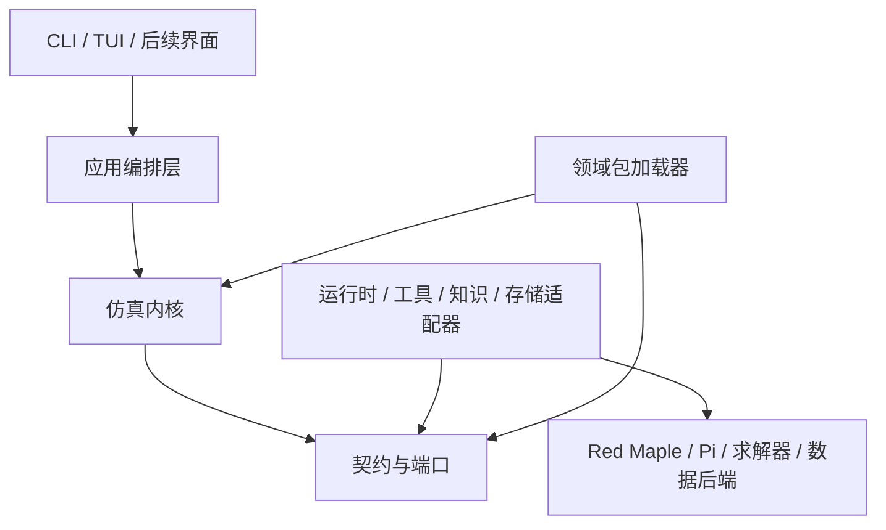

# 01 架构与模块边界

## 1. 依赖方向

箭头表示代码依赖，运行时由应用层注入端口实现。内核不得导入 Pi、具体求解器 SDK、领域脚本或领域包名称；领域声明不得依赖内核私有符号。

## 2. 模块责任

| 模块 | 输入与输出 | 不变量 |
|---|---|---|
| contracts | 跨模块记录、Schema、枚举、版本与错误码 | 无宿主和求解器依赖 |
| pack-resolver | 包、任务、环境→解析计划、锁文件或缺口 | 依赖、引用、能力与策略先校验后执行 |
| kernel | 命令、回执、状态→事件、执行意图、状态投影 | 唯一科学流程推进权威 |
| runtime-redmaple | 角色任务→实际会话/工具回执 | 会话输出不能直接改内核状态 |
| execution | 运行规格→作业状态、输出和对账结果 | 未知副作用不盲目重试 |
| knowledge | 查询/读取/提案→来源、读回执、候选 | 排名不改变确认状态 |
| artifacts | 工件注册、解析、校验、依赖→不可变引用 | 按原始字节摘要；二进制不得 UTF-8 化 |
| analysis/presentation | 数据与口径→指标、图表和来源记录 | 不改锁定验收标准 |
| improvement | 来源证据→候选、评估、发布记录 | 不自动修改活跃受保护资产 |

这些是维护边界，不要求一模块一服务或一 npm 包。先在独立 `simulation/` workspace 实施，产品目录尚未创建。

## 3. K1–K7 与新增能力的归属

K1 管阶段图、分支、研究活动与迭代；K2 管触发、检查和审查；K3 管工件身份与依赖；K4 管来源、读回执与证据；K5 管运行监督与修复计划；K6 管状态、事务、版本、对账与恢复；K7 管计量、科学验证和任务验收的记录框架。

包加载在执行前为 K1–K7 提供解析后的配置；不另造一套工作流状态机。耦合协议作为 K1 的有界子流程和 K3/K7 的交换/验证契约组合，不创建“耦合专用成功”的旁路。

## 4. 状态所有权与持久化

| 数据 | 权威所有者 | 其它副本 |
|---|---|---|
| 案例、方案、阶段、审查和计数 | SimulationStore | UI/JSON/Markdown 只读投影 |
| 实际模型/工具调用账本 | 宿主运行时 | 通过 operationId 精确关联 |
| 求解器运行状态 | 外部工具与 execution 对账记录 | 内核状态是已核实的投影 |
| 对话和角色上下文 | 会话运行时 | 不能据最后一句话推进阶段 |
| 原始知识/工件 | 版本化内容存储 | 搜索索引可重建 |

一次状态变更必须以 expectedStateRevision 做 CAS：校验前态、回执、摘要和权限，原子写入新状态、事件和 outbox 意图。跨宿主库和外部求解器不存在伪造的分布式原子事务；通过幂等处理、回执收集及对账恢复。

工件先在暂存区完整写入并校验，发布不可变内容，再提交引用。提交前崩溃留下孤立工件可延后清理；已提交引用丢失时阻塞并报告，不自动补一个同名空文件。

当前工作区位于同步盘，活跃数据库/WAL/锁应放本机状态目录；同步一致性备份和不可变工件。跨机同时写入需单一状态服务，文件同步不能承担分布式锁。

## 5. 接入现有基座

依据既有[基线核验](../基线核验.md)，`full-runtime.js`、`platform-extension.js`、`workflow-runner.js`、`native-workflow.js`、`session-controls.js`、`knowledge.js` 等是候选接入点。文件中存在能力不等于公开导出可直接调用；开工时需检查 `package.json` exports 和对应函数签名。

保留旧通用 WorkflowRunner 处理普通任务。仿真任务可用专用持久任务桥接内核；宿主调度状态只表示调用调度，不是第二套科学阶段状态。原按预算和时间过滤的调用关联应由适配器收紧到 operationId，而不是把所有历史关联机制描述成失效。

## 6. 设计禁止项

- 以领域名称分支决定内核阶段、模型参数、科学检查或指标公式。
- 由模型自由文本、文件存在、工具退出码直接把阶段改成 PASS。
- 在多个模块维护可独立写入的当前阶段、修订计数或有效包版本。
- 通过换 session、run 名称或预算 ID 清零失败历史。
- 为方便跨域而把单位、坐标、参考和实体关联削减成无语义的数字数组。
