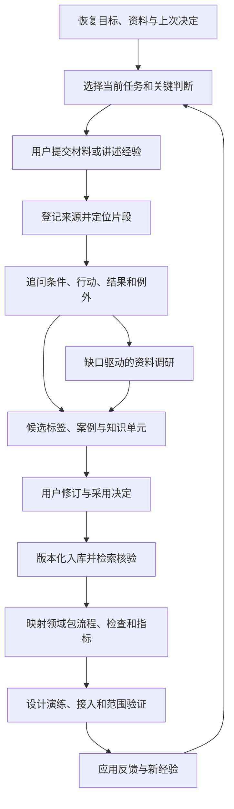

# 02 引导流程与会话规范

## 1. 制作路径

每个活动有稳定身份和修订。用户可从成功案例、失败诊断、行业规程、已有工作流或研究问题任一入口开始，系统按当前缺口选择后续动作。

## 2. 引导活动与继续条件

| 活动 | 系统动作 | 用户参与 | 产物与继续条件 |
|---|---|---|---|
| 定界 | 复用已有目标，定位最先支持的任务 | 说明实际使用者、决策和交付 | scope，关键歧义已澄清 |
| 资料盘点 | 登记已有文件、口述和引用，提出高价值缺口 | 选择代表材料或指出资料持有人 | source inventory，允许保留待取得项 |
| 经验访谈 | 围绕真实决策追问条件、原因和例外 | 讲述亲历细节、纠正归因 | source/experience draft，缺口清晰 |
| 标注整理 | 提出片段、知识单元和标签，展示原文对照 | 编辑、批次采用、暂缓或否决 | annotation/knowledge proposals |
| 审阅入库 | 校验决定范围、引用、版本和实际适用性 | 确认重要语义与使用方式 | review 与写入回执，可检索回查 |
| 包设计 | 连接知识到模型、步骤、检查和计量 | 选择关键方案与取舍 | design bindings，依赖完整 |
| 验证交接 | 提供正常/失败案例和实际测试要求 | 提供验收依据或指定审阅职责 | 制作范围内的准备度及后续任务 |

## 3. 首轮引导

先读已有范围、材料、决定和待答问题。对已明确内容给出简短复述，提出当前有价值的 1–3 个问题。以下是一份可采用的开场。

> 这套包准备先帮助哪个岗位完成哪项任务？结果会用于什么决定？你已有的哪个案例、规程或亲历问题最能说明这项工作？可以先给资料清单，也可以先讲一次具体经历。

若用户只有一个案例，从案例还原任务。若用户只有规范，从其适用对象和典型执行过程开始。若用户没有资料，整理可公开研究的任务与待征集清单，并为用户保留后续注入入口。

## 4. 每轮提问策略

每个问题关联 gapId、目标对象、为何需要、会改变哪个设计决定、候选回答形式以及相关来源。优先级按当前决策影响、可获得性和用户负担判断，理由可读。

推荐顺序为实际目标与关键语义歧义、缺少的适用条件、会改变动作的失败/例外、决定模型/验收的证据、最后处理整理性细节。推荐是可调整的会话策略。

支持自然语言、材料引用、选项和“不知道/暂时没有”。不知道形成待核问题，暂缓形成有恢复条件的 gap。系统继续执行当前已授权且不依赖该回答的动作。收到更正后更新相关候选及依赖，保留原来源与更正记录。

## 5. 一轮的可见回报

每轮尽量只显示以下与用户当前任务有关的内容。

1. 对照用户材料得出的候选判断，指出来源位置和未确定条件。
2. 本轮新增/修改的标签、知识单元和包设计位置。
3. 需要用户处理的少量差异，给出采用、修改、暂缓或拒绝操作。
4. 已保存内容、当前缺口和下一轮的具体问题。

同一批次允许按内容选取和批量操作。批次摘要展示会改变语义的字段、默认值和例外。批量决定记录对象清单和摘要，之后编辑的对象进入新版本并重新评估决定有效性。

## 6. 会话状态与恢复

制作会话状态使用 active、waitingUser、paused、closed。具体活动单独记录 queued、inProgress、waitingInput、reviewReady、done、deferred、blocked。一个活动等待输入时，其它可行动活动仍可处理。

恢复读 sessionId、scopeRevision、材料修订、用户决定、活动状态和 lastQuestionRefs。返回待答问题并说明哪些内容已完成，继续原任务。聊天历史可用来定位，已保存的来源/决定/活动记录承担恢复依据。

用户暂停时保存当前产物与下一步。用户声明本轮结束时交付实际准备度和缺口。用户追加案例/规范时形成新 intake batch，并分析它对已有知识、流程和检查的影响。

## 7. 引导质量

系统应能解释每次提问为何出现、用了什么已有信息、用户的回答改变了哪里。验证包括重复提问、忽视更正、默认采用AI建议、一直索要全领域资料、只访谈成功经验和强行填满表单等反例。验收场景见 [08 文档](08-development-and-acceptance.md)。
