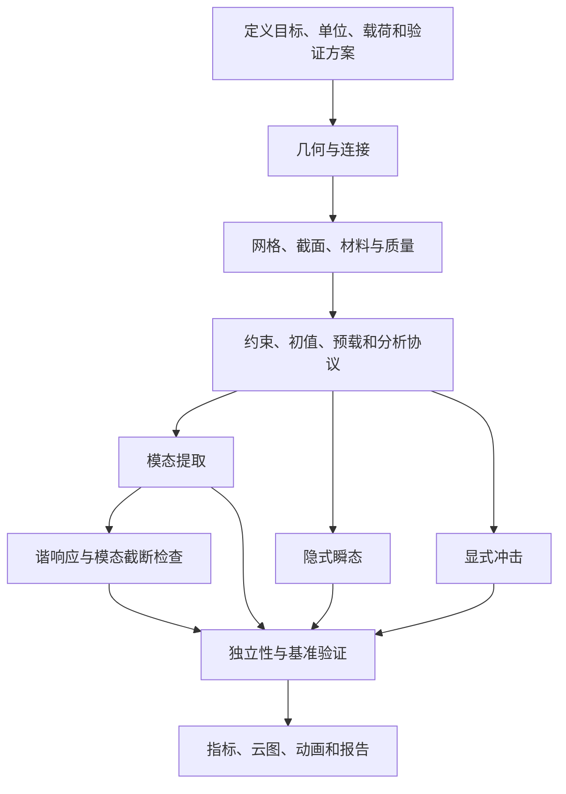

# 有限元动力学领域工作流

包 ID 为 fem-dynamics，版本 0.1.0-draft。覆盖结构振动与冲击，提供 modal、implicit-transient、harmonic-response、explicit-impact 四条公开路线。默认研究对象为连续体结构，可采用梁、壳、实体及有明确验证记录的连接/接触模型。

## 1. 问题定义与方法选择

| 路线 | 适用目标 | 模型与求解约束 | 主要结果 |
|---|---|---|---|
| modal | 固有频率、振型、模态贡献 | 定义质量与刚度、约束和线性化状态，按需包含预应力 | 频率、振型、广义量和有效质量 |
| implicit-transient | 时间变化载荷下的位移/应力/加速度，按需接触或材料非线性 | 锁定积分、时间步、非线性求解、初值和阻尼 | 时程、场、反力、能量及收敛记录 |
| harmonic-response | 线性或预应力状态附近的稳态周期响应 | 频段、阻尼、激励幅值/相位和模态截断控制 | 复数 FRF、幅频/相频、峰值与传递率 |
| explicit-impact | 短时冲击、高速接触、大变形的候选路线 | 适用材料/接触、稳定步长、质量缩放、单元/能量控制 | 接触力、冲量、动量、变形、能量和损伤 |

输入包括几何/网格、单位制、材料与密度、连接/接触、支承、初始状态、载荷或基底运动、时间/频率范围、输出区域、精度和资源。阻尼、应变率效应、接触摩擦和损伤参数逐项记录来源与适用范围。

## 2. 共用前处理和路线图

| 阶段 | 共用输入/输出 | 审查与检查重点 |
|---|---|---|
| plan | task→plan | 动力学问题、路线、量纲、参考、误差/资源与指标，独立审查 |
| geometry | plan→geometry-bundle | 几何简化、接触面、连接、局部坐标和载荷位置，独立审查 |
| discretize | geometry→discrete-model | 网格质量、单元形式、截面和材料映射、质量/惯量 |
| configure | plan、离散模型→dynamic-input | 约束/初值、阻尼、激励、积分/频段、输出计划，独立审查 |
| qualify | dynamic-input→qualification | 路线能力、版本、基准与预期刚体模态，独立审查 |
| solve 或 modes→solve | 锁定输入→solution | 真实运行、输出、所需模态文件和适用状态 |
| verify | solution→verification | 网格/时间步/模态截断等研究及物理收支，独立审查 |
| analyze | solution、verification→metrics | 口径、峰值/相位、坐标/位置、可信度和目标判定 |
| report | metrics→deliverables | 图像核验、变形比例、动画时间、模态归一化、来源 |

动态平衡按适用模型检查 `M a + C v + f_int(u) = f_ext(t)`。线性模型可写为 `M a + C v + K u = f_ext(t)`。质量矩阵、密度、集中质量和约束处理都会影响频率和响应。

验证阶段使用显式有界迭代，内部子流程按“准备研究变体→真实子运行→比较样本”执行。默认最多六轮，并同时受案例运行数和预算约束。聚合器保留各轮数据及停止原因，再按累计误差判断。谐响应研究变体重新生成匹配的模态基础。阶段图中的 verification-sample 是内部子流程，四条公开路线分别调用它。

## 3. 工具路线与版本

前处理以 Gmsh、经过验证的 CAD/网格导入及模型生成能力为候选。CalculiX profile 负责模态、隐式直接积分和模态谐响应。谐响应需要与当前模型/预载匹配的模态基础及存储文件，适配器记录依赖摘要。[CalculiX 项目](https://www.dhondt.de/) [谐响应手册镜像](https://feacluster.com/CalculiX/ccx_2.18/doc/ccx/node331.html)

公开手册提供显式动力学说明。显式冲击的包配置同时提供 CalculiX 候选与 LS-DYNA 候选路径，实际选择依赖当前版本、单元、接触、材料及输出能力的基准验证。LS-DYNA profile 还需要环境中的许可证配置。[直接积分手册镜像](https://www.feacluster.com/CalculiX/ccx_2.18/doc/ccx/node171.html)

本轮取得了 CalculiX 官方版本页面，读取的详细公开手册为 2.18 镜像。实施时需固定目标版本并核对关键字、材料/单元和输出支持。`*FREQUENCY`、`*DYNAMIC`、`*STEADY STATE DYNAMICS` 仅作为路线定位，具体输入卡片由适配器按目标版本生成。

## 4. 路线专属要求

### 4.1 模态

检查密度、材料、集中质量、约束和模型连通性，记录预应力与线性化条件。自由体应预期相应刚体模态，支承结构的异常近零模态需诊断。振型采用明确归一化，比较时使用 MAC 或子空间方法匹配，接近/重复频率应按模态簇分析。

频率使用 Hz，角频率使用 rad/s，转换为 `ω=2πf`。模态频率与网格研究绑定。参与质量的“累计足够”需指定激励方向和容差，工具支持情况记录在输出检查。

### 4.2 隐式瞬态

初位移、初速度、平衡态和载荷时间基准必须一致。载荷表给出 step/total time、单位和插值方式，突加载荷保留其高频影响。积分数值阻尼和物理阻尼分别记录。

稳健的积分仍需时间步精度研究，比较峰值、到达时间、频谱或关键时程范数。输出采样另行设计，记录抗混叠或降采样方法。接触问题还要记录穿透、接触状态、摩擦耗散和非线性迭代。

### 4.3 谐响应

锁定峰值/RMS 幅值、激励与响应坐标、相位正负和复数表示。频率步长在共振附近做精度研究，采用模态法时检查截断与必要的残余修正能力。多点激励需保留相对相位。

同一 FRF 指定输入量，例如 N、m/s² 或 m。输出 m/N 和 m/(m/s²) 有不同含义。基底加速度需明确相对/绝对响应、输入映射和目标工具支持。

### 4.4 显式冲击

检查接触初始化、初始速度与动量、材料应变率、单元畸变、稳定时间步、人工能量和质量处理。质量缩放记录具体实现与有效质量/惯量改变，按当前求解器语义解释。稳定步长由工具与模型共同决定，基于最小尺寸/波速的估算只用于预检。

能量评估覆盖初始动能、外功、内能、剩余动能、接触/摩擦、人工/小时玻璃及删单元等项。耗散和质量阈值由案例锁定，验证时与关闭/减小相关数值处理的对照比较。单元删除和损伤需对应标定及网格敏感性研究。

## 5. 模型、阻尼和数值控制

线性弹性给出 E、ν、ρ 和适用温度。材料非线性增加塑性、率相关、失效和标定来源。壳厚、梁截面、局部方向、连接刚度和附加质量均属于可追溯参数。

Rayleigh 阻尼采用 `C=αM+βK` 时，模态阻尼比满足 `ζ(ω)=α/(2ω)+βω/2`。α 单位为 s⁻¹，β 为 s。案例应给出拟合频点和目标阻尼，检查分析频带的偏差。模态阻尼、结构损耗和比例阻尼各自按工具语义实现。

## 6. 指标与科学验收

| 指标 | 输出与口径 | 验证 |
|---|---|---|
| 频率/振型 | 模态号、Hz、归一化、节点/自由度 | 解析/实验比较、MAC、网格研究 |
| 峰值位移/速度/加速度 | 节点/区域、方向、时窗、绝对/相对、采样 | 时间步/输出采样研究与传感器比较 |
| 动态应力/应变 | 单元积分点或节点外推、局部坐标、时刻、平均 | 材料模型、网格和奇异性影响 |
| FRF/共振/传递率 | 复数数据、幅相约定、输入单位、频段 | 阻尼、频率采样和模态截断研究 |
| 接触力/冲量 | 接触界面、方向、时间积分与采样 | 力时程/动量收支、接触敏感性 |
| 能量与平衡 | 一致时间点与控制体内全部适用项 | 归一化残差、人工耗散和质量处理对照 |

动态强度/寿命评估还依赖材料数据及适用失效判据。峰值附近需报告时空分辨率和局部奇异性。频率误差、时程误差和网格变化阈值由目标与参考质量确定。

## 7. 基准与反例

首组基准采用单自由度弹簧—质量自由振动和谐响应，核对 `ωn=√(k/m)`、无阻尼自由响应及已知阻尼下的解析 FRF。第二组采用细长均匀悬臂梁，比较 Euler–Bernoulli 条件下的弯曲固有频率，并做网格研究。梁的剪切、转动惯量、边界和实体离散差异写入适用性说明。

显式路线增加短脉冲/简单接触基准，核对动量与能量及步长/网格影响。建议先采用可解析的弹性碰撞或波传播问题，再进入损伤冲击。

反例覆盖缺密度、错误单位、约束冲突、非预期刚体模态、欠采样、旧 `.eig` 文件、阻尼单位错误、共振频带不足、过大显式步长和未披露质量处理。

## 8. 交付和文件

交付原始模型、输入闭包、工具版本、材料/载荷依据、运行记录、模态/时域/复数场、独立性研究、指标及图像。动画需标实际时间、位移放大倍数和振型归一化。

`manifest.json` 的四条公开流程均有完整依赖。各 JSON 资源给出知识、模型、检查、计量、失败和研究协议。`examples/task.json` 为 SI 制悬臂梁隐式瞬态示例，几何/载荷参数及容差均标为 proposed，资料引用在任务中保留待准备状态。

各路线表单可直接编辑。[隐式瞬态](examples/task.json) [模态](examples/modal.task.json) [谐响应](examples/harmonic-response.task.json) [显式冲击](examples/explicit-impact.task.json)

工具绑定、原生结果和环境要求见 [工具配置](tooling.md)。
