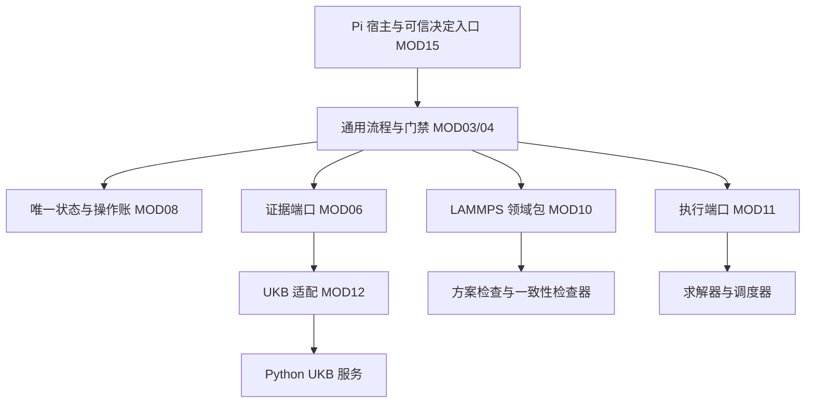

# 四子系统修订与 Pi 接入开发设计

工程修订 HR-1。以下是**待实施契约**，不是本包已经提供的新接口。现有函数与拟议新增记录明确分开；通用字段继续遵守 [MD-1 集成契约](../module-development/集成契约.md)。

## 1. 范围与架构决定

采用“先修交接基线，再按端口迁入”的两步路线。保留 Python UKB 和有价值的检查/证据算法；不为统一语言重写成熟数据库逻辑。Pi 侧使用受控进程/RPC 适配器，领域计算放在 LAMMPS 包。新的跨领域阶段和状态仍由既有 MOD03/08 负责。

图中是逻辑调用与数据流，不允许 kernel 直接 import UKB、dsh 或 LAMMPS 实现。许可由通用门禁/状态链持有，领域检查器只能提供记录。

| 交接资产 | 处理方式 | 目标模块与约束 |
|---|---|---|
| `src/ukb/ukb` | 包装复用 | MOD12；保留独立 DB、entry@revision、审核链、原文 blob |
| `evolution/kb/client.py`、adapter | 参考及薄适配 | MOD12/16；明确状态映射和能力，不照搬全局环境解析 |
| `evidence_v3` | 分离纯机制与存储后复用/改写 | MOD04/05/06/08/09/11；TaskStore 不能与 K6 同时权威 |
| `md_proj_mcp` | 先修缺陷，取其领域方案/受控命令语义 | MOD10/15；状态迁入 K6，可信用户决定由宿主提供 |
| `design_review`、`physics_gate`、consistency | 领域适配 | MOD10；科学规则/单位/阈值属于领域数据与版本锁 |
| `review_experience` | 有来源的版本化数据 | MOD10/12/19；canary 不自动提升为硬门禁 |
| 旧 stage_state/stage_gate | 历史只读和迁移参考 | MOD16；不得再作为 v3/Pi 新任务写入器 |
| dsh 两个插件 | 行为参考，重做宿主工具约束 | MOD02/15/18；dsh 对话工具拦截不代替 Pi 服务端许可 |
| Web UI、CLI | 分阶段适配 | MOD15；UI 展示必须标明知识来源与检查覆盖，不能由按钮文案改变权威状态 |

### 生命周期与单写者

| 运行模式 | 科学/任务状态所有者 | 允许的另一端行为 |
|---|---|---|
| 原包兼容运行 | v3 TaskService/TaskStore | 旧阶段模块只读；mdproj 方案以显式摘要输入 v3，不推定两状态自动同步 |
| Pi 迁移预演 | 原系统仍权威，Pi 候选空间 | Pi dry-run 导入，禁止提交真实动作 |
| Pi 切换完成 | MOD08/K6 | 原包任务冻结只读；UKB 仍独立拥有知识库 |

不实现两个可推进状态机之间的双向自动同步。若阶段一只能整体调用 v3，则先标为外部任务服务，K6只保存 operation 与观测回执，不额外复制一套可独立推进的科学状态；正式迁移时再替换所有者。

## 2. 配置及能力契约

新增统一配置解析器（拟议）返回 `ResolvedRuntimeConfig`：

| 字段 | 约束 |
|---|---|
| dataRoot/projectRoot/ukbRoot | 规范化绝对路径；项目/数据/知识库职责独立 |
| credentialRef | 受控凭据引用；不得在返回值、日志或报告中含 token |
| knowledgeMode | `production` 或显式 `fixture`；不存在隐式“失败即换库” |
| runtimeVersions | Python、Node、numpy、UKB schema/包版本、适配器协议版本 |
| capabilities | 逐项为 available/unavailable/degraded，附 reason 和证据时间 |
| configDigest | 不包含 secret 的规范化有效配置摘要 |

新接口以显式配置为主；兼容读取旧环境变量时，所有给定根必须解析一致。`MDAGENT_UKB_ROOT` 与 `REVIEW_UKB_ROOT` 不一致则返回拟议 `CONFIG_CONFLICT`，不得悄悄挑一个。自检报告同时列有效根及来源，但不输出凭据。

能力至少分开列：knowledgeRead、knowledgePropose、humanDecision、planReview、consistencyCheck、executionValidation、executionProduction、executionReconcile。包内缺 kit、注册表或模型凭据只能导致相应能力 unavailable，不能让其他独立开发停工。

依赖支持范围以实际 CI 为准。当前复测环境 Python 3.11.4、Node 22.19.0、numpy 1.25.0；README 的 Python 3.11+/Node 18+ 是宣称范围，尚未覆盖全部版本矩阵。后续增加安装说明和已测版本约束，不擅自声称所有更高版本都兼容。

## 3. 身份、命令与权威记录

沿用公共 CommandEnvelope。适配层必须完整保留 `workspaceId/caseId/revisionId/commandId/expectedStateRevision/authorizationRef`。actor 从宿主认证上下文获得；调用方提供的字符串不是身份凭据。

### 3.1 旧目录定位修订

优先使用持久索引 `(projectId,caseId,runId)→relativePath`。导入旧目录时：

1. 将 caseId 做正则转义；只接受完全相等目录或 `^<caseId>_YYYYMMDD_HHMMSS(?:_序号)?$`。
2. 仅接受根内真实目录，拒绝越界/符号链接/连接点；检查内部工件身份。
3. 多个 run 时要求 runId 或既有明确选择记录；不得再按修改时间给出隐式胜者。
4. 旧工件缺身份时记为待映射，人工/迁移规则补映射；不要从前缀反推后写入。

新错误拟议：`CASE_NOT_FOUND`、`CASE_AMBIGUOUS`、`CASE_ID_MISMATCH`、`UNSAFE_PATH`。错误均不产生写入。

### 3.2 人工方案决定

新增拟议 `HumanDecision`：`decisionId, actorId, source, workspaceId, caseId, revisionId, subjectDigest, action, scope, issuedAt, expiresAt?, decision`。宿主将不可变方案预览和摘要交给真实用户决定入口，保存原话作为附属证据。模型仅提交 decisionRef；服务端验证来源、作用域、当前摘要、有效期及撤回状态。

旧 confirm_quote 迁移为 `legacyClaimedConfirmation`，不得自动升级为可信审批。旧 CONFIRMED 仍保留原文/状态用于历史审计；新的可执行许可需重新建立当前授权。方案批准与执行授权分开，不能凭 CONFIRMED 直接启动作业。

### 3.3 幂等与版本

| 原包 action 类 | 当前源码边界 | 目标契约 |
|---|---|---|
| init/revise/refresh_knowledge | 部分使用 request_id；并非统一提交协议 | 同 commandId+请求摘要返回原回执；异摘要冲突 |
| plan/evidence/proof/review/authorize/advance | 不可假设所有 request_id 生效；各有版本/不可变记录检查 | 对外变更命令统一去重；CAS 与去重在同一权威事务 |
| sim_exec start | request_id、许可、spec 指纹及 START_UNKNOWN 机制 | 保留一次性动作、未知结果对账；不做通用重试 |
| finish/reconcile | 服务端运行回执路径，不能按一般用户 CAS 理解 | 校验 run/operation、输入闭包、提供方与回执摘要，重复回执去重 |
| status/retrieve | 状态读取或知识查询 | 明确只读语义；日志副作用不推进任务 |

v3 `revision` 是内容版本，`state_seq` 是更广泛状态序号，`generation` 是知识发布代次。Pi 的 `expectedStateRevision` 不得直接假定等于旧 revision；适配器保存两者及转换版本，由 K6 生成自己的提交序号。

## 4. 写入、审计和故障恢复

原包修复阶段为每个方案引入任务锁；在锁内重读、验证版本/决定、生成不可变提交记录、写同目录临时文件、flush/fsync、原子替换。备份以独占创建避免覆盖。仅文件 replace 不足以使方案与独立 JSONL 审计成为原子事务。

拟议文件事务协议：

1. 独占写 `operations/<commandId>.json`，记录 expectedVersion、beforeDigest、afterDigest、不可变新方案引用与 pending 状态。
2. 原子切换方案指针/文件；提交记录作为恢复所需的唯一依据。
3. 提交可核验回执；审计 JSONL 作为可重建投影，事件 ID 去重。
4. 审计/提交步骤失败时返回 pending/unknown，暂停该方案新确认和执行；启动对账读取 before/afterDigest，确认提交或保留旧版。不得“审计失败但普通成功”。

Pi 阶段使用 MOD08 既有事务+outbox，不能再维护与它竞争的文件事务。大工件先不可变落盘再登记，未引用工件仅是 orphan，不能当已提交证据。

只读暂态错误可按既有规范有限重试；格式/身份/科学不满足直接返回。写入超时先按 commandId 对账，不自动生成新 commandId 重发。外部提交超时保持 unknown，只有真实外部状态证明未发生才允许新的提交计划。取消请求不等于已取消。

## 5. 审阅输入与一致性结果契约

### 5.1 审阅输入闭包

新增拟议 `ReviewCoverage`：`subjectDigest, inputClosureDigest, requiredItems, chunks[{artifactRef,digest,start,end,unit}], deliveredChunks, reviewedChunks, missingItems, truncated, budgetUsed, reviewerIdentity, reviewProtocolVersion`。

范围单位明确为字节/行/token，不互相替代。原文字节哈希和用于模型输入的表示哈希分别保存。每一必需项都需绑定已投递、实际审阅回执；模型自报“已读完”不足以证明传输范围。输入 include、势文件和相关数据依赖由 MOD05 建闭包。

预算超限优先结构化分块；全部片段审阅及汇总完成才可提供门禁依据。缺片、硬截断、超时、无凭据或输出结构失败返回拟议 `REVIEW_INCOMPLETE`/`REVIEW_UNAVAILABLE`；保留部分结果供诊断但不放行。新方案摘要与审阅摘要不同则要求重审。

### 5.2 一致性检查

保留 `ok/questionable/unproven/invalid/plan_conflict` 五档，不混入科学验证结论。新增拟议覆盖字段：`checkSetVersion, expectedCheckIds, executedCheckIds, excludedCheckIds(reason), inputClosureDigest, parserVersion, unsupportedConstructs`。

汇总规则：先校验结构和枚举。非法枚举返回契约错误，不颁发 verdict；空检查或必需项缺失为 REVIEW，并带 coverageIncomplete。完整集合内继续采用 invalid→FAIL，plan_conflict→NEEDS_REVISION，questionable/unproven→REVIEW，全部 ok→PASS。

检查是否适用由已版本化的领域检查集声明；不能靠“零条检查”表达不适用。动态变量、include、未知命令无法完整解析时显式 unproven/unsupported，不默认为一致。20% 等现有阈值记录领域规则版本与单位；修改科学阈值需要领域依据，HR-1 不自行改科学政策。

报告分别显示 consistencyVerdict、coverage、gateDecision、scientificValidation。`findings=[]` 只说明零政策汇总层没有新增 finding，不表示不存在不确定性或风险。

## 6. 知识、证据和备份恢复

查询回执至少保存 backend/storeIdentity、entryId、revision、contentDigest、status、source、readScope、retrievedAt、degradedReason。UKB 已支持固定版本引用，适配器应验证后使用，不因旧设计中的条件描述而忽略这项现有能力。

UKB active/trial/candidate/deprecated/superseded 等值按实测状态机映射；保留 rawStatus，trial 不直接等于通用 confirmed。机器 observation 写路必须记录机器 actor 和证据来源；管理员 token 不得暴露给普通模型工具。知识批准、实读、适用性、科学审阅和执行授权分别存证。

production 模式需要的知识不可读时返回能力缺口；fixture 模式可用已版本化本地 JSON，但报告必须标 fixture/degraded，不能作为生产 PASS 的充分依据。Null source 返回 unavailable/notConfigured，而非混同“真实查询无匹配”。

完整备份拟议协议：在受控窗口获得一致 SQLite 快照，从快照枚举所有引用 blobs，拷贝并核对摘要；写 manifest（schema、包版本、DB 摘要、blob 摘要与大小、条目/修订计数、审计链端点）。若快照引用对象复制期间消失，备份失败，不给完整标记。备份凭据单独受控，不随知识导出分发。

恢复到新目录：校验清单→DB integrity/foreign_key→全部引用 blob→原文抽样回读→固定版本查询/审核链→凭据重新配置→读取回执对比→停止旧写并切换。失败保留旧根。不能直接将热库目录复制进百度同步盘作为一致备份；运行库应位于本机受控目录。

## 7. 迁移与交付边界

保留原 ZIP、manifest、源码来源、许可证及 patch 账；新增文件记录新来源，不重写为上游已有文件。先 dry-run 输出对象数量/状态/摘要/缺件，导入候选空间，完成引用闭包对账；旧许可与旧“已确认”不能成为新执行许可。

跨语言 RPC 的 schema、错误码、协议版本和正常/拒绝/unknown fixtures 由 MOD01/12/11 共同维护。实现文件路径由后续仓库结构确定，本设计没有声称已经存在 `simulation/packages/*` 新代码。

正式交接必须包含四级状态：文档已核验、实现已测试、目标环境已演练、科学结果已验收。任一层缺证据都保持未验证，前一层不自动推进后一层。
