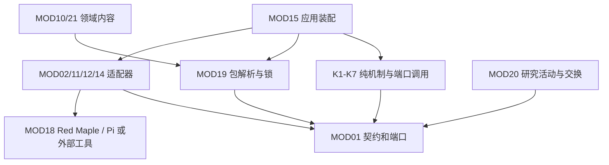

# 模块集成契约与交接顺序

工程修订 MD-1，2026-11-17。本文细化内部维护边界，不替换 [02 数据与接口契约](../development-spec/02-contracts.md) 和 [04 状态机](../development-spec/04-workflow.md)。代码、Schema、数据库和测试入口均待实现；下文伪代码不是当前可调用 SDK。

## 1. 唯一来源与依赖方向

通用产品行为引用 development-spec；LAMMPS 专属义务引用 MIG 矩阵；模块正文描述实现；tasks.json 只列规划。状态枚举沿通用规范 camelCase，旧字段由边界适配，不在模块中另造同义状态。



图中领域到解析器表示内容输入，其余为维护依赖概念；代码以应用层注入端口，kernel 不 import 具体 adapter、领域包或 Pi。研究活动由现有 K1/K3/K7 组合，复用 K6，不维护第二套可推进阶段状态。模块的实施依赖表不是 import 图；可以先用受约束假端口开发独立模块。

| 生产者 | 提供给消费者的内容 | 消费者 | 集成交接条件 |
|---|---|---|---|
| MOD01 | Schema、类型、错误、兼容 fixture | 全部模块 | 同一版本的合法/非法记录集合，序列化 round-trip |
| MOD19 | ResolvedLock、能力绑定、缺口 | K1/K2/K7、MOD02/11/12 | 精确版本/摘要、无悬空资源，draft 不冒充已验证 |
| MOD05 | ArtifactRef、输入闭包、ChangeSet | K2/K4/K5/K7/执行/报告 | 原始字节摘要、依赖完整、写入已封存 |
| MOD06 | 实读回执、来源分组、证据满足/缺口 | MOD04/09/12/13 | 范围和等级真实，来源可核对 |
| MOD04 | 不可变审查/门禁裁决、许可引用 | MOD03/11 | 身份独立、当前subjectDigest/checkSet匹配 |
| MOD03 | 候选状态事件、执行意图 | MOD08 | 纯转换、不产生外部副作用、所有依据显式输入 |
| MOD08 | 已提交意图、回执引用、状态投影 | 所有执行/展示端 | CAS、去重、事件/outbox同事务 |
| MOD02 | 角色会话回执和实际调用引用 | MOD03/04/07/09 | 明确operation、角色版本、输出完整性和unknown |
| MOD11 | RunRecord、日志、输出、取消/对账 | MOD07/09/14 | real/dryRun分开，实际外部状态可核 |
| MOD09 | MetricResult、ValidationReport | MOD14/20 | 单位/方法/选择/参考固定，实际run与数据绑定 |
| MOD12 | 原文版本、检索定位、知识裁决记录 | MOD06/02/13 | 索引非权威、旧状态保留、来源失效可见 |
| MOD13 | 候选、评测、发布和回滚回执 | 新角色/包版本加载方 | 授权作用域匹配，候选hash与实际应用一致 |
| MOD14 | 图/报告/复现清单 | MOD15/17 | 真实图像核验、未生成项分列，报告不改状态 |

## 2. 命令、回执与身份

建议在公共记录头外新增下列逻辑封套，落到 MOD01 Schema 后才成为实现接口：

```ts
type CommandEnvelope<T> = {
  schemaVersion: string;
  commandId: string;
  workspaceId: string;
  caseId: string;
  revisionId: string;
  expectedStateRevision: number;
  kind: string;
  payload: T;
  authorizationRef: string;
};
type OperationIntent<T> = {
  operationId: string;
  commandId: string;
  requestDigest: string;
  lockRef: string;
  inputClosureRef: string;
  providerCapability: string;
  deadline: string;
  budgetRef: string;
  payload: T;
};
```

认证后的 actor/actorInstance 来自宿主上下文，不由 command.payload 自报。用户决定由真实 UI/RPC 宿主确认入口记录：授权对象、动作范围、D7/资源/候选摘要、有效范围、发生时间、实际来源。普通模型工具不能通过 `human:true` 冒充此记录。

同 commandId 与同请求摘要返回原提交回执；相同 ID 不同摘要返回冲突。operationId 表示持久副作用意图，attemptId 表示阶段尝试，runId 表示真实求解身份，四者不得互换。已确认失败后的新尝试可创建新 operation，但须关联原链和预算。源的短交接格式作为 payload 内容保留，外层封套不抹去角色差异。

## 3. 放行与真实运行的原子边界

1. K2 验证 review 身份、输入闭包、规则版本和证据，生成不可变 GateDecision。
2. K1 计算推进候选；K6 同事务检查 expectedStateRevision、授权与许可引用，写事件及 outbox。
3. 执行消费者领取意图，K6 再确认当前许可有效并登记 dispatchClaim；claim 包含 owner 与有效代次，过期 owner 不得回写当前状态。
4. 执行始终使用不可变 inputClosure，不能读可变工作目录“当前版”。外部提交带 operationId 并尽可能持久标签。
5. 当前方案在提交后发生变更时，已在运行的旧输入不被就地替换；记录失效/取消意图，旧 run 回执归原 revision。未确认停止不能声称取消完成。
6. 收到实际回执后验证主体与工件，再提交状态；缺回执即 unknown。跨 SQLite、Pi 和调度器没有全局事务，也不承诺所有工具 exactly-once。

许可至少绑定 revisionId、lockRef、inputClosureDigest、gateReceiptRefs、authorizationRef、policyVersion、issuedStateRevision。许可不能从模型输出文本直接产生；新调用不能复用已失效许可。

## 4. 状态与数据库边界

状态实体由 MOD08 存储，模块提供已验证记录或纯转换。表结构是实施设计建议，具体 SQL 需迁移和兼容测试：

| 实体 | 主键 / 关键唯一性 | 写入方 / 用途 |
|---|---|---|
| cases/revisions | workspaceId+caseId；caseId+revisionId | K6；当前方案指针与历史锁 |
| stage_instances | caseId+revisionId+stageInstanceId | K6；输入绑定、attempt、状态和审查引用 |
| counters | caseId+revisionId+counterKind+stableSubjectId | K6；连续REVISE/修复失败分别存 |
| commands | workspaceId+commandId；requestDigest绑定 | K6；重复命令回原结果 |
| events | caseId+stateRevision+eventOrdinal；eventId唯一 | K6；一次提交可有多事件，按ordinal明确顺序 |
| operations/outbox | operationId唯一，requestDigest固定 | K6；意图、owner代次、发送状态、回执引用 |
| receipts | receiptId；operationId+receiptDigest去重 | K6；追加回执，重复不多计数 |
| artifact_links | artifactId+digest；依赖边唯一 | MOD05提交、K6登记；不可变依赖 |
| decisions | decisionId；目标摘要与作用域 | 宿主决定入口提交、K6登记 |
| schema_migrations | version唯一、checksum | 数据层维护者；禁止静默修改已应用迁移 |

状态revision每次成功事务增加，冲突/回滚不增加。阶段 passed/skipped/cancelled 的历史终态保留，失效是新事件/新attempt或revision，不把旧成功记录擦掉重写。所有表关联workspace/case作用域，不跨案查“最新”。

Pi会话、红枫实际调用、科学状态和知识正文各有唯一所有者。知识SQLite与仿真SQLite可独立维护，以来源/回执引用连接，不直接跨库写对方表。数据库实时文件置于本机目录，不依赖百度同步盘锁。

## 5. 默认超时、重试与对账

沿规范02：只读暂态网络错误默认最多重试2次，间隔1s、3s，受deadline约束；格式/权限/科学失败不重试。有副作用的submit/apply一律无通用自动重试。

| 场景 | 可采取动作 | 不可采取动作 |
|---|---|---|
| 明确发送前拒绝/取消 | 记未发生、释放对应预留；新授权范围内可创建/恢复操作 | 伪造真实执行回执 |
| 已发送，结果不可知 | 持久unknown，对账外部ID/标签/真实回执 | 仅凭超时重发或释放全部费用 |
| 已确认执行失败 | 保留失败证据，K5给最小修复计划 | 自行改变科学判据 |
| 状态CAS冲突 | 重读并重新评估命令 | 原命令无条件循环重放 |
| worker租约到期 | 新owner先核原进程/外部状态并对账 | 租约到期就当原操作未执行 |
| 取消后断网 | 保持cancelRequested/unknown并继续观测 | 报告cancelled或completed |

队列等待、求解walltime、角色模型预算和UI等待分别配置。启动真实任务前必须有资源/deadline范围；开发阶段使用受控时钟验证超时，避免10ms墙钟竞态。只读轮询频率由适配器按工具能力配置，计入请求限额，不占无限模型轮次。

## 6. 工件、指标和交换数据

文件使用 `sha256:<hex>` 的原始字节摘要；闭包规范版本显式记录，排序路径按包/工件根相对POSIX路径。JSON规范化必须锁定算法，禁止依赖对象偶然属性顺序。二进制restart、mesh、dump不做UTF-8转换；大对象流式校验、分块索引，分块命中不等于全文件已读。

MetricDefinition引用在真实运行前锁定，输出闭合链为 `criterion→metric→requiredData→producer/output`。图和报告引用 MetricResult，不复制可独立修改的另一套阈值。数值结果、新图、知识确认均不能追溯修改旧审查。

研究活动新记录需在MOD01注册：

| 记录 | 必需信息 | 检查 |
|---|---|---|
| StudySpec | 变化参数、受控条件、seed/采样、子run计划、汇总方法、预算、停止规则 | 校准与独立验证数据不混用 |
| IterationReceipt | studyId、iterationIndex、子阶段/run、停止指标和原因 | 达上限不等于converged |
| ExchangeRecord | 来源/目标量、单位、坐标、实体关联、时刻、序号、映射方法/误差、数据摘要 | 同字段名不保证同物理量 |
| CheckpointBundle | 所有子模型checkpoint、共同逻辑时刻/交换序号、子包锁、摘要 | 时间/版本不一致不能恢复 |

## 7. 配置、保护策略与兼容

优先顺序是约束合取：宿主权限边界、已批准任务范围、包必需政策、profile能力均须满足；后加载配置不默认覆盖更强约束。冲突返回POLICY_CONFLICT并定位双方。包声明不能执行任意脚本、更改状态转移或重置计数。

发布遵守精确目标及摘要绑定：新的包/角色/技能版本先写staging，用户应用决定引用候选hash、评估回执、目标版本，再CAS切换。多文件受保护资产若不能原子原位更新，优先使用完整版本目录+单一指针；中途失败保留旧指针。历史文件格式暂时不能版本目录化时，必须使用可恢复应用日志，报告部分应用并阻止继续加载，不声称已原子回滚。

新runtime须暴露能力/契约版本，MOD02启动校验。保留当前公开导出及旧会话读取；不将 Pi 私有成员传到领域包。破坏性更改采取 expand→迁移消费者→停旧写入→保留只读兼容的顺序，不能同时让新旧组件写同一语义不同的记录。

## 8. 集成验收与交接

每个交接提供：提供者commit、消费者commit、契约版本、输入输出fixture、正常/错误/取消回执、准确测试入口、未验证外部能力和恢复方法。缺能力可阻塞受影响路径，独立内核开发继续。

至少演练一次贯穿链：MIG-041→MOD10规则→MOD04触发→MOD06证据→MOD08拒绝提交→MOD11无真实作业；再从MOD04拟议源码反查需求和验收。该演练目前是实现计划，文档验证只能确认引用闭合。
