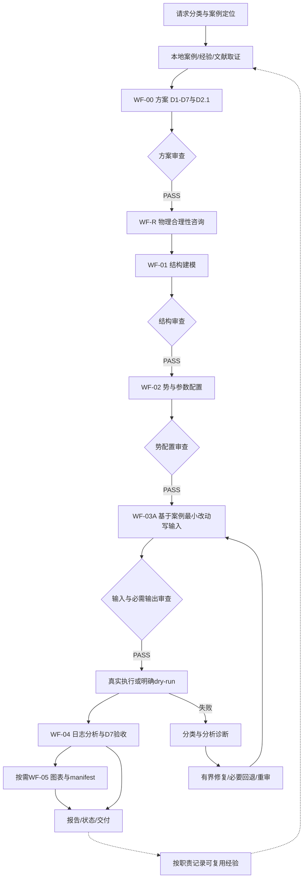

# 完整仿真工作流设计

> 文档整合版 · 2026-11-17 · 仅完成设计，不修改或运行产品源码。
> 本文是本目录的**主阅读文档**：从任务接收到仿真交付，再到知识经验沉淀和代理改进，按实际操作顺序完整说明。无需先阅读审计、修订记录或自行拼接各专项文档。
> 设计依据为 autolammps `feaf7f6` 的原工作流、角色、知识管线与自进化方案。通用化沿用已讨论的三层边界；不存在的实现和原方案未确定的机制不补造。

## 目录

1. [目标与总体工作方式](#1-目标与总体工作方式)
2. [代理角色与协作关系](#2-代理角色与协作关系)
3. [任务接收、案例定位与证据准备](#3-任务接收案例定位与证据准备)
4. [完整仿真主流程](#4-完整仿真主流程)
5. [门禁、检查与状态推进](#5-门禁检查与状态推进)
6. [执行、失败诊断与最小修复](#6-执行失败诊断与最小修复)
7. [结果分析、科学验收与呈现](#7-结果分析科学验收与呈现)
8. [案例文件、版本、状态与恢复](#8-案例文件版本状态与恢复)
9. [知识库与经验库](#9-知识库与经验库)
10. [自进化与技能挖掘](#10-自进化与技能挖掘)
11. [模块化与换领域](#11-模块化与换领域)
12. [一条贯穿案例](#12-一条贯穿案例)
13. [设计交付范围与后续使用](#13-设计交付范围与后续使用)

---

## 1. 目标与总体工作方式

### 1.1 要实现的工作方式

系统不是“让模型写一个 in 文件，然后尝试运行”，而是：

**先找依据与可复用案例 → 明确研究目标和验收标准 → 逐阶段生产与独立审查 → 真实执行 → 按既定标准解释结果 → 把可复用教训留给后续任务。**

其中三条要求始终保留：

1. **写输入前查本地参考案例。** 读到相关案例的实际输入与适用条件，不能只看到文件名或搜索摘要。
2. **基于参考案例最小改动。** 修改任务真正需要改变的部分，说明差异与风险，不为小改动重写整套已可用脚本。
3. **设计判断先有证据。** 先核对案例、手册、文献或已确认经验，再将判断写入方案；查不到就记录待核问题，不把猜测写成已经确定、可以执行的决策。

### 1.2 准确度怎样落实

| 控制对象 | 负责环节 | 实际操作 | 不允许替代为 |
|---|---|---|---|
| 研究对象是否真的被建出来 | architect、writer、reviewer | 将目标拆成必需特征，逐项检查实际结构或命令 | 文件里写了注释就算实现 |
| 物理设定有没有依据 | architect、reasoner、librarian、paper-researcher | 方案每项给来源，核对材料、工况、模型与尺度 | 搜到相似关键词就直接采用 |
| 命令、映射、参考基准是否正确 | writer、reviewer | 本地案例与手册交叉核对，执行适用强制检查 | 程序能解析就算科学正确 |
| 运行是否真实发生 | executor、analyst | 核对实际命令、run、日志、退出情况和输出 | dry-run 或脚本生成成功 |
| 数据是否足以支持结论 | writer、analyst | 写作时反查 D7 所需输出；分析时核定义、单位与区间 | 文献数值、模板数值或估算冒充结果 |
| 经验能否帮助下次工作 | writer、知识整理角色 | 记录具体错误、修正与来源，经相应整理/裁决后供检索 | 仿真结束自动把一切变成强制规则 |

这些机制共同支持计算可靠性，但不构成“必然正确”的保证。科学模型适用性、数值收敛、统计充分性和参考证据仍需要具体领域判断与真实验证。

### 1.3 三层边界

| 层 | 管什么 | 变化时改哪里 |
|---|---|---|
| 领域包 | 决策项、必需特征、检查内容、失败模式、计量口径、模板与工具映射 | 换领域优先改声明和领域内容 |
| 流程内核 K1–K7 | 阶段顺序、门禁语义、交接、证据约束、诊断修复、状态恢复、验收框架 | 不因材料或求解器变化加领域分支 |
| 适配层 | agent/模型调用、文件操作、求解器、调度器、知识检索和报告输出 | 换运行环境或工具时替换实现 |

K1 阶段、K2 门禁、K3 工件、K4 证据、K5 执行修复、K6 状态恢复、K7 计量验收各有独立责任。模块化不要求拆成七个服务，也不要求一个阶段配置一个新代理。

---

## 2. 代理角色与协作关系

### 2.1 实际角色设定

以下来自冻结快照的 agent 定义，是原角色配置，不是未来必须绑定 Sonnet 的要求。13 个领域定义均声明 `permissionMode: acceptEdits`；权限声明不代替真实工具授权。

| 实际 agent | 主责与输入 | 输出与交接 | model / effort / maxTurns |
|---|---|---|---|
| `lammps-coordinator` | 识别入口、委派、处理专家结果、维护项目记忆 | 阶段状态、审查记录、下一责任方与用户摘要；不亲自做技术工作 | sonnet / low / 40 |
| `lammps-simulation-architect` | 根据目标、案例、文献形成 WF-00 | D1–D7、D2.1、风险、方案；交 reviewer | sonnet / high / 100 |
| `lammps-simulation-reasoner` | 方案合理性、修复中的设计根因、结果物理解释 | assessment、风险与设计根因建议；交 coordinator | sonnet / high / 80 |
| `lammps-input-writer` | WF-01 结构、WF-02 势配置、WF-03A 输入及有界修订 | 工件、来源、差异、风险、自检、阶段 packet；交 reviewer | sonnet / low / 100 |
| `lammps-reviewer` | 独立检查方案、结构、势、输入；执行适用 MB | PASS/REVISE/BLOCKED、证据、问题位置与修复要求 | sonnet / medium / 80 |
| `lammps-data-analyst` | 真实 run 与输出的诊断、指标、D7 比较 | analysis-report、文献对照、回滚和绘图建议 | sonnet / medium / 160 |
| `lammps-post-processor` | 按既定分析和图集生成图表 | 实际图像/脚本、manifest、未生成项和错误 | sonnet / medium / 120 |
| `lammps-case-librarian` | 查本地案例、规则、经验、手册与纠错 | 可定位证据、适用限制和参考路径；不代做审查 | sonnet / low / 60 |
| `lammps-paper-researcher` | 文献发现、元数据/DOI核验、全文阅读 | 实读页节、证据等级、方法/参数依据及论文笔记 | sonnet / medium / 80 |
| `lammps-kb-coordinator` | 处理知识来料和队列、组织整理/审阅 | 实际裁决状态、落点、增强或新建说明 | sonnet / low / 100 |
| `lammps-kb-curator` | 分类、去重、提取最小经验单元、建议合并 | lesson、适用范围、来源、目标文件和 merge 建议 | sonnet / low / 80 |
| `lammps-kb-reviewer` | 判断知识相关性、可复用性和操作价值 | confirmed/candidate/quarantined 及理由 | sonnet / medium / 80 |
| `lammps-analyst` | 遗留分析定义，供理解旧引用 | 日志分析和回滚建议；当前 analyze/debug 主路由使用 data-analyst | sonnet / low / 160 |
| `hello-agent` | 项目问候示例，非仿真职责 | 简短项目介绍 | 未声明 |

一个 writer 负责三个生产阶段，但三阶段分别交付、分别审查。不能因为由同一代理生成就合并审查，也不需要为此拆三个新代理。

### 2.2 职责边界

- coordinator 负责流程，不代替 architect 做方案、不代 writer 写输入、不代 reviewer 放行、不代 analyst 解释日志。
- writer 自检不等于 reviewer 独立审查。writer 返回的“生产完成”不能当作阶段 PASS。
- reasoner 给咨询意见，不签 reviewer 的放行结论；但完整流程的规定调用不能省略。
- analyst 负责计算指标并逐项判 D7。这里不增设原设计没有的额外“验收批准者”。
- 知识 confirmed、阶段 PASS、运行 completed、D7 met 和图像 generated 属于不同状态，不能互相替代。
- 技能候选和代理改进提案更不能用一次仿真 PASS 直接批准安装或修改活跃定义。

### 2.3 短交接与长工件

专家把完整技术内容写入文件，给 coordinator 返回短结果：结论、摘要、工件路径、问题、置信度和下一步。明确规定 RESULT/LOG/NEXT 的角色沿用该格式；没有规定的角色不强造统一返回枚举。

原 coordinator 对可读工件的限制，与证据人工回退要求存在冲突。接入宿主时需明确实际访问范围，不能靠一句“协调者可以读所有 JSON”悄悄扩权。

---

## 3. 任务接收、案例定位与证据准备

### 3.1 先分清请求

| 请求 | 进入路径 | 必须说清的完成范围 |
|---|---|---|
| 新研究、目标模糊、多阶段任务 | WF-00 开始完整流程 | 不能只交可运行脚本就称研究完成 |
| 修改既有案例 | 找基线→识别差异→最早受影响阶段 | 保留未受影响内容，重做受影响审查与结果 |
| 只执行已有输入 | 依赖核对→执行→最小运行核验 | 没做 D7 分析就明确写未做科学验收 |
| 只分析已有输出 | WF-04 | 缺方案或口径时限定结论，不倒推编造参数 |
| 只绘图 | 已有分析→WF-05 | 不重新定义指标，不用漂亮图替代验收 |
| 查语法、案例、规则或论文 | 检索/取证 | 无需强制建一个仿真案例目录 |
| 失败诊断 | 特定 run→分类→analyst | 给有界修复/回退或明确缺口，不凭关键词断根因 |
| 跨会话恢复 | 状态与工件核对→可信节点 | 不把最后一条消息或“最新文件”当完成证明 |
| 论文复现 | 前置复现审计→按裁决进入方案 | 摘要级/部分复现不能写成完整复现 |

部分入口不等于免风险审查。只改一行若涉及势映射、关键命令、应力应变或续算来源，仍需相应证据与 reviewer。

### 3.2 查本地参考案例

写作前按材料/体系、研究目标、模型/势族、工况、尺度、边界与加载查近例，先看案例索引和已确认经验，再窄读实际输入和相关手册。

最低要求是**至少一份相关本地案例**，不是一条搜索摘要。案例路径可来自 `work/cases/` 或 `knowledge/cases/raw/`。手册解释命令语义，模板提供结构，两者都不能单独抵消本地案例要求。

选择后记录：

- 用的是哪份输入、结构、势或配置；
- 参考的具体段落/命令与适用条件；
- 本任务与参考案例哪些相同、哪些不同；
- 哪些内容复用、哪些必须改变、改变依据是什么。

找不到案例或手册依据，就报告 coordinator 并补查。不能用“全新构建”“人工接受风险”或一段重写理由，宣称原前置已经满足。

### 3.3 分层读取经验

writer/reviewer 先读 core-checks 与适用强制检查索引；按 CL ID、命令或当前问题经 MCP 找经验详情。MCP 不可用时才按 ID 窄读 confirmed 台账。

pending 经验只在相关问题触发时读，不能不加区别提升为已确认事实。historical/session 是经验来源，不是代码强制的晋升阶段。临时 `tmp_*` 文件和一次性调试脚本不优先作为稳定依据。

### 3.4 文献取证

先查已有论文笔记，再发现候选，核标题、作者、年份、DOI，取得有权访问的全文并阅读相关页节。最后提炼具体参数或方法，说明适用条件、限制与证据级别。

全文、出版社页面、摘要、仅元数据和未核候选分别报告。没读到全文就不能称全文已核；查不到 DOI 就不编。

论文复现另做缺参、替代来源和可信度审计。缺参可追索补充材料、同文其它位置、引用方法、本地核验案例或可信文献；替代与推断须显式标记，不伪装原文精确值。

---

## 4. 完整仿真主流程

### 4.1 总流程



图中省略各门的 REVISE 回本阶段、BLOCKED 停止边。修复可能回结构、势或设计，不是所有错误都回输入。咨询发现重大风险/设计根因时按专门路径处理，不由图中单一箭头掩盖。

### 4.2 WF-00：把目标变成有依据的方案

| 项 | 必须写什么 | 依据与下游用途 |
|---|---|---|
| D1 材料体系 | 元素、组成、晶体/非晶等结构 | 本地案例；约束建模 |
| D2 研究目标 | 具体物理问题或现象 | 本地案例；决定必须出现的实体 |
| D2.1 必需特征 | 目标中物理实体、criticality、verification_method、required_in_stage | 必填、至少一项 critical；后续逐阶段实现 |
| D3 热力学条件 | 温度、压力、环境 | 文献；进入输入与结果解释 |
| D4 边界与尺寸 | PBC、几何、尺寸和规模 | 本地案例；约束结构与尺度效应 |
| D5 加载与积分 | 方向、速率、步长、温压控制与阶段协议 | 文献；进入输入脚本 |
| D6 候选势族 | 候选 EAM/ReaxFF/MEAM/LJ 等及适用理由 | 案例或文献；具体参数文件留 WF-02 |
| D7 验收标准 | 指标、阈值/范围、可计算口径 | 文献依据并保留源用户确认要求 |

例如目标为“位错切过析出相”，D2.1 不能只有“Cu 晶体”；必须有位错、析出相及相关加载等特征，并规定如何核验。每项 critical 都要能在实际结构或命令中检查，不能只写注释。

方案附风险、依据和待核问题。没有证据的必需决策不锁定、不获 PASS，也不批准下游输入。记录假设用于继续调查，不是免除必需依据。

architect 自检后交 reviewer。REVISE 回 architect 修订；BLOCKED 明确缺什么。通过后方案 approved，关键决策锁定。

### 4.3 WF-R：必须调用的物理咨询

完整流程在 WF-00 PASS 后、WF-01 前派 reasoner。其检查目标包括：现象在计划尺度/时间内是否可实现、尺寸是否足够、势适用范围、温压/速率/步长是否合理、D7 是否有物理基准。

| 咨询结果 | 处理 |
|---|---|
| physically-sound | 保留依据，进入后续生产 |
| concerns-identified | 记录顾虑、影响和建议，由 coordinator 处理 |
| significant-risks | 显式报告重大风险，不能藏在方案备注里 |
| 已确认 design_root_cause | 返回 architect 修改设计并重审 |

reasoner 不审语法、不替 reviewer 放行，也不把自己意见写成已通过的审查结论。

### 4.4 WF-01：结构建模

writer 先读方案和适用 D2.1，按来源与工具选择路线：复用结构、CIF 转换、多晶构建、结构编辑或晶体构建。路线分数只是排序线索，不是成功概率。

工作顺序：**选路线→准备/渲染工具任务→检查任务与参数→执行建模→结构检查→reviewer**。

交付结构、来源说明、元素/type 映射、盒子/边界、验证记录和 WF-01 packet。核对原子/类型声明、几何、组成、重叠、关键缺陷与实体；基础格式脚本通过不代表这些科学条件都已验证。

按 `required_in_stage` 核查本阶段每项特征。缺 D2.1 表要修订，关键特征无法实现则 BLOCKED，不生成一个“看起来正确”的通用结构顶替。

### 4.5 WF-02：势函数与参数落地

从 D6 候选族进入具体势文件/参数集选择，核材料覆盖、所研究现象、温压适用范围、引擎支持、文件来源与元素顺序。

结构 type、data Masses、`pair_style/pair_coeff` 和势文件元素必须对得上。反应势所需电荷与求解设置按适用原规则及实际版本手册检查。

交付所选势、备选项、文件引用、元素映射、证据、已知风险和 fallback。结构不兼容回 WF-01，方案前提不成立回 WF-00；不能下游暗改 D1–D7。

### 4.6 WF-03A：基于参考案例写 in 文件

1. 读已审方案、结构与势 packet，确认当前 case/version。
2. 找相关本地输入与适用模板，读实际命令，不凭记忆重造布局。
3. 对本任务进行最小必要修改，说明每处改动及其依据。
4. 所有命令级修改引用案例与手册；语义命令和高风险触发还需相应额外来源。
5. 根据模板族安排适用的弛豫、预稳定、平衡、升温/保温/冷却与加载分段；不照抄统一步数和温度。
6. 按适用 D2.1 核验实际命令/结构特征。
7. 在运行前反查 D7 所需输出，缺项在设计时补，不等运行后发现。
8. 执行自检，给出工件、来源、假设/风险、检查结果和审查关注点，再交 reviewer。

**D7 输出闭合表必须能回答：**

| 验收项 | 依赖输出 | 需要核对 |
|---|---|---|
| 某个物理量/判据 | 对应 thermo、dump 或其它文件/列 | 是否真的输出，频率和区间是否足够，单位/参考是否已知，哪些缺失 |

沿用原 packet 的 `thermo_outputs`、`dump_outputs`、`d7_support.criteria_supported/missing_outputs` 语义，不用“有一个 dump”代替逐项支持。

源 writer 还明确规定 WF-03A 的最低 `pe/atom`、`coord/atom` 诊断，FCC/BCC 的 `centro/atom`、多相/变形的 `cna/atom` 以及相应 dump。它们是原角色要求，实际引擎版本和科学适用性仍需核验；外部 requirements 文件未取回，不能据此省掉角色正文已经写明的核对职责。

---

## 5. 门禁、检查与状态推进

### 5.1 四道阶段门

完整 LAMMPS 流程对 WF-00、WF-01、WF-02、WF-03A 分别审查。WF-04/05 不额外新增原设计没有的强制 reviewer 门。

| 裁决 | 含义 | 下一步 |
|---|---|---|
| PASS | 当前范围与当前工件已满足适用检查 | 保存审查工件，记录状态，再推进 |
| REVISE | 有明确、可修正的问题 | 给生产者具体位置、修法和复查条件 |
| BLOCKED | 强制规则违规、必需材料不足、上游不成立或决策受阻 | 停受影响推进，说明缺口和责任方 |

**同一阶段连续三次 REVISE 后停止并报告。** 换问题 ID、改标题或换会话不能绕开阶段累计。另有“同一修复尝试连续三次失败”的错误恢复停止要求，两者不混成一个计数。

### 5.2 强制检查

| 检查 | 什么时候检查 | 不能省掉的内容 |
|---|---|---|
| MB-001 参考长度 | 拉伸/变形及 NPT→deform 切换 | 冻结参考长度；输出引用冻结值，不追着动态盒长变 |
| MB-002 固定组速度 | 固定/冻结/约束组与 velocity 存在 | 速度作用范围排除固定原子 |
| MB-003 控制竞争 | npt 与 deform 同时存在 | 控压和变形方向不能竞争 |
| MB-004 反应势前置 | reaxff/reax/c | 按原表与当前手册核 atom_style、电荷平衡及不适用模型 |
| MB-005 打印求值 | **任何 fix print** | 变量定义和实际求值语法正确；不能以“已经写对”为触发 |
| MB-006 参数映射 | **任何 pair_coeff** | ffield、元素列表和 data type/Masses 交叉核对 |
| MB-007 续算来源 | read_restart 或 data 续算 | 来源、生成时间、box 与当前目标一致 |

上述 MB 触发后若违规，原要求是 **BLOCKED**，不能降成普通建议或 REVISE。具体命令语义以原检查表及实际引擎手册核对；摘要表不替代手册。

### 5.3 证据要求

- 每项检查能回到来源、位置、摘录与实际核验结果。
- 高风险按原分组保留 manual/correction 与 case/memory 两侧，不仅数“任意两类”。capsule 对第二组另含 artifact 的异文需要明确，不能偷偷选宽松版本。
- 同一资料的两种转述、同一输入导出的两个文件，不算独立来源。
- `verified: true` 只表示真实核对过；复制模板默认值不构成核验。
- 缺关键证据可交付缺口说明或部分结果，但阶段不能因此 PASS。

### 5.4 条件触发与检查结果

原规则由 reviewer 逐项判断触发并执行检查。本基座已讨论的条件声明方案，用于把该过程记录得更清楚，但不是原仓已实现的引擎。

| 条件判定 | 操作 |
|---|---|
| true | 执行检查，记录结果和依据 |
| false | 有依据地记不适用 |
| unknown | 不许当 false；补材料或由审查者依据原规则明确裁定 |

“是否使用 pair_coeff”决定要不要查映射；“映射正确”是检查结果。二者倒置就会漏掉最需要检查的错误输入。

### 5.5 审查工件与推进

完整审查结论落盘，短 RESULT 返回结论和路径。内容包括范围、风险、逐项触发/结果、证据、问题、修复要求、置信度和下一责任方。协调者确认真实结论后更新状态与日志，不改写 reviewer 的原结论。

原 `evidence-validate/evidence-check` 入口是占位，不能以退出成功当校验通过。可执行验证不可用时，按原人工清单核对并如实标人工核验和置信度限制。协调者访问 JSON 的源规则冲突仍需在接入时明确，不能因此假称机器门已打通。

---

## 6. 执行、失败诊断与最小修复

### 6.1 执行前核对

确认当前输入审查、结构/势/include 路径、工作目录、命令、输出位置、资源与运行授权。需要 HPC 时准备调度配置；MPI 启动不等于已向调度器提交作业。

运行记录保留 run_id、实际 argv、workdir、输入引用、stdout/stderr/log 路径、起止情况、退出状态和运行模式。

| 层次 | 可以说明 | 不能说明 |
|---|---|---|
| 预检 | 依赖/路径/格式核查情况 | 求解器已计算 |
| dry-run | 执行计划/接口演练 | 真实运行、模型正确或 D7 达标 |
| 真运行结束 | 真实命令与输出、退出情况 | 科学结果必然正确 |
| 分析验收 | 在明确口径下判据是否满足 | 其它材料/工况也适用 |

历史执行脚本的实际检查远弱于完整前置：主要检查主输入与 argv 首项，不自动核 reviewer PASS 或所有依赖；也没有完整的超时/资源/取消监督。接入时不能把设计要求误当已经存在的保护。

### 6.2 四段分责

**执行→分类→规划→协调者委派修复**。repair 只给候选原因和建议，loop 只产下一步计划；它们不会自动修改输入、调用代理或完成重跑。

| 现象/证据 | 处理 | 修复范围 |
|---|---|---|
| 命令/环境不可用 | 修环境并核实际路径 | 不先改科学参数 |
| 输入/依赖缺失、语法问题 | writer/reviewer 核具体文件和命令 | 最小输入修正 |
| lost atoms、bond missing、non-numeric | analyst 读失败前后日志和工况 | 结合结构、势、步长、边界判因，不凭关键词选根因 |
| 运行完成但 D7 不满足 | 先核单位、算法、参考、统计与输出充分性 | 确认物理问题后再回模型或设计 |
| 疑似设计根因 | analyst→reasoner | 确认后回 architect 修方案并重审 |

### 6.3 修复证据链

保留 **原失败证据→根因假设→修改差异→重新审查→新的 run→新的分析结果**。

不能为让程序跑完无限调参，也不能为达标更改 D7。回退到最早受影响阶段，而不是最后成功阶段；未受影响部分继续复用。环境恢复不必触发整套物理重建。

---

## 7. 结果分析、科学验收与呈现

### 7.1 分析顺序

analyst 读取方案、reasoner 意见、run/repair 及实际日志，先初始化与错误警告区段，再读 thermo 和尾段。大日志可抽样，但报告写清实际区段、是否抽样、待补读位置；“未见异常”只覆盖已查范围。

计算每个关键量时核对：名称、分量/方向、单位、符号、参考基准、公式、采样区间、统计方法和来源运行。这组完整口径是本基座的分析契约，不能说历史模板天然已经齐备。

尤其不能把 x 方向当所有任务的默认加载方向、把三向压力平均当通用轴向应力、把固定换算系数套到所有 units。需要文献对照时记录对应材料和工况差异，不用外部值代替本次计算。

### 7.2 D7 判定

本基座表达 met、not_met、cannot_compute、borderline 四种情况，分别说明达标、未达标、数据/定义不足和边界不确定。原角色与模板的枚举/数据形状有差异，接入时做显式映射，不凭字段同名假定兼容。

每个结论指向对应指标定义、数据文件和实际 run。不能算就说明原因；未达标就写未达标；不能靠改图、改窗口或改判据凑成功。

### 7.3 图表与科学语义

数值曲线用 matplotlib，原子坐标成像用 OVITO。先选适用模板，再改路径和已核参数，不从记忆猜 API、列号或枚举。

图像检查包括：实际输入和粒子数、有效帧/步、全局或 ROI/截面/缺陷目标、切片筛选是否删掉研究对象、着色属性/色标/图注是否一致。CNA 是局部结构分类，不直接等于相分数真值。

逐图 manifest 记录工具、数据、模板、输出和状态，轨迹图记录帧及空间选择。分析口径和来源运行从已有分析报告核对；历史 manifest 没有统一绑定字段时，不能声称它已有完整追踪。

状态分别为 **generated / script_only / skipped / failed**。生成脚本不等于生成图像；实际图像需打开核验，不仅检查退出码、文件大小和尺寸。源有两套 OVITO 接口/相机规则，适配时明确采用哪份，不混成无冲突模板。

### 7.4 交付

交付说明本次究竟完成了方案、审查、真实运行、科学验收还是呈现，列实际工件、限制、未完成项与下一步。不用一个“全部完成”合并这些不同事实。

---

## 8. 案例文件、版本、状态与恢复

### 8.1 案例与输入归属

沿用原 writer 的实际案例纪律：

```text
work/cases/<case-slug>/
  SIMULATION_SCHEME.md
  inputs/
    structures/
    potentials/
    scripts/          # in.*、建模/提交脚本
    raw/              # 不改动的用户原文件
  outputs/
  figures/
  versions/vNNN-<label>/
```

方案、势族、结构来源或主要运行协议改变时另建版本，竞争方案不混放；参数扫描可留同一版本的 run/output 子目录。case_dir/version_id 不明且无法唯一推断时停止写作，不散写仓库根或临时目录。

### 8.2 权威状态与交接

源 standalone 使用 `.lammps-project/`，team 使用 project-memory、任务依赖和 scratchpad。选择本次案例实际模式，明确状态归属，不假设两处自动同步。

状态保存当前阶段、已作决定、审查、工件、阻塞、修订计数、运行关联和下一步。packet 是轻交接：来源、输入、产物、假设/风险、证据、审查路径和回退线索；存在 packet 不等于通过质量门。

本基座提出的统一 state.json、领域版本绑定、内容摘要及冻结/重开仍是目标契约，不是旧项目已有保证。沿用历史案例时不强制迁移、不补造旧摘要，也不为单次检索创建完整案例。

### 8.3 修改影响

| 修改 | 需重新检查的范围 |
|---|---|
| 只改图样式且不改数据/选择 | 对应呈现 |
| 改算法、单位、统计窗或参考 | 分析与受影响图，必要时回看 D7 |
| 改输入科学命令或运行协议 | 输入审查、执行、分析、图 |
| 改势文件/映射 | 势配置及受影响下游 |
| 改结构/几何/分组 | 结构及受影响下游 |
| 改研究目标、关键前提或验收 | 方案重审并逐项评估下游 |

这是通用化的影响分析规则，不表示原代码已有自动失效传播器。实际审查/运行记录要与当时工件对得上。

### 8.4 恢复

读案例与模式→状态/决策/审查记录→核当前工件→明确 run→对上输入、日志和分析→定位最后可信节点→只补缺失或已失效部分。

历史各脚本“最新文件”选择规则不完全一致。恢复时优先显式指定 run/repair/analysis，不能只凭文件名排序或修改时间。如果关联不足，报告不能确定的部分，不自动归成成功。

---

## 9. 知识库与经验库

### 9.1 存什么、从哪里用

| 内容层 | 保存内容 | 在流程里怎么用 |
|---|---|---|
| rules | 稳定规则、mandatory checks、learned-rules | 方案和审查约束 |
| memory | confirmed、pending、historical、session 台账及核心索引 | 按问题/CL窄读经验；四本是组织分层，不是自动晋升阶梯 |
| cases | 族索引、原案例、notes | 写作前找近例、读实际输入、比差异 |
| corrections | 纠错原文与复盘依据 | 解释错误模式及修正条件 |
| manuals | 引擎命令与限制 | 核语义、顺序、适用版本 |
| templates/answers | 模板与回答骨架 | 复用结构，但不替代本案例审查 |
| potentials/papers | 模型笔记、文献、方法和参数依据 | 方案、选势与结果比较 |
| reports/maintenance | 操作记录、维护候选与统计 | 追溯和整理，不天然构成科学规则 |

知识正文、原始材料与索引分开。Markdown/来源文件保存内容，SQLite/FTS 帮助查找；索引命中不是知识批准，更不是阶段放行。

### 9.2 读库过程

问题与材料/模型/阶段条件→查询理解与别名扩展→FTS候选→分层加分/多样性重排→返回路径、摘录、whyRanked、evidenceLines→实际窄读与适用核对→用于方案或审查。

排名高只说明检索偏好。pending/historical 也可能被召回；caseReliability 等标签不自动验证真实性。相同案例的多个 chunk 不能伪装多个独立来源。

现有 lookup 的 synthesizer 是确定性拼装，不是另一个科学推理模型。没有真实来源时即使生成“结论式文本”，也不能直接写入方案。

### 9.3 从工作经验写回

writer 发现可重复脚本生成错误后，任务完成时按原经验工作流记录。reviewer 也有经验记录职责；知识整理可交 kb-coordinator。没有统一自动发布器，不代表这些职责可以省掉。

记录为：**发生在什么情形→出现什么风险/错误→怎样修正或检查**，加实际来源、适用范围与不确定性。不要只写“以后小心”，也不要把整段聊天直接当已确认规则。

### 9.4 入库处理

```text
原料投递 → 分类与保留原文 → curator 提炼/去重/建议落点
        → reviewer 对困难或高价值项裁决 → apply 落账
        → 活跃索引更新 → 后续任务检索并核对原文
```

内容类型共13类；状态 candidate、pending_review、quarantined、confirmed；质量标签单独保存，不混成可信等级。

分类保留 reasons。经验/纠错/问答通常进入待审；高置信度其它内容可进 candidate；低信号内容可隔离。分类分数是启发式，不是已校准的正确概率。

curator 给最小 lesson、适用条件、证据路径、类型、落点、merge mode/target；reviewer 判断相关性、操作价值、复用条件与紧凑性。confirmed 表示允许进入合适知识位置，不替代后续适用性核查。

原代码还存在批量直接 confirmed 的入口，且 reviewer 字段只是文本。部署时应报告实际走了哪条路径，不能凭角色名宣称强制独立人审已发生。候选、隔离和确认各自保留真实状态。

### 9.5 合并、维护与质量检查

写入前读目标正文，判断新增、增强还是重复。保留来源与理由；同一证据路径重复出现不变成独立证据。原 merge 依区段 ID/标题匹配，并非语义去重，replace 还可能整文件覆盖，实际使用需核目标范围。

维护脚本读取台账、列重复项、筛晋升候选和风险人工队列，**只出报告，不执行晋升**。分号分段数不等于已核实独立来源数，也不是全系统唯一确认政策。

现有检索 regression/eval 用固定正则判断 JSON 或确定性 lookup 文本，不能验证科学结论；部分题目能被硬编码 checklist 命中。保留其定位回归价值，不把“分数通过”当正确证据。

### 9.6 通用记忆与知识分域

memdir 保存 user、feedback、project、reference 等跨会话线索，薄索引定位后按需读取，可做提取、整理和陈旧提醒。

“用户偏爱某势函数”是偏好，不是势适用证明；“过去跑通过”是历史线索，不是本次科学验收。通用记忆不能绕过知识裁决直接升级强制规则。

### 9.7 同步、备份与 UKB 接口

原文件同步/备份使用 manifest、对象与版本快照，可用于文件恢复；它不等于每条知识都有语义版本、发布撤回或下游影响反查。

知识后端可替换为本地文件、原检索系统或 UKB。工作流消费可定位来源、正文、适用条件和实际状态；若后端无法固定修订或确认来源，必须如实披露，不拿 entry ID 当稳定版本证明。

UKB 不接管仿真调度与 D7 验收，管理员发布知识也不等于批准本次输入。未设计的统一知识生效期、撤回传播、强身份与外部来源版本方案继续保留为边界，不在本文临时补造。

---

## 10. 自进化与技能挖掘

自进化保留原项目的三条不同路线，不混成“系统自动改自己”。

| 路线 | 改进对象 | 产物 | 发布边界 |
|---|---|---|---|
| A 知识经验改进 | 后续判断能用的经验、纠错、模式 | 知识条目、案例笔记、规则内容 | 按实际知识入口整理/裁决；不将普通经验自动变为 MB |
| B 技能挖掘 | 重复的操作流程 | staging 技能候选 | 用户查看后显式保存/安装，不因候选存在就自动启用 |
| C 代理行为与上下文改进 | 角色读错资料、漏查、越界、冗余上下文等行为 | 提案、候选代理副本、对照验证结果 | 人工查看证据、验证候选、明确要求 apply |

### 10.1 知识经验改进

从案例、会话、错误和审查中提炼可复用知识，给来源与适用条件，合并到相应正文，再由后续任务检索使用。

原 Bob 批量提炼的特定脚本使用关键词和预写 lesson，这只是其中一条实现，不代表整个自进化。它可能直接确认并写 learned-rules，维护报告则只提供候选，两者不能说成同一个自动安全门。

经验变成模板时保留“pattern / key operations / applicable cases”关系。不能因为一个成功案例就宣布所有材料适用，也不能把案例短 ID 直接说成内容哈希或独立证据。

### 10.2 技能挖掘

取已授权范围内的近期提示和会话片段，形成重复操作线索，经模型提出结构化技能候选，写入独立 staging。

候选应包含目标/触发、完整步骤与成功条件、必要工具、证据片段、理由、频次和建议作用域。读取历史的范围、样本外发和工具权限都要明确；不能为方便默认读取并发送所有项目历史。

用户接受、编辑或拒绝候选后，才按相应操作保存为技能。候选挖掘不自动安装；原安装代码的覆盖、状态回写和卸载恢复有边界，不能因为存在 install/uninstall 函数就声称它具备安全回滚。

### 10.3 代理行为与上下文改进

沿用源自进化基线的六层工作分工：

| 步骤 | 做什么 | 交付 |
|---|---|---|
| 1 证据采集 | 只读工作日志、审查、决策、会话和代理定义 | 来源引用，不整段复制所有历史 |
| 2 行为评价 | 看重复 REVISE、漏检查、错误回退、越界、恢复、token/time 热点 | 对应具体 agent 的可核问题 |
| 3 提案 | 说明改哪个角色、为什么、预测影响、怎么验证 | proposal，明确 human_review_required / auto_apply_allowed=false |
| 4 候选副本 | 在独立提案目录准备候选定义 | 活跃 agent 不变 |
| 5 离线对照 | 同任务比较原版和候选 | 审查轮次、运行失败、回退、最终质量与上下文成本 |
| 6 人工应用 | 人查看差异与验证，明确指定 proposal 后应用 | 精确 diff、变更记录、恢复说明和适用测试 |

优先改进任务相关上下文，不是一出问题就加一条长 prompt。writer 用匹配 lesson、近例和精确手册；reviewer 常载核心检查再触发窄读；coordinator 只收短结果；architect/reasoner 分层取案例、文献、风险证据。

拒绝：空泛“更小心”、针对单个案例硬编码、把专家职责挪给 coordinator、删 reviewer、未经测试改活跃定义、只加复杂度而没有可衡量收益。

**不自动改活跃 agents、核心提示词、knowledge/rules、命令、hooks 或开关。** 条目整理、技能安装和代理行为发布必须各自说明，不能互相借授权。

源里这条代理改进链主要是设计基线，不能把设计稿列出的命令/目录当现成执行器。本轮没有进行真实 replay 或模型验证。

---

## 11. 模块化与换领域

### 11.1 保留机制，替换领域内容

| 保持不变的机制 | 换领域时填什么 |
|---|---|
| 目标→必需特征→实际工件核验 | 物理实体、模型/网格/物料特征与验证方法 |
| 设计先有依据 | 对应标准、文献、手册和本地案例 |
| 生产前找案例、最小修改 | 新领域的输入、配置、参数与模板 |
| 阶段门、适用检查、错误处置 | 新领域必需检查与失败动作 |
| 执行/分类/建议/修复分责 | 求解器命令、日志信号和诊断方法 |
| 验收口径与逐项结论 | 指标、单位、参考、公式、统计与判据 |
| 经验提炼与可追溯改进 | 新领域经验类型、落点、风险与复用条件 |

七个领域声明文件仍按已讨论目标：domain、decisions、checks、failures、measurement、tooling、vocabulary。它们是待实现的接口形式，不是源项目已有 YAML 运行系统。不会因采用这种形式就把 LAMMPS 原硬要求改成默认可关闭。

### 11.2 避免单点变化导致整套流程失效

- 阶段、输入输出和失败语义固定，实现可替换；不用把整个 CLI fork 搬成基座。
- 可视化、HPC、远端同步等能力不可用时如实降级；但**本任务必需的科学证据不能降级成 PASS**。
- 回退只重做受影响范围，不为小修整案重写。
- 一个案例明确一套当前状态，旧布局与目标布局适配而不制造第三套真相。
- 模板、索引、摘要和 context-pack 是辅助，不能覆盖原始证据或已锁设计。
- 不在领域包中开放任意代码钩子来改变门禁、计数或阶段跳转。

### 11.3 运行模式

guided 保留阶段边界确认；semi 仅在关键缺参、连续 REVISE 达上限或无法自修复时提问；auto 不逐子步骤询问且仍走 reviewer。

源 auto 禁问与 D7 必须用户确认、重大风险交用户决定之间仍存在冲突。这里保留各要求，不假定 auto 可以扩大计算、花费、凭据或发布授权。完整流程接入前需把具体模式与实际权限说清。

---

## 12. 一条贯穿案例

**需求：复用一个已有单轴加载案例，改变温度和加载方向，得到可解释的结果。** 以下演示的是设计中的交接，不是本轮实际完成的仿真。

| 步骤 | 责任角色 | 实际动作 | 产物/继续条件 |
|---|---|---|---|
| 1 | coordinator | 定位案例与修改意图，判断哪些原决策受影响 | 基线、case/version、任务范围 |
| 2 | librarian / paper-researcher | 读原案例与温度/方向相关手册、文献、经验 | 可定位来源和差异，不只搜索摘要 |
| 3 | architect | 修改受影响 D3/D5，核 D2.1 和 D7，先给依据 | 方案修订，reviewer 通过；不能改判据迎合结果 |
| 4 | reasoner | 核新温度、方向、模型与尺度合理性 | assessment 及风险处置 |
| 5 | writer | 仅调整需要的结构方向、控制和输出，其余核适用 | 相关阶段工件与最小差异 |
| 6 | reviewer | 核固定参考、控压/变形、映射、诊断及 D7 输出 | 分别记录 PASS/REVISE/BLOCKED |
| 7 | executor | 对已审输入真实运行，保存新 run | 真实命令、日志与数据；dry-run 明确分开 |
| 8 | analyst | 按新方向和单位计算，检查稳定/统计与 D7 | 结果、定义、来源 run、限制和必要回退 |
| 9 | post-processor | 用同一口径出图并打开核验 | 图、脚本、manifest 和未完成项 |
| 10 | writer / 知识角色 | 若暴露可重复生成错误，任务后记录并整理 | 有情形、问题、修正和来源的经验，报告真实裁决状态 |
| 11 | 改进负责人 | 若是反复的角色问题，提出上下文/行为候选 | 原版与候选对照，人工明确应用，不直接改活跃 prompt |

整个过程中，“输入审查通过”“真实运行完成”“D7 未达标”“经验待审”“技能候选待确认”可以同时存在，不需要强行合并为一次笼统成功。

---

## 13. 设计交付范围与后续使用

### 13.1 当前完成的是什么

本文完成了工作流、知识经验、门禁/状态、执行分析和自进化的完整阅读主线。它是后续讨论与实现的设计文档，**不是新软件已实现、真实模型链路已接通或求解器验收通过的回执**。

领域 YAML、三值条件引擎、统一摘要绑定和生命周期属于已经讨论的目标接口；原角色/规则、检索/入库代码、技能挖掘和代理改进方案的实际成熟度不同。需要复用时再查看对应实现入口，不把设计句子当可调用 API。

### 13.2 细节查询入口

| 需要看什么细节 | 文档 |
|---|---|
| 架构与内核边界 | [00 总体架构](00-总体架构与模块边界.md)、[01 内核规范](01-流程内核规范.md) |
| 工件字段与领域声明 | [02 工件与契约](02-工件与契约.md)、[03 领域包](03-领域包规范.md) |
| 检查适用性与审查作业 | [05 条件判断](05-条件判断与触发判定.md)、[08 证据系统](08-证据系统设计.md) |
| 知识条目、FTS、同步与记忆 | [06 知识库与经验库](06-知识库与经验库设计.md) |
| 技能候选、代理改进和发布边界 | [07 自进化](07-自进化设计.md) |
| 实际命令、脚本行为与工具限制 | [09 关键操作](09-关键操作与运行支撑.md) |
| 验证场景与换域填充 | [04 场景与验收](04-场景与验收.md)、[附录B 操作手册](附录-B-换域操作手册.md) |
| 源码查找 | [源码定位表](distillation/源码定位表.md)；[独立源码角色基准](../autolammps-design-baseline-v1/01-代理角色与协作契约.md) |

本主文档直接纳入已核实的完整要求，阅读不依赖审计/修订记录。后台来源与历史记录继续保留，供核对而非作为主流程的一部分。
