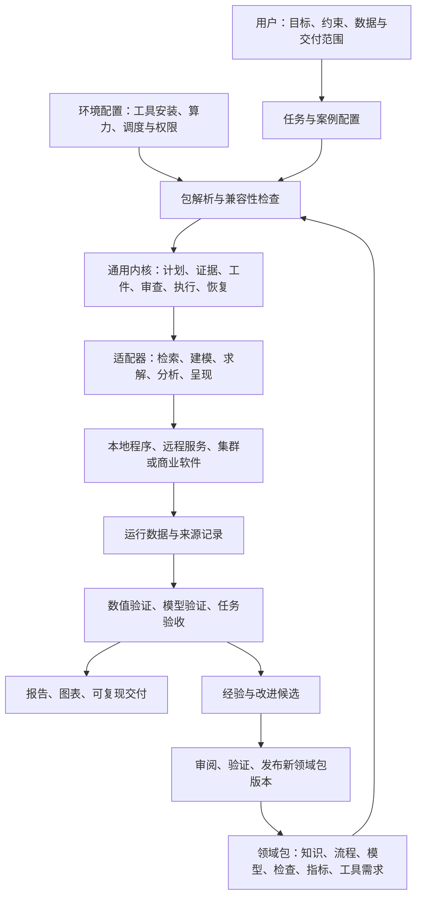

# 跨领域通用仿真工作流与领域包设计

> 2026-11-17 · 设计稿 v1.0  
> 基于《完整仿真工作流设计.md》重新拆解。目标是形成可通过领域包切换的通用仿真框架，覆盖微观、介观、宏观、多尺度，以及离散事件、系统动力学等仿真。  
> 本文描述目标能力和建议契约，不表示原项目已实现这些功能；本次不修改产品源码、不执行仿真。本文可独立阅读。

阅读建议：第 2–4 节看拆分边界和领域包结构；第 5–7 节看知识、工具与流程如何连接；第 8–9 节看跨域实例；第 13–14 节看如何切换、修改和配置；第 16–17 节看迁移与验收。

## 1. 要实现的产品形态

**一套通用仿真内核，加载不同的领域包，就能采用对应领域的知识、工具、建模方法、仿真流程和验收标准。**

用户可以在领域包中修改知识来源、参数定义、工具绑定、阶段依赖、检查和指标。新增领域优先通过新增领域包完成；只有需要尚不存在的工具能力或数据类型时，才开发相应扩展。

例如，同一入口可以选择：

- 材料分子动力学包：建立粒子体系，配置相互作用，平衡与采样，分析微观结构和物性。
- 结构力学包：准备几何，配置本构和约束，离散求解，分析位移、应力和稳定性。
- 流体与传热包：定义流动域和物理模型，划分网格，设置边界，求解并检查守恒、收敛和工程指标。
- 电磁包：建立几何与材料，配置激励和边界，开展时域、频域或本征分析。
- 交通或排队包：建立网络、参与实体和事件规则，开展随机重复试验，分析等待时间、吞吐量及拥堵。
- 多尺度或多场耦合包：组合多个子模型，通过明确的物理量传递和耦合协议共同求解。

这里的“通用”指**工作流机制、数据契约和扩展方法通用**，不意味着各领域共享同一数学模型、同一流程或一套万能正确性检查。覆盖一个新领域，需要相应知识、模型、工具支持和验证案例。

### 1.1 用户实际操作

1. 选择领域包及任务模板，也可由系统推荐后明确显示当前选择。
2. 填写目标、对象、工况、数据、资源限制和希望交付的内容。
3. 系统检查领域适用性，加载知识、解析流程、匹配工具，展示缺口与运行方案。
4. 在已有授权和预算范围内执行建模、检查、计算与分析。
5. 接收结果、依据、可信度限制和可复现记录。
6. 修改任务参数、切换工具配置或创建新的领域包版本，再开展后续任务。

### 1.2 核心对象

| 对象 | 作用 | 不应与什么混合 |
|---|---|---|
| 仿真内核 | 通用执行和治理机制 | 特定求解器语法、某领域的默认流程 |
| 领域包 | 一类问题的知识、流程、工具需求和科学判断规则 | 单次任务的具体输入与结果 |
| 工具适配器 | 将统一调用转换为工具实际操作 | 领域科学决策、质量放行 |
| 环境配置 | 机器、路径、调度器、安装位置、许可证引用和资源额度 | 可分享领域包中的机器私有信息 |
| 案例 | 一次问题定义及其方案版本 | 可供所有项目继承的通用模板 |
| 运行 | 某组固定输入在确定环境下的一次真实计算 | 仿真方案、完整研究活动 |
| 研究活动 | 参数扫描、收敛研究、校准、优化或不确定性分析中的一组运行 | 单个求解器进程 |

## 2. 原稿应如何拆解

原稿已经包含证据、分阶段审查、真实运行、结果验收和经验沉淀等可复用机制。主要问题在于：阶段顺序、决策字段、角色名称、工具和检查仍围绕 LAMMPS。

### 2.1 从原设计到通用设计

| 原稿内容 | 通用化后 | 归属 |
|---|---|---|
| 材料、元素、晶体 | 研究对象、组成、实体、拓扑、空间与状态 | 领域包中的问题定义 |
| 原子结构建模 | 模型表示构建：粒子、几何、网格、网络、状态空间、事件系统等 | 领域流程与构建工具 |
| 势函数与参数 | 支配模型与参数：势、本构、方程、闭合关系、概率和行为规则等 | 模型库、参数库 |
| 热力学条件 | 环境、运行条件、外部输入、工况与场景 | 决策定义 |
| 加载与积分 | 驱动、初始条件、边界条件、约束和求解协议 | 决策定义与流程 |
| in 文件 | 求解器配置、脚本、工程文件、API 请求或模型对象 | 工件与工具适配 |
| thermo、dump | 标量、时序、场、粒子、事件、网络、检查点等输出 | 工件类型与输出契约 |
| 应力应变与结构识别 | 领域指标、计算方法、统计口径及解释规则 | 计量与验收 |
| LAMMPS 强制检查 | 按领域与工具版本触发的检查集 | 领域包和工具包 |
| 固定四道阶段门 | 各包定义具体检查位置，内核保证必要检查不可绕过 | 流程定义＋内核 |
| 固定 WF-00→01→02→03A | 有依赖的阶段图，可分支、并行、迭代和组合 | 可修改工作流 |
| 固定角色与模型档位 | 通用职责＋领域上下文＋运行时角色绑定 | 角色配置与运行环境 |
| 本地案例检索 | 有适用条件的参考案例和方法证据检索 | 知识库 |
| 错误修复与回退 | 原因假设、影响分析、有界修复、重新检查和重跑 | 内核机制＋领域诊断规则 |
| 知识整理和自进化 | 候选知识、模板、工具或流程变更，经验证后发布新包版本 | 包维护流程 |

### 2.2 原稿中不应直接固化为通用规则的内容

1. **固定“结构→势→输入”顺序。** 有限元、CFD、系统动力学、离散事件并不共享这套顺序，应转成分子动力学包的工作流。
2. **所有任务必须有本地案例。** 通用内核要求依据充分；领域包可要求经过核验的本地基线，也可接受解析基准、制造解、公开验证算例等明确替代路径。不能用无依据的空白模板替代验证。
3. **固定输出原子诊断量。** 这类要求留在相应领域包；宏观领域应声明场量、通量、残差、力与能量收支等输出。
4. **把连续三次修订作为所有任务的唯一上限。** 通用机制保留累计、限制和升级，次数与计算预算由项目策略配置；原包可继续保留三次上限。
5. **每种领域都要配置同一批代理。** 必须保留责任和审查证据，但不要求固定数量的代理或固定模型厂商。
6. **所有任务都强制调用“物理合理性专家”。** 泛化为模型与方法适用性评估，可由相应领域专家、规则或经过验证的程序完成。

这些是新通用设计相对原稿的主动调整。迁移原 LAMMPS 包时，原有必需检查应逐条保留和映射；任何放宽都要作为显式的包版本变更，不能在迁移中静默丢失。

## 3. 总体架构：内核、领域包、适配器与案例



### 3.1 通用内核负责什么

| 内核能力 | 固定责任 | 领域包提供的内容 |
|---|---|---|
| 包加载与解析 | 依赖解析、版本锁定、兼容性和能力检查 | 包声明、依赖、适用范围 |
| 流程调度 | 依赖、分支、迭代上限、状态推进、暂停恢复 | 阶段、条件、输入输出、迭代协议 |
| 决策与证据 | 假设状态、来源定位、决策冻结与变更记录 | 决策字段、证据要求、参考来源 |
| 工件与来源追踪 | 输入输出关联、内容摘要、版本与失效传播 | 类型定义、语义约束、转换要求 |
| 检查与审查 | 条件判定、结果记录、放行约束、职责区分 | 检查规则、严重程度、检查器 |
| 执行控制 | 提交、查询、取消、超时、预算、运行记录 | 工具能力需求、资源建议、退出识别 |
| 诊断与恢复 | 保留证据、有界修复、重审与回退 | 失败信号、候选原因、诊断方法 |
| 计量与验收 | 绑定指标定义、数据来源和逐项结论 | 公式、单位、统计、阈值、参考 |
| 知识反馈 | 候选记录、审阅状态、发布追踪 | 领域分类、适用性和回归案例 |

内核不包含 `if domain == lammps` 一类领域分支。它只识别通用契约、已注册能力、阶段状态和检查结果。

### 3.2 领域包和适配器的边界

**领域包决定“为什么做、做什么、按什么方法、怎样判断”；适配器负责“怎样调用具体软件并取回结果”。**

例如结构力学包要求“检查约束是否足以消除非预期刚体模态”；有限元适配器负责提取约束、自由度或相关求解信息。适配器不能因为软件退出码为零而自行宣布结构模型合理。

一个领域包可以使用多个工具；同一适配器也可以被多个领域包使用。适配器可以支持命令行、API、软件脚本、工程文件或必要的界面操作，但都要记录实际执行证据。具体工具应在满足科学能力、格式、版本、许可证和资源要求后才能替换。

## 4. 领域包：可修改内容的完整边界

领域包的三个主要组成是**知识包、工具配置、流程定义**。模型、检查、指标和失败诊断作为明确契约连接三者，避免只提供散落的文档和提示词。

### 4.1 建议目录

```text
domain-packs/<pack-id>/
  manifest.yaml               # 身份、版本、兼容性、能力、依赖与适用范围
  README.md                   # 适用任务、使用方式、限制和示例
  problem-schema.yaml         # 目标、对象、条件、假设、必需特征与参数
  vocabulary.yaml             # 术语、别名、物理量、单位和语义映射
  knowledge/
    catalog.yaml              # 来源、主题、版本、适用条件与检索范围
    references/               # 理论、标准、文献或外部引用
    manuals/                  # 工具手册引用及版本
    cases/                    # 基准案例、复用案例与验证记录
    lessons/                  # 经验、纠错、失效与适用范围
  models/
    catalog.yaml              # 支配方程、本构、势、闭合、状态转移等模型
    parameters/               # 参数集、来源、单位与有效区间
  workflows/
    default.yaml              # 默认流程或任务路由
    tasks/                    # 具体任务的阶段图
    subflows/                 # 网格研究、平衡、校准等可复用子流程
  tooling/
    capabilities.yaml         # 所需能力与输入输出契约
    profiles/                 # 求解器、建模器、分析器的组合与版本约束
  artifacts/
    schemas/                  # 工件结构和领域语义要求
  checks/
    rules.yaml                # 触发、方法、证据、严重程度与失败处置
  measurements/
    metrics.yaml              # 指标、单位、方向、基准、统计与输出需求
    acceptance.yaml           # 验收模板及需要按任务确定的判据
  failures/
    catalog.yaml              # 信号、原因假设、诊断、回退范围与修复限制
  templates/
    model/                    # 建模、求解配置和脚本模板
    reports/                  # 交付结构与图表规范
  roles.yaml                  # 职责所需的领域上下文，不固定厂商模型
  validation/
    cases/                    # 包发布验证用例
    expected/                 # 预期关系、容差、性质或参考结果
  CHANGELOG.md
```

该目录是逻辑组织建议，不要求初版每项都建独立文件。小包可合并声明；大数据、受限资料和工具二进制可以外部引用，但必须明确来源、可用性、修订和访问条件。

### 4.2 修改层次

| 层次 | 典型修改 | 生效范围 |
|---|---|---|
| 任务参数 | 温度、载荷、入口流速、需求强度、样本数 | 当前案例版本 |
| 项目配置 | 常用材料、报告格式、资源上限、认可参考集 | 当前项目的新计划 |
| 领域包版本 | 增加模型、检查、任务流程、指标或工具配置 | 锁定到新版本的案例 |
| 工具适配器 | 新增文件解析器、求解器接口或远程执行支持 | 使用该适配器版本的任务 |
| 内核 | 新增通用状态或调度语义 | 所有兼容包，需回归验证 |

任务参数可以覆盖包中明确允许修改的默认值；不能覆盖内核约束、宿主权限或包中的强制检查。环境配置负责绑定实际工具，不得悄悄改变科学模型。包依赖、规则或指标冲突必须显式解决，不能用“最后加载的文件获胜”。

### 4.3 包的组合与复用

推荐按需要组合：基础方法包＋领域包＋任务流程＋工具配置。

例如：通用量纲与统计检查＋结构力学知识＋非线性静力任务＋某有限元求解器配置。共用内容通过显式依赖复用，避免多个包各复制一套收敛检查后逐渐不一致。

组合必须解析依赖版本、命名空间、工件类型、检查冲突和阶段映射。一个工件存在多个生产者时必须指定来源；多个包声明同名但不同定义的“应力”时必须保留语义差异。

### 4.4 用户要改什么，就改哪里

| 修改意图 | 主要修改位置 | 随后需要核对 |
|---|---|---|
| 加入一本手册或一组实验数据 | `knowledge/` | 来源、版本、访问条件、适用范围 |
| 增加材料、本构、势或行为模型 | `models/`、`problem-schema.yaml` | 参数单位、有效范围、工具支持和基准 |
| 更换已有求解器 | `tooling/profiles/` | 能力、模型语义、格式转换和结果可比性 |
| 新接一个尚未支持的软件 | 新适配器及 `tooling/` | 接口、输出解析、错误状态和真实调用验证 |
| 加入前处理、网格研究或重复试验 | `workflows/` | 阶段依赖、工件、预算、停止和回退条件 |
| 加一条领域检查 | `checks/`，必要时增加检查器 | 触发条件、正常/失败/未知情形与证据 |
| 改指标或验收方法 | `measurements/` | 口径、依据、输出充分性和旧结果影响 |
| 修改图表和报告样式 | `templates/reports/` | 数据选择和指标语义是否受到影响 |

包编辑入口可以是文件编辑器，也可以是后续开发的表单或流程编辑器；它们应读写同一份包定义，避免界面设置与实际运行配置各有一套。

## 5. 知识库怎样通用化

### 5.1 知识分类

| 分类 | 主要内容 | 用途 |
|---|---|---|
| 理论与方法 | 假设、支配规律、求解方法、尺度条件 | 判断方法是否适用 |
| 模型与参数 | 势、本构、输运系数、反应率、概率分布、行为规则 | 建模与参数选择 |
| 工具知识 | 命令语义、版本限制、格式、接口、已知缺陷 | 正确调用软件 |
| 参考案例 | 输入、来源、工况、工具版本、结果与验证范围 | 复用与差异分析 |
| 标准与实验 | 测试定义、测量条件、数据、允许误差 | 校准与模型验证 |
| 检查规则 | 必需条件、触发条件、证据与严重程度 | 方案与产物检查 |
| 经验与纠错 | 触发情形、症状、原因、修复及适用边界 | 诊断和避免重复错误 |
| 模板与操作方法 | 可复用配置、分析步骤和报告结构 | 提高生产效率 |

### 5.2 每条知识的最低记录

- 身份：条目 ID、类型、标题、修订或内容摘要。
- 来源：原始文件或地址、页节/行段、作者或发布方、工具版本；无法固定外部版本时记录获取时间与限制。
- 适用范围：领域、模型、尺度、工况、单位制、工具、任务类型与已知不适用情形。
- 证据内容：实际读到的段落、数据或验证工件；区分全文、摘要、元数据和未经核验的线索。
- 状态：候选、待审、确认、隔离、弃用或撤回；内容状态与适用性分别判断。
- 关系：替代、补充、依赖、冲突、共同来源以及相关案例。

“确认”表示该条目通过了相应知识审阅，不代表它能适用于所有新任务。多个转述同一实验或论文的条目也不构成独立证据。

### 5.3 检索与使用流程

任务字段→术语归一→按模型/尺度/工况过滤→检索候选→核原文与适用条件→记录支持的具体决策→形成当前任务的证据集合。

知识后端可以是文件、全文索引、向量库、图数据库或外部知识系统。内核消费统一的来源、内容、状态和适用条件，不绑定某种数据库。检索分数不能直接用作科学置信度。

### 5.4 切换领域时的知识隔离

切换领域包后，默认检索范围随包改变，仍可显式检索共享方法知识。跨域条目只有经过适用性判断后才能使用。

例如原子维里应力与连续体柯西应力不能仅凭“stress”同名就互换；微观势参数也不能直接作为宏观本构参数。跨尺度转换需要独立的模型假设、计算步骤和验证。

知识更新不得自动改写已完成案例的依据。新案例使用新修订；旧案例保留当时使用的知识快照或可定位引用。重要来源撤回时标记关联案例待复核，同时保留历史记录。

## 6. 工具怎样通用化

### 6.1 按能力组织工具

| 能力 | 可能的实现 | 标准输出 |
|---|---|---|
| 取证与检索 | 文件搜索、知识库、手册与文献接口 | 可定位证据 |
| 构建模型表示 | 粒子生成器、CAD、网络构建器、方程编辑器 | 模型表示及检查记录 |
| 离散化 | 网格器、粒子布置、时间离散、降阶工具 | 离散模型及质量记录 |
| 配置模型 | 参数选择、本构绑定、行为规则配置 | 带来源的模型定义 |
| 配置实验 | 边界/初值、加载、激励、随机场、场景生成 | 试验或运行协议 |
| 生成求解输入 | 模板渲染、软件脚本、工程文件生成、API 构造 | 可执行输入及依赖 |
| 执行与监督 | 本地进程、远程执行、调度器、服务 API | 运行记录、日志和输出 |
| 提取与分析 | 字段提取、统计、特征分析、事件分析 | 带口径的指标数据 |
| 验证与比较 | 解析解比较、网格研究、实验比较、守恒检查 | 验证结果和适用限制 |
| 呈现与报告 | 曲线、云图、粒子图、网络图、动画、报告生成 | 图表、报告及来源清单 |

离散化对部分任务不适用；不能为了流程齐整而人为生成网格阶段。

### 6.2 统一工具契约

每个适配器声明：能力 ID、版本、支持的模型和格式、输入输出类型、前置条件、资源需求、调用方式、真实运行证据、错误结构，以及是否支持取消和续算。

调用请求至少包含任务/阶段/运行 ID、输入工件引用、参数、工作目录、运行模式和资源约束。返回状态、实际命令或请求记录、产物、诊断、实际工具版本和环境标识。

对求解类能力，建议提供 `validate / prepare / submit / status / collect`；`cancel / resume` 按工具真实能力声明。没有续算功能时明确不支持，不能把重新运行称为续算。检索、分析等工具无需伪装成有提交队列的求解器。

### 6.3 声明与代码的边界

常规换参数、换模板、调整阶段、增加知识、绑定已有工具能力可以通过声明完成。新增二进制格式解析、复杂模型转换或全新求解器接口通常需要适配器代码。

领域包可以引用经过注册和版本管理的检查器、分析器及脚本模板；不能通过任意钩子修改门禁结果、清空修订次数或绕过权限。新可执行扩展应像软件依赖一样安装和验证，不能因为“它在领域包里”就自动获得执行权限。

## 7. 通用主流程：固定责任，不固定领域步骤

### 7.1 通用责任链

**接收任务→加载领域包→收集依据→定义问题与验收→设计方法→构建模型与试验→检查准备→执行计算→验证和分析→交付→沉淀经验。**

这是责任链，不是所有领域必须采用的固定十一个脚本。具体阶段、依赖、检查位置、可跳过项与循环由领域包声明；内核保证依赖完整、证据充分、状态可信。

| 通用环节 | 核心问题 | 最低产物 |
|---|---|---|
| T0 任务接收 | 做什么，完成到哪一步，有何约束？ | 任务范围、资料、预算和入口 |
| T1 包与能力解析 | 包适用吗，依赖和工具齐全吗？ | 解析结果、锁定配置、缺口 |
| T2 依据与问题定义 | 研究对象、现象、模型范围和判据是否明确？ | 问题定义、依据、假设和验收计划 |
| T3 方法与试验设计 | 为什么选这些模型、条件、数值方法和实验？ | 方案、必需特征、运行/验证计划 |
| T4 模型与输入构建 | 实际产物是否实现了方案？ | 模型、参数、配置、输出计划 |
| T5 就绪检查 | 科学、数据、工具和资源前置是否满足？ | 针对具体输入版本的检查记录 |
| T6 执行 | 实际计算了什么，在哪运行，是否完成？ | 运行证据、日志、数据和检查点 |
| T7 验证与分析 | 数值可信度、模型可信度和指标分别如何？ | 指标、验证结果、限制和验收结论 |
| T8 交付 | 哪些工作已完成，哪些结论有依据？ | 报告、可视化、复现材料 |
| T9 反馈 | 哪些经验可复用，是否需要修改领域包？ | 候选知识或变更提案 |

部分任务可从中间进入，但必须核对依赖。例如“只分析”不强制重新仿真，也不能在缺少单位、模型来源或运行关联时补造这些信息。

### 7.2 不再固定 D1–D7 的具体字段

问题定义采用通用分类，领域包展开具体表单：

| 分类 | 通用定义 | 领域差异示例 |
|---|---|---|
| 目标与使用场景 | 要回答的问题，以及结果将用于何种判断 | 机理解释、性能预测、设计比较、运行优化 |
| 系统与对象 | 实体、组成、相互关系与系统边界 | 原子体系、结构、流体域、交通网络 |
| 必需特征 | 目标成立需要实际存在的对象、行为或机制 | 位错、接触面、流体入口、排队规则 |
| 尺度与分辨率 | 空间、时间、统计、状态或事件粒度 | 原子数、网格尺度、时间步、事件聚合粒度 |
| 模型与假设 | 支配模型、闭合/简化及适用范围 | 势、本构、湍流模型、到达过程 |
| 参数与条件 | 参数、初值、边界、载荷、激励、场景 | 温压、位移约束、热源、需求分布 |
| 计算与试验协议 | 求解策略、重复试验、采样、校准和资源 | 瞬态、稳态、频率扫描、随机重复 |
| 指标与验收 | 定义、输出要求、参考、阈值和可信度要求 | 模量、压降、温度、吞吐量及误差 |

必需特征逐项绑定生产阶段、验证方法和证据。对单纯数据分析任务，必需特征可以是必要数据列、统计覆盖或来源完整性，不强制存在“物理实体”。

### 7.3 领域包定义阶段图

每个阶段声明：

- ID、目的、责任角色和适用条件。
- 输入、输出、依赖阶段和工件类型。
- 采用的能力、模板、模型和知识查询条件。
- 自检、独立检查要求、放行条件和证据。
- 失败分类、允许修复范围、回退目标和资源限制。
- 完成条件、取消行为以及可否从检查点恢复。

流程支持条件分支、并行分支、汇合和子流程。顶层依赖图保持无环；网格自适应、校准、优化等循环通过显式迭代节点表达，每次迭代内部仍是可追踪的阶段图，并有停止条件、预算与迭代编号。

循环停止可能是达到精度、达到最大次数、预算耗尽、没有进展或被取消。达到上限不等于收敛。条件值未知时不得悄悄走“无需检查”的分支。

### 7.4 研究活动是一等对象

一个案例可以包含多组运行，支持：

- 网格、粒子数、时间步、采样长度和随机重复次数研究。
- 参数扫描、敏感性分析、试验设计和模型比较。
- 参数校准、反演、优化和不确定性传播。
- 多保真计算、降阶模型或代理模型验证。

每组活动声明变化参数、受控条件、样本/种子策略、汇总方法、预算和停止规则。校准使用的数据与最终独立验证数据应区分；优化找到了较好目标值，也不代表仿真模型已经验证。

## 8. 领域流程示例：验证抽象是否真正跨域

| 项目 | 分子动力学 | 宏观结构有限元 | 流体与传热 | 离散事件/排队 |
|---|---|---|---|---|
| 对象表示 | 粒子、键、盒子 | 几何、部件、连接与接触 | 流体/固体域、界面 | 实体、资源、队列、网络 |
| 支配模型 | 相互作用势、运动方程 | 本构、平衡/动力学关系 | 质量、动量、能量与闭合模型 | 到达、服务、路由和调度规则 |
| 离散化 | 粒子体系和时间离散 | 单元、网格、积分与时间离散 | 空间网格、通量与时间离散 | 事件时间推进或指定时间步 |
| 条件 | 温压、边界、加载 | 载荷、约束、初值 | 入口出口、壁面、热源与初值 | 初始队列、资源数、需求场景 |
| 求解前阶段 | 最小化、平衡等适用步骤 | 网格与约束检查，必要的初始平衡 | 网格质量与初始化检查 | 输入分布与事件规则检查 |
| 真实计算 | 动力学轨迹与采样 | 静力、瞬态、模态或屈曲等 | 稳态或瞬态场求解 | 事件仿真和独立重复试验 |
| 数值/统计检查 | 步长、守恒、有限尺寸、相关性 | 网格/时间步、残差、平衡与能量 | 网格/时间步、残差、通量收支 | 事件守恒、预热期、重复次数、置信区间 |
| 典型指标 | 扩散、结构、热力学量、力学响应 | 位移、应力、频率、极限载荷 | 压降、流量、换热、温度 | 等待时间、吞吐量、利用率 |
| 参考依据 | 解析、实验、文献或可信基准 | 解析解、试验与验证算例 | 解析解、实验与验证算例 | 排队理论、观测数据与基准模型 |

### 8.1 分子动力学流程

定义问题→选择模型与势的候选→构建粒子体系→确定参数和映射→配置边界与运行协议→检查输入→按需最小化/平衡→生产采样→统计与物理验证→指标与交付。

原稿的势映射、固定组速度、参考长度、控制竞争及相应命令检查均放在该包中。不同子任务可采用不同流程，不能把单轴拉伸模板套到所有分子模拟任务。

### 8.2 宏观结构有限元流程

定义受力问题和精度目标→选择结构理想化与本构→准备几何和接触关系→选择单元并划分网格→配置载荷/约束/初值→检查材料映射、网格和自由度→求解→检查收敛与平衡→开展适用的网格/时间步研究→比较实验或解析依据→输出工程指标。

必须支持线性/非线性、静态/动态等任务差异。应力奇异点不能仅靠继续细化网格得到所谓“收敛峰值”；需按研究目标明确评价位置、平均方法或其它合理判据。

### 8.3 流体与传热流程

定义流动和热问题→选择可压缩性、流态、湍流和传热模型→建立计算域→划分并检查网格→配置边界和物性→初始化→求解→检查残差、流量/能量收支及目标量稳定性→开展适用的独立性研究→验证并提取指标。

残差下降不能单独证明压降或换热系数可靠；边界位置、网格分辨率和闭合模型的适用性都应纳入包中的判断。

### 8.4 离散事件流程

定义服务系统和目标→建立实体、资源与事件关系→从数据估计输入分布→配置路由/服务规则→核对事件逻辑→试运行→确定预热和统计方案→多次独立运行→估计指标及置信区间→与观测或理论比较→交付。

此流程没有势函数、连续场网格或物理残差，但仍使用同一套证据、工件、运行、统计验收与恢复机制。

## 9. 多物理场与跨尺度仿真

跨域任务不能只靠切换包顺序执行。它需要一个耦合包，组合子包，并明确**交换什么、何时交换、如何转换、何时停止**。

### 9.1 三类组合

| 类型 | 例子 | 必需契约 |
|---|---|---|
| 单向顺序传递 | 微观计算参数供宏观模型使用 | 有效工况、单位、映射、参数不确定性和来源 |
| 双向分区耦合 | 流体载荷影响结构，结构变形影响流场 | 时空映射、交换频率、松弛、收敛和同步策略 |
| 单体联合求解 | 同一求解器处理耦合方程 | 联合变量、材料模型、边界、求解和验证配置 |

### 9.2 耦合接口至少声明

- 交换量的名称、物理语义、单位、坐标系、分量与符号约定。
- 源位置与目标位置：原子、单元、节点、面、体、网络边或统计样本。
- 空间插值、投影、均匀化、时间平均和尺度转换方法。
- 守恒条件、插值误差、精度损失和不确定性传播。
- 交换时间、子步长、延迟、迭代/松弛以及收敛标准。
- 子模型失败、无效数据、检查点不一致时的停止和恢复规则。

例如“微观弹性响应→宏观本构”需说明温度、应变率、均匀化方法、张量方向和适用范围；不能直接复制一个数值就认定完成跨尺度建模。

双向耦合需保留同步检查点或可重放的交换记录。一个子求解器从后一个时刻恢复、另一个从前一个时刻恢复，会破坏耦合状态，不能各自选择最新文件后继续。

## 10. 通用工件与追踪契约

### 10.1 不强制统一底层文件格式

粒子轨迹、有限元结果、CFD 场和事件记录可以保留原生格式。统一的是工件的身份、类型、语义、来源和使用条件；需要跨工具交换时再使用有验证记录的转换器。

| 工件类型 | 内容示例 |
|---|---|
| 问题定义 | 目标、必需特征、条件、假设、任务验收 |
| 方法方案 | 模型选择、实验设计、验证策略、风险 |
| 模型表示 | 几何、粒子、网格、网络、方程或事件定义 |
| 参数集 | 数值、单位、来源、有效范围和校准信息 |
| 运行协议 | 初始/边界条件、载荷、激励、求解和采样设置 |
| 可执行输入 | 文件、配置、API 请求及完整依赖 |
| 检查记录 | 适用性、检查方法、证据和裁决 |
| 运行记录 | 命令/请求、环境、状态、日志、输入与输出 |
| 数据集 | 场、时序、轨迹、事件、统计样本 |
| 分析结果 | 口径、方法、指标值、误差和来源 |
| 交付产物 | 报告、图表、动画、复现说明 |

### 10.2 工件公共元数据

建议至少记录 `artifact_id`、类型/模式版本、案例/方案/运行 ID、生产阶段、位置、内容摘要、输入依赖、生产工具版本、包锁定引用和生成状态。

数值数据另记录单位、坐标系、时间基准、空间/实体关联、分量、精度和缺失值约定。不同领域需要不同语义字段，可以由包扩展，不能用一个宽松 JSON 对象代替必要约束。

### 10.3 关键链条

**任务目标→方案决策→必需特征→实现工件→检查证据→真实运行→原始数据→指标定义→验证与验收结论。**

每个结论应能沿链条回查；每个输入变化应能沿依赖关系找到受影响工件。复用缓存时检查内容、包/工具版本与相关环境条件，不能仅凭文件名相同。

## 11. 检查、科学可信度与验收

### 11.1 四类结论分别记录

| 类别 | 回答的问题 | 示例 |
|---|---|---|
| 执行完成 | 工具是否真正完成了指定计算？ | 真实运行、输出完整、无未解释的截断 |
| 数值与实现验证 | 方程/规则是否被正确实现并得到足够准确的解？ | 解析/制造解比较、收敛、守恒、统计充分性 |
| 模型验证 | 模型对目标现实问题是否具有所需可信度？ | 独立实验、观测或适用验证数据比较 |
| 任务验收 | 指定指标及交付要求是否满足？ | 压降阈值、位移限制、误差目标、报告齐全 |

这些结论相互关联但不能替代。纯方法研究可以按任务范围不做现实模型验证，但要明确“未开展”，不能宣称已验证现实预测能力。没有证据的验证声明不能通过将条目标为“不适用”来规避。

### 11.2 通用数值与统计检查族

领域包按适用性选择：空间/时间离散误差、迭代收敛、守恒与平衡、域尺寸和边界影响、采样自相关、随机重复与置信区间、参数敏感性、校准误差、模型形式误差和不确定性传播。

具体指标、阈值、估计方法和最小试验设计由领域包与任务方案给出，不能用一个残差阈值或一个固定百分比覆盖所有仿真。

### 11.3 检查规则

每项规则包含 ID、适用条件、检查对象、检查方法、所需证据、严重程度、失败动作和修复范围。

- 适用性为 `true / false / unknown`；未知不能自动视为不适用。
- 结果为通过、失败、证据不足或有依据的不适用。
- 审查裁决为 `PASS / REVISE / BLOCKED`；由检查结果、严重程度和政策计算/审定。
- `PASS` 绑定具体工件和规则版本；工件变更后需重新评估有效性。

生产者自检不能冒充独立审查。要求独立审查的阶段可以由另一次独立审查职责或独立验证程序完成，并记录实际执行方式；不虚构“专家已审”。

### 11.4 指标与输出闭合

每项指标明确：名称、定义、单位、方向/分量、参考基准、公式、空间选择、时间/事件窗口、采样和统计方法、误差/不确定性、阈值来源以及所依赖的输出。

运行前逐项检查输出是否存在、频率是否足够、数据精度和存储是否可行。运行后结果可为 `met / not_met / cannot_compute / borderline`；不适用项另给理由，不能混成“已满足”。

验收判据在正式运行前固定。修改判据或分析窗口必须记录原因、建立新版本并披露对既有结论的影响，不能为了通过验收临时调口径。

## 12. 执行、失败、版本与恢复

### 12.1 执行前

核对包和工具锁定、当前输入审查、全部外部依赖、工作目录、资源/许可证、输出位置、预算和授权范围。界面上的“自动模式”只影响交互频率，不改变权限和科学标准。

预检、接口演练、真实运行、分析验收分别记录。记录运行命令或请求、工作目录、输入摘要、随机种子、并行配置、起止时间、调度 ID、退出信息和实际输出。浮点并行差异可能影响逐位重复，应按领域定义可接受的数值复现标准。

### 12.2 通用失败分类

| 分类 | 例子 | 首先返回哪里 |
|---|---|---|
| 环境与资源 | 程序缺失、许可证不足、内存耗尽、调度失败 | 环境和执行配置 |
| 输入与格式 | 文件缺失、单位或类型错误、版本不兼容 | 输入生成/转换阶段 |
| 表示与离散化 | 网格畸变、重叠粒子、网络断连 | 模型构建/离散化 |
| 模型与条件 | 约束冲突、参数超范围、边界不适用 | 模型/试验设计 |
| 数值求解 | 发散、步长过大、非线性不收敛 | 数值方法和必要的上游诊断 |
| 统计与数据 | 样本不足、相关性过强、缺关键输出 | 采样/输出设计及运行 |
| 科学前提 | 尺度不匹配、缺少关键机制 | 问题定义与方法方案 |
| 分析与呈现 | 分量、单位、参考或绘图选择错误 | 分析或可视化 |

错误关键词只能提示候选原因，不能直接确定根因。修复过程保留“失败证据→原因假设→检查→差异→重审→新运行→比较”。环境失败不应诱发随意修改科学参数。

### 12.3 状态分开记录

阶段可用 `pending / ready / running / awaiting_review / passed / needs_revision / blocked / failed / cancelled / skipped`；检查裁决、运行状态、验收结果和知识状态分别保存。

`failed` 表示该次动作失败，`blocked` 表示前置或决策缺口阻止推进。`skipped` 需要明确适用性依据。运行结束、任务达标、知识确认不能共用一个“成功”字段。

### 12.4 失效传播

| 变化 | 至少重新评估 |
|---|---|
| 图表字体或配色 | 相应呈现 |
| 统计窗口、公式、单位或参考 | 分析、验收和呈现；必要时检查原始输出充分性 |
| 求解输入或采样设置 | 输入检查、运行、分析和交付 |
| 模型、几何、离散或边界 | 相关构建与检查及其下游 |
| 目标、模型假设或验收标准 | 方案和所有受影响的下游 |
| 包、检查器或工具版本 | 按依赖和变更类型做影响评估，不能默认旧结果仍有效 |

失效并不删除历史产物，而是标注旧产物对应的版本及不能再支撑的当前结论。纯文档修订也不应无差别触发全部重算。

### 12.5 建议案例布局

```text
cases/<case-id>/
  task.yaml
  revisions/<revision-id>/
    resolved-lock.yaml        # 包、流程、知识与工具的实际解析版本
    plan/                     # 问题定义、方案、验收和研究活动
    inputs/                   # 原始资料与生成输入，保留来源
    reviews/
    studies/<study-id>/        # 参数矩阵、重复/收敛研究及汇总
    runs/<run-id>/             # 每次运行的输入绑定、日志和输出
    analysis/
    figures/
    reports/
  state/                      # 当前状态与持久事件记录
  feedback/                   # 知识及包改进候选
```

大型数据可使用外部对象存储，目录内保留稳定引用和校验信息。恢复时先核对权威状态、实际作业和输入输出关系，再从最后可信节点继续，不依赖文件修改时间猜测“最新成功运行”。

## 13. 领域包切换、修改与发布

### 13.1 切换领域包的完整过程

1. 选择目标包、版本、任务模板和工具配置。
2. 校验当前任务是否落在包的适用范围内。
3. 解析依赖及共享模块，确定知识范围和实际流程。
4. 校验任务字段、工件类型、能力、格式与工具版本。
5. 检查工具安装、许可证、资源及必要数据。
6. 展示实际阶段、必需检查、预计资源和缺口。
7. 固定解析结果，再开展任务。

如果只有缺失的可选绘图工具，可以按交付范围降级；缺少必需求解能力或关键科学证据时，只能形成准备结果和缺口说明，不能宣称已经具备可执行仿真能力。

### 13.2 三种操作必须分清

| 操作 | 行为 |
|---|---|
| 为新任务切换包 | 使用新领域的表单、知识、流程、工具和验收 |
| 为已有任务切换同领域工具 | 创建新方案版本，检查语义兼容、转换损失，并按影响重新验证 |
| 将已有任务迁移到另一领域 | 建立新案例或显式迁移版本，重新解释目标、模型、输入和指标；原结果保留 |

快速切换指配置和能力组合的切换快，不承诺任意模型文件能自动转换，也不承诺换领域后原有科学假设仍成立。运行中的案例固定原包；包更新不应中途替换其规则。

### 13.3 修改与发布流程

修改草稿→声明/引用/依赖检查→阶段图与工件契约检查→相关基准和负例验证→科学审阅→生成差异和版本→发布→供新任务选择。

验证至少包括：正常案例、缺资料、工具缺失、检查不通过、错误单位、失败恢复和旧版案例保持可复现。发布依据应说明做过哪些真实工具测试，哪些只是声明检查或模拟适配器测试。

自动反馈可以产生知识、规则、模板和流程候选，但不能直接覆盖当前有效包。发布身份与权限由使用环境管理，包内的配置不能自行扩大权限。

## 14. 声明示例：宏观结构力学包

以下 YAML 是目标接口示意，不是已实现的配置格式，也不是拿去即可运行的求解器输入。引用的适配器、检查器、子流程和基准都需要实际提供并验证。

### 14.1 包入口

```yaml
id: structural-mechanics
version: 1.0.0
schema_version: 1
kernel_compatibility: ">=1.0,<2.0"
scope:
  domains: [solid-mechanics]
  scales: [continuum]
  tasks: [linear-static]
  exclusions: [fracture-growth, fluid-structure-coupling]
entrypoints:
  problem_schema: problem-schema.yaml
  knowledge: knowledge/catalog.yaml
  workflow: workflows/tasks/linear-static.yaml
  tooling: tooling/capabilities.yaml
  checks: checks/rules.yaml
  metrics: measurements/metrics.yaml
  acceptance: measurements/acceptance.yaml
required_capabilities:
  - geometry.import
  - mesh.generate
  - solid.linear_static.solve
  - field.extract
  - metric.evaluate
defaults:
  tool_profile: fem-local
```

### 14.2 流程片段

```yaml
id: linear-static
stages:
  - id: model
    uses: subflows/define-solid-model.yaml
    requires: [approved_problem]
    provides: [solid_model]

  - id: discretize
    capability: mesh.generate
    requires: [solid_model]
    provides: [discrete_model]
    checks: [mesh-quality, region-mapping]

  - id: configure
    uses: subflows/configure-static-problem.yaml
    requires: [approved_problem, solid_model, discrete_model]
    provides: [solver_input]
    checks: [units-consistent, constraints-valid, outputs-sufficient]
    review_required: true

  - id: solve
    capability: solid.linear_static.solve
    requires: [solver_input]
    requires_passed: [configure]
    provides: [run_record, solution_fields]

  - id: verify
    uses: subflows/verify-static-solution.yaml
    requires: [approved_problem, run_record, solution_fields]
    provides: [verification_report, metrics]
```

`approved_problem` 是该片段的外部输入，由完整流程的问题定义阶段提供。`verify` 子流程可声明平衡检查及有界网格研究；不能仅凭阶段名称声称做过收敛验证。

### 14.3 检查片段

```yaml
id: constraints-valid
applies_when:
  fact: analysis.kind
  equals: linear-static
requires: [solver_input]
method:
  checker: structural.constraint_audit
on_unknown: blocked
on_fail: revise
evidence_required:
  - constrained_dofs
  - rigid_body_mode_assessment
```

### 14.4 指标片段

```yaml
id: max_displacement
quantity: displacement_magnitude
unit: m
source:
  artifact: solution_fields
  association: node
selection: task.evaluation_region
operation: max
definition_version: 1
acceptance:
  operator: less_than_or_equal
  threshold_ref: task.allowed_displacement
  required_evidence_ref: task.displacement_limit_source
```

阈值来自任务要求或认可标准，示例不预填任意数值。更换为分子动力学包时，替换模型、阶段、检查和指标声明；阶段执行、证据记录、状态和恢复机制继续使用同一内核。

## 15. 角色与协作的通用化

| 职责 | 负责内容 | 不能替代 |
|---|---|---|
| 协调 | 任务路由、依赖、状态、交接、预算和缺口 | 专业模型决策和检查结论 |
| 方案设计 | 问题定义、模型方法、试验和验证计划 | 工具执行证据 |
| 知识取证 | 检索、核来源、判断适用限制 | 当前任务的独立放行 |
| 模型与输入生产 | 按方案建立模型、参数、协议和输入 | 独立审查 |
| 审查与验证 | 核模型、工件、证据、检查和可信度 | 代替生产者偷偷修改输入 |
| 执行 | 真实提交、监督、取消、收集和运行记录 | 科学正确性判断 |
| 分析 | 指标、误差、统计、对照和任务验收 | 编造缺失数据 |
| 呈现 | 图表、报告、语义与来源一致性 | 用视觉效果掩盖未通过的验证 |
| 知识维护 | 经验提炼、去重、审阅和包变更候选 | 自动改写有效科学规则 |

这些是责任划分，不要求同时运行九个代理。可以由人、AI、确定性程序或混合方式承担。包提供领域上下文，运行环境决定具体代理与工具绑定；高要求的独立审查必须保留真实的职责隔离。

## 16. 从现有设计迁移的建议顺序

1. **先提取契约。** 整理任务、工件、检查、运行、指标和知识记录；标出原设计中的 LAMMPS 专属内容。
2. **形成第一个包。** 将原角色上下文、流程、势/结构知识、命令检查、模板和失败诊断收进分子动力学包，逐条核对原要求未丢失。
3. **建立最小内核。** 实现包解析、阶段依赖、质量检查、工具调用、记录和恢复，先贯通一个任务。
4. **接入宏观包。** 优先用结构有限元或流体传热验证抽象；发现仍需领域分支的地方，判断是通用契约缺失还是适配器能力不足。
5. **接入不同范式。** 用离散事件或系统动力学检验内核是否仍隐含“必须有几何、网格、物理残差”的假设。
6. **再扩展研究活动与耦合。** 完善随机重复、收敛研究、校准优化、多尺度和多场耦合。

这是建议实施顺序，不是本次已完成的软件实施范围。只用多个材料或多个分子动力学模板测试，不能证明框架已经跨领域。

## 17. 如何验收“通用化”是否成功

| 场景 | 通过条件 |
|---|---|
| 从微观切到宏观 | 选择结构/流体包后，使用相应模型、流程、检查和指标，内核不新增领域条件分支 |
| 从连续物理切到事件仿真 | 不强制生成网格或势函数，能执行重复试验和统计验收 |
| 修改领域流程 | 新增或调整阶段后，依赖、输入输出和检查均经过校验，可发布为新包版本 |
| 替换求解器 | 能核对能力、模型语义、格式、单位和版本；不兼容时明确阻止或要求转换与验证 |
| 扩充知识 | 新条目可按适用范围检索，当前运行的知识依据保持固定 |
| 缺工具/缺证据 | 明确缺口，不用脚本生成、模拟调用或退出码冒充仿真完成 |
| 运行成功但结果不可信 | 分别显示执行完成、数值/模型验证不足或任务未达标 |
| 恢复失败任务 | 从匹配的输入和检查点恢复，保留失败证据，不重复计算无关部分 |
| 更新已有包 | 旧案例绑定旧版本，新案例使用新版本，可追踪差异与失效范围 |
| 跨尺度或多场耦合 | 交换量、映射、误差、收敛及同步恢复有明确记录 |
| 修改任务参数 | 在允许范围内覆盖默认值，不绕过强制检查和权限 |
| 反例与异常输入 | 错误单位、错误映射、缺输出、未知条件能被检出，不能被默认值掩盖 |

建议以至少一个微观真实算例、一个宏观真实算例和一个不同仿真范式的算例作为初期验收组合，并保留独立参考和异常输入测试。包配置可加载只是第一步，真实求解、验证与跨域隔离同样需要证明。

## 18. 本次拆解后的设计边界

通用框架固定的是：**任务和证据的组织方式、工件契约、检查语义、执行监督、版本追踪、失败恢复与交付责任。**

领域包可修改的是：**研究对象和模型、知识库、任务表单、阶段图、工具组合、参数模板、检查内容、指标口径、失败诊断和验证案例。**

因此，知识库不是单独的资料附件，工具不是散落的执行命令，流程也不是固定在内核里的提示词。三者通过明确的模型、工件、证据和验收契约组成一个可编辑、可验证、可发布、可切换的领域包。
