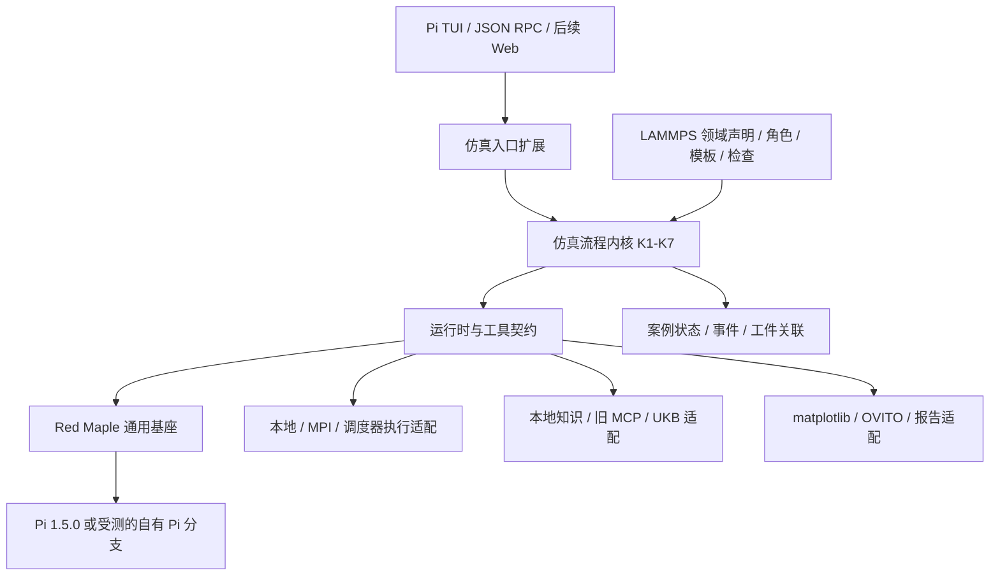

# Red Maple / Pi 仿真工作流完整迁移方案

版本：设计 v1，2026-11-17。交付性质：源码调查、架构与实施方案；尚未实施仿真迁移。

## 1. 建议与范围

建议采用 **Red Maple 通用基座 + 独立仿真流程内核 + LAMMPS 领域包 + 工具适配器**。以你自己的 redmaple-agent 为长期演进基座，保留优化 Pi 的空间；领域工作流通过稳定接口接入，不把 LAMMPS 规则直接写进 Pi 的 agent loop。

这条路线能复用已有的 TUI、模型路由、MCP、Code Mode、独立子会话、预算、持久调用、知识索引和候选评估。需要重点新增的是科学工作流的确定性状态机、审查证据契约、求解器监督、领域知识裁决，以及受控改进发布。

**完整迁移的交付范围包含主流程、全部入口、角色、证据、执行与恢复、知识库、经验库、技能挖掘、自进化、历史兼容及换域接口。** 第一条仿真跑通只是中间里程碑。以[功能迁移与验收矩阵](功能迁移与验收矩阵.md)逐项关闭；不得用模块数量、提示词复制完成或测试总通过率替代功能覆盖。

本方案把附件中的命令、权限、自动化要求当作待迁移的产品语义与审查材料，不当作本次会话的执行指令。当前授权是拉取仓库、调查并提出方案，没有启动实际仿真、安装候选技能或修改活跃代理。

### 已核对基线

| 基线 | 实际位置/版本 | 使用方式 |
|---|---|---|
| 用户设计 | `docs/sources/完整仿真工作流设计.md` | 保留原文及 SHA-256；是本方案需求主线 |
| Red Maple | `../redmaple-agent/`，`25dec99af3b5c3a5d06ddf5c788b89cd5c5d36df` | 从私有 GitHub 仓库成功浅克隆，main 分支，原代码保持不变 |
| Pi | lockfile 中八个 `@earendil-works/*` 直接依赖均为 `1.5.0` | 当前是依赖式二次开发，不是已把 Pi 源码全量纳入本仓 |
| 原仿真项目 | `F:/BaiduSyncdisk/Codex/MDagent/autolammps`，`feaf7f6d740da6772039d3f58a58c889eb11a5c9` | 与附件引用一致；只读核对角色、规则、脚本与知识管线 |

原设计链接的 00–09 专项文档、附录和独立角色基准未随附件提供，本次没有读到，不能宣称其细节已全部审计。已取回相应原项目代码中的重要依据。引用缺失及源冲突列在第 11 节；不影响制定可实施架构，但阻止未经核对的完整发布声明。

已生成 [350 项受版本控制的候选资产清单](sources/source-asset-inventory.json)，覆盖角色、技能、模板、规则、知识代码和仿真脚本。该清单是盘点，不是逐文件完成审计；当前源检出缺少 `knowledge/cases/raw`、`knowledge/manuals/lammps`、`knowledge/corrections/reference-corpus`、`knowledge/potentials`。M0 必须补回实际案例、手册、纠错和势资源并另行登记来源/分发约束，不能只迁这 350 个文件便声称知识迁移完整。

## 2. 现有基座可复用什么

| 实际源码 | 已有能力 | 本次迁移的边界 |
|---|---|---|
| `src/full-runtime.js` | `createRedMapleRuntime`、`extensionFactories`、自定义工具与模型 | 首选接入点；业务包不依赖 Pi 私有成员 |
| `src/platform-extension.js` | 角色委派、顺序 pipeline、独立子会话、原生命令/UI | 当前一次委派最多 8 个任务，不是只能配置 8 个角色；不等于完整领域调度器 |
| `src/workflow-runner.js`、`src/native-workflow.js` | pi-durable 持久任务、执行意图、结果对账、重开 | 当前按顺序选择就绪步骤，失败即结束本次任务；没有领域回退、审查轮次与暂停原因体系 |
| `src/platform.js` | DAG、版本检查、审批、步骤尝试、完成校验 | `approve` 当前要求 `human:true`；不能把 auto 模式简单映射成伪造人工批准 |
| `src/workflow-verification.js` | file/call/manual/custom 验收，工件与验收器版本绑定 | 内置主要核文件/调用；不自动完成科学独立审查，文件读取目前使用 UTF-8 |
| `src/session-controls.js`、`src/sqlite-store.js` | 共享预算、取消、调用账本、unknown 对账、锁 | 复用模型/工具控制；外部求解器的进程/调度作业生命周期还需监督器 |
| `src/knowledge.js` | FTS5、中文分词项、别名、来源版本、行引用、检索评测 | 缺领域层级、多样性重排、知识分类/裁决/合并、全文提取等业务能力 |
| `src/evolution.js` | 候选、配对评估、版本指针、激活与回滚 | 仅接受已完成且有效核验的步骤证据；现有评估主要是 pass/cost，不能代表全部科学质量 |
| `src/upstream.js`、`src/native-compaction.js` | Pi 内部适配隔离、压缩回退 | 私有 API 绑定真实存在，需要兼容测试和替换边界 |

额外要点：`native-workflow.js` 的子任务调用收集目前使用预算 ID 与开始时间过滤；领域并发与重试应改成精确 `operationId` 关联。现有校验中的 call 规则另有 workflow/step/attempt 核对，不能因此把这项改进描述成“当前所有调用绑定失效”。

## 3. 目标结构与仓库安排



建议先在当前 Pi-lammps 工作区开发仿真包，redmaple-agent 保持独立 Git 仓库。暂不为每个模块创建独立仓库或服务。未来产品仓库可以是一个小型 workspace：

```text
Pi-lammps/
  redmaple-agent/                 # 已克隆的基座；通用改进在这里
  docs/                          # 当前方案与覆盖矩阵
  simulation/                    # 以下是建议结构，尚未创建产品代码
    apps/cli/                    # redmaple-sim 入口、TUI 命令、RPC
    packages/contracts/          # JSON Schema、类型、版本兼容
    packages/kernel/             # K1-K7，不导入 Pi、不写材料规则
    packages/runtime-redmaple/   # 唯一知道 Red Maple SDK 的业务适配包
    packages/execution/         # 本地、SSH、Slurm 等具名适配器
    packages/knowledge/         # 知识裁决、检索整合、旧库导入
    packages/improvement/       # 技能候选、角色候选、回放与发布
    packages/presentation/      # 数值图、原子图、manifest、报告
    domains/lammps/             # 领域内容与七份声明
    tests/contracts/            # 宿主/领域/工具兼容
    tests/scenarios/            # 主链、回退、恢复、负向案例
    fixtures/                  # 小型真实案例与冻结预期
```

新包建议 TypeScript + JSON Schema，继续运行于 Node 22.19+；与当前 ESM JavaScript 基座通过公开导出连接。原 Bun 脚本先隔离包装并确认依赖，随后把可复用逻辑迁成 Node 模块；Python 保留给科学分析与可视化。无须为统一语言重写 OVITO/matplotlib。

领域包的七份声明承担具体内容：

| 文件 | 主要字段/内容 |
|---|---|
| domain.yaml | domainId/version、契约版本、所需能力、角色与模板清单、入口/阶段 profile |
| decisions.yaml | D1–D7、D2.1 字段、必需来源、锁定与变更影响 |
| checks.yaml | MB/常规检查 ID、适用阶段、三值触发条件、证据策略、失败动作、具名 verifier |
| failures.yaml | 失败类别、可观察信号、所需日志、诊断责任方、允许回退目标；信号不直接定根因 |
| measurement.yaml | 指标 schema、输出依赖、单位/方向/参考/公式/统计与 D7 判定类型 |
| tooling.yaml | 建模/执行/分析/绘图适配器 ID、能力与版本、模板引用；不写任意执行代码 |
| vocabulary.yaml | 领域术语、材料/命令别名、跨旧版字段/角色名映射 |

声明采用受限条件表达式，不能执行任意 JavaScript。具名 verifier 在可信适配器注册表中提供；领域声明不能重定义内核的计数、权限、状态跳转与必需门。加载时校验全部引用并锁定包摘要。

开发时可使用 workspace/file 依赖；发布时使用确切 commit 或私有构建包、lockfile 和构建摘要。`@paperpilot/agent-base` 当前 `private:true`，不可假设已经可从公共 npm 安装。改包名/命名空间属于兼容迁移，不与仿真主链混做。

### K1–K7 的职责

| 内核 | 内容 | 不应承担 |
|---|---|---|
| K1 阶段 | 请求入口、阶段实例、依赖、咨询与回退计划 | LAMMPS 命令解释 |
| K2 门禁 | 三态适用性、审查回执、权限、计数、推进 | 模型自由文本直接改状态 |
| K3 工件 | case/version/attempt/run、不可变修订、依赖摘要 | 把文件存在当科学正确 |
| K4 证据 | 引用、独立来源组、已读回执、适用条件、版本 | 按两个 chunk 计两份独立证据 |
| K5 执行修复 | 运行监督接口、失败分类、修复链、有界重试 | 按错误关键词直接改势或步长 |
| K6 状态恢复 | 单写者、CAS、事件、对账、快照、影响失效 | 以最近聊天/mtime 恢复 |
| K7 计量验收 | 指标定义、数据充分性、D7 结果与追踪 | 定义某材料阈值或代替 analyst 判断 |

**调度选择：**科学主链使用 `pi-durable` 上的专用 `SimulationTask`，状态推进调用 kernel。现有通用 `WorkflowRunner` 保持普通任务用途，不硬塞动态回退进当前静态 DAG。TUI 的计划列表可以显示科学任务的只读投影；不能出现两个可独立修改的“当前阶段”。

## 4. 完整角色与入口迁移

角色是按需启动的会话配置，不要求 13 个代理常驻，也不要求 13 个不同模型。保留旧 ID 作为追踪和导入别名，使用下表规范 ID；旧 analyst 独立定义归档，旧路由显式兼容。

| 原角色 | 目标 ID | 输出/边界 | 原 effort / maxTurns 迁移基线 |
|---|---|---|---|
| lammps-coordinator | coordinator | 委派、短摘要、推进请求；不写科学工件 | low / 40 |
| lammps-simulation-architect | architect | WF-00、D1–D7、D2.1、设计修订 | high / 100 |
| lammps-simulation-reasoner | reasoner | 物理咨询与设计根因；不签阶段 PASS | high / 80 |
| lammps-input-writer | writer | WF-01/02/03A 各自产物、自检与差异 | low / 100 |
| lammps-reviewer | reviewer | 四阶段独立审查、适用 MB、审查回执 | medium / 80 |
| lammps-data-analyst | analyst | 日志诊断、指标计算、D7 判定 | medium / 160 |
| lammps-post-processor | postProcessor | 实图、脚本、图集 manifest | medium / 120 |
| lammps-case-librarian | librarian | 本地案例、手册、规则、经验取证 | low / 60 |
| lammps-paper-researcher | paperResearcher | DOI/元数据核对、全文阅读、论文笔记 | medium / 80 |
| lammps-kb-coordinator | kbCoordinator | 队列、整理/审阅委派、落账记录 | low / 100 |
| lammps-kb-curator | kbCurator | 最小 lesson、去重、适用范围、合并建议 | low / 80 |
| lammps-kb-reviewer | kbReviewer | 内容裁决及理由 | medium / 80 |
| lammps-analyst（遗留） | legacyAnalyst → analyst | 旧引用解析，保留原定义档案 | low / 160；不覆盖主 analyst 配置 |
| hello-agent | 非领域示例 | 可保留示例，不计入仿真完成条件 | 不适用 |

Sonnet 只是原模型配置；建立角色到 provider/model/thinkingLevel 的映射，未经评测不声称不同模型等效。`maxTurns` 的原计数语义与 Pi loop 轮次、modelCalls 不天然相同：适配器分别记录工具轮次和模型调用预算，设显式上限，并用短轨迹确认换算，不把 100 turns 直接等同 100 API 调用。原 `acceptEdits` 也不直接变成 unrestricted。

论文复现审计是源项目的 `.angsheng/skills/lammps-paper-reproduction-auditor/SKILL.md` 能力，coordinator 的路由名与 agents 目录不一致。迁移为 `paperReproductionAudit` 任务，由 paperResearcher 执行相应 skill，必要时咨询 reasoner；保留 ready-for-reproduction / reproducible-with-assumptions / partial-only / blocked，不伪称源里存在完整独立 agent 定义。

九类入口都保留：新研究、修改案例、仅执行、仅分析、仅绘图、知识/文献查询、失败诊断、跨会话恢复、论文复现。仅查询不建案例目录；已有输入涉及高风险改动仍回到所需门禁；“仅执行”的交付范围明确不包含科学验收。

### 角色权限与独立性

1. writer 可以写本次候选工件，不能提交 reviewer 回执；reviewer 使用不同 session/actorInstance，只读生产工件，经 `review.submit` 写自己的审查记录。
2. coordinator 读取状态、短交接和宿主生成的验证摘要。完整 JSON 由验证器读取；人工回退由 reviewer/宿主审阅界面处理。若要扩展 coordinator 对原审查 JSON 的读取，作为显式角色版本变更，不能默认扩大所有文件读取范围。
3. analyst 可读取实际日志并使用有界分析任务；postProcessor 不能修改 D7。executor 是受控工具/服务，不必新增第 14 个 LLM 角色。
4. 角色 `tools` 配置目前主要是活动工具选择，不应作为硬权限承诺。需要宿主在所有工具调用路径（含 Code Mode、MCP、子委派）验证 actor capability、case/version 和写入目标。可信 Node 扩展不是操作系统沙箱。
5. RESULT/LOG/NEXT 仅为源中规定角色保留。外层统一加结构化交接 envelope，内部角色输出维持原业务形状，不把所有角色塞进同一个结果枚举。

## 5. 主链、门禁、回退与授权模式

```text
入口分类 → 本地案例/经验/文献取证
  → WF-00 architect → reviewer 门 1
  → WF-R reasoner（必调）
  → WF-01 writer → reviewer 门 2
  → WF-02 writer → reviewer 门 3
  → WF-03A writer → reviewer 门 4
  → 受控真实执行 → WF-04 analyst → 按需 WF-05 postProcessor → 分项交付
```

所有门采用 `生产工件 → 独立审查 → 结构/证据机器核验 → 持久回执 → 内核提交推进`。机器核验不代做科学审查；只写了 PASS 的 JSON 也不代表审查有效。四道门绑定方案修订、输入闭包摘要、检查版本、reviewer 身份、attempt 和证据。

必须实现：

- PASS 才能推进；REVISE 回本阶段生产者；BLOCKED 停受影响分支并记录原因。
- 同一阶段连续三次 REVISE 停止；独立保存同一修复链连续三次失败计数。更换 session、问题 ID、标题或预算不重置；修复链关联不能由模型随意新建逃逸。合法重开保留历史和原因。
- 四道门分别执行，一个 writer 不能合并三阶段审查。WF-04/05 不增设强制 reviewer 门。
- 三值条件 true 执行、false 有依据地不适用、unknown 补材料/经规则裁定，绝不当 false。
- MB-001–007 完整保留，匹配违规为 BLOCKED；MB-008 的必需特征和 MB-009 的诊断要求由角色正文补入领域清单，缺失参考表不等于要求可删。
- WF-R 的 concerns 记录处置；significant-risks 提交明确风险决定；确认 design_root_cause 回 architect 后重审，不能直通 WF-01。
- D7 在设计阶段有依据且得到用户确认，输入阶段先建立输出闭合表；运行后不能改阈值凑达标。

修改影响按依赖闭包失效：图样式仅图；算法/单位/窗口使分析和图失效；输入科学命令使输入审查及执行、分析、图失效；势、结构、方案依次回更早阶段。复用未受影响工件，但必须保存“仍适用”的判断记录。

### 三种运行模式的落地建议

| 模式 | 确认方式 | 共同限制 |
|---|---|---|
| guided | 保留阶段边界确认 | reviewer 不省略 |
| semi | 既定授权内连续执行；缺参、计数上限、重大风险/无法自修复时请求决定 | D7 与资源范围明确绑定 |
| auto | 已确认目标、D7、资源与范围后自主推进 | 缺必要授权则持久 `waiting_user_decision`，不自行放行 |

这是对源 auto 禁问与 D7 必须确认冲突的**推荐解决方案**，不是原项目已达成一致的事实。缺少确认时先输出可审阅方案/缺口，记录停点；允许用户下一次补充后恢复。初次确认可覆盖明确的后续步骤，不重复询问已授权操作。运行预算、外发历史、知识发布、技能安装、代理定义应用是不同作用域，授权不串用。

## 6. 契约、存储与恢复

以下为拟新增接口，不是现有 SDK API：

```ts
interface AgentRuntimePort {
  executeRole(request: RoleTask, signal: AbortSignal): Promise<RoleReceipt>;
  reconcile(operationId: string): Promise<OperationReceipt>;
  cancel(operationId: string): Promise<CancelReceipt>;
}
interface ExecutorPort {
  preflight(request: RunSpec): Promise<PreflightReceipt>;
  submit(request: RunSpec, operationId: string): Promise<JobReceipt>;
  status(job: JobRef): Promise<JobStatus>;
  cancel(job: JobRef): Promise<CancelReceipt>;
  collect(job: JobRef): Promise<RunManifest>;
  reconcile(operationId: string): Promise<JobReceipt | UnknownReceipt>;
}
interface KnowledgePort {
  search(query: KnowledgeQuery): Promise<SearchPage>;
  read(ref: SourceRef): Promise<SourceReadReceipt>;
  validate(ref: SourceRef): Promise<SourceValidity>;
  propose(change: KnowledgeProposal): Promise<ProposalReceipt>;
}
// 接口能力与版本在启动时协商；缺必需能力返回 blocked，不能假成功。
```

工件不只保留文件名，至少采用以下契约：

| 契约 | 必需关联与字段 |
|---|---|
| CaseState | schemaVersion、workspaceId、caseId、versionId、revision、domainVersion、当前阶段/尝试、阻塞、两种计数、运行与下一步 |
| Design | D1–D7、D2.1、来源、假设/缺口、用户决定引用、设计摘要和锁定修订 |
| StagePacket | producer、输入/输出引用、来源、diff、风险、自检、审查路径；保留 thermo_outputs/dump_outputs/d7_support |
| EvidenceRef | sourceId、revision/hash、来源类别、独立来源组、位置/摘录、适用条件、实读回执、verifiedBy/At；URL 不自动等于全文已核 |
| ReviewResult | PASS/REVISE/BLOCKED、stage/attempt、producer/reviewer 身份、输入摘要、三值触发、逐项结果、证据、修复与下一责任方 |
| RunManifest | runId、operationId、argv、workdir、engine/version、模式、资源、输入闭包、进程/jobId、stdout/stderr/log、起止与退出/取消/未知状态 |
| Analysis | runId、指标名/分量/方向/单位/符号/基准/公式/窗口/统计、数据引用、脚本版本、D7 逐项判定与限制 |
| FigureManifest | 工具/版本、模板、脚本、数据/analysis/run、帧、空间选择、色标图注、图片核验、generated/script_only/skipped/failed |
| ImprovementProposal | 来源范围、问题、目标角色/技能、diff、候选摘要、评估集/基准/结果、human_review_required、auto_apply_allowed=false |

建议沿用 `work/cases/<slug>/inputs/{structures,potentials,scripts,raw}`、`outputs/`、`figures/`、`versions/vNNN-*`，补明确的 `reports/`、`manifests/` 和审查目录。原文件位置可通过 legacy adapter 映射，旧案例不强制搬迁。

**唯一状态与事务：**科学状态、事件、回执、两种计数放在一个 SimulationStore 事务域；JSON/Markdown 状态是导出投影。Pi 会话保存对话，Red Maple 账本保存实际调用，pi-durable 保存任务调度，它们不是同一业务状态的三份权威。跨库不能声称原子提交：SimulationStore 用 outbox 写执行意图，调度器以 operationId 幂等消费，完成回执回填再推进。

工件先写临时文件，再以不可变 revision 名发布，最后提交 manifest/状态；崩溃留下的无引用文件可回收，缺失文件的已提交引用必须阻塞。输入包包含结构、势文件、include 依赖和求解器配置，按**原始字节**计算摘要；大 dump/restart 以流式摘要和元数据索引处理，不能通过现有 UTF-8 file verifier 读取全部二进制。

工作区在百度同步盘：运行中的 SQLite/WAL 与锁建议存于本地 `%LOCALAPPDATA%/RedMaple/workspaces/<workspaceId>/`，只同步已完成的一致性备份、不可变工件和导出 manifest。两台机器不得同时对同步副本写状态；要跨机协作再接单一状态服务，不能把同步盘当分布式锁。

恢复顺序：选 case/version → 读状态与历史事件 → 核 domain/role/check/engine 绑定版本 → 核当前工件闭包 → 对账 operation/jobId → 对上 run/log/analysis → 定位最后可信阶段。中断后未知提交不自动重跑，参数扫描也使用稳定子 run 身份。冻结版本的新运行读取原绑定；运行中热重载只影响后续新实例，必要升级经显式 rebase 和重审。

## 7. 求解器、分析与图形

### 真实执行

先包装现有 `lammps-model-route/model-execute/atomsk-render/structure-validate` 和 `lammps-execute/error-summary/auto-repair/repair-loop/log-sections` 的可用逻辑，保留输入输出；原脚本的命令/路径检查不够时由新监督器补齐，不能因脚本返回 0 就认为前置完成。

本地执行优先；远程采用具名 SSH/Slurm 适配器，明确 `submit/status/cancel/collect/reconcile`。MPI 是启动方式，不是调度器。持久监督器独立于 TUI 等待生命周期：对话结束不等于作业已取消，取消只有收到进程组/调度器回执才记 cancelled，联系中断记 unknown。

预检包括当前输入门 PASS、闭包摘要、路径、引擎包支持、资源授权和输出位置。执行前保存 intent，外部提交带 operationId，收到 jobId 落盘。对“提交成功但回执前崩溃”使用调度标签查回，确认不了不重复提交。区分排队超时、运行超时、用户取消、非零退出和模型等待预算；HPC 长作业不占用无限模型轮次。

故障链固定为：原日志 → 分类 → analyst 根因假设 → 必要 reasoner → coordinator 分配最小修改 → 相应重审 → 新 run → 新分析。环境错误不先改物理参数，设计错误不能只改输入消症状。

### 分析和图形

分析先读初始化/错误段、thermo、尾段，抽样记录覆盖区间。D7 采用 met / not_met / cannot_compute / borderline，保留旧枚举到新枚举的显式迁移表；未知旧值保留原文并阻塞解释，不猜映射。

模板明确 x/y/z 加载方向、units、应力符号、冻结参考长度及统计窗口。文献比较记录材料和条件差异。运行 completed 与 D7 not_met 可以同时成立。没有实际数据不得把参考值写成仿真结果。

数值图使用 matplotlib、原子图使用 OVITO，保留两类工具各自的模板和版本适配。图像必须打开检查研究对象是否还在、帧/ROI/切片、着色与图例一致。CNA 分类不自动成为相分数。源两套 OVITO 接口分别封装并绑定模板版本，通过小轨迹验证后选默认，不能混用相机/API。

报告分列生产、审查、执行、科学验收、图形、知识和改进状态。暂时没有 OVITO 可以如实给 script_only；必需证据或数据不足不能降级为 PASS。

## 8. 知识、经验与自进化完整迁移

### 知识与经验

第一阶段复用原知识正文和目录，旧知识检索 MCP 可作过渡后端；Red Maple 检索器提供新索引基础。不要仅复制 Markdown 而丢掉状态，也不要为快速上线同时建立两个都可写的 confirmed 台账。

保留 rules、memory、cases、corrections、manuals、templates/answers、potentials/papers、reports/maintenance；记忆的 confirmed/pending/historical/session 是组织层，不是自动晋升阶梯。memdir 的 user/feedback/project/reference 保留类型与作用域，个人偏好不能作科学证据。

源知识管线 13 类完整保留：case、case_note、correction、dialogue、error、experience、input_script、output_log、potential_note、qa、rule、template_snippet、unknown。状态 candidate / pending_review / quarantined / confirmed；quality 的 gold_candidate / noise / uncertain / useful 单独存，不转成可信概率。

管线：原料/原文保存 → 分类 reasons → curator 提炼与去重/merge 建议 → 需审条目由 kbReviewer 裁决 → 受控 apply → 索引更新。保留来源、适用条件和原路径；批量直接 confirmed 的历史记录标注实际入口，不能补造独立审阅身份。新适配器不向普通模型暴露绕过裁决的直接确认入口。

检索增加领域/阶段/材料/势族筛选、层级偏好、来源多样性重排，返回 whyRanked、evidenceLines、状态与版本。候选命中后必须实读。旧确定性 synthesizer 只当摘录汇总；检索回归只验证召回和定位，不验证物理结论。

合并写入前重读目标，按 section ID/明确范围检查，不用标题相同推断语义重复；replace 需显示实际覆盖范围。使用指纹/CAS、备份和回滚记录。维护脚本只输出晋升候选/风险报告，不直接晋升。

历史导入使用 dry-run inventory → 映射/重复/缺失报告 → 备份 → 事务导入 → 文件数量、状态数量、抽样引用和查询回归 → 切换写入方。保留 legacyId/path/status/reviewerText/importedAt；旧来源没有摘要则记“导入时观测摘要”，不得伪造成历史审查时摘要。

UKB 仅实现 KnowledgePort，不拥有仿真状态和 D7。返回不出固定来源修订就标不具备该能力。同步/备份继续保留 manifest/对象/版本快照；知识语义版本、撤回对下游影响、强身份和外部来源固定版本作为独立后续协议，不冒充已有能力。

### 三条改进通道

| 通道 | 入口 | 产物与生效 |
|---|---|---|
| 工作经验 | writer/reviewer/analyst 的错误、修复与已核结果 | 经知识裁决成为有适用范围的 lesson |
| 技能挖掘 | 已授权近期会话范围、重复任务片段 | staging；用户接受/编辑/拒绝后安装，拒绝自动覆盖已有技能 |
| 代理改进 | 漏检查、重复 REVISE、错误回退、上下文/时间热点 | 证据采集→评价→提案→候选副本→离线对照→用户明确应用 |

现有 `EvolutionStore.validateEvidence` 只接受通过且完成的步骤，不能直接用它导入失败回执。新增通用 `EvidenceBundle` 接口，让候选来源可以是失败、审查、运行和用户反馈；来源有效与结果成功分别记录。旧成功路径继续兼容，**不得为了让失败经验入库而给失败步骤补一个 PASS**。

角色候选与技能候选分别管理。新增评估向量：关键门漏判、错误结论、REVISE 次数、运行失败、回退准确性、恢复正确性、最终 D7 解释质量、token/时间/费用。先满足科学与权限不退化，再比较成本收益；不能仅通过“更便宜且输出文件存在”批准角色策略。

仿真 profile 禁止配置自动激活受保护资产的 activationPolicy；通用基座可保留其预授权能力。对活跃 agents、核心 prompt、rules、commands、hooks、开关统一经候选发布事务应用：精确目标、diff、预期摘要、评估记录、人工决定、写前检查、应用回执、恢复说明。现有 evolution 的资产指针回滚不等于磁盘文件已回滚，技能卸载也不能删掉用户后续修改。

回放需隔离 workspace、固定输入/工具/模型版本，真实模型重复采样；只重放历史输出可验证状态机，不能证明候选提示词提升科学能力。历史读取范围与模型外发范围分别记录，只取相关片段。

## 9. 为 Red Maple 和 Pi 本体预留开发空间

| 优先级 | 基座改动 | 触点与验收 |
|---|---|---|
| P0 | RoleTask 公共接口：结构化回执、精确 operationId、角色能力及限额 | 抽取 native-workflow 与 delegate 的子会话公共逻辑；保留现有 SDK |
| P0 | 工具调用统一能力检查 | session-controls/permissions 与 Code Mode/MCP；角色不能经另一入口越权推进 |
| P0 | 稳定取消/对账接口、外部 job 引用 | 通用异步 operation；不在基座加入 LAMMPS 分支 |
| P0 | 取消、unknown 与预算耗尽的语义/测试一致性 | 当前兼容 SDK 回归有可复现断言差异；先判明发送状态，再决定修实现还是更新过时测试 |
| P0 | 二进制/流式工件引用、不可变 revision | 不改变既有 UTF-8 hash 的历史含义；新 scheme/version 区分 |
| P1 | 等待状态与宿主授权回执接口 | 区分 waiting_input / waiting_job / blocked / failed；避免伪装 human:true |
| P1 | 上下文按角色装配与预算 | source refs 可追踪、命中率/漏检与成本评测；当前 memoryContextTokens 实际按 UTF-8 字节累计，需要命名或估算修正 |
| P1 | 失败证据与多指标评估 | evolution 扩展协议；兼容旧成功证据和旧评估 |
| P2 | Pi 压缩、工具调度、流式交互优化 | 先测再改，保持会话格式、预算/取消/unknown 语义 |
| P2 | 更丰富 TUI / Web 观测 | 查看阶段、证据、run、图、候选；不将 UI 状态变成权威状态 |

Pi 优化按三步走：先用公开 SDK/extension 改；公开接口不足则在 Red Maple runtime adapter 中集中适配；确有必要再建立单独 Pi 源码 fork，固定 upstream commit、维护小型 patch 集和兼容矩阵。**本次尚未核对 Pi 1.5.0 的完整上游源码 commit，不编造 fork 基线。** 开工该分支前从包来源与发布标记定位确切源码，并保留 MIT 许可。

任何更换模型、调度方式或上下文压缩实现，都必须跑 RuntimePort 合约测试和科学场景集。领域包只声明所需 capability/version，不依赖 Pi 的 `_runDefaultCompaction` 等私有字段。保留稳定版 runtime 与实验版 runtime 双入口，在同一个冻结 case 上比较，再选择性发布。

## 10. 实施顺序与完成条件

下列是依赖顺序，不是将后半部分默认为可省略。工作量为初步人周估算，假设熟悉 TS/Node 的开发者与能审阅 LAMMPS 的领域人员协作，已有可运行求解器环境；不包含大规模新实验计算耗时。

| 阶段 | 交付 | 退出条件 | 估算 |
|---|---|---|---|
| M0 基线与资产冻结 | 原文/源码版本、需求矩阵、角色/规则/模板/知识清单、缺件与冲突决议 | 每项要求有去向与验收，找齐或明确重建缺失依赖 | 1–2 人周 |
| M1 内核与 RuntimePort | K1–K4/K6、角色权限、状态机、证据/工件 schema、回执 | 假角色即可演练四门、三次停止、版本失效、崩溃恢复；不调用真实云模型 | 2–3 人周 |
| M2 端到端仿真纵切 | WF-00→WF-R→WF-01/02/03A→真实本地 run→WF-04/05 | 单轴加载近例完整执行，真实 D7/图像与来源绑定；正负例都通过预期判定 | 2–3 人周 |
| M3 领域覆盖与执行恢复 | 九入口、全部适用 MB、结构/势族、修复、参数扫描、远程/HPC 适配 | 多版本/重启/取消/未知作业不串 run；相应实环境验证 | 2–4 人周 |
| M4 知识与历史迁移 | 13 类型、状态裁决、合并、检索、memdir、备份/同步/UKB 契约 | 旧库只读导入可对账、来源可追溯、负向晋升被拦截 | 2–3 人周 |
| M5 技能与代理改进 | staging、失败证据、候选副本、配对回放、人工发布/恢复 | 未批准不影响活跃定义，应用/回滚保护用户改动，真实任务评估有证据 | 2–3 人周 |
| M6 完整验收与换域验证 | 全矩阵、Windows/Linux 回归、Pi 兼容、最小第二领域包 | 必迁项 100% 有有效验收证据，必需缺口为零 | 1–2 人周 |

合计约 12–20 人周；不将其当作固定日期承诺。两位开发可按内核/工具两线推进，科学审查不能省；知识和改进可以在契约稳定后并行开发。**完整迁移发布以 M0–M6 全部范围验收为准。** 第二领域包仅验证没有写死 LAMMPS，不宣称第二求解器也完成生产级科学验证。

第一批实现建议：先做契约/单一状态与 RoleTask，再做阶段审查门，随后接一个真实近例。不要先花数周装修 TUI 或同时 fork Pi 全部包。Pi 通用改动与仿真功能分成可独立审查的提交/PR，互相通过固定契约版本集成。

### 验收层次

1. 确定性测试：状态转移、三值触发、证据约束、计数、权限、幂等、失效传播、数据映射。
2. 故障注入：提交前/提交后断电式终止、写回前崩溃、日志截断、工具超时、磁盘/索引失败、重复消息、并发写。
3. 真实工具：LAMMPS、Atomsk、Python/OVITO、MPI/调度器按启用能力分别验证。
4. 真实模型与科学任务：角色独立审查、必要特征、物理依据、D7、来源独立性、反例识别；不能由 mock 流代替。
5. 用户范围验收：矩阵逐项证据，并明确真实环境未覆盖项。可选外部后端未配置时只能声明接口已实现，不能声明部署已验证。

核心贯穿案例采用附件的“已有单轴加载近例，改变温度和加载方向”。补至少六类对照：无近例、势元素映射错、冻结组速度错、参考长度动态变化、已运行但 D7 不达标、提交成功后进程退出。另含缺关键实体和缺诊断输出，保证 MB-008/009 没有因缺外部文件而遗漏。

## 11. 已知冲突与缺件的处理

| 编号 | 核实问题 | 推荐处理 / 关闭条件 |
|---|---|---|
| C01 | coordinator 禁读 JSON 与人工证据回退冲突 | 宿主机器核验 + 独立人工审阅；协调者只读摘要。需要扩大范围时显式改角色版本 |
| C02 | auto 禁问、D7 确认、重大风险决定冲突 | 模式控制交互频度，授权控制行动；缺授权持久等待；落成产品行为决议 |
| C03 | capsule 允许 case/memory/artifact，reviewer 正文是 case/memory | v1 按更严格 manual/correction + case/memory，两侧保持独立；artifact 为核验对象，不自动补独立来源 |
| C04 | mandatory-checks 文件仅 MB-001–007，reviewer 正文还有 MB-008/009 | 保留正文义务；补目标特征与诊断规则来源、结构检查与测试，不只补编号 |
| C05 | goal-feature-registry、diagnostic-compute-requirements、validate-goal-features、evidence-schema、capsule schema 存在缺失引用 | 原文件寻回或明确标为新实现；当前不宣称源校验器已可用 |
| C06 | evidence-check / evidence-validate 实际是 stub | 新建真实 schema + evidence validator；占位输出一律不是成功依据 |
| C07 | 复现 auditor 路由在角色表缺定义，但 skill 存在 | 显式 skill-to-role 适配，保留判定与缺参审计，不复制成虚假历史角色 |
| C08 | 两套 OVITO 接口、状态枚举和旧目录不同 | 版本化适配 + 旧/新 fixture；不按同名字段直接兼容 |
| C09 | 红枫允许 activationPolicy 自动启用，源禁止自动改活跃行为 | 仿真 profile 关闭受保护资产自动启用；人工应用独立于知识确认 |
| C10 | 失败经验无法直接进入当前 EvolutionStore | 扩展证据类型，状态与成功分离；以失败回执生成候选的测试关闭 |
| C11 | 专项设计文件未取得 | M0 继续取得；与主文档矛盾时形成差异表；完整发布前未关闭必需语义差异为零 |
| C12 | 源检出缺 raw 案例、手册、纠错语料、势资源四个引用目录 | 从原数据分发/备份恢复并核来源；没有实际可读近例与必需手册时不执行完整科学流程 |

以上是具体可执行的解决建议，不是要求本轮先停下来逐条确认。实施时涉及产品行为的决议集中处理，常规内部结构按本方案推进即可。

## 12. 本次交付与后续边界

已完成：拉取并锁定 Red Maple、安装锁定依赖、核对关键调用链、核对同提交 autolammps 资产、设计迁移与验收方案。实际基座测试结果记录在[基线核验](基线核验.md)，历史 README 测试成绩不冒充本轮结果。

尚未完成：仿真内核、领域包、求解器集成、数据迁移、真实模型/科学验证和候选发布。因此当前结论是“具备可落实的迁移路线和完整性控制办法”，不是“已证明迁移完毕”。后续工作以矩阵中的逐项证据为准，保留待实现、待验证、已通过的区别。
