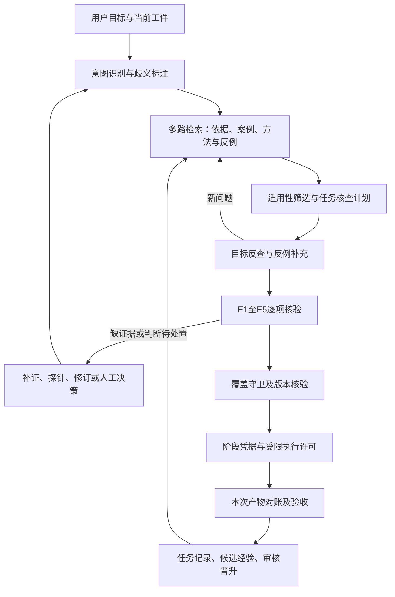

# 证据系统修改方案 v3.0：开放核查、证据与授权分离、统一阶段门

日期：2026-10-29。状态：已获用户确认，工程实施中，未验收。方案任务 T-032；原方案证据 EV-20261029-003；实施 T-034 / D-018 / EV-20261029-005。

## 0. 来源、已确认方向和建议边界

用户本轮要求：指出 E6 与 E1–E5 职责重叠、核查项写死无法覆盖所有情况；允许建立可容纳更多检查项的证据库，但禁止一开始就写死检查内容，要求至少意图识别与检索来处理开放问题；同时修正人工权与事实混淆、代码与 AI 物理判断冲突、前置双门与阶段门脱节，给出完整修改方案。

已确认的是上述目标和改变方向。本稿提出的模块、协议、失效策略、迁移顺序及验收口径为推荐实现，不把用户要求方案解释成允许修改产品代码或已确认全部技术取舍。本轮仅产出方案及治理引用。

现有依据从 docs/README.md 进入：五规则与证据分级 v2.2（含 v2.3 E6）、前置双门定稿 v1.0、2026-10-29 本机审查。前两份继续记录当前/历史实现，本稿批准且实施后才替换其相应段落；不删除历史设计。

本方案沿用单人协作研究工作流定位，不扩大成对抗 agent 安全系统。原转述不核对、直写不设防、注入不筛查三项边界继续披露。凭据是工具协议中的可核验工件，不是签名认证；不承诺抵御有文件直写权限的攻击者。

## 1. 对 E6 的判断与新架构

E6 与 E1–E5 不是逻辑上必然冲突，但现实现存在职责重复和不一致来源：surface.evaluate 再做分级和独立 min_grade 判定，答案/合理性/方法/验收又与 E1–E5交叉；固定30项、按phase全量启用，可能出现无关项强套、未知问题漏查、两处门槛不一致。

修改为三层：

1. **开放核查发现与规划**：识别任务意图、检索知识及反例、判断适用性、生成本任务核查计划，并在新信息下修订。
2. **E1–E5 实质核验**：每条核查义务指定唯一主责规则，其他规则作为输入依赖，不重复裁决同一结论。
3. **流程与覆盖守卫**：检查计划是否完成发现审查、目标是否有映射、本阶段是否仍有必要的未决项、引用是否过期，以及阶段推进/执行许可。它只消费规则结果，不自行判断物理正确或证据等级。

因此取消 E6 作为第六条独立实质规则。对外名称改为“核查规划与覆盖”；旧 E6 拒因与 API 保留迁移映射，不再新建第二套阈值。结构拒因使用 coverage:missing-result/stale-plan 等，不重新编号为一套领域规则。

固定的是通用协议：任务身份、来源、依赖、版本、结果、失败处理。科学问题、检查目录、领域族、参数阈值、问题数量、检查顺序不写死在核心代码。现有30项只能在来源和条件明确后作为候选知识迁入，不能默认强加，也不能默认代表完整范围。

## 2. 开放核查怎样工作

### 2.1 意图识别先于领域检查项选择

输入包括用户原话、研究目标、实验与仿真方案、当前输入、预期结论和已有验收条件。AI 在编排/审阅层生成 TaskIntent：

- 研究问题与交付目标；计划要支持的事实主张和设计选择。
- 对象、方法、条件、约束、阶段、已有工件、预期输出。
- 已知事实、暂定假设、未知项、矛盾信息和需要澄清的歧义。
- 每个提取内容的来源定位；区分用户已给信息与 AI 推断。

先识别本轮是只读咨询、方案探索、验证取证还是生产执行。只读咨询可输出带局限的分析，不为回答问题强迫走完整生产状态机；只有请求对应受控动作时才消费该动作的许可。意图不清时不得擅自把咨询升级成执行。研究任务不要求匹配预设实验族，也不能强行归到“最接近的族”。标签用于检索，可多标签、可新增、可未知。影响安全执行或科学目标的歧义必须处理；不影响当前阶段的未知可以带到后续阶段，但不能伪装成已确认。

确认用户目标与关键推断时展示原话对应关系，不让用户反复填写整套表单。已有内容未改变时复用，不机械重新询问。

### 2.2 检索是实际步骤，不是提示词里一句“参考知识库”

按当前意图生成多组查询，覆盖支持依据、适用条件、失败案例、反例、替代方法和结果解释。检索通道：

- review_experience 中已审核的方法、教训、核查知识与反证。
- atoms、已有案例/场景和其原始证据引用。
- 文献/标准/手册及本地外部语料；材料尚未取得时只登记线索。
- 本任务已有输入、运行、测量和未决问题。

首版复用现有文件型底座与 Python stdlib 关键词检索，补查询改写、多表达召回及相关性解释。现有 memory.find_scenario_semantic(query, top_k=5) 实为关键词重叠，不能冒称向量语义检索。AI 可做查询扩展和候选复核，核心检索器不调用 LLM；不以向量数据库作为本期前提。

每路返回 ok/empty/error/unavailable，保留查询、来源版本、拒绝原因和截断情况。排序分只表示召回相关程度，不是证据强度；Top-K不能决定核查全集。截断、只展示一部分、文献只有摘要等都进入局限说明。检索内容中重复来源去重，复制成多个载体不能当作多份独立证据。

### 2.3 适用性筛选

候选先核验生命周期、来源和条件，再输出 applicable/inapplicable/unknown 及理由。比较任务对象、模型、方法、条件范围、阶段、观测量及结论用途。缺条件不能当匹配；相似案例可提醒问题，但未必可直接支撑决策。

语义适用性由 AI 给出有依据的判断；精确单位换算、范围/版本匹配等可由代码核验。AI 与规则提出不同结果时保留冲突，不能由排序分或多数票定夺。

### 2.4 动态形成核查计划

候选项有三个来源：检索命中的适用知识、目标/验收/假设推导的任务项、独立反例审查新发现的问题。即使库中没有，也允许任务项先存在；不要求先晋升知识才能提问。

每项包含：稳定obligation_id、精确命题、为何需要查、关联目标/选择/主张、适用性与来源、主责E规则、截止阶段、所需材料与核验办法、是否属于可以接受的设计不确定性、当前答案及结果引用。必要性、适用性、N/A、截止阶段和假设可接受性由计划审查及主责规则给出明确结果，coverage只核对这些结果。一个科学问题需要不同核验时拆成关联义务，避免E规则互相覆盖。

删项、延期、降为可选或改变主责都必须保留差异、理由和复审结果；未决finding不因删条目而消失。确实改变目标/范围时可以合法排除旧义务，但要显示结论不再覆盖原目标。不能通过缩减计划清掉BLOCK。

例如“采用某个步长是否足够”：E1负责设计选择依据，E4负责真实脚本是否确实采用该设置，E2负责稳定性试验的数字是否来自本次产物，E3负责这些数据是否足以支持当前物理判断。它们引用共同对象，但不分别维护四个互相竞争的‘通过’值。

计划状态为 drafting → discovery_reviewed → active；后续可 revised/superseded。条目为 proposed/awaiting_evidence/evaluated/accepted_assumption/not_applicable/stale。不能只由调用方提交 status=evidenced 自封通过，最终状态由主责规则及合法处置派生。

### 2.5 补漏与停止条件

初步计划形成后，进行独立的一遍目标反查和失败路径检查：每个目标/验收是否有对应核验；关键假设是否有支持或明确处置；是否存在替代解释；已知失败条件是否处理；新方法是否引入新义务。记录新增项、排除项、剩余未知和本次覆盖边界。

发现不足继续检索与补证。检索轮次/时间/上下文预算可以配置并记录；预算耗尽时保留未决并停止受影响阶段，不把“没搜到更多”解释为全面或通过。满足当前范围、当前阶段的必要义务且成功完成补漏审查后才可发凭据，文案是“本次范围内核验完成，剩余局限为……”，不承诺所有科学风险已被穷尽。

### 2.6 空库、开放领域与故障

| 情况 | 明确行为 |
|---|---|
| 空库或正常无命中 | 继续按任务目标/假设推导核查项，补文献/专家输入/先导试验；不得零项即通过 |
| 新领域、族未知 | 允许规划与检索；不因generic本身一律拒绝。必要判断无法完成时停在对应问题，说明缺什么 |
| 文献通道不可用 | 标明故障；若该材料是当前必要义务则不放行。可选通道只有在义务已由其他合法证据满足时才可降级 |
| 规则包/核验器/必要审阅故障 | 显式设施阻断，恢复后重审；不吞成空库、concern或PASS |
| 冲突或不适用知识 | 保留双方来源和条件；产生冲突问题或排除理由，不能强套最近族 |
| 人工临时新检查 | 可直接加入任务计划，检查适用范围并指定主责规则；不等全局知识审核 |

## 3. 可扩展证据库与知识治理

用户允许扩展证据库。本方案推荐在既有单一知识底座上扩展证据/核查知识类型，提供统一检索入口，不新建相互独立的领域规则正卷。这个选择满足可持续增加检查项，同时保持原知识通道约束。

区分三类内容：

1. **证据材料**：论文片段、实验记录、运行测量、原始引用，说明它支持哪条主张、有哪些局限。
2. **核查知识**：在何种条件下，应提出什么问题、为何、需要什么证据、怎样核验以及已知例外。
3. **决策政策/专家偏好**：允许做什么选择、接受什么风险、适用范围和撤回条件。它不是事实真值。

条目可以携带可扩展标签和条件，不预设固定领域全集。最小字段为 id/version/kind/title/question_or_claim/rationale/conditions/exclusions/source_refs/verification_method/counterexamples/lifecycle/supersedes/owner_rule。verification_method区分确定性、测量、语义审阅，不允许将外来条目作为任意Python或shell代码运行；首版只引用已注册通用检查器或送交AI审阅。

能力不支持与设施故障分开：库外新问题需要尚未注册的checker时返回UNSUPPORTED，允许重新选择有依据的等效测量/检查方法、语义审阅，或将允许的设计未知提交人工接受；不要求必须改代码才能新增核查项。已经承诺、已绑定的检查器缺失/崩溃/结果损坏则是INFRA_ERROR，不能静默换方法掩盖失败。更换方法需修订计划、说明等效性与局限并重审。AI不能替代真实测量编造数值，也不能把没有证明的结论标为确定性已证。

同一知识目录保留已有包级consumer协议，新增类型避免跨消费方误隔离。所有消费者共用加载契约：包身份、版本、来源、审批元数据、允许状态必须明确；缺status不默认active，未知状态拒绝计入，重复ID或覆盖冲突显式报错，坏包隔离同时报告健康状态。被隔离包若是本次必要依赖则阻断，不能仅因‘隔离成功’视为检查成功。运行时与种子条目的覆盖要有显式版本/替代关系，不靠目录优先级悄悄改判据。索引是可删除重建的投影，不持有唯一知识；任务计划、候选发现和审阅快照落tasks，属于工件。

沉淀路径：本任务观察 → record_atom（候选）→ 提案/来源与条件审核 → apply_proposal人工晋升 → review_experience。当前apply_proposal尚缺核查条目专用目标/验证契约，实施必须补上，不能假定已完整接通。AI可自动记录候选，不可自行把新判断变为跨任务active硬规则。canary只提示，active才在范围内消费，revoked/superseded退出有效引用但保留历史。

一次任务的实测转为旧案例或经验后，不再是新任务的本次实测。使用次数、重复提交、同一来源多个投影不能增信。核查项“被采用过”不等于科学上被证明。

本稿不要求独立向量库或第二事实源；若将来更换物理存储，须整体迁移或作为派生索引，不静默引入双写。

## 4. 证据、判断、人工授权三者分离

### 4.1 取消来源的单轴真值排名

A–F保留为来源类别：人工、文献、本次实测、旧案例、经验、估算，兼容旧ref；废除单一RANK/best_grade比较一切的做法。

每条记录分开表达：

- claim_support：材料究竟支持什么主张，原始出处、核验方式、质量局限。
- applicability：适用范围、条件和当前任务匹配结果。
- provenance：任务/运行/输入/产物/主张等绑定和生命周期。
- authority：谁决定允许做什么，授权范围、理由、接受的问题、撤销状态。

“论文引用格式可解析”“材料已取得”“材料内容支持主张”是不同状态；paper:zz不得因字符串格式得到内容已核验。人工事实陈述仍需核对；人工选择则可授权在证据不充分时开展特定探索。

### 4.2 新风险口径

不再用固定来源数量或等级一票判定科学支持充分。每项义务的证据充分性来自目标、风险、适用方法和核验结果，高风险增加核验深度、对局限的披露和明确授权，不简单等于强制论文。

| 事项 | 满足条件 |
|---|---|
| 设计选择 | 适用材料支持，或在允许范围内明确记为待验证假设并获人工知情授权；高风险也可纯人工决定探索 |
| 生产结果的数值/趋势 | 指定本次运行的可重算材料；论文、人工和旧案例不能替代；不可授权伪造数据 |
| 可判定矛盾 | 前提与算法有效时必须修正，或通过纠错证明检查器/前提不适用；单次接受不能消除 |
| 审阅设施故障 | 恢复并成功核验；人工确认不能把没有完成的检查变成完成 |

本次实测也不自动是真理：解析器、单位、窗口或采样可能有错。允许保留原始产物，新增纠正测量并写明supersedes，重新核验下游；禁止以人工想要的值覆盖原结果。

### 4.3 人工覆盖和二次确认

保留高风险允许纯人工设计选择、冲突感知追问、同冲突不机械重复的原则。人工记录精确绑定选择、范围、问题指纹和所接受的后果，不能通过接受顶层段而授权全部未来问题。

两次确认必须是同一内容与范围的两个可识别事件，重复提交不算。晋升后成为高权限专家决策政策或有来源的专家意见；跨任务仍须检查条件、撤销、当前冲突及执行范围。它可以减少同一已知选择的重复追问，不能自动成为其他任务的生产许可，也不能免除必要结果核验。

## 5. 代码与AI的职责、分歧处置

### 5.1 分工

代码负责身份、状态、版本、依赖哈希、引用解析、测量计算、可判定的一致性谓词、权限和流程纪律。AI负责意图、开放问题发现、检索策略、语义适用性、物理/方法推理与证据解释。stage_state/stage_gate等核心模块不执行模拟；实际启动与回执由md_mcp既有执行桥适配层负责，统一任务服务提供锁内核验和许可消费契约，不把求解器调用塞入证据判定。

确定性核心继续纯stdlib、零LLM；AI调用位于既有编排/design_review适配层。门禁只消费成功形成且契约合法的审阅工件，不能在异常时临时调用LLM或放宽条件。

现有assessment/deep_review重构为事实与信号生产器：经验区间越界、异常趋势、适用维度缺失进入审阅，不能因为JSON里有一个阈值就成为物理真理。config_check只对已明确解析语义、作用域和前提的关系作确定性结论；正则命中与跨文件拼接不构成完整语义证明。无法解析的动态语义显式为unknown/unsupported，需要补充处理。

### 5.2 问题类型与处置

严重程度和可否接受分开，不再由AI的hard或critical标签决定永久阻断性质。

| 类型 | 默认处置 | 人工可做什么 |
|---|---|---|
| 确定性矛盾 | 阻断；附谓词、输入、单位、前提和可重算结果 | 纠正输入，或质疑检查器并取得有效纠错；不能直接接受为真 |
| 基础设施错误 | 阻断受影响阶段 | 修复/恢复，不能用人工确认替代失败检查 |
| 必要证据缺失 | 保持未决 | 补证；允许的设计局限可转为带授权假设，结果实测等不可豁免 |
| 判断性反对 | 暂停推进，给理由和反证入口 | 补证、复核、专家裁定或接受风险 |
| 已接受不确定性 | 按范围推进，保留限制 | 撤回、缩小或变更范围；改变后重评 |
| 一般建议 | 展示和留痕 | 选择采用与否，必要时形成设计选择 |

AI声称“数学上矛盾”时，必须能提交可核验前提和谓词给检查器，否则仍是判断性反对。即使字段引用真实，AI推理也可能错。

争议路径：针对finding提交理由/反证 → 判断争议在事实、前提还是解释 → 增加度量或成功复审 → 专家裁定不适用/错误/接受假设 → 形成明确替代关系。原AI不必最终同意才可继续，但原意见和裁定永久可见。仍成立的确定性矛盾和设施错误不可被这个入口抹掉。

## 6. E1–E5在新方案中的职责

| 规则 | 唯一主责 | 不再承担的内容 |
|---|---|---|
| E1设计有据 | 设计选择与支持材料或合法假设授权之间的关系；条件、冲突及范围 | 不把人工权限当事实真值，不重复评估输入/数值 |
| E2计算有据 | 精确运行链；每条数值/趋势主张绑定本次材料和重算记录 | 不因tool成功判结果正确，不用时间戳代替来源 |
| E3物理合理 | 消费成功的物理/方法审阅、当前问题和合法处置 | 不把经验阈值或AI标签当不可质疑真理 |
| E4方法学合规 | 核验实际输入、方案与方法约束的一致性，区分可判定与待解释 | 不以字符串匹配冒充所有引擎语义 |
| E5结论完整 | 逐项回应验收目标、限制、失败与回退/降级 | 不允许只填rollback_target就成功验收 |

coverage守卫不调用分级器，不设领域阈值，只核对目标→核查项→当前E规则结果的完整映射以及必要处置。N/A必须有适用性判断及依据；accepted_assumption不冒称evidenced。计划本身要完成发现/反例审查，不能仅靠空数组满足‘所有项通过’。

旧design_review的completeness、anchors和methodology-dimension等领域入口统一改为候选召回/计划指定核验，不能在旁边继续运行一套隐含必查目录。只有通用协议与格式守卫可直接执行。Top24/Top-K只是单批上下文预算，计划必要项须分批审查或保持未完成，第25条不能自动丢失；不适用的旧必填项不得另行硬拦。

如果两个规则结果互相矛盾，状态为CONFLICT，不靠最后写入或多数票覆盖，形成问题进行复核。

## 7. 双门、状态机与执行的统一

### 7.1 一个任务，两种正交状态

沿用既有tasks作为权威目录，由stage_state成为唯一状态写入器。稳定task_id只创建一次；project/case是别名；冲突不能选最新目录猜测。

一个任务聚合内保留：

- current_stage：PLAN/BUILD/CONFIG/EXEC/ANALYZE。
- plan_status：DRAFT/CLARIFIED/DESIGNED/CONFIRMED/REVIEWED/NEEDS_REVISION。
- revision：受审内容版本；state_seq：每次状态提交的并发序号。
- active_receipts、runs、current_findings、resolution_refs。

intent.json改为不可变内容快照/兼容视图，不独立维护另一份权威状态。MDPROJ_ROOT与MDSIM_DATA_ROOT需显式映射到同一task_id，不能各自决定能否执行。

目标、方案、输入、核查计划、用于判定的证据或知识快照改变时，生成新revision并使受影响的下游凭据stale。日志/状态事件用state_seq，不因为写日志就改变方案版本。运行产物属于run；将新产物作为证据时生成相应评估版本。独立无关变化可在依赖证明下复用旧核验，但必须在当前凭据中引用，不能静默沿用旧GO。

审阅锁外执行、返回锁内CAS：若评审期间内容改变，旧结果只归档为stale，不覆盖现状态。minor_revision也不能免除实质内容版本更新。

避免版本自循环：subject_manifest只包含被审内容及该结论实际依赖的材料，不包含这次新生成的审阅凭据自身、日志或状态序号。写入成功审阅、确认事件或许可只更新state_seq，不反过来改变被审内容哈希。新增支持材料/处置若改变主张或结论，生成新revision并重评受影响结论；签发当前凭据本身不触发下一次revision。新run结果可以在同一执行revision下记录，后续结果审阅以独立run/claim依赖集定位，不因为产物写入就让原运行身份失效。

### 7.2 凭据依赖链

凭据是带完整依赖的核验结果，不是passed布尔值。共同字段：task_id、revision、kind、scope、目标/验收/方案/决策/输入/核查计划/相关知识的哈希、上游凭据、核验器版本、问题处置与授权引用、设施健康状态、时间和替代关系。规范化序列化和完整内容哈希需版本化，不依赖mtime。

| 凭据 | 用途 |
|---|---|
| PLAN_REVIEW | 双门对方案内容、动态计划及依据出审阅结果；尚无输入时明确inputs_unbound，不能直接执行 |
| BUILD_CHECK/INPUT_REVIEW | 对构建与最终执行输入及其依赖闭包核验 |
| PRODUCTION_PERMIT | 绑定run_id、精确命令/参数/cwd/允许环境/输入快照的单次生产许可 |
| VALIDATION_PERMIT | 针对某问题、受限规模/资源/停止条件的单次探针许可 |
| RUN_RECEIPT | 实际启动身份、运行类型、输入和结束结果 |
| FACTCHECK/RESULT_REVIEW | 指定运行与产物上的主张重算、物理判断和验收结果 |

双门是审阅生产者，阶段门是其结果的强制消费者；同一个有效审阅可同时满足E1/E3需要，不为满足两个标签重复调用模型。flow-gate提示仍辅助引导，不是执行授权来源。

### 7.3 阶段与守卫

| 动作 | 必须满足 |
|---|---|
| PLAN→BUILD | 目标与方案已确认；有效PLAN_REVIEW；E1/E3及design覆盖完成 |
| BUILD→CONFIG | 本次构建产物；E4及build覆盖完成 |
| CONFIG→EXEC | 最终输入依赖清单；有效INPUT_REVIEW和E4；方案一致性与当前覆盖完成 |
| EXEC内生产受理 | 上游凭据有效；E2运行链与exec覆盖；适用执行策略；单次许可原子消费 |
| EXEC→ANALYZE | 选定运行结束且有RUN_RECEIPT及产物，不能只拿生产许可推进 |
| ANALYZE→完成 | E2/E3/E5与analyze覆盖；当前问题合法处置，结论与目标一致 |

G-EXEC拆开表达“允许生产受理”和“运行已结束”，防止开跑许可被当作完成证据。缺状态包、缺许可、未知run_kind、未知阶段/规则绑定一律拒绝受控执行，不再选择性启用。

验收失败进入回退/失败归档；降低目标形成新revision并获批准后重验，不悄悄把失败改成功。

### 7.4 validation独立，不洗掉production阻断

探针可以在PLAN、BUILD、CONFIG、EXEC等阶段作为父任务下独立受限run申请，不推进父任务的生产阶段，也不要求先进入EXEC。它只依赖探针自身必需的验证问题、输入审阅、资源/规模限制、观测量、停止条件与授权，不得依赖它将产生的结果，也不得要求父任务先解决这个待验证问题。若父问题是‘是否稳定’，可授权有限稳定性探针；若探针自身存在尚未修正的确定性矛盾或必要审阅设施故障，仍拒绝。

只豁免明确不属于该探针的生产义务，不豁免探针自身的可执行性和受限条件。现有validation必须处在EXEC的守卫需一起修改，否则开放取证仍有循环死锁。

探针结束只产生验证运行与测量；不向G-EXEC写通用ACCEPT。只有测量有效解决原问题并重新签发生产许可后才能继续生产。任意旧success、其他任务结果或同任务无关探针不能满足先行验证。

#### 动作级授权与限制落点

sim_exec现有职责还包含构建、文件操作和分析，不能给所有调用套生产许可而堵死输入生成。适配层按明确动作契约授权：只读查询限只读资源；BUILD写入只允许待审工作区和构建操作；ANALYZE只读指定运行产物并写分析工件；VALIDATION/PRODUCTION各消费对应运行许可；维护操作在研究状态机外单独授权并审计。命令、路径和副作用由服务端核对，客户端run_kind只是请求，不足以改变权限。

探针规模通过冻结输入/协议核验，允许命令/路径通过现有桥白名单及适配层检查，超时与终止使用已支持的执行控制，产物与次数限制由run记录核对。首版仅支持能落实这些限制的动作适配器；不能落实时返回UNSUPPORTED并选择替代方法，不声称一个标签就形成沙箱，也不为此修改kit或dsh。

### 7.5 核验与启动之间不能换输入

冻结完整输入依赖：入口、include、材料参数、数据文件、restart、变量和影响执行的环境。动态依赖无法解析则不能声明完整绑定，可先限域或补解析能力。

在任务锁内重读状态、核验revision/依赖/授权、消费单次许可并登记STARTING；桥实际执行受控冻结快照，取得启动回执再释放锁，等待计算在锁外。快照与输出分离，受控工具不得改冻结输入。仅锁状态、随后去可变工作目录跑，仍有检查后输入被替换的问题。

request_id幂等：重试返回原run；不产生第二次启动。桥与文件系统不是同一个事务，不能承诺绝对exactly-once。回执丢失或启动超时进入START_UNKNOWN，先对账，禁止自动重跑。确定未启动才可登记失败并申请新许可；已启动则补同一次run身份。

跨任务知识发布/撤销与授权撤回需要共同同步点，任务锁本身不足。推荐受控发布通道维护知识代次及授权撤回代次，统一锁顺序为‘知识/授权短事务锁→任务锁’；最终受理重核代次并提交STARTING为线性化点，启动交接短暂保持相关锁，长计算释放。此前提交的相关撤销/新增适用义务必须重评；此后提交的变更按已运行待复核处理。新知识先复核适用性，不因发布而全局变硬义务；无关代次变化只需证明依赖不变。索引和快照仍是派生工件，不新增知识正卷。所有受控晋升/撤回入口遵守此协议；直接改文件仍属原信任边界外，不能宣称已消除这种竞态。

本方案不自动新增杀进程权限；运行中发生知识撤销或新矛盾，保留运行事实，后续分析/交付置待复核。

## 8. 数据对象与接口契约

任务工件最小对象：

| 对象 | 关键内容 | 生产者/消费者 |
|---|---|---|
| TaskIntent | 目标、主张、条件、来源、未知与推断 | 编排AI生成，用户/审阅复核 |
| RetrievalBundle | 查询、通道健康、来源清单、候选及排除、截断 | 通用检索器→规划AI |
| CheckPlan | revision、意图哈希、目标映射、动态项、发现审查、剩余未知 | 规划AI提议，任务服务提交 |
| EvidenceRecord | 原始来源、支持主张、核验状态、条件、run/产物绑定、生命周期 | 工具与审核通道→E1/E2 |
| Finding/Resolution | 类别、严重性、依赖、反证、处置和授权 | 检查器/AI/人工→E3/E4与守卫 |
| RuleResult/Receipt | 精确对象、版本、输入、证据、判定、局限和依赖 | 核验服务→阶段服务 |
| RunRecord | 许可、输入快照、启动身份、状态、产物 | 执行入口→分析/对账 |

建议接口：recognize_intent；retrieve_evidence；propose/revise_check_plan；record_evidence；evaluate_rule；resolve_finding；review_plan/input；evaluate_gate；advance_task；authorize_and_start；record_run_result；complete_task。API命名实施时可沿用MCP现有名称，行为契约固定。

所有变更带expected_revision/state_seq与request_id；服务端计算状态，客户端传PASS、evidenced、manual_gate仅视为申请/说明。工具无权限时不写；空数据、错误、未决、过期和成功分别反馈。

状态唯一写入器在任务锁内重读—校验—改写；不可变工件先写完，最后原子更新权威state指针。整写tmp+os.replace，必要flush/fsync，备份O_EXCL；断电孤立工件不能授权。JSONL为审计投影，不靠多文件同时写成功的假设维持状态。

失败恢复：保留输入与失败工件，修复后只重做失效项；依赖无法证明未变则重审相关闸。沉淀失败登记pending并重试，不伪造成功ID；是否影响阶段只取决于沉淀是否属于该阶段明确义务。

## 9. 用户可见行为

沿用对话与现有审阅视图，核心修改不以新前端大改为前提。每个阶段展示：

- 我理解的目标、关键推断与当前范围。
- 本次实际搜了哪些来源、哪些不可用、哪些没有命中。
- 为什么需要这批核查项，哪些是任务新发现，哪些候选被排除。
- 每项答案、支持材料、适用性、负责规则、结论及当前状态。
- 哪些问题阻止下一步；哪些可补证；哪些允许知情接受；接受后结论有什么限制。
- 当前方案/输入版本、审阅是否过期、允许的是探针还是生产、结果属于哪次运行。

允许用户补充核查项、质疑AI问题、修改目标、提供证据、接受允许的假设、撤回授权。取消保留已提交任务状态；重复提交幂等；并发冲突提示刷新并合并变更而非覆盖。

事实、判断和决定分栏显示，不用单个绿色总分隐藏局限；“当前核验项已处理”不叫“科学上完全正确”。

## 10. 实际代码改动映射

路径相对MDagent-src。新模块名称为建议，不是本轮已创建的产品文件。

| 工作包 | 实现面及现有依据 | 要做的具体改动 | 验收锚点 |
|---|---|---|---|
| WP-OPEN-1 | evidence_grade.py:20/64/218；content_check.py:115 | 拆来源/支持/适用性/授权；数值绑定claim/run/metric/unit/window/tolerance与源哈希；缺源或解析失败拒绝 | VT-06/07/09 |
| WP-OPEN-2 | memory.py:83/140/177；design_review.py:94/173；corpus_lookup.py:23 | 新evidence_retrieval统一现有召回通道；健康状态、来源去重、适用性；编排AI意图和查询扩展 | VT-01/02/03 |
| WP-OPEN-3 | surface.py:54/127/181；stage_gate.py:565 | 新check_plan处理动态计划与依赖；移除固定清单强制与E6分级；coverage仅消费E1–E5结果 | VT-01/04/05 |
| WP-OPEN-4 | assessment.py:105/221；deep_review.py:175；config_check.py:24；physics_gate.py:305；design_review.py:310 | 事实/经验信号/证明与AI判断分类；故障显式；finding争议、纠错、假设接受与替代关系 | VT-08/10/11 |
| WP-OPEN-5 | stage_state.py:176/230/365；md_proj_mcp.py:135/421/530/683/733 | 唯一task/revision/state_seq；双门适配；完整输入审阅；凭据消费与统一写入器 | VT-12/13/14 |
| WP-OPEN-6 | md_mcp.py:242/708/855 | 缺身份拒绝；许可与冻结执行；生产/验证隔离、幂等、START_UNKNOWN与恢复 | VT-15/16/17 |
| WP-OPEN-7 | apply_proposal.py:168；POLICY.json；review_experience数据 | 核查知识晋升契约、canary/active/revoked、重复来源/确认去重及依赖失效 | VT-18/19 |
| WP-OPEN-8 | webui/server.py；static/app.js；现有tests与功能矩阵 | 展示范围/证据/判断/授权/过期状态；并发版本；修订文档和测试工装 | VT-20/21/22 |

不恢复project_checks.py；kit/dsh/third_party零改动；领域规则只在数据中，核心代码/注释/测试不写具体域规则字面量。通用测试用匿名对象与临时知识数据，真实域例保留在数据夹具/实弹工件。

认知与检索先接现有AI层和存储；本期不新增向量服务、独立知识正卷、ACL/签名认证或对抗注入工程。后者是原边界外事项，不混入本轮成本。

## 11. 迁移与实施顺序

### 11.1 代码基线

已知缓存main含证据核心，不含完整双门；当前交接分支dirty。实施前保存HEAD/index/未提交修改及未跟踪源码和必要数据的可恢复快照；在隔离工作树从缓存main起步，联网恢复后核对真实远端。原目录不reset/clean/stash-pop或直接整笔合并。

按实际差异提取双门专有实现及必要修复，不能整笔重放旧证据核心。当前main已有内容以内容比对确认，未跟踪不能直接当作新开发成果。提交/PR/推送仍需后续实施授权。

### 11.2 数据迁移

只读建立旧intent/state/case目录映射清单；同名/多候选显式待处理，不选最新。备份、版本化、幂等迁移。旧GATED_PASS/GO/ACCEPT保留为历史材料，不自动变新许可。缺当前证明回最早缺口阶段。旧已完成任务保持旧标准历史，新增运行/交付需新核验。旧运行保留LEGACY_RUNNING并对账，不补造过去授权或自动重启。

原30项：逐项补来源/条件/适用范围/核验方式，转候选知识；无来源、无条件的先canary或候选，不默认active。旧surface答案保留，需重新映射到动态计划及当前规则结果；没有证据不补造。

### 11.3 交付切片

1. 先完成来源/授权/finding/凭据契约与已知fail-open回归，阻止旧日志/缺包授权。
2. 接通意图识别、多路检索、动态计划、补漏与E1–E5；新方案端到端成立后切掉E6重复逻辑，避免出现核查空窗。
3. 整合双门、状态写入和完整输入审阅；生产/验证许可及运行对账。
4. 补知识晋升、撤销失效、迁移与用户可见状态；用新领域留出案例和真实运行证明。

切片可分别测试，但不把‘仅删E6’或‘仅加检索工具’称开放核查完成。新任务强制新契约；旧历史只读，不用兼容开关让生产继续走无证据路径。回滚软件不能恢复失效旧许可；保留新工件，受影响生产停止至兼容版本可重验。

工作量只给相对顺序：动态发现与语义审阅、统一身份/执行原子性是主要成本；没有完成隔离基线和首个纵向样例前不承诺人日或DDL。本轮未建立ready_for_build包、未初始化新的PM台账。

## 12. 可判定的验收矩阵

所有测试必须同时有正向控制，避免‘全部拦住’冒充正确。执行测试观察桥调用次数、确切输入哈希、许可消费和状态；除最终实弹外先用替身验证。

| ID | Given / When | Then / 证据 |
|---|---|---|
| VT-01 | 知识库之外的新任务，完成意图与检索 | 能生成不在原30项内的任务项，有目标与来源/推导依据；不要求已有族；保存检索与计划工件 |
| VT-02 | 同一任务改为相似措辞，或存在多义目标 | 召回语义相关项并说明；关键歧义保持unknown/澄清，不硬归族；人工标注检索集复核 |
| VT-03 | 冷启动、正常empty、检索error分别输入 | 三种结果可区分；空库可继续规划但不零项通过；必要故障阻断；无证据不伪造支持 |
| VT-04 | 两个任务输入同一批候选知识，其中部分不适用 | 生成不同适用计划和排除理由，旧30项不全量出现；核查项数不是成功指标 |
| VT-05 | AI初稿遗漏与目标相关的风险，进行反例审查 | 增补计划或显式保留未知；预算耗尽不自动通过；coverage不能接受空计划的vacuuous pass |
| VT-06 | 高风险设计只有可核验人工选择且接受局限 | 可获限定设计授权，状态为accepted_assumption；不强制论文，也不显示为事实已验证 |
| VT-07 | 人工指定结果值或paper:占位字符串 | 不能替代本次测量或材料内容核验；分别保留授权与事实缺口 |
| VT-08 | 经验阈值越界，但条件不匹配或存在反证 | 产生可争议判断及适用性记录，不能直接升确定性矛盾；纠错后可继续 |
| VT-09 | 验收99999引用其他字段1的PASS、跨run/单位/窗口或缺源 | E2拒绝，指出精确绑定差异；修正合法主张后通过 |
| VT-10 | AI判错，专家反证成功；或真实可重算矛盾仍存在 | 前者有保留原意见的纠错通路；后者不能靠accepted消除 |
| VT-11 | 模型断网/JSON坏损/已绑定checker故障/必要包缺失；另测新问题方法不支持 | 故障设施阻断；UNSUPPORTED可经计划复审选等效核验，不用AI编造测量或证明 |
| VT-12 | PLAN审阅通过后改目标/输入/计划/相关知识 | 凭据失效；重新核验有效依赖后才签新凭据；无关改动可有依据复用 |
| VT-13 | 两任务同别名、审阅中修订、并发写入 | 拒绝歧义；旧结果stale；CAS避免丢更新并可重试 |
| VT-14 | BLOCKED工件、错误阶段凭据或非末段complete | 状态不推进；正确有效凭据可推进并留审计 |
| VT-15 | 无任务/无许可/旧ACCEPT或许可重放调用生产 | 拒绝且桥零次；同request_id最多一次受理；不得用日志尾20条决定 |
| VT-16 | production被BLOCK后运行合法validation | 可受限验证，但生产仍BLOCK；针对性证据解决问题并签新许可后才可生产 |
| VT-17 | 检查后改工作区输入、或启动回执丢失 | 实际执行仍为已核验快照；不明状态不重复启动，先对账 |
| VT-18 | 同一来源沉淀多个atom、重复确认或跨任务引用实测 | 不当独立证据、不自动晋升；旧C不能保留为新C；两次合法确认可晋升限定政策 |
| VT-19 | active条目被撤回或新增适用必需规则 | 相应依赖失效并重评；canary不变硬义务；未引用且无适用变化不全局乱失效 |
| VT-20 | 答案有数字但不支持问题、写N/A模板、只挂引用 | 不视为完成；由主责规则核验语义/材料，coverage只消费有效结果 |
| VT-21 | 结果未达验收，只填rollback_target | 进入回退/失败；缩小目标须新revision和批准，不伪造成功 |
| VT-22 | 迁移旧PASS任务、旧完成任务和运行中任务 | 历史可追溯，不自动授权/重启；新执行须新许可；失败可恢复且不丢原工件 |
| VT-23 | PLAN缺少先导实测，申请受限探针；另测探针自身矛盾 | 合法探针可取证且父阶段不跳转；无需先有其输出或生产许可；自身矛盾仍阻断 |
| VT-24 | 第25条必要核查项、旧固定清单不适用项；删去失败项 | 必要项分批覆盖；无关固定项不拦；删失败项不消BLOCK，合法改范围有依据 |
| VT-25 | BUILD生成输入、ANALYZE读取产物；生产冒用构建标签 | 合法阶段动作可做；越范围拒绝；探针资源限制实际可落实，否则UNSUPPORTED |
| VT-26 | 撤回/发布和启动并发、无关知识更新 | 按共同同步点顺序处理；先撤回后受理须重评，已受理后保留事实待复核；无关更新不全局失效 |

开放能力验收使用开发未见任务与人工标注目标/应发现问题；测试集与知识库构建集分开。报告召回、遗漏、误套、反例发现、证据支持、可接受假设及剩余未知的具体案例，不靠固定条目计数/综合分证明‘应对所有情况’。模型调用与上下文成本、检索轮次、失败恢复需实测记录；本轮仅定义验收，不伪造通过率。

## 13. 方案审查记录与状态

已完成设计草案的五个视角：

1. 产品：核查目标从固定清单过闸改为任务开放发现；E6职责拆除；支持新问题与人工补项。
2. 体验：展示检索过程、适用理由、未决与接受假设；缺证据、空库、错误、争议、撤回、并发及取消可区别。
3. 技术：复用stdlib存储和现有AI适配；数据/状态/依赖契约，检索空与故障区分；不新增独立正卷。
4. 实现：以实际surface/evidence_grade/状态/MCP/知识晋升接口映射八个工作包；不把只有工装补链称生产接通。
5. 验收：26组具体正反例，另含开放任务留出集；不以静态30项或单测全绿取代行为证据。

两遍反向检查分别覆盖现有职责/接口和反例/恢复/跨模块变化。主要修订为：证据支持与人工权分离；AI hard不等于确定性证明；计划发现审查防空计划放行；双门凭据接阶段；生产许可与运行完成分离；validation不洗白；输入冻结与START_UNKNOWN；晋升保持来源去重和适用性。

独立只读反向复核又提出六项契约补全，已纳入：PLAN/BUILD探针独立可达；UNSUPPORTED与设施故障分开；旧completeness/Top-K服从动态计划；删项不能消除未决finding；构建/分析与运行的动作级授权；知识/授权变更与受理的共同同步点。新增VT-23至26，修订VT-11。上述补全经文档逻辑走查，尚未通过实现或运行测试证明。

这些是方案审查完成面，不是用户已逐项批准或五轮功能定档已锁定。用户本轮已确认改变方向；本稿详细契约待审阅，开发门禁未开启。旧实现的fail-open仍待修，不因本稿生成而消失。独立复核结论若有新增缺口，在本文件继续修订，不另建冲突设计。
