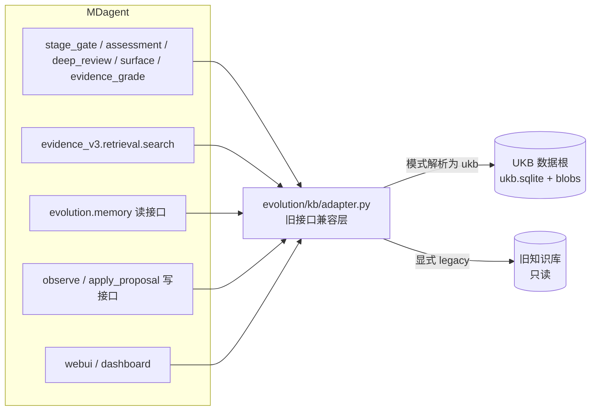

# UKB 嵌入 MDagent 替换知识库方案 v1.0

| 项 | 值 |
|---|---|
| 日期 | 2026-11-01（2026-11-02 更新） |
| 状态 | **v1.4（2026-11-02）**：本机完整替换已执行，启动器固定 UKB；所有者授权测试库跳过人工审核，99 条候选已批量处理（80 approve / 17 trial / 2 reject），审核队列为 0、门禁读取恢复；内容问题未修，结果仅用于功能校验；服务器 atoms 未迁移（B-002），见 §12.6 |
| 治理 | D-035、D-036、D-038、D-039 / T-064、T-065、T-068、T-070 / EV-20261101-002、EV-20261101-003、EV-20261102-001、EV-20261102-002、EV-20261102-004 |
| 冻结产物 | `ukb/RELEASE.json`（version 1.0.0，79 个文件逐文件 sha256，schema_version 2）；`python tools/freeze.py --check` 可复验 |
| 目标库 | **已确认 `MDagent-evidence-v3`**（本机在研副本，VERSION 1.6.8+20260921，含 webui/mcp/evidence_v3）；本任务不修改其他源码库 |
| 替换范围 | 本机、临时替换"旧知识库设计"：atoms / scenarios / SOP / knowledge_cards / review_experience 多 schema / evidence_v3 知识检索 |

## 1. 目标与边界

**目标**：让 MDagent 的知识读取只有一个来源（UKB），写入只有一个入口（UKB 收件箱 + AI 预审 + 管理员批准）；旧知识库的代码与数据保留不动，可随时回切。

**边界**：

- 替换知识后端并接入证据投递、知识快照、任务失效与启动/完成同步；E1–E5 职责保持，UKB 变更保守要求任务重验。
- 旧知识文件保留作只读导入源与回切对照，不删除或回写；`memory/tasks/` 仍由 TaskStore 写状态与不可变工件，UKB 使用独立数据根。
- 旧代码（`evolution/memory.py`、`knowledge_cards.py`、`evidence_v3/retrieval.py` 等）保留，由开关切换，不做删除式重构。
- 不改 `agent_deploy_kit*`、dsh 底座、前端页面结构。

## 2. 替换前接入面（历史调查，现行 UKB 契约见 §12.5）

| 位置 | 读写的知识对象 | 数据位置 | 谁在调用 |
|---|---|---|---|
| `evolution/memory.py:83 load_atoms` / `:177 record_atom` / `:91 retract_atom` / `:99 supersede_atom` / `:132 current_value` / `:140 find_scenario_semantic` / `:164 find_scenario_weighted` / `:235 rebuild` / `:287 find_scenario` | atoms、scenarios、SOP | `<data_root>/memory/atoms.jsonl`、`scenarios.json`、`SOP.md` | 进化层、observe、apply_proposal、dashboard、cloud |
| `evolution/knowledge_cards.py:212/292/371 build/review/_load_atoms` | 卡片投影 + 人工核卡 | `memory/knowledge_cards.jsonl`、`knowledge_reviews.json` | `cloud/evo_graph.py:196`、`dashboard/web_monitor.py:1896/2175/3228`、webui |
| `evolution/stage_gate.py:130 exp_status_index`、`:171 load_methodology_entries`、`:124 _load_atoms`、`_e4` | review_experience 条目状态、methodology 约束、atoms | `mcp/review_experience/*.json`、`$REVIEW_EXPERIENCE_DIR`、`memory/review_experience/` | 证据门 E4、阶段门 |
| `evolution/assessment.py:35 load_anchors` | physics-anchor 条目 | 同上三个根 | 物理合理性评估 |
| `evolution/deep_review.py:31 load_dimensions` | methodology-dimension（family→条目） | 同上 | 深度审阅 |
| `evolution/surface.py:54 load_items` | confirmation_surface 条目 | 同上（`confirmation_surface.json`） | 核查面 |
| `evolution/evidence_grade.py resolve` | 经验条目证据等级 | 同上 | 证据分级 |
| `evolution/evidence_v3/retrieval.py:63 load_knowledge`、`:251 search` | review_experience 包校验、召回（atoms / scenarios / local_corpus） | 上述根 + `external_corpus/` | `mcp/evidence_api.py:62`、`mcp/evidence_discovery.py` |
| `evolution/evidence_v3/knowledge.py publish/prepare_publication/snapshot` | evidence-v3 知识包发布（经 apply_proposal 受控写入） | `memory/review_experience/evidence_v3.json` | `evidence_api.py:148-158`、`apply_proposal.py:221` |
| 种子数据 `mcp/review_experience/*.json` | 13 个包：physics-anchor 6、methodology 2、methodology-dimension 10、confirmation_surface 30，另有 boundary/lesson/convention/capability/completeness 约 49 条 | 随代码分发 | 以上全部消费者 |

要点：

- review_experience 目录实际承载 5 种 schema、5 套消费者，同一 id 在不同消费者里语义不同（见设计 v0.3 §2.8 的历史审查结论）。这正是 UKB 要收敛的部分。
- evidence_v3 召回把 atoms/scenarios 当作 `candidate_only` 记录，旧包一律标 `legacy-package`/`approval-not-recorded`；UKB 有真实审批链，可给出更强的可信标记。

## 3. 替换架构



**核心：一个适配层、一个开关、一个数据根。**

| 决策 | 内容 |
|---|---|
| 代码落位 | `MDagent-evidence-v3/ukb/`（UKB 源码内置一份，随仓库走）+ `MDagent-evidence-v3/evolution/kb/adapter.py`（兼容层） |
| 数据根 | `MDAGENT_UKB_ROOT` 优先；未设置 `MDSIM_DATA_ROOT` 且未传其他数据根时采用仓库配置 `data/ukb`，否则 `<data_root>/ukb`。库缺失 fail-closed，须显式 bootstrap，不自动建库 |
| 开关 | 非空 `MDAGENT_KB` → `<data_root>/kb_mode.json` → 仓库 `mcp/kb_config.json`（仅未设置 `MDSIM_DATA_ROOT` 时）→ legacy；仓库当前配置 `mode=ukb, ukb_root=data/ukb`。未知模式/坏配置 fail-closed，不因异常回退 legacy |
| 旧库角色 | 只读。UKB 不回写 `memory/`，`mcp/review_experience/` 保持原样 |
| 单一来源 | 启用后所有知识读取只查 UKB；旧文件仍在磁盘上，仅作回切与对照 |

## 4. 接口映射（初始设计；当前实现以 §12.1、§12.5 与工程包 INTERFACES 为准）

适配层逐个实现旧函数签名，内部查 UKB，返回旧形状的 dict/list。这样 5 个消费者与 evidence_v3 召回都不必改代码，只改 import 目标。

| 旧接口 | UKB 实现 | 返回形状 |
|---|---|---|
| `exp_status_index()` | 取 active/trial/deprecated/revoked 条目，按 `origin.ref=legacy:<pack>/<id>` 或条件 `legacy_id` 建索引 | `{id: {status, kind, severity, pack, entry}}`；`entry` 由 `read` 渲染后还原为旧字段名 |
| `load_methodology_entries()` | 类型 `rule`/`procedure` 且条件 `legacy_kind=methodology` 的 active 条目，`constraints` 放在 payload 的 `check` 字段 | `[旧 entry + _status]` |
| `load_anchors()` | 类型 `parameter` 且条件 `legacy_kind=physics-anchor` | `{id: entry}`，quantity/value/unit/range 还原为旧键 |
| `load_dimensions()` | 类型 `checklist`/`procedure` 且 `legacy_kind=methodology-dimension`，`family` 用条件键 | `{family: [entries]}` |
| `load_items()` | 类型 `checklist` 且 `legacy_kind=confirmation_surface` | `{id: entry}`，phase/question/min_grade/na_allowed 还原 |
| `evidence_grade.resolve()` | 读取条目来源等级（`source.grade`）与状态 | 原返回结构 |
| `load_atoms()` | 类型 `observation` 的 active/trial/candidate 条目，`fact`=正文，`refs`=来源 locator，`axes` 由标签还原 | 旧 atom dict 列表 |
| `find_scenario_semantic(query, top_k)` | `ukb.api.catalog` + `read`（内部接口，逐级暴露限制只对 MCP 生效）；返回旧 atom 形状并保留打分次序 | 旧结果列表 |
| `rebuild()` | 空操作并返回 `{"ok": True, "note": "ukb-managed"}`；scenarios/SOP 不再生成 | — |
| `knowledge_cards.build()` | 返回 UKB 派生的浏览视图（可选，见 §7 决策 4）；不写 legacy 文件 | 旧卡片形状 |
| `evidence_v3.retrieval.search(intent, data_root)` | UKB 条目 + 健康清单；`channel` 用 `ukb`，保留 `id/source_locator/source_refs/conditions/lifecycle/approval/candidate_only/content/record` 字段 | 原返回结构（entries/manifest/health/generation） |
| `evidence_v3.retrieval.load_knowledge(dirs)` | 忽略 `dirs`（启用 UKB 时），返回 UKB 全量可见条目；`legacy-package` 不再出现 | 原返回结构 |
| `record_atom(kind, fact, refs)` | `propose(type=observation, tags=[topic/<kind 映射>], sources=refs, origin={kind:"run", ref:"legacy:atom"})`，写收件箱 | `atom_id` |
| `retract_atom / supersede_atom` | `propose_status(revoked/superseded)` | 旧返回 |
| `apply_proposal` 知识发布 | `propose` + 预审（同一套）+ 管理员批准；不再直写 `evidence_v3.json` | 旧返回（含 intake_id） |

**ID 兼容**：UKB 的 entry_id 与旧 id 不同。适配层维护双向映射：

- 写入时把旧 id 存进条目条件 `legacy_id`（注册一个新的条件键，属于数据，不是代码）；
- 读取时按 `legacy_id` 反查，消费者继续用旧 id 作 key，外部引用（`atom:<id>`、`exp:<id>`）解析不变；
- 迁移脚本输出映射表 `data/ukb/legacy_id_map.json` 供审计。

## 5. 数据映射（原生类型目标；当前兼容导入见下文）

| 旧对象 | UKB 类型 | 标签 | 条件 | 状态映射 |
|---|---|---|---|---|
| atom（observation） | `observation` | `topic/<kind>` 或映射表 | `legacy_id`、必要时 `legacy_kind` | 无 status→candidate；`retracted`→revoked；`superseded_by`→superseded |
| scenario / SOP | 不迁移（派生视图） | — | — | — |
| knowledge card | 不迁移（投影） | — | — | — |
| physics-anchor | `parameter` | 按 quantity 归类 + `property/*` | `legacy_id`、`legacy_kind=physics-anchor`、range/conditions 逐项转条件 | active/canary/revoked 原样 |
| methodology | `rule`（`severity`）或 `procedure` | `method/*` | `legacy_id`、`legacy_kind=methodology` | 同上 |
| methodology-dimension | `checklist` | `topic/*` + `method/*` | `legacy_id`、`family` | 仅 active 导入 |
| confirmation_surface | `checklist` | `stage/*` | `legacy_id`、`phase`、`min_grade`、`na_allowed` | 仅 active |
| completeness_* | `checklist` | `stage/*` | `legacy_id`、`family` | 仅 active |
| boundary / lesson / convention / capability / completeness（知识包） | `rule` / `lesson` / `definition` / `procedure` / `checklist`（映射表可改） | 原 `kind` 记入条件，标签按内容 | `legacy_id`、`legacy_kind`、`severity_hint`→`severity` | active/canary/revoked |

当前导入按 `data/domain/mdagent_legacy/kind_map.json`：atoms→legacy_atom、physics-anchor→legacy_anchor、methodology→legacy_methodology、methodology-dimension→legacy_dimension、confirmation_surface 包→legacy_surface，其余→legacy_entry；原记录整体保存在 raw_json。上表原生类型归一化为目标，不代表已完成转换；证据与证据知识发布当前均使用 evidence_claim。

## 6. 迁移步骤

1. **建库**：`python -m ukb --root MDagent-evidence-v3/data/ukb init --admin <你的ID>`，输出管理员令牌（只显示一次）。
2. **装域包**：`load-pack ukb/data/domain/mdagent_legacy`（kind 映射、legacy_id 条件键、legacy 标签）。
3. **导入**（工具 `tools/kb/import_legacy.py`，只读源）：
   - 读 `mcp/review_experience/*.json` 13 个包，按 §5 映射逐条 `propose(channel=import, submitter=import:legacy)`；
   - 读 `<data_root>/memory/atoms.jsonl`，逐条投递为 `observation`；
   - `--dry-run` 先出报告：条数、跳过项、无法映射项、重复项；
   - 幂等：同 `legacy_id` 已存在则跳过，不重复投递。
4. **预审**：导入条目全部进候选。由 AI 预审（可批量）+ 管理员逐条或批量批准。**不自动转正**。
5. **核对**：`tools/kb/verify_import.py` 对比：旧包条目数 vs UKB 解析数、每个旧 id 可解析、severity/status 一致；输出差异清单。
6. **切开关**：`MDAGENT_KB=ukb`，跑 §8 的回归与对照。
7. **对照期**：双模式各跑同一批任务，比较门禁结论与召回 id 集合；差异逐条归因。
8. **稳定后**：旧数据目录打只读标记（或整体备份），保留回切能力。

## 7. 写入路径与策略（A 已确认；自动批准不适用证据知识）

启用 UKB 后，旧写入点行为变化：

| 写入点 | 旧行为 | UKB 下 |
|---|---|---|
| `record_atom`（observe 信号） | 直接追加 atoms.jsonl，立即可见 | 进收件箱，状态 candidate，需预审+管理员批准才 active |
| `retract_atom / supersede_atom` | 立即生效 | 状态变更提案，需批准 |
| `apply_proposal` 知识发布 | 受控直写 evidence_v3.json | 走 UKB 投递 + 审核 |

这会让"机器观察"也停在候选态，可能影响进化层闭环节奏。三个选项：

- **A（推荐）**：知识条目（anchor/methodology/lesson 等）严格人工；机器观察（observation，来源是运行信号）允许 `system` 身份自动批准，但仍记审计、仍可被撤销。自动批准范围由注册表策略限定为"类型=observation 且 origin.kind=run"，代码里可校验。
- **B**：全部严格人工。最可信，但 observe 产生的观察会积压。
- **C**：观察不自动入库，只保留摘要。信息量损失最大。

## 8. 测试与验收

| 项 | 方法 | 通过标准 |
|---|---|---|
| UKB 自身 | `python -m unittest discover -s tests -t .`（103 项）+ `tools/freeze.py --check` | 全绿、清单一致 |
| 适配层单测 | 新增 `tests/test_kb_adapter.py`：旧形状还原、legacy_id 反查、状态映射、fail-closed | 全绿 |
| 消费者对照 | 同一份导入数据，在 legacy/ukb 两种模式下运行 `test_stage_gate`、`test_assessment_v2`、`test_deep_review`、`test_surface`、`test_evolution`、`test_evidence_v3_knowledge`、`test_evidence_v3_migration` | 结论一致或差异有清单解释 |
| evidence_v3 召回 | 固定 intent 集，比较 `search` 返回的 id 集合与 channel | 无遗漏；UKB 条目替代原 review_experience 条目 |
| 端到端 | `tests/e2e_evidence/run_functional_matrix.py`、微基准任一题 | 门禁、阶段、执行链路不变 |
| 回滚 | 去掉环境变量重启 | 旧路径立即可用，数据无变化 |

**验收完成条件**：上述全绿 + 对照差异清单经所有者确认 + 旧数据目录未被修改（用哈希抽查）。

## 9. 风险与对策

| 风险 | 影响 | 对策 |
|---|---|---|
| 机器观察需人工批准，进化闭环变慢 | 观察积压 | 决策 1 选 A；或先只替换读路径，写路径后切 |
| 旧 id 语义在不同消费者间不一致 | 适配层还原错字段 | 迁移按消费者分别核对（§8 对照）；`legacy_kind` 区分 |
| `apply_proposal` 受控发布链被绕开 | 审计缺口 | adapter 的发布走 UKB 投递 + 审核；旧的 `evidence_v3.json` 只读 |
| 开关两套路径长期并存 | 行为漂移 | 对照期固定两周，结束后把 legacy 分支标 deprecated，只留回切 |
| 前端卡片/监控读旧卡文件 | 显示旧数据 | 决策 4；过渡期接受"卡片区显示旧快照" |

## 10. 实施顺序与工作量

| 阶段 | 内容 | 估时 |
|---|---|---|
| P0 | 建库 + 域包 + 导入工具 + dry-run 报告 | 0.5 天 |
| P1 | adapter 读接口（6 个消费者 + evidence_v3 召回）+ 开关 | 1 天 |
| P2 | 导入执行 + 批量预审/批准 + 核对工具 | 0.5 天 |
| P3 | 写接口（record_atom / retract / apply_proposal）按决策 1 落地 | 1 天 |
| P4 | 对照运行、差异归因、文档与回滚演练 | 1 天 |
| 合计 | | 约 4 天（不含所有者审核时间） |

## 11. 原拍板清单（结果见 §12）

1. **目标库**：确认是 `MDagent-evidence-v3`（本机在研副本），还是 `MDagent-src` 或 `sim-agent-runtime`。
2. **写路径策略**：A（观察自动批、知识人工）/ B（全部人工）/ C（观察不入库）。
3. **evidence_v3 知识包**是否也由 UKB 接管（发布走 UKB 审核），还是保留其独立发布链。
4. **前端卡片与监控**：过渡期继续读旧卡快照，还是改为从 UKB 生成只读视图。
5. **数据根位置**：`MDagent-evidence-v3/data/ukb` 是否合适（会进同步盘）。
6. **本地数据源**：迁移哪一份 atoms（本机现有 vs 服务器 527 条经 rsync 导入）。

## 12. 实施记录（v1.1，2026-11-01）

所有者已拍板：目标库 `MDagent-evidence-v3`；写路径 A（机器观察自动放行、知识人工）；evidence_v3 知识包由 UKB 接管；前端卡片暂不管；数据根 `data/ukb`；atoms 从服务器迁移后人工审核。以下记录代码接线与隔离演练，不证明真实知识或服务器 atoms 已完成迁移/审核。

### 12.1 代码

| 文件 | 作用 |
|---|---|
| `MDagent-evidence-v3/ukb/` | 内置冻结库 1.0.0（`tools/freeze.py --check` 通过，未改动） |
| `evolution/kb/adapter.py` | 兼容层：旧读接口、`legacy_id` 反查、机器观察写路径、evidence_v3 召回与知识发布 |
| `evolution/{stage_gate,assessment,deep_review,surface,memory}.py` | 各加载/写入点加开关分支（相对导入与扁平导入都可用） |
| `evolution/evidence_v3/{retrieval,knowledge}.py`、`evolution/apply_proposal.py` | 召回与知识发布分支到适配层 |
| `data/domain/mdagent_legacy/` | 迁移域包：6 个 legacy 类型、条件键（legacy_id/kind/pack/family/consumer）、来源类型、标签、kind 映射 |
| `tools/kb/bootstrap.py` | 建库、建人类管理员与 `mdagent-system`（令牌写入 `system_auto.token`） |
| `tools/kb/import_legacy.py` | 只读导入 13 个包 + atoms；幂等（按全部修订的 legacy_id 查重）；`--dry-run` |
| `tools/kb/verify_import.py` | 逐 id 核对可解析与状态一致 |
| `tools/kb/compare_modes.py` | 双模式对照（门禁索引/锚点/维度/核查面/召回集合） |
| `mcp/kb_config.json`、`tools/kb/activate.py` | 仓库 ukb/data/ukb 默认；activate 用 atomic_json（tmp + os.replace）持久化模式，环境可覆盖 |
| `tools/kb/serve.py` | 审核台（沿用 UKB Web 控制台） |
| `tools/kb/review_queue.py` | 待审摘要 |
| `tools/kb/pull_server_atoms.py` | 从服务器 rsync/scp 拉取 atoms.jsonl（只读） |
| `tests/test_kb_adapter.py` | 合成隔离测试：模式/旧形状、候选审批、工件/来源/测量、metadata/强化/健康失效、启动/finish 锁边界及 WAL 拒绝 |

### 12.2 对齐结果

- 用仓库自带的 13 个包做迁移演练（临时数据根，未碰本机正式数据）：导入 97 条候选，审核后：
  - `exp_status_index` 97 vs 旧 98，唯一差异是 `_template.json` 的示例条目（按设计不导入）；
  - 锚点 6、维度 4 族 10 条、核查面 30、方法学 2，全部一致；
  - evidence_v3 召回集合一致（8 条内部命中；外部语料作为只读参考通道保留）。
- `verify_import`：缺失 0、状态不符 0。
- 最终全流程演练（干净临时库）：bootstrap → 导入 97 条 → 逐条预审并批准 97 条 → verify 通过 → compare 0 差异（索引 97 对 98，锚点 6、维度 4 族、核查面 30、方法学 2、召回 8 条）。
- 以上为先前临时库对照演练，不代表当前源码最终验收。最新验证记录以 `project-development/packages/F-015/v3.0/VERIFICATION.json` 为准：全 v3 **218 项=217 通过+1 项 Windows symlink 权限跳过，99.953 秒，exit 0**；该次运行使用已补齐 `knowledge_snapshot_hash` 的 fixture。此前 98.614 秒运行因缺少该字段失败，保留为验证历史。此前快照的适配层 + source integration（`test_kb_adapter` + `test_kb_evidence_sources`）**31 项=30 通过+1 项 Windows directory symlink 权限跳过，69.934 秒，exit 0**；source-only 子集 **12 项=11 通过+1 项 Windows directory symlink 跳过，25.894 秒，exit 0**（含 stale-run snapshot hash 拒绝；此前 11 项/25.974 秒属前一快照）。raw_sources 校验覆盖每个声明文件的缺失/改动与 hash、畸形/空/不匹配清单、Windows reparse point 与 symlink 路径组件；schema-v1 测量要求非空且与原始 JSON 一致的 manifest。
- registry 扩展已完成：独立测试最新7/7（7.233秒；此前7/7、6.775秒为前一快照）。live missing-only 应用恰好新增8个缺失定义，actor=`agent:evidence-integration`；entries/revisions 47→47、review_tasks 48→48、decisions 95→95、approvals 47→47，既有非凭证行/ID精确不变；audit 274→282、types/typeversions 15→16、facets 7→7、tags 7→8、conditions 3→8、sources 9→10。备份 `evidence-registry-20261101T132324469496Z.sqlite`，SHA256 `4de9e773b903bfd18c87e918afa0e863ab1194d2721c2f25ecb27fdc3983d661`。幂等重跑新增0且无备份/新行；UKB freeze 103/103（49.121秒），清单未变化。adapter/source/registry 工程集成验证已完成：39项=38通过+1项Windows directory symlink权限跳过，64.611秒，exit 0（20 adapter + 12 sources + 7 registry）；不宣称最终审计或产品验收。测试均为合成隔离夹具，不证明生产、真实模型、solver 或科学质量；真实知识迁移未在本任务完成。

### 12.3 本机准备与切换步骤（操作说明，不是已执行回执）

```bash
cd MDagent-evidence-v3
python tools/kb/bootstrap.py --admin <你的ID>          # 记下令牌
python tools/kb/pull_server_atoms.py --host <服务器>    # 或 --from-file <已拷贝文件>
python tools/kb/import_legacy.py --dry-run              # 先看条数与类型分布
python tools/kb/import_legacy.py                        # 写入候选（不批准）
python tools/kb/review_queue.py                         # 看还剩多少要审
python tools/kb/serve.py                                # 审核台逐条批准/修正/驳回
python tools/kb/verify_import.py                        # 核对
python tools/kb/compare_modes.py                        # 与旧库对照（应无差异）
python tools/kb/activate.py ukb                         # 切换；legacy 可随时回切
```

注意：

- 迁移条目全部是候选态，**未批准前不会进入任何门禁或召回**。
- 机器观察（`record_atom`）在切换后自动落库并记审计，类型固定为 `observation`、来源固定为 `mdagent:observe`，可用 `MDAGENT_KB_AUTO_OBS=0` 关闭。
- 审核台只绑定本机；令牌只显示一次，`python -m ukb --root data/ukb admin-add <id>` 可补发。
- 回切：`MDAGENT_KB=legacy` 或在无环境覆盖时 `python tools/kb/activate.py legacy`；仅删除环境变量会采用模式文件/仓库默认，不能视为回切。

### 12.4 后续扩展约定

后续所有知识、经验、自进化和长期记忆都只经这一套底座，不再新增存储。

| 用途 | 入口 | 落到 UKB 的形态 |
|---|---|---|
| 机器长期记忆（观察） | `memory.record_atom` | `observation` 类型；候选，或按 A 方案由系统自动放行；旧 id 存 `legacy_id` |
| 经验、规则、参数 | MCP 的 `ukb_propose` 或 API `propose` + AI 预审 + 管理员批准 | 原生类型（lesson/rule/parameter 等），标签与条件齐全 |
| 自进化提案与知识发布 | `apply_proposal.apply_knowledge_proposal`、`evidence_v3.knowledge.publish` | 经适配层转成投递，走同一审核链，返回旧响应形状 |
| 门禁与审阅消费者 | `adapter.exp_status_index / load_anchors / load_dimensions / load_items / load_methodology_entries` | 旧形状，状态映射为 active/canary/deprecated/revoked/superseded |
| 召回 | `evidence_v3.retrieval.search` | UKB 条目加外部语料只读通道，返回原 bundle 结构 |

新增消费者只允许调用 `evolution.kb.adapter`，不要直接读 `memory/` 或 `mcp/review_experience/`。

### 12.5 当前证据耦合契约与限制

- `publish` 校验 proposal 的人工 review/hash、来源、验证方法与 approver 一致性，只投递 `evidence_claim` 候选；完整 proposal 存 `raw_json`，返回 `pending_review`。`approver` 字符串和已有 review 不构成 UKB 管理员批准，须另经 UKB 预审及令牌认证、bound_hash 绑定的管理员决策才可召回；其他状态变更走 UKB 原生审核。
- `submit_evidence` 在 TaskStore generation→task 锁内重读任务，核同 task_id/id 的唯一记录、canonical hash 与不可变 evidence 工件；源必须为绝对路径、非符号链接且真实 hash 匹配 `source_sha256`（非测量）或 `output_hash`（测量）。非测量要求 content_review；测量另核 FINISHED run、不可变 RUN_RECEIPT、任务/run/输入输出与 claim/metric/unit/value/window/tolerance 绑定。仅 active/verified 且主张、溯源齐全才投递；完整 EvidenceRecord 保存为 `raw_json`，同一序列化记录重试复用审核任务。UKB 是待审复用投影，任务工件仍是运行事实权威。
- UKB 快照包含记录/状态/修订、原生条件、confirmed 标签、来源明细、reinforcement、管理员审批和 evidence source health。强化无需新修订也改变快照；源改动/缺失产生 health=error 并退出召回。快照变化要求 REVALIDATION_REQUIRED；UKB refresh 始终保守 `reusable=False`，即使保留 generation history 也不自动复用，并且不在 UKB guard 内调用 knowledge_reviewer；清有效凭据、标 review stale 与任务/运行 needs_revalidation。
- 任务门只支持 UKB rollback-journal，WAL fail-closed。start 在 generation→task 锁和 UKB 读事务内复核并提交 STARTING 消费 permit，随后释放 UKB 读锁再调用 launcher，保留任务锁与外层 generation 锁。run 保存 `knowledge_snapshot_hash`；handoff 后知识变化标任务/run needs_revalidation，保留真实启动事实且不重跑。finish 的可信回调与产物 hashing 同样在 UKB guard 外保留任务锁，最后用短 guard 复核并提交；测量/生产消费者及 policy 拒绝 stale 标记或知识 hash 不匹配的运行。
- Agent 的 UKB MCP 继续 overview 标签→catalog 标题（最多 20，过宽要求细分）→read 本会话已列条目（每次至多 3 条）；内部证据 lexical recall 不解除该限制，也不替代科学核验。
- 迁移条目仍由 `raw_json` 还原；前端卡片区可能显示旧快照。缺库/坏配置/WAL 不自动回退，回切须显式 legacy。真实知识迁移未在本任务完成；其他任务设计评审库的 46 active / 1 revoked 不作为本任务迁移证据。

## 12.6 本机全量替换执行记录（2026-11-02）

所有者指示"开始工作，进行完整替换"。执行结果与边界如下。

### 已生效

| 项 | 状态 |
|---|---|
| 启动器 | `run-dsh.sh` / `run-dsh.ps1` 显式设置 `MDAGENT_KB=ukb`、`MDAGENT_UKB_ROOT=<repo>/data/ukb`；未改其他启动行为 |
| 存储 | 正式库 `MDagent-evidence-v3/data/ukb`；UKB 1.0.0 冻结清单未变（`freeze --check` 通过） |
| 读路径 | 门禁索引、物理锚、方法维度、核查面、atoms、evidence_v3 召回与知识发布均经 `evolution/kb/adapter.py` 读取 UKB |
| 写路径 | 观察（`record_atom`，仅 observation + origin=run）经机械预审后由系统管理员自动落库并记审计；其他知识一律候选，需预审与管理员批准 |
| 回切 | `MDAGENT_KB=legacy` 启动即回到旧库；旧 `memory/` 与 `mcp/review_experience/` 未被修改 |

### 数据状态

| 类别 | 数量 | 说明 |
|---|---|---|
| 生效知识（原有） | 46 | 另一条接入线写入：12 lesson / 25 observation / 9 rule（+1 revoked），保留未动 |
| 旧库迁移候选 | 98 | 6 物理锚、2 方法学、10 方法维度、30 核查面、49 其它知识、1 条本地占位 atom；测试库批量审核后 80 active、17 trial、1 rejected（测试闸口 atom） |
| evidence 候选 | 1 | `check1`（Anonymous check）集成测试占位，已按驳回处理 |
| 测试夹具 | 18 | 早期根目录解析缺陷导致误写入正式库的合成 evidence_claim；已按审核驳回并留审计 |
| 服务器 atoms | **未迁移** | 见下方阻塞 |

### 12.6.1 AI 预审结果（2026-11-02）

为让审核台可用（UKB 要求管理员批准前必须有独立 AI 预审），新增本地预审辅助 `tools/kb/prereview.py`（`queue` / `bundle --compact` / `corpus` / `submit`），并按类型拆成 6 组、由 7 个独立 reviewer（`llm:mdagent-prereview-1..7`）完成 99 条预审。全部 99 条均已预审、`awaiting_prereview=0`，没有发生管理员批准或条目修改。

| recommendation | 数量 | 含义 |
|---|---:|---|
| approve | 55 | 未发现阻断问题，可优先审核批准 |
| approve_as_trial | 17 | 内容可用但来源/数值证据不足，建议先按 trial |
| request_changes | 25 | 存在可修问题（判据不自洽、数量级错误、重复/类型错误等），建议先改 |
| reject | 2 | 非知识残留（占位证据、测试闸口 atom），建议驳回 |

按类型：物理锚 1 approve / 2 trial / 3 changes；方法学 2 approve；方法维度 3 approve / 7 changes；其它知识 36 approve / 1 trial / 12 changes；核查面 13 approve / 14 trial / 3 changes；本地 atom 1 reject；证据候选 1 reject。

重点发现（按处理优先级）：

1. **密度锚 `anchor-md-005` 区间错误**：0.5–3.0 g/cm³ 会把 Fe/Ni/Cu/Ti/W 等常见金属判为越界，而 `assessment._rule_density` 会直接判 critical；预审同时登记了与 0.259/0.484/0.67 g/cm³ 经验条的矛盾。建议改区间/按体系细分后再批准。
2. **验收锚 `anchor-accept-001` 类型错误**：无可度量量、单位与数值范围，实际是流程约束；建议改 `legacy_methodology`，否则锚规则无法执行。
3. **10 条方法维度中 7 条 check 与 statement 不自洽**：正则或“命令存在”检查不能证明完整弛豫、充分平衡、统计段≥1/4、起始偏离等要求，存在假通过与假阴性；建议先修判据。
4. **核查面重复/同义**：`mech-control` 与 `ens-barostat` 实质重复；`acc-criteria` 与 `anchor-accept-001` 同义；建议合并或明确“规则+核查面”分工。
5. **标题截断（迁移缺陷）**：`tools/kb/import_legacy.py` 把标题截到 120 字符，12 条标题达到 120 字符上限（多数明显截断）；正文与 raw_json 完整。建议修导入器并在审核时改正标题。
6. **两条非知识残留**：`check1` 匿名占位证据；`TASK-UT-009` 测试并发闸口事件。建议驳回，审计留在原处。

完整逐条清单与预审摘要见 `docs/审核_UKB迁移候选预审摘要_20261102.md`；机器可读结果在 `MDagent-evidence-v3/data/ukb_prereview/prereview_results.json`。预审记录已写入 `review_decision`（reviewer_kind=llm），**不构成批准**。

建议审核顺序：先处理 2 条 reject，再处理 25 条 request_changes，随后 17 条 trial，最后批量批准 55 条 approve。

### 12.6.2 测试库批量审核（功能校验，2026-11-02）

所有者指示：这是测试数据库，先不考虑审核问题，由 AI 直接批准、跳过人工审核，只校验审核功能可用。执行前备份 `data/ukb/backups/pre-batch-approval-20261102-1793617461.sqlite`；管理员令牌在进程内重置、未打印或落盘。

| 项 | 结果 |
|---|---|
| 处理任务 | 99（98 条旧库迁移 + 1 条 evidence 候选），失败 0 |
| 管理员决定 | 80 `approve`（含 25 条预审建议修改但按指示暂不修内容）、17 `approve_as_trial`、2 `reject` |
| 驳回对象 | `check1` 匿名占位证据；`TASK-UT-009` 测试闸口 atom |
| 审核队列 | `open=0`、`awaiting_prereview=0` |
| 条目状态 | active 126（原 46 + 新 80）、trial 17、rejected 20、revoked 1 |
| 审计链 | `verify_audit` 通过，732 条 |
| 门禁读取 | 锚点 6、方法学 2、方法维度 4 族、核查面 30、atoms 25、索引 144 |

验证覆盖了 `approve` / `approve_as_trial` / `reject` 三条管理员路径、`review_task` 关闭、标签确认、审计写入和读取侧回灌；`tools/kb/serve.py` 审核台在本机 8799 端口完成登录与空队列渲染（HTTP 200），随后关闭。逐条结果在 `data/ukb_prereview/batch_approval.json`。

**边界**：25 条 `request_changes` 的内容问题（密度锚区间、验收锚类型、7 条方法维度判据、2 条重复、12 条标题达 120 字符上限等）**未修**，因此这些规则现在虽已生效，但门禁结论仍只用于功能校验，不能当作生产知识或生产结论。管理员令牌已轮换；需要登录审核台时用 `python -m ukb --root data/ukb admin-reset redmaple` 重新获取。

### 阻塞 B-002：服务器 atoms 无可用源

只读核查了台账中可连接的 4 台主机：

- `vastmind.com.cn`：可达，无 `/opt/mdagent`，全盘限定搜索无 `atoms.jsonl`；
- `129.211.3.209`（red）：可达，无 `/opt/mdagent`，`/opt` 与 home 限定搜索无 `atoms.jsonl`；
- `gb10`（公司开发机）：可达，`/opt` 与 `/home/wyp` 限定搜索无 mdagent 部署或 `atoms.jsonl`；
- `gb10-2`：可达，同样无 mdagent 部署。

本机 `F:\opt\mdagent\data\memory\atoms.jsonl` 只有 1 行（281 字节，`review-loop-block`），是旧配置解析出的占位路径，不是服务器 527 条账本。文档中"服务器 `/opt/mdagent/data`（527 atoms）"与当前可连接主机不符，不能作为迁移源。**未用占位数据伪造迁移。**

### 门禁影响（必须先审核）

批量审核后 6 个物理锚、10 条方法维度、30 个核查面均已生效，`load_anchors()`、`load_dimensions()`、`load_items()` 已恢复读取。但其中 25 条带已知内容问题且未修，因此：

- 物理合理性评估（assessment）无可执行锚规则；
- E4 方法学约束为空（当前实现输出"知识包为空"后跳过）；
- 深度审阅无维度；
- E0/E6 核查面为空。

门禁读取已恢复，但内容未修正，门禁结果仍只用于测试库功能校验；要作为生产结论，必须先修密度锚、验收锚和方法维度判据等预审问题。

### 验证

- `test_kb_adapter` 20/20、`test_kb_evidence_sources` 11/11（1 平台跳过）、`test_kb_registry_extension` 7/7；
- legacy 消费者 14 套（stage_gate/assessment/deep_review/surface/cards/evidence_v3 knowledge/api/discovery/service/review/planning/policy/measurements/webui）全部 OK；
- 跑完全部测试后正式库计数不变（46 active / 99 candidate / 18 rejected / 1 revoked），测试未再写入正式库；
- 审计链 `verify_audit` 完整（批量审核及审核台冒烟后 732 条）；
- 备份：`data/ukb/backups/pre-owner-review-20261102.sqlite`；此前 `pre-full-replacement-20261102.sqlite`。

### 审核入口

```bash
cd MDagent-evidence-v3
python tools/kb/review_queue.py            # open=0（99 条已批量处理）
python tools/kb/serve.py                   # 本机审核台；管理员 redmaple
```

逐条意见摘要见 `docs/审核_UKB迁移候选预审摘要_20261102.md`；机器可读结果 `data/ukb_prereview/prereview_results.json`。

登录令牌不在本记录中保存；如遗失，用 `python -m ukb --root data/ukb admin-reset redmaple` 轮换。

### 回切

```bash
MDAGENT_KB=legacy ./run-dsh.sh ...         # Linux
$env:MDAGENT_KB="legacy"; .\run-dsh.ps1 ...  # Windows
```
