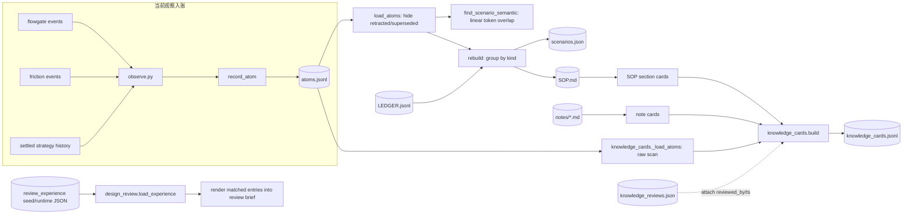

# 知识库现状、知识元入库与 Agentic 检索实施方案 v1.1

| 项 | 值 |
|---|---|
| 日期 | 2026-10-30 |
| 状态 | D-022 已确认方向的详细实施设计；本文件给出文件/字段/流程与验收路径，**不代表该路径已编码或生产验收**。v1.0 为简要稿，由本版取代 |
| 治理 | T-052/F-018/D-022；本版方案与源码事实核对 EV-20261030-013；此前本机写入与旧检索实测 EV-20261030-002 |
| 主线审查基线 | 缓存 `origin/main@c40deb2`，结论见 `审查_Mdagent-main知识库与经验库设计_20261029.md`；不是线上 main 最新性声明 |
| 实施目标 | 未选择/未授权。`sim-agent-runtime` 是本轮本机试写所用的独立仓库，PROJECT_OVERVIEW 明确它属于本工作区非目标；不得据此变更其代码/数据。`MDagent-src/` 也是只读参考（仅 D-005 证据系统实施为例外）。本文件只列出候选落位路径，目标所有者/仓库/活动 data root 确认前不能开工 |
| 其他代码口径 | T-031 缓存 main、脱敏 `MDagent-src/` 与独立 `sim-agent-runtime` 分开说明。此工作区把 `MDagent-src/` 定义为只读参考（证据系统另有 D-005 授权例外），本轮无权对其知识代码作实改；本文件仅为方案 |
| 架构约束 | D-004 单一知识底座、单一晋升通道、多派生服务面；沿用既有 `record_atom`、人工审批/`apply_proposal` 和 `review_experience`，不建第二套知识正卷 |

## 1. 先给结论

当前并不存在一套由“知识库、统一索引、经验卡片”组成且端到端接线完成的单一产品。能观察到的是几种职责不同、成熟度不同的记录与投影：

1. **atoms 是追加式事件/观察账本**。它能记录一个短事实和若干 refs，不自带“已审核、可跨任务复用”的语义。
2. **关键词搜索是 atoms 的线性扫描函数**。它按空白分词和子串重叠计数，不是向量检索，也不是一个独立知识索引服务；主线审查基线没有证实该函数已接入 MCP 的普通问题召回链。
3. **scenarios 和 SOP 是从 atoms/LEDGER 重建的统计/可读视图**。scenario 按 `kind` 分组；SOP 的“修复状态”来自 LEDGER 映射。它们既不做语义聚类，也不等同经过完整审核的知识条目。
4. **knowledge_cards 是浏览/蒸馏投影**。atom 卡按 `kind` 聚合，不是每条知识一张卡；人工核卡状态另存，LLM 蒸馏可选。卡片不持有统一知识生命周期，且当前 loader 直接读取原始 atoms，撤回/取代过滤与记忆搜索不一致。
5. **review_experience 才是面向审阅/门禁消费者的经验条目服务面**。它有自己的包 schema、`statement`、`conditions`、`refs` 和 `active/canary/revoked` 状态；但“atom/提案→人工审批→review_experience”的持久晋升接口在主线审查中未闭合。不能把文件可手工落盘说成已实现自动晋升。

因此，atom 不应被继续切成更小的“知识元”。需要补的是**atom 到完整经验单元之间的审核晋升对象**，以及这个对象的确定性索引/按 ID 详情读取路径。体量小，不需要向量 RAG；实现分级检索时依次路由、找候选、读完整单元、核对适用条件和证据即可。

## 2. 当前结构究竟是什么

### 2.1 必须分开的三个代码/数据口径

| 口径 | 可用于说明什么 | 不能据此声称什么 |
|---|---|---|
| `origin/main@c40deb2` 的 T-031 审查 | 该缓存 main 可见的 evolution 代码、原子/卡片流程与包消费差距 | 不能代表服务器实时账本；该基线不含 `design_review.py`，所以不能说它的 design-review consumer 已进入该 main |
| 本地 `MDagent-src/` 脱敏导出 | 可查看较新的本地源码，包括 `mcp/design_review.py` 与 `mcp/review_experience/` seed 包 | 不是服务器运行态，也不自动代表 main 已合并或正在部署 |
| 本地 `sim-agent-runtime/` 与 `simrt-data/` | 可实际运行其 `memory.py`、`knowledge_cards.py` 并验证本机数据路径；该处本轮有 6 条 atoms、10 张 cards | 不是 MDagent 的 review_experience 生产库，也不是 MDagent 服务器数据；该运行时没有接入本文第 2.7 节的 review_experience consumer |

本轮 `record_atom` 实测写入的是 `sim-agent-runtime/simrt-data/memory/atoms.jsonl`。服务器台账路径探查未找到原交接文档中的 `/opt/mdagent/data`；因此没有向未核实的主机写入，更没有把本机测试称为服务器生产测试。`sim-agent-runtime` 是单独仓库且当前工作区把它列作 non-goal；该处只作为先前旧数据路径试写夹具，不构成实施目标确认或修改授权。`MDagent-src/` 同样为只读参考（除 D-005 特批证据系统面）；要实施 F-018，须先在独立项目决策/治理记录中选定实际目标仓库、运行分支、服务部署和 data root，再按目标重新核查 API/权限。当前稿中的 `packages/evolution/`、`packages/domain-md/tools/` 是 sim-agent-runtime 候选树路径的示例，不是本工作区批准的源码改动清单。

### 2.2 atoms：事实是怎样写入的

主线快照与本地运行时的 `evolution/memory.py` 主要逻辑相同，运行时另将锁实现移植为跨平台 `filelock`。写入函数为 `record_atom(kind, fact, refs=None)`，当前记录形状大致为：

```json
{
  "id": "a<毫秒时间>_<短随机串>",
  "t": 0,
  "kind": "某种观察/失效签名",
  "fact": "短事实",
  "refs": ["源记录或工件引用"],
  "axes": {
    "topic": [],
    "topic_candidates": [],
    "method": [],
    "ops": [],
    "exam_ready": false
  }
}
```

具体行为（`MDagent-src/evolution/memory.py:177-232`；运行时 `sim-agent-runtime/packages/evolution/memory.py:175-228`）：

- `fact` 转成字符串；长度小于 10 的拒绝；输入超过 2,000 字符先截断，最终落盘最多 400 字符。因此这不是可任意承载长篇经验正文的知识对象。
- `refs` 若为单一字符串会包成一项；atom 中保留前 8 项。`tagging._norm_refs()` 用于打轴时每项最多 200 字符，但这不等于 `record_atom()` 对源 refs 做了统一 schema 校验；atom 写入点不会确认被引用文件/条目存在。
- 完全相同的 `kind + fact + refs` 返回已有 atom；近似去重还会把最近 20 条内同 `kind`、`fact` 前 50 字符相同的记录折叠，即使 refs 不同。这对重复事件有用，但也说明不能用 atom 的去重规则表示独立知识版本。
- 新 atom 尝试调用纯函数 `tagging.tag_atom()` 加入 axes；打标失败被吞掉，不阻止事实入账。atom 追加本身不会普遍触发 scenarios/SOP/cards 全量重建；`observe()` 和 `apply_proposal()` 等调用方会在各自路径上调用 `rebuild()`，其他 writer 不一定会。
- `load_atoms()` 对 `retracted` 和 `superseded_by` 作过滤，原记录仍留在 atoms 文件用于追溯。写入无 `status` 字段，atom 自身不是人工批准的经验条目。`replay_eval.validate_atoms()` 是另一个消费者，直接逐行扫描指定 atoms 文件、只看 `axes.exam_ready` 与其考场 ref 格式，不先调用 `load_atoms()`；所以撤回/取代语义在普通检索、卡片和回放筛选间也不一致（`sim-agent-runtime/packages/evolution/replay_eval.py:98-144`）。

调用者也不是一个通用“knowledge ingest”接口：`observe.observe()` 中 flowgate 的 repeat/correction/violation 信号用 `userText` 调 `record_atom`；pipeline error/critical 用于起 proposal 计数，但不在同一分支写 atom；friction 信号尝试写 `"turn ... session ..."` fact，而 `record_atom()` 对 `friction-interrupt`/`friction-tool-error` 会拒绝同时含 turn/session 的该形状。这说明观察采集目前按信号源/签名散落，不能把 observe 名称等同“所有经验必入库”（`sim-agent-runtime/packages/evolution/observe.py:426-463,494-511,533-544`；reject 规则 `memory.py:189-190`）。新知识 proposal 第一版应由调用者显式给 source_atom_ids，不能假设 observe 自动替它组装完整上下文。观察路径逐类如下：

| 事件输入 | 当前 atom/proposal 行为 | 后果 |
|---|---|---|
| flowgate violation/repeat/correction | 最近窗口内每条符合时间的记录以 userText 调 `record_atom`，refs 为 flowgate 文件行标识；proposal 另按阈值与最近24小时相关性生成 | atom 只拿到 userText，不自动把 previousText、整轮对话或 gate decision 作为组合结构 |
| pipeline error/critical | 按窗口、distinct case 统计并可能生成 proposal | 该分支不直接对每个 pipeline event 调 `record_atom` |
| friction interrupt/tool error/denial | 三类都尝试以 `turn ... session ...` fact 入账 | `record_atom` 会过滤同时含 turn 和 session 的 interrupt/tool-error；denial 不在该过滤种类里，三类输入结果并不一致 |
| settled strategy history success/fail | `observe_kit` 按时间顺序对结账项写 recovery-outcome atom，ref 含 ts/strategy/case | 这是以账本结局为证据的事件 atom，不等于策略已跨任务晋升为通用 knowledge entry |

来源：`sim-agent-runtime/packages/evolution/observe.py:426-463,494-544,1380-1408`；过滤：`memory.py:189-190`；运行时锁：`packages/evolution/filelock.py:49-103`。MDagent-src 的相应具体代码需按其自身分支重新定位。

### 2.3 分类：现有 taxonomy 的边界

`tagging.py` 是确定性词表打标，不是完整本体或审核系统。主要分类路径为 `tagging.tag_atom()`（运行时 `packages/evolution/tagging.py:191-209`）：

- `topic`：命中 `known_topics` 的已认证 topic。
- `topic_candidates`：case ID 正则抽到的候选，明确不过认证闸。
- `method`：受控方法关键词，子串匹配。
- `ops`：运行/治理关键词，ASCII 裸词用词边界、其他关键词用子串匹配。
- `exam_ready`：有 refs、kind 在允许清单、fact 有结局信号的**语法筛选位**；它不是“知识已证实”标记，进回放前还应核验 refs。

这几轴混合了 topic、方法和系统运行领域，适合将 atom 路由到现有工具/技能，不表示“这是 observation/claim/procedure 中哪一种知识对象”，也不表示审核状态、证据强度或置信度。topic 候选尤其不能参加认证统计。

此外当前至少还有三套并行分类，不共享同一 taxonomy：

| 分类字段/输出 | 当前生成方式 | 实际用途与限制 |
|---|---|---|
| `atoms.kind` | `record_atom` 接受调用者传入字符串；没有通过受控 kind registry 校验 | 被 `rebuild()` 当 signature 分组，也是按 kind 搜索/统计键；同名即聚合，不说明知识对象类型 |
| `knowledge_cards.category` | `knowledge_cards._category(kind)` 按 kind 子串命中若干硬编码类别，未命中落“其他” | 卡片 UI 排序/浏览标签；不是受控知识分类，不代表 reviewed/verified |
| card-council `layers`/`physics` taxonomy | 从 card 的 kind/title/最多3条事实走 `LAYER_RULES`、`PHYSICS_RULES` 子串首命中；可选 LLM 生成另一个派生 taxonomy/cache | 角色面/主题面浏览归类，输入当前最多读取 200 张卡；不是 atom axes，也不会反写 canonical 数据 |
| `review_experience.kind` | 各 consumer 用枚举/专属字段校验；design-review 支持 boundary/lesson/convention/capability/completeness/methodology；evidence packs 使用 physics-anchor/methodology-dimension/surface 等独立 schema | 表示消费者解释的条目语义；不同 consumer 不能仅凭共享目录或同名 kind 互相解释 |

因此现状不是“一套分类树”，而是 atom grouping key、词表路由 axes、card UI bucket、card-council 展示 taxonomy 和 review-pack consumer kind 并存；它们各自解决不同问题、粒度不同、真实性不同。新方案补 `unit_type` 和受控 entry kind，是为了让 agent 用一个**可审核的知识对象类型**区分 claim/lesson/procedure 等，而不再把 atom.kind 或 card.category 误用为经验类型。

运行时支持 `SIMRT_TAG_VOCAB` 或 `simrt_config.json.tag_vocab_files` 扩词（`tagging.py:30-54`）；是否生效必须核对实际配置，不能只凭 manifest 中声明了扩展文件就认定加载。标签表是治理数据，应由人工审阅添加，禁止把具体域词表写进通用算法。

### 2.4 scenarios 与 SOP：当前“分层”做了什么

`rebuild()` 做全量确定性投影（`memory.py:235-283`）：

- 只取 `load_atoms()` 过滤后的 atoms。
- 以 `kind` 作为 `signature` 分组，生成 `{signature,count,atom_ids,examples}`；examples 最多 3 个且每条最多 120 字符。这里没有用 embedding、因果识别或实体关系来判断“同一场景”。相同 kind 只意味着签名一致。
- 读取 LEDGER，将已应用且未回滚的变更按 `CLASS_TO_SIGNATURES` 映射到 signature，渲染为 SOP 的“修复”文字。
- `scenarios.json` 是聚合计数/ID 列表；`SOP.md` 是全量重建的可读汇总，能回溯 atom/ledger，但它不是逐条审核、适用条件完整的知识规范。

对应入口 `memory.py:235-283`，`CLASS_TO_SIGNATURES` 位于 `memory.py:37-44`。`rebuild()` 会重算已有可见输入，不会自动抽取可复用 claim，也不会审批经验。

### 2.5 `find_scenario_semantic`：名称比实现更像语义搜索

实现位于 `memory.py:140-152`（运行时 138-150）：

1. 将查询转小写并按空白拆词，构成去重 token 集。
2. 对 `load_atoms()` 返回的所有 atom，检查每个查询 token 是否是 `fact` 或 `kind` 的子串。
3. 命中 token 数作为分数；按分数降序、atom 时间降序排序，返回前 `top_k`。

它是 O(atom 数 × query token 数) 的词项重叠扫描；没有 tokenizer、同义词、字段权重、条件过滤、状态授权判断、索引结构或全文知识单元详情 API。中文句子若无空格，可能作为一个很长 token，导致召回差；传 `top_k` 也不是检索质量保证。CLI `memory.py semantic` 能调它，但 T-031 审查未发现主线 MCP 将本地 atoms/SOP/cards 普遍接到自然语言问题检索上。运行时已有 `sim_search_sessions` 查历史会话（`packages/domain-md/tools/sim_search_sessions.py`），不能把它叫知识库索引。

**结论：**当前存在可用的基础关键词召回能力，不是“完全没做召回”；但它不是统一、分级、带状态/来源契约的运行时知识服务。

### 2.6 当前数据流图：已实现路径与断点



虚线表示 card review sidecar 只给浏览卡附核验者/时间，不会晋升 `review_experience`。当前 atoms 搜索视图与卡片 raw loader 的生命周期过滤不同。主线审查缓存没有普通知识 MCP 查询链；本地 MDagent-src 有 design-review consumer，但它和 sim-agent-runtime 是不同代码/部署口径。

`knowledge_cards.build()` 是读源重建投影，默认读取 atoms、SOP、notes、scenarios，输出 `memory/knowledge_cards.jsonl`；`knowledge_reviews.json` 单独保留人工核卡信息（`knowledge_cards.py:283-393`）。

卡片的来源与分组如下（`knowledge_cards.py:45-178,292-368`）：

- atom 卡：按 `kind` 聚合一张卡，不是一条经验一张卡；facts 按序去重后最多 8 条，每条最多 400 字；refs 最多 12 项，atom IDs 最多 20 个。
- SOP 卡：按 Markdown 的 `##` 节拆卡，每节抽最多 8 条非标题/注释行。
- note 卡：每份 Markdown 取首个非注释段，截到 400 字。
- `scenario_count` 可合到同 kind atom 卡，LLM 蒸馏需显式 `--llm` 才会运行。
- 人工 `review(card_id)` 写 `{by,ts,note}` 到 sidecar；卡片重建后只投影 `reviewed_by/reviewed_ts`，不返回 `note`。
- 现有 card schema 不复制 atom `axes`，也不复制每条 atom 的撤回/取代状态。
- **高影响不一致：**`knowledge_cards._load_atoms()` 直接读 JSONL、只检查 dict/kind，不调用 `memory.load_atoms()`；因此撤回/取代 atom 可能仍进入卡片的 count/facts/refs。卡片是浏览投影，不能当作权威有效知识集。

`card_council.py` 又对 cards 做关键词规则基线及可选 LLM 分类，taxonomy/cache 是从 cards 算出的另一层视图，不会反向修正 atom、也不代表入库分类已人工确认；其 `load_cards()` 默认最多读取 `MAX_CARDS=200` 张，且交给模型的摘要最多取每卡 3 条事实、每条截到 160 字符（`card_council.py:95-112,190-194`）。不能把 council 输出当完整索引，也不能把 atom axes、card category、card council taxonomy 当成一个分类系统。另一个会影响晋升判定的问题是：`graduation.review_tag()` 默认以 `memory.load_atoms()` 取 atoms；该函数已经过滤所有 `retracted` atom，随后 graduation 再从这批可见 atoms 检查 `retracted_at`（`graduation.py:129-150`），正常调用下看不到被过滤的近期撤回，近 30 天稳定性条件会失真。实施时应另取仅供审计的 raw atoms 做撤回时间检查，同时 active 统计仍用可见 atoms；为“原子事实撤回”与“知识单元撤销”分别建回归用例。

### 2.7 `review_experience`：真正面向 AI 审阅的经验条目面

在本地 `MDagent-src` 源码中，seed 包位于 `mcp/review_experience/*.json`；运行时目录按 `paths.memory_dir()/review_experience` 或 `REVIEW_EXPERIENCE_DIR` 覆盖。`design_review._experience_dirs()` 把运行时目录置前，seed 目录置后（`mcp/design_review.py:94-108`）。此设计与 main 审查基线分开：T-031 的 `origin/main@c40deb2` 缺少 `design_review.py`，因此不能把这个本地消费者说成该缓存 main 的功能。

共享 knowledge pack 形状见 `mcp/review_experience/README.md:29-55`：

```json
{
  "pack": "my_pack",
  "schema_version": 1,
  "entries": [{
    "id": "exp-...",
    "kind": "boundary|lesson|convention|capability|completeness|methodology",
    "statement": "核心经验",
    "conditions": {},
    "severity_hint": "hard|soft",
    "rationale": "理由",
    "remediation": [],
    "refs": [],
    "provenance": {"source": "human|evolution|literature|seed"},
    "status": "active|canary|revoked"
  }]
}
```

`design_review` 读取所有 schema_version=1 JSON；包的 `consumer` 只接受空值或 `design-review`，`consumer:evidence` 的不同 schema 被跳过。entry 校验主要检查 ID 正则、`statement` 非空、status/kind 枚举；`active` 是缺 status 时的默认值。status revoked 不注入，canary 注入但标为 experimental。相关度只看 conditions 的值能否在 intent JSON 文本中找到：family 命中加 4，其它命中加 1；按分数排序，`_entries_text` 最多送入简报 24 条（`design_review.py:141-210,222-231`）。

因此当前路径是“人或代码直接把 JSON 放到运行时目录→loader 校验/匹配→设计审阅简报”；README 中“未来注册为 apply_proposal evidence 类”的话仍标作预留。主线 T-031 核查还发现：`apply_proposal` 成功后写的是 evolution-change atom 与 SOP，没有写 review_experience。一个 pack 合法可加载，不等于来源授权已证实、所有字段均显示、或晋升链已闭合。

**实际可见字段比 schema 少：**`_entries_text` 只显示 id/kind/severity/canary 标记、statement、rationale、conditions。额外加入 `limitations`、`outcome`、反证字段而不更新 renderer，字段虽在 JSON 内，AI 实际不会看到。

### 2.8 同一 review_experience 目录实际是多个 schema / 多套 consumer

`review_experience/` 不是一个所有消费者同规则读写的单体表：

| 包/对象 | 例子与 schema | 主要 consumer | 当前边界 |
|---|---|---|---|
| 设计审阅 knowledge entries | `physics_basics.json`、`experiment_design.json` 等；schema v1 `entries[]`，有 `statement/conditions/rationale/remediation/refs/status` | 本地 `mcp/design_review.py` | 只接空 `consumer` 或 `design-review` 包；匹配靠 conditions 值对 intent JSON 的子串命中 |
| evidence anchors | `anchors_seed.json`；`kind:physics-anchor`，字段为 quantity/unit/range/conditions/refs/status | `evolution/assessment.py`；`stage_gate.py` 状态索引 | `design_review` 跳过 `consumer:evidence`；assessment loader 自己扫包，不走 design-review validator |
| evidence methodology dimensions | `methodology_deep.json`；`kind:methodology-dimension`，字段为 family/question/check/params/status | `evolution/deep_review.py`；另有 stage_gate 的 methodology 读取路径 | schema 没有 knowledge entry 的 statement，不能当普通经验包解析 |
| confirmation surface | `confirmation_surface.json`；phase/question/min_grade/na_allowed 等 | `evolution/surface.py` | 按 ID 合并运行时覆盖种子，但 `load_items()` 本身不按 status 过滤 |
| completeness packs | `completeness_*.json`；family/required_fields/guidance | design_review checklist 与证据 gate | 不是普通 `entries[]` 经验单元，结构字段另有消费规则 |

生命周期也存在消费者差异（本地源码）：

- `design_review._entry_ok()` 缺 status 时默认 `active`，再拒绝不在枚举内的状态；它过滤 `revoked`，接受 `canary` 并在简报标记试验性（`mcp/design_review.py:141-153,181-199,222-230`）。
- `stage_gate.exp_status_index()` 扫 seed、`REVIEW_EXPERIENCE_DIR` 和 `memory/review_experience`，不验证 `consumer` / 每类 pack schema；缺 status 默认 `active`，同 ID 后扫描 root 覆盖前值。`load_methodology_entries()` 仅跳过 `revoked`，其它未知状态可能进入 E4（`evolution/stage_gate.py:131-179`）。
- `assessment.load_anchors()` 以 kind/id 收集 physics-anchor，自身不复用 design_review 的 package consumer/schema validator，且保留条目原 status 供规则决定拦截级别（`evolution/assessment.py:35-66`）。
- `deep_review.load_dimensions()` 只接 `status == active` 的 methodology-dimension（`evolution/deep_review.py:31-57`）。
- `surface.load_items()` 按 ID 合并条目，但此加载函数不做 lifecycle status 过滤（`evolution/surface.py:54-71`）。

**实施含义：**不得“直接把四条候选 atom 写进 review_experience 目录”作为入库方案。必须先确定属于哪个 pack schema/consumer，再走提案批准和唯一写入器；新知识单元只能落在共享 knowledge package 的兼容 schema，或先经明确决策扩展通用 entry validator 与 renderer。不能让 evidence anchors、methodology dimensions、surface items 意外被知识检索器或设计审阅当成普通经验。

**数据源含义：**主线审查基线没有 design-review consumer；本地 `MDagent-src` 有设计审阅与 evidence consumers；本地 `sim-agent-runtime` 又没有上述 review_experience 目录/加载器，且 importer 只复制 atoms/LEDGER/cards/scenarios/SOP/proposals 等，不复制 `review_experience/` 和 `knowledge_reviews.json`（`sim-agent-runtime/import/import_mdsim.py:107-152`）。后续实施必须先选定目标运行时与数据根，不可跨三者混称“当前生产知识库”。

## 3. 为什么需要补充：现有各层间的断点

| 已有结构/能力 | 当前提供的价值 | 当前缺口 | 补充后的提升 |
|---|---|---|---|
| atom + refs + axes | 记录短事实、来源线索、粗分类；可追加、去重、撤回/取代 | 400 字 fact；无“审核后可复用”标志；多条 atom 没有一等 claim/case 组合体；refs 不验证真实性 | atom 保持小而可审计；完整经验使用稳定 ID 串回多个 atom/case/source，不再靠拼接或卡片猜上下文 |
| semantic keyword overlap | 零依赖地从短记录找候选 | 空格切词/子串计分；只搜 atoms；没有 status、条件、反例、详情读取 | 先找小集合候选，再按稳定 ID 读完整经验；适用性和证据/授权分别判断 |
| scenario + SOP | 同签名计数、LEDGER 修复摘要、人类可读 | 同 kind 归组可能把不同条件/根因混一起；不是完整经验或自动晋升 | 明确仅为统计/导航投影；不做权威推理、不合并相反案例 |
| knowledge cards + card review | 聚合浏览，人工标记，LLM 可选摘要 | raw atom 直接读可含撤回/取代；聚合截断；不含 axes；kind/card_category 混淆；不是 ID 级知识正卷 | 修成一致过滤的浏览投影；新增单元仍以 experience entry 为权威，卡片只是链接与完整展示 |
| review_experience packages | 有 statement/conditions/refs/provenance/status，AI 消费端可做条件匹配与引用仲裁 | 当前数据目录可直接编辑；机器晋升未接好；状态、来源校验和字段呈现需统一 | 把知识候选审核/批准/撤销纳入现有提案、人工闸和 LEDGER；每个 consumer 使用同一 schema/status 规则 |
| axes/topic/kind/card taxonomy | 有 topic/topic_candidates 与 method/ops；卡片另有展示分类和 council taxonomy | 轴、kind、status、证据等级、相关度经常被统称分类；domain extension 需核对配置 | 分类轴有各自定义和受控源；分类只路由，不冒充证据、生命周期或审核权 |

补充不是为了层数变多或堆标签，而是让系统具备一条可验证的数据闭环：**观察入账 → 知识候选组装 → 人工审核 → 唯一权威经验包写入 → 内存索引重建 → 分级检索与完整回读 → 任务留痕 → 反例/结果回流 atom，再次审核。**

## 4. 推荐的权威数据与投影布局

### 4.1 不新增平行正卷

在选定的活动 `SIMRT_DATA_ROOT`/`MDSIM_DATA_ROOT` 下复用 `memory/`：

```text
memory/
  atoms.jsonl                         # 观察/事件/反例的权威追加账本
  LEDGER.jsonl                       # 提案决定与应用结果的追加审计账
  proposals/<proposal-id>/            # 待审候选工件；不参加正式召回
  review_experience/                  # 既有经验服务面，多包、多 consumer，不是单表
    <已有 seed/runtime packages>.json # 原有 owner/consumer 不变，不复制/迁移
    knowledge_units.json              # F-018 新 package，仅存该 consumer 晋升条目
  scenarios.json                     # atoms 按 kind 统计的可重建聚合
  SOP.md                             # atoms+LEDGER 可读派生摘要
  knowledge_cards.jsonl              # 浏览投影，回链 source/id
  knowledge_reviews.json             # 可选的“卡片看过”sidecar，不是经验审批
  （不落盘 search index）             # consumer-specific Catalog 只驻内存
```

`review_experience/` 本身是多个既有知识/证据包的共享服务面，不能将 `knowledge_units.json` 宣称成覆盖所有包的唯一文件。原始观察仍以 `atoms.jsonl` 为权威；既有 seed/runtime package 保持各自 ID、schema 和 consumer。本方案只新增 `consumer:"knowledge"` package 作为 F-018 通用知识 canonical 来源，不复制既有 design-review/evidence 条目。proposal 仍在 proposals/ 作审批工件；成功后只将批准 entry 写入该 package，不另建 stage 目录或索引正文文件。Catalog 不只读这一个新文件：它可同时读取**被 intent 明确请求的 legacy design-review knowledge entries**，通过只读 adapter 映射检索字段、保留 consumer/source ID 和原 refs；未请求 design-review scope 时不得自动把这些经验混入通用结果。evidence/surface/completeness 使用各自既有 consumers，不进入普通经验 index；需要这些对象时走对应的证据核查 API。notes/、外部语料、会话和 case 工件只作为来源，未经审核不得自动提升。

文件名使用独立 package 的原因：现存同目录并非单 schema；seed 目录有 knowledge entries、evidence anchors、methodology dimensions、confirmation surface 和 completeness packs。不得把不同 schema 混写在同一个 JSON 顶层。新 package 声明 `consumer:"knowledge"`；新 knowledge loader 只读此 consumer。`design_review` 已跳过非 `design-review` consumer；`stage_gate.exp_status_index()` 等通用扫描器还需增加 consumer guard，避免意外把 knowledge unit 作为 evidence entry。该包仍由既有 review_experience 目录/审批通道管理，不是第二事实源。

本机 `sim-agent-runtime` 当前没有 review_experience loader/目录，也没有这条 gate receipt 验证能力；如独立项目所有者将来选择它，才可评估在其实际 `SIMRT_DATA_ROOT/memory/review_experience/` 下复用共享经验服务面，且**不得在可信 gate receipt adapter 可用前应用任何条目**。其 `POLICY.json` 把 `apply_proposal.py` 与 `POLICY.json` 自身列在演化提案禁区；对应代码/config 改动须通过该仓库的独立、人工控制的软件开发与治理发布，不能由 knowledge proposal 自行修改。本工作区本轮没有这项跨项目代码授权，也不得把本机副本误写成 MDagent 服务器路径。`MDagent-src` 在此工作区仍按参考源码纪律，本文件不授权改动。

### 4.2 权威 package 与 entry 格式

新 package 位于既有 `review_experience/` 根，形状与现有 pack 容器兼容，但用显式 consumer 做路由：

```json
{
  "pack": "knowledge_units",
  "schema_version": 1,
  "entry_schema_version": 1,
  "consumer": "knowledge",
  "entries": [ ... ]
}
```

一个 entry：

```json
{
  "id": "ku-<stable-id>",
  "unit_type": "claim|lesson|procedure|boundary|case_synthesis",
  "kind": "lesson|methodology|boundary|convention|capability|completeness",
  "title": "短检索标题",
  "statement": "一条可独立引用的结论",
  "keywords": ["中文短语", "别名", "English alias"],
  "axes": {"topic": [], "topic_candidates": [], "method": [], "ops": []},
  "conditions": {"all": [{"field": "<context path>", "op": "eq|in|contains", "value": "<value>"}]},
  "rationale": "依据与推理边界",
  "remediation": ["建议动作/检查步骤"],
  "observed_outcome": "观察结果；没有生产/案例实测时明确标记未验证",
  "limitations": ["不适用条件、反例或未验证范围"],
  "evidence": {"supports": ["atom:<id>"], "refutes": []},
  "relations": [{"type": "related|supersedes|depends_on", "target": "稳定ID"}],
  "refs": ["atom:<id>", "case:<id>", "paper:<id>"],
  "provenance": {"source": "human|observation|literature", "proposal_id": "...", "recorded_at": "..."},
  "approval": {"receipt_id": "...", "proposal_sha256": "...", "approved_by": "...", "approved_at": "..."},
  "status": "active|canary|revoked"
}
```

schema 约束：

- 继续使用 `review_experience` 当前允许的 `kind` 与 `active|canary|revoked`；candidate 留在 proposal，不进入正式 package；quarantined 是 loader 结果，不是可检索 status。
- `unit_type` 是额外通用对象分类；validator 必须显式加白名单。首期映射固定为：claim/lesson→kind=`lesson`；procedure→`methodology`；boundary→`boundary`；case_synthesis→`lesson` 并强制有 ≥2 个 case/atom refs。若不能映射到已有 kind，不得临时加 kind；需先修改共享 loader、允许枚举、renderer 与测试，并经人工 review。
- 新增 axis 值只通过受控 taxonomy 数据文件维护，不在代码中硬编码领域词。首期复用 `expert_tags.json` 及 `tagging._registry()` 产生 topic/method/ops 标签；运行时域扩展只有经 `SIMRT_TAG_VOCAB` 或配置 `tag_vocab_files` 明确加载才生效。当前 `domain-md/manifest.json` 声明一个扩展文件，但 `_extension_paths()` 不读 manifest，且本机扩展文件为空，故不把该声明误当作已生效 taxonomy。
- 建议 schema v1 限制：ID ≤80字符并符合 `[A-Za-z0-9_-]`；title ≤160、statement ≤4,000、rationale/observed_outcome 各≤8,000；keywords ≤32×80字符；refs/supports/refutes/relations 各≤32项；conditions ≤16 clauses；每个 limitation/remediation ≤1,000字符；entry canonical JSON ≤64 KiB、整个 package ≤4 MiB/5,000 entries。越限必须在 proposal 校验时拒绝并提示缩减或外置 source artifact，不截断已批准正文。这些是拟实施 contract，需通过 tests 后才成为有效代码约束。
- `conditions` 使用版本化的 context path/operator 白名单；首期只实现 `eq` 与 `in`，`contains` 仅用于字符串，不用于任意对象遍历。所有 clause 必须具备已注册 path/type；缺 context 返回 `unknown`，任何 mismatch 返回 `mismatch`，不得把 unknown 当适用。字段注册表由运行时契约按稳定代码/API 字段名维护，不能让每条 entry 任意遍历 Python 对象路径；业务值/允许标签作为配置数据，不在搜索代码写领域规则。
- 首期 source resolver 只实现 `atom:<id>`：读取 raw atoms 验证 ID 唯一性并检查 retracted/superseded 状态；有效 atom 方可作为支持引用。sim-agent-runtime 的 case 工件目前在 `paths.data_root()/cases/<case_id>/`，不是 `memory/cases/` 注册表；在实现固定根 realpath-containment + 文件存在校验前，`case:` 标记 unsupported，不能标 verified。`paper:` 当前无通用受控来源注册表，同样标 unsupported/unverified；active 晋升必须至少有一条已验证 support ref。
- `evidence.supports/refutes` 用来区别支持和反证；`refs` 是具体源 ID 的全集。支持和反证若均存在，entry 要解释冲突边界，不能只用一个 confidence 值抹平矛盾。
- 同一 `id` 内容修订须新 ID。**新 entry** 以 `relations:[{"type":"supersedes","target":"旧ID"}]` 指向旧记录；旧记录再由人工批准置 `revoked` 并在 ledger 记录原因，不原位覆盖、不删除。
- 新知识 package 必须 `consumer:"knowledge"`，其 `entries` 不得被 design-review/evidence 消费器误收。runtime 消费器需先按 consumer 路由，再解析该 schema。

## 5. 如何入库：实现成一条真实可执行的人工晋升链

### 5.1 第一步：事实观察只写 atom

事件/任务观察继续使用既有 `memory.record_atom(kind,fact,refs)`，不直接写经验包：

- fact 必须短于 400 字符且保持语义完整；超长原文留在既有 source/case/artifact，atom 只写观察摘要和 refs。
- kind 表示观察类别/签名，不等于经验类型；axes 由现有受控 tagging 生成，不能自称 active。
- refs 至少有一个可核验的稳定来源 ID；纯自然语言的“据经验”不可作为证据引用。
- observation/case 事实有冲突时追加新的 atom，不覆盖旧 atom；旧事实的纠正通过 retract/supersede 及理由处理。

### 5.2 第二步：把 atom 汇总为知识提案工件

使用既有 `memory/proposals/<date>-knowledge-<slug>/` 工件目录，不增加 staging database。候选 payload 放 `knowledge_entry.json`；在审批/应用前保持 proposal 状态：

```json
{
  "op": "knowledge_upsert",
  "proposal_id": "<stable-proposal-id>",
  "payload_sha256": "<canonical-entry-sha256>",
  "entry": {"id": "ku-...", "unit_type": "lesson"},
  "source_atom_ids": ["<atom-id>"]
}
```

`target` 不由 proposal 提供；写入器把唯一目标固定在 `paths.memory_dir()/review_experience/knowledge_units.json`。`payload_sha256` 对 canonical entry 计算。提案必须有复用理由、适用条件、结果/未知、限制和反例、支持/反证 refs、受控分类值，以及新建或撤销/替代哪个 ID。proposal 本身不进入正式知识召回。

第一期的入库操作逐项如下：

1. 观察事实仍调用 `memory.record_atom(kind, fact, refs)`；记下返回 atom ID。若写入校验拒绝或返回既有 atom（去重命中），调用方检查返回 ID、fact、refs 是否对应本次来源，不能假定一定新建成功。
2. 人工/agent 读取该 atom 与 refs 指向的源材料/案例，再决定是否有跨任务复用价值；证据不足只留 observation，不创建 active entry，也不把 atoms.jsonl 直接改成经验包。
3. 起 proposal：canonicalize `knowledge_entry.json` 并计算 SHA256；写 `meta.json` 的 operation/root/proposal ID/hash；`evidence.md` 列每个来源的意义、可达性、支持/反例和待人工确认项。proposal 不进入检索索引。
4. 把 proposal ID/hash 交给真实 user-gate；只有取得由 gate 单写者生成、可查询且与同一 payload hash 绑定的批准 receipt 后才能应用。现有代码尚未提供这个 receipt reader，因此第 4 步是当前实施前置阻塞，不声称已经可自动执行。
5. receipt 验证通过后，typed writer 更新 canonical package 并写 LEDGER；之后从新包重建内存目录，调用 `knowledge_get(id)` 实读回正文/refs/status，再用 `knowledge_find` 验证可召回。任一步失败不得报告晋升成功。

自动 `observe` 如参与，最多创建 atom 或 proposal 并请求人工审批，不能直接写 canonical package。

### 5.3 第三步：由实际 gate 决策授权后执行专用数据操作

当前实现边界：`observe._append_gate_request()` 追加 `op=enqueue/kind=evolution_proposal/ref=<proposal dir>` 到 `user_gate_requests.jsonl`，只是排队请求；它没有已批准回执。`proposal_reviewer.py` 写的 `recommend_approve` 是建议，不是人工批准。`apply_proposal.py --approver <name>` 只检查非空字符串并把该字符串写入 LEDGER；它不验证人名、gate ID、批准状态或 payload hash。当前检查到的接口因此不足以让 knowledge writer 独立验证批准结果。

**硬前置条件：**实现前必须从目标部署现有 user-gate 单写者/人工审批口取得可信、持久且可查询的批准结果。约定 adapter 接口 `read_decision(request_ref) -> {decision, actor_id, decided_at, approved_payload_sha256}`，其中 ref 精确绑定 proposal ID，批准 hash 必须等于即将写入的 entry canonical hash。当前源码只证明请求投递和 apply 后 resolve 投递，尚未找到这个 read/receipt 契约；在 receipt API/数据源未由实际 gate 所有者确认前，所有 knowledge upsert/revoke 必须拒绝，禁止用 CLI `--approver` 字符串、`review.json` 推荐字段、一个可编辑 JSON 文件或“用户在聊天中确认了方案”代替对**具体知识 payload**的审批。若目标 gate 不提供此能力，这是明确的外部阻塞；需另行批准并设计 gate adapter，不能修改 kit/DSH 来绕过当前治理边界。

receipt 契约确认后，数据流水线如下：

1. 候选生成时 canonicalize entry 并计算 hash；proposal 固定保存 `proposal_id`、`payload_sha256`、entry、source atom IDs。`observe` 的 gate 请求带 proposal ref 和 hash。现有 inbox/gate 是否保留 hash 未确认，需在 gate adapter 集成测试验证；不保留即阻塞，不得降级授权语义。
2. `apply_proposal` 增加独立 CLI operation（建议 `--knowledge-upsert <proposal_dir> --gate-receipt <id>` / `--knowledge-revoke ...`），在尝试读 diff 前分流；现有 code patch CLI 不变。knowledge operation 只接受 `meta.root == "dsh_agent"`，但不向这个代码 root 打补丁；写入路径始终由 `paths.memory_dir()` 解析，不接受 proposal 中 target/path。
3. writer 从可信 adapter 获取同 proposal 的批准回执，核对 decision=approve、actor、request ref、payload SHA256；再验证 package `consumer=knowledge`、schema version、entry schema、ID唯一、refs、conditions、axes、status。任一缺失/未知/不匹配均 fail-closed。
4. 在 runtime memory 目录锁内重读当前 `knowledge_units.json`，upsert/revoke 后验证整个 package；同 ID+同 payload 为幂等，同 ID+不同 payload 拒绝；修订用新 ID 和 supersedes relation。
5. 写前用 `O_EXCL` 建唯一备份，写临时文件后严格 parse/validate，再 `os.replace`；写后回读核对 entry hash。失败不得留下 APPLIED 或改变旧包。成功后将 proposal ref、entry ID、op、payload hash、receipt ID/actor、备份路径和结果写进既有 LEDGER（不保存第二份正文）。
6. 成功后失效内存索引/卡片缓存并从 canonical package 重建。撤销同样经 gate 与备份，改 status=revoked、记原因、保留 refs；卡片 review 不可晋升/撤销知识。

当前 `apply_proposal.py` 只支持 `meta.root` + unified `diff.patch` 操作；`main()` 一开始即要求 meta/proposal/diff/evidence 四文件，再解析和打补丁（`MDagent-src/evolution/apply_proposal.py:209-300`），成功后才记 LEDGER 和 evolution-change atom（`337-394`）。所以 knowledge operation **不是现有功能**，必须做带测试的新分支：通用文件为 `proposal.md/evidence.md/meta.json/knowledge_entry.json`；code-patch 仍用 `diff.patch`；knowledge payload 不伪造 diff，也不调用通用“给任意文件打补丁”能力。

`POLICY.json` 当前把 `evolution/apply_proposal.py` 与自身放在 forbidden_paths（`MDagent-src/evolution/POLICY.json:111-123`），禁止 evolution proposal 修改应用闸/策略。这条保护必须保持；新增 typed operation 属常规受控软件开发与代码测试，不是可由 knowledge proposal 自我修改的策略开关。按工作区约束不改 kit/DSH 底座。

候选文件落点示例（仅当独立项目所有者选定 `sim-agent-runtime` 为实施目标时适用；本工作区当前没有批准修改这些文件）：

| 文件 | 变更 |
|---|---|
| `packages/evolution/knowledge_units.py`（新增） | pack/entry validator、typed ref resolver、canonical hash、固定 memory-root、锁内 package writer、内存目录 `by_id/by_term/by_axis/by_kind/by_status/by_condition`、find/get/rebuild/invalidate；通用代码不含域规则 |
| `packages/evolution/apply_proposal.py` | CLI 知识操作分支，diff patch 路径不变；knowledge 操作先验证可信 receipt，再调用固定 writer，不接受任意路径 |
| `packages/evolution/observe.py` | 可选起草候选与 gate 请求，带 proposal/hash；绝无自动批准/落包 |
| gate receipt adapter（外部接口） | 先确认现有 user-gate 单写者可提供批准查询和 hash binding；若无，列为阻塞并等所有者另行授权，不臆造 API/数据文件 |
| `packages/evolution/knowledge_cards.py` | 统一过滤 atom lifecycle；区分 atom aggregate 与 unit card；卡片只读 canonical entry |
| `graduation.py`、`card_council.py` | 按 source 分流，防同一经验重复计数/错误晋升；只读 taxonomy |
| `packages/domain-md/tools/knowledge_find.py`、`knowledge_get.py`、`tools/__init__.py` | 注册只读 search/get MCP adapter，返回完整记录与来源，不写知识 |
| `packages/evolution/stage_gate.py`、`assessment.py`、`deep_review.py`、`surface.py` | package consumer/schema guard；knowledge pack 不得被 evidence loaders 当作 evidence entries |
| `tests/evolution/test_knowledge_units.py`、`test_knowledge_ingestion.py` 与 domain tool tests | receipt缺失/拒绝/hash不符、固定路径、锁/备份/原子替换、duplicate、引用、conditions三态、生命周期、完整回读、MCP装配与负例 |

知识 pack 不是原子事实库的替代，也不是现有 evidence package 的通用混合包。design_review 若要消费它，必须通过共享 catalog 明确接线；evidence consumers 必须 skip `consumer:knowledge`。仅目录相同不会自动赋予兼容性。

## 6. 如何分类：主类、路由轴、适用条件、治理状态各做各的

分类字段要做到“一个问题一个字段”，不继续把 kind/tags/status 混成一串：

| 字段 | 表示什么 | 取值来源 | 是否参与筛选 |
|---|---|---|---|
| `unit_type` | 知识对象语义：claim/lesson/procedure/boundary/case_synthesis | 通用 schema | 用于选择消费者/输出模板，不表示真伪 |
| `kind` | 面向当前 knowledge entry consumer 的内容类别 | legacy design-review `_KINDS` 为 boundary/lesson/convention/capability/completeness/methodology；新 knowledge package 复用兼容值，不能把 atom `kind` 原样当该字段 | 可作粗过滤 |
| `axes.topic` | 已认证主题/项目 | 受控 taxonomy + 人工批准 | 强过滤或加权路由 |
| `axes.topic_candidates` | 未确认主题候选 | 自动提取或人工草稿 | 只能扩候选搜索，不得当认证类目 |
| `axes.method` / `axes.ops` | 方法与运行治理维度 | 受控词表；打标算法只负责提示 | 可过滤/加权，不承担状态 |
| `conditions` | 本条适用的条件事实 | 人工编写、源证据约束 | 必须参与适用性判断 |
| `keywords` | 人工策展的召回词/同义表达/缩写 | 审核提案 | 倒排索引主词，检索导航 |
| `status` | 是否可供消费者使用 | 人工晋升/撤销操作 | 强过滤；active/canary 行为不同 |
| `refs` / `relations` | 支持、反例、来源、替代关系 | 实际源 ID | 详情核验、冲突发现 |
| relevance score | 与当前问题的匹配度 | 搜索算法运行时计算 | 仅排序，不是置信度或授权 |

不把 `axes` 误写进 `conditions`：前者是路由标签，后者是适用性边界。`knowledge_cards._category(kind)` 的字符串规则是 UI 分类，也不等于受控 taxonomy。

## 7. 如何索引：小库的可重建内存倒排表，不建向量库

### 7.1 权威源与索引字段

Agent 侧不是只搜一个文件，而是一个**按 consumer scope 路由的目录**。每份来源保持自己的 canonical package 与 schema；Catalog 只建可检索字段/id 映射，详情仍从对应 canonical package 读取：

| 来源 | package/规范化方式 | 可进入的检索 scope | 写入方式 |
|---|---|---|---|
| F-018 新知识 | `consumer:"knowledge"` 的 `review_experience/knowledge_units.json`，按 v1.1 entry schema 校验 | `knowledge`；其它 consumer 只有明确声明可引用时才可路由 | 仅 typed proposal+可信 receipt upsert/revoke |
| 既有 design-review seed/runtime entries | 读取 `consumer:"design-review"`，或兼容旧 `consumer` 缺省（legacy loader 默认归 design-review），用只读 adapter 映射检索字段；原始 entry 不迁移、不重写 | `design-review`；Agent 明确按任务意图请求此 scope 时返回，并保留 consumer/source ID | 仍走原现有来源/人工维护方式；不能由新 knowledge writer覆盖 |
| Evidence packages | `consumer:"evidence"` 的 physics-anchor/methodology-dimension/surface 等专用 schema | 不进入一般 knowledge scope；需要时调用各自既有 evidence consumer | 仍由 evidence owner/既有机制维护 |
| Completeness packages | `required_fields/guidance` 等 checklist schema | 不当普通知识 entry；由 completeness/gate 路由 | 维持既有 gate package 更新路径 |
| atoms / scenarios / cards / notes | observation/artifact 与其浏览投影，不是经验正卷 | 仅显式 `include_observations` 时以 `source=observation` 追加候选；不能与 active experience 混排 | atom 只走 `record_atom`；投影由 build/rebuild 生成 |

本地 seed 快照中，design-review 兼容包含有 statement 的 entry 共 51 条、跨 6 包；另有 46 条 evidence 专用 entries（anchors 6、methodology dimensions 10、surface 30），以及独立形状的 completeness packs。扫描时全部 97 个带 ID entries 暂未发现重复，但 Catalog 仍须拒绝重复 `(consumer,id)`，不能依赖当前 seed 偶然不冲突。sim-agent-runtime importer 当前不复制 `review_experience/`，目标运行时也没有这些 seed；选该仓库作目标时，要单独决定是否以及哪些 package 有权导入。不可把 MDagent 的领域 seeds 无差别复制到另一运行时。

atom 是 observation fallback，不进入 active unit index；只有明确 `include_observations=true` 才由 `memory.find_scenario_semantic()` 或新的 atom source adapter 返回为 `source:"observation"`，且不得和 active experience 混排或给同等效力。

`knowledge_units.py` 在内存中构建：

```text
by_id[id] -> 完整 entry
by_term[normalized keyword/token] -> [entry_id]
by_axis[(axis, value)] -> [entry_id]
by_kind[kind] -> [entry_id]
by_status[status] -> [entry_id]
by_condition[(key, normalized value)] -> [entry_id]
```

Catalog 从唯一的 `knowledge_units.json` 计算 package SHA256；只维护稳定 ID 到完整 entry 的内存引用及词项/轴/kind/status/condition ID 倒排映射，不复制并落盘第二份正文。启动首次加载、显式 refresh、每次 find 前轻量比较 package `(mtime_ns,size)` 并在变化时重算 SHA/全量重建；apply 成功主动 invalidate。相同 hash 可复用当前内存结构；loader 错误时丢弃旧 catalog 并返回不可用状态，避免旧 cache 静默冒充最新。

### 7.2 文本规范化与排序

1. `unicodedata.normalize("NFKC", text).casefold()`；ASCII 路径、代码符号另保原文；索引要返回 Unicode codepoint/stable-ID 次序打破同分，保证相同 package 与 query 生成可重复结果。
2. `keywords` 是知识单元必须人工提供的首要召回入口，特别存放中文短语、英文别名、缩写；实现将每个 keyword 规范化为一个完整 phrase term，并对 `statement/title/rationale/remediation` 生成空白/标点 token 与相邻 CJK bigram。不要假装有完美中文分词或语义理解；查询若是中文整句，Agent 需抽取短语/别名词项，不把整句直接当一个 token。
3. Query API 接受 `q` 和可选 `terms[]`；Agent 的意图步骤把长问题整理成少量关键词、同义词与 scope filters。完全无匹配时可放宽词项后重试，但每次返回都说明匹配原因。
4. 对每个候选 ID 计算可复现的分项：`keyword_exact`=命中的显式 phrase 数（每个 phrase 一次）；`kind_or_axis_exact`=精确命中的 kind/axis 过滤项数；`condition_exact`=精确匹配的条件 clause 数；`text_token_overlap`=body token 命中数，按 query token 去重。公开的排序分为 `8*keyword_exact + 4*kind_or_axis_exact + 2*condition_exact + text_token_overlap`，返回分项以便解释。`active` 与 `canary` 分组输出，canary 显示 experimental；proposal candidate、revoked 和 quarantined 不进入可采用候选。分数仅排序，不抵消状态或条件不匹配。
5. 条件 evaluator 返回 `match|mismatch|unknown`。所有 `conditions.all` 都为 match 才标适用；任一 mismatch 则明确不适用；有 unknown 且无 mismatch 时返回“需 Agent/补上下文判断”，不得按 match 自动放行。检索排序不把 unknown 当 match。
6. 搜索结果返回最多 10 条 `{id, unit_type, kind, axes, status, title, matched_terms, score_breakdown, condition_result, refs_count}`。它是候选列表，不含足以替代正文的摘要判断。
7. `knowledge_get(id)` 返回一个完整 entry、全部 refs/relations、状态与来源。未通过 validator 的 ID 不可取；来源核验失败明确返回 `unverified`，不能默默降级成已证实。

### 7.3 调用者的 Agentic 分级步骤

```text
问题 → 意图/条件/风险识别
     → knowledge_find(q, terms, axes, conditions, status=active [+ canary separately])
     → 对候选逐个 knowledge_get(id)
     → 检查条件、limitations、refutes/relations、引用可达性
     → 冲突/高风险/依据不足时读取 atom/case/source 原件
     → 回答时引用 knowledge id + 支持/反驳 refs
     → 如产生新事实，record_atom；如要推广，重新走知识 proposal 人工闸
```

低风险简单问题可止于完整单元；高风险或冲突时才展开更多 refs。这不是 RAG chunking：没有 embedding、切片召回或 top-k 片段直接注入。它是结构化小目录检索 + 按 ID 读取完整记录。

## 8. 卡片设计该怎样改，且为什么不能把卡片当数据库

卡片继续服务浏览、聚类看板和历史向导，保留两种 `source` 且语义清楚：

1. `source:"atoms"`：现有按 kind 的统计聚合视图，字段包括数量、时段、facts、refs、atom_ids；需修 `_load_atoms` 生命周期不一致并复制 axes，但它不是一个完整经验单位，不能计作单条 active unit。
2. `source:"review_experience"`：建议每个 canonical unit 一张 card，`id:"kc-unit-<unit-id>"`，含 `unit_id`、title、statement、unit_type/kind、axes、conditions、limitations、status、refs 和 evidence 数；正文/状态仍由 pack 唯一权威，卡片不允许人工改写成为新事实源。

`knowledge_cards.build()` 每次重建；基于 source hash 可复用没有变化的展示字段，不复用过期的 status/refs/axes。`review()` 现在是“浏览卡核看”，与知识晋升批准是两种操作；应改名/分开语义：

- `knowledge_review` 是按 proposal_id + payload hash 的人工批准/拒绝/要求修改，写 LEDGER，经 apply gate 才改 pack。
- `knowledge_cards.review` 只标注“看过/核对过展示”，不能改变 active 状态、不能把 canary promote。

下游 `graduation.py`、`card_council.py` 必须显式按 card source 分流，避免经验 unit card 被当作 atom 统计卡重复计数。`card_council` taxonomy/cache 只是展示分析，不能回写 canonical axes/status。

## 9. 与 L0-L3 / L-A-L-C 的关系

L0-L3 是现有数据加工/投影结构：来源与事件 → atom → scenario → SOP；knowledge cards 与 review_experience 是旁路消费者资产，并不自然等于 L4/L5。建议在这些源上补“知识单元”作为经审核的**另一种对象视图**，而不是再排一个必经的级联层级。

v2 的 L-A 执行证据、L-B 内容证据、L-C 知识证据是证据类型/证明责任，不是 L0-L3 存储阶段；`EvidenceRecord/RuleResult/RunRecord` 等任务工件不进入本 knowledge index。只有当任务观察经审核变成可复用经验，才进入 review_experience。同理，可复用经验的“支持/反驳”不等价于证据等级或用户授权。

## 10. 按文件/接口实施的阶段计划

### P0：选择目标并确认人工闸（未完成即停止）

- 目标尚未授权。本工作区的 `PROJECT_OVERVIEW.md` 把 sim-agent-runtime 列为非目标、MDagent-src 除 D-005 证据系统实施面外列为只读参考；因此不能直接按下表改这些源码。需要所有者明确指定实际仓库、分支、部署服务及数据根，并在其治理内登记；若选 sim-agent-runtime，须由该独立仓库自己的所有者/治理批准。目标确定后再核实 branch/HEAD、环境变量解析、服务进程读写根、备份/恢复责任。不能沿用旧交接文档的 `/opt/mdagent/data` 假设。
- 只读检查真实 user-gate 所有者，取得已批准 resolution 的正式 API/持久记录格式；按其 schema实现 `read_decision(request_ref)` adapter，并确认 resolution 将 proposal hash 原样绑定。当前只查到 enqueue request 与 apply 后的 resolve 通知，没查到批准 receipt reader/字段，因此此项是明确 gate。没有可信 receipt、不能把批准绑定 payload hash，实施不进入 P1。
- 不在本工作区源码中伪造审批 receipt、不为测试在 production root 写 fake approve；适配器单测可用 test-only stub，只验证消费契约。部署/跨边界 approval 源由 owners 按独立服务边界提供。

### P1：增加仅内存 Catalog 与 deterministic find/get

- 新增 `packages/evolution/knowledge_units.py`：`load_catalog(root)->Catalog`、`validate_pack/entry()`、`find(q,terms,consumer_scopes,filters)`、`get(consumer,id)`、`rebuild_cache()`、`invalidate_cache()`。按 consumer 单独校验/建索引：knowledge package 用新 schema；design-review legacy package 用只读 adapter；evidence/completeness package 不进入普通知识索引。缺省 consumer 按 legacy 规则等价于 design-review，不得推断为全局 knowledge。duplicate `(consumer,id)`、未知状态、schema 错误 fail-closed，不让后扫目录静默覆盖 ID。
- 加载时先 `lstat` 拒绝非普通文件/符号链接，限制 package 4 MiB/5,000 entries、entry 64 KiB、statement ≤4,000 字符、单个 ref ≤512 字符；坏行/过长字段不得静默截断。source hash 改变就清空并重建完整内存 catalog；多个 package 若之后引入，必须显式按 owner/namespace 合并，不得 last-writer-wins。旧 cache 不得与新 package 混合。
- 对已存在的兼容 knowledge entries 建 read-only adapter，标准化为 `{consumer:"design-review", source_pack, id, title, statement, conditions, rationale, refs, status}`；不要求它们具备新 schema 才能被原 consumer 使用。Catalog 只索引通过该 consumer validator 的条目，冲突/重复 ID 进入隔离报告，不覆盖。新 F-018 package 另用严格新 schema。
- 保持索引纯内存；按 source package SHA-256 检查 freshness；启动、显式 refresh、canonical package 成功写入后整包重建。重建失败标记 catalog unavailable/error，不继续向调用方宣称旧 cache 是最新。
- 分类词汇：先复用 `expert_tags.json`；如使用 domain vocabulary，按 `_extension_paths()` 的实际配置接入受控配置，增加启动报告/测试验证配置确实加载。未配置的 manifest 声明不作为成功条件。
- 加 `tests/evolution/test_knowledge_units.py`：目录 consumer 隔离、active/canary/revoked、重复 ID、未知状态、坏 JSON、坏 ref、CJK aliases、受控轴、conditions 三态、排序 breakdown、sha 改动重建、完整 get、空/坏包 fail-closed。

### P2：接入 read-only tools/find-get

- 新增 `packages/domain-md/tools/knowledge_find.py` 与 `knowledge_get.py`，模块各导出 `NAME/DESCRIPTION/INPUT_SCHEMA/run(args)`，由 `tools/__init__.py` 装配。`knowledge_find` schema：`q:string(必填,1..1000)`、`terms:string[](≤12,每项≤80)`、`axes:object(受控键和值)`、`conditions:object(仅已注册context fields)`、`include_canary:boolean(默认false)`、`include_observations:boolean(默认false)`、`limit:integer(1..10,默认5)`；reject additional properties。`knowledge_get` schema：`id:string`、`include_observations:boolean(默认false)`；单次只读取完整 unit。输入超限、未知字段/轴/条件运算符用明确参数错误返回，不做无提示截断。二者复用 evolution catalog，不把领域词写进 search engine。工具返回统一 envelope `{ok, catalog_hash, complete, hits|entry, error}`；`complete=false` 或 `ok=false` 不得解释成“没有知识命中”。
- 在 `packages/domain-md/tools/__init__.py` 的 `_MODULES` 注册，通过已有 `TOOLS/HANDLERS` 暴露；graph/dashboard 不是知识召回 API，不以已有图查询或 `sim_search_sessions` 代替 find/get。
- `find` 默认只返回 active；canary 另字段/可选参数且显著标实验性；revoked/quarantined 不得作为候选。`get` 返回完整 entry + 每个 ref 的解析状态。
- Domain MCP tests 和 `tests/domain-md/smoke.mjs` 验证 list/call schema/路由/find/get/权限只读/负例。不得在 tool 中有写经验功能。

### P3：经已验证 gate receipt 做 typed package upsert/revoke

- 在现有 `apply_proposal` CLI 入口增加**独立操作类型**，不能套用 unified code diff 伪装数据写。common required: `proposal.md/evidence.md/meta.json`；code operation 仍需 `diff.patch`；knowledge operation 要 `knowledge_entry.json` + `gate_request_ref` + target payload SHA256，并从可信 adapter 读回批准 receipt。
- 先验证 `decision=approve`、`actor_id` 非空/授权、proposal ref 精确匹配、receipt payload hash 等于待写 entry canonical hash、receipt 未消费/未过期；`--approver` 只可作为 CLI 调试显示值，不能替代 receipt。读取/校验失败 `REJECTED`，不得改包。
- 目标固定为所选目标运行时 `paths.memory_dir()/review_experience/knowledge_units.json`；知识 payload 不得指定 target path。文件锁内 re-read、schema/refs/ID 校验；O_EXCL 备份+唯一 tmp+`os.replace`+写后重读；ledger 记录 proposal/entry/op/hash/gate receipt/actor/result/backup。相同 ID/同 hash 幂等；同 ID/异 hash 拒绝；替代走新 ID + relation + 人工 revoke。目标未选择或 receipt 未验证时，该步骤不执行。
- 不要把 JSON package merge 实现成通用 overlay 或列表后写者覆盖。未知 ID/格式冲突/写失败均原子拒绝；`tests/evolution/test_knowledge_ingestion.py` 正反测试 receipt 缺失/拒绝/ref 错/hash错/重复/并发/备份碰撞/损坏恢复/撤销传播。

### P4：统一卡片与现有 consumers 的状态/类型语义

- `knowledge_cards._load_atoms()` 改用 `memory.load_atoms()` 过滤撤回/取代；atom card 明示 aggregate，复制 axes，并核实原始 atoms 不能越过生命周期过滤。`graduation.review_tag()` 的 stable-days 条件必须从 raw atoms 读 retracted_at，因为它当前从已过滤的 `memory.load_atoms()` 读入后再检查撤回标记，近期撤回不会被看到。测试 recent retraction确实阻止毕业；cards 中 atom/card source 与 unit source 分开计数。
- 新 unit card 每 entry 一卡，ID 固定由 unit ID 派生，正文、status、axes、refs 均从 canonical pack 生成；review sidecar 只记浏览核对，不改变知识 status。`card_council` 只能生成 taxonomy 投影，禁止回写 canonical axes。
- `design_review` 只有显式加入 knowledge consumer route 才可加载 `consumer:knowledge`；加 router 前旧 `_entry_ok` 不应该读取它。Renderer 应把 outcome/limitations/refs 加到 AI brief；测试确认实际 brief 含这些字段，否则不算接通。
- `stage_gate.exp_status_index` 对 `consumer` 与每类 schema 做 allowlist；其他 evidence loaders 继续仅读取其 own schema，并统一未知 status fail-closed。逐个测试 anchors、methodology、surface、knowledge package 不互相误读。

**范围外**：SQLite/FTS/embedding/RAG；第二知识存储；无审批自动晋升；外部语料自动入正卷。

## 11. 实施验收表

| 面 | 正例 | 反例必须拒绝/降级 | 证据 |
|---|---|---|---|
| atom ingest | 同一来源幂等；多来源 atom 可引用 | fact 被 400 字符静默截掉；refs 字符串拆成字符；不同事件因 50-char 近似被错并 | atom JSON 对账、refs/fact 完整性、重复回归 |
| atom lifecycle | raw 记录可审计；有效视图排除 retract/supersede | cards 仍包含已撤回 atom；graduation 以过滤后的 atoms 检查 retracted_at 导致近期撤回漏检 | raw/active 双视图测试，近期撤回阻止毕业的正反例 |
| knowledge candidate | 一份完整单元 references 多 atom/case，含条件/结果/例外 | 无来源、只有“总结经验”、结果/推理/限制空缺或矛盾未说明 | proposal/evidence 工件检查 |
| human promotion | 同 proposal hash 有批准回执；pack write 记 approver 与 hash | proposal reviewer 的建议当审批；自报 approver；审批后内容 hash 改变 | gate + apply integration test，LEDGER 精确对账 |
| package write | 固定唯一文件、锁内重读改写、backup O_EXCL/temp replace、写后再校验 | 任意 path、重复 ID 不同 payload、未知字段/状态、symlink/已有 backup、损坏 package | failure-injection 与无源文件变化断言 |
| classification | type/kind/axes/conditions/status 字段各司其职 | candidate topic 变已认证；tag/category 当审核或置信 | taxonomy unit tests |
| index/retrieval | 受控 terms/axes 找 ID，再完整 get；SHA 变更重建 | 只读截断 card/atom 作为最终结论；relevance score 当置信；revoked 仍命中 | API/MCP integration tests |
| projection | 撤回/取代状态同步；cards 可重建；recent retraction 会阻止毕业稳定性通过 | 卡片漏滤退役 atom；graduation 从已过滤列表检查 retracted_at 导致撤回盲区；card review 被误作知识审批；unit card 被重复计数 | card/graduation/council tests |

验收不得只看“JSON 可解析”或“keyword query hit”。至少检查原始 pack hash、entry count、refs 可达性、status propagation、全文读取、反例/冲突保留和用户闸审计记录。

## 12. 本机四条知识的既有真实测试记录

EV-20261030-002 记录的是前一轮在 `sim-agent-runtime/simrt-data/memory/atoms.jsonl` 用既有 `record_atom` 写入四条短 atom，并通过现有 whitespace-token substring scan 做 4/4 关键词命中，`knowledge_cards.build(with_llm=False)` 产生对应 4 卡且保留 fact/refs；atoms 总数 6，旧 atom 2 条不变；evolution unittest 192 项通过、14 项跳过。

这次测试**不是**本方案新增的 knowledge pack 写入、人工审批、倒排索引或 MCP tools 验收，也没有把四条 atom 晋升为 active。它只能实证既有记录器、旧线性搜索和卡片投影可用，不能证明当前实现已达到 F-018。该区别在后续实现前必须保留。