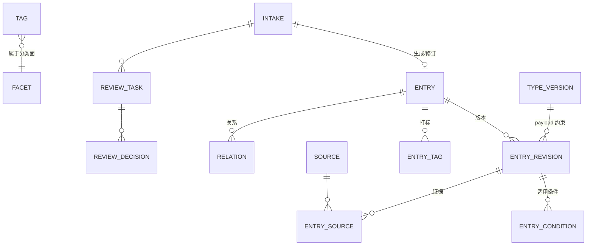
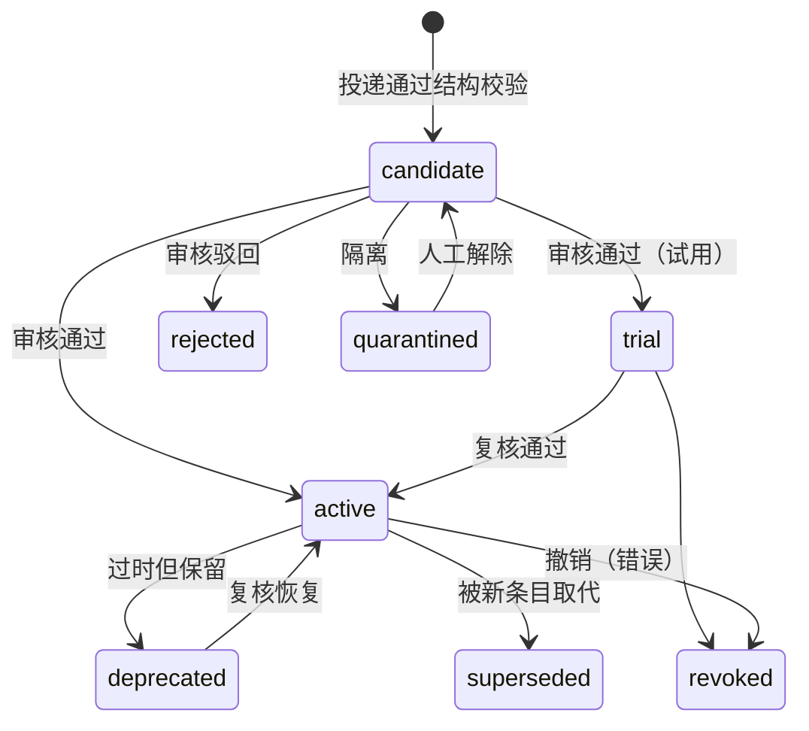
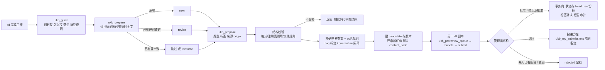

# 通用知识库 UKB 数据库设计 v0.8

| 项 | 值 |
|---|---|
| 日期 | 2026-10-30 |
| 状态 | v0.6：已实现于工作区根 `ukb/`；96 项测试、真实内容入库与打标审计 92 项、演练均通过（§12–§13）。文件名沿用 v0.1 |
| 修订 | v0.8（D-034）：Agent 侧改为精简文本输出与会话短编号，案例与文献按 depth 分层，每题暴露量再降 79%，见 §6.2 末。v0.7（D-033）：检索改为逐级暴露并在 MCP 层强制（overview 逐层标签 → catalog 只给标题 → read 只读选中条目，每次至多 3 条），投递侧 guide/prepare 同样分级，见 §6.2。v0.6（D-031）：审核简化为管理员一人批准，取消策略、角色与多人批准；新增 AI 主动总结投递（guide/prepare/origin/限流/my_submissions/预审队列）；入库与打标核查后的修复见 §12.1。v0.5（D-030）：实施；增加文件类型白名单与拒绝清单、去掉外部大文件引用、人工巡检审核台、AI 预审强制，模式权威转到 schema.sql（§10）。v0.4（D-029）：新增文档型条目（案例、文献等大段内容）的摘要层与原文层分级，见 §7。v0.2（D-027）：删除 FTS5 索引与 BM25 打分。v0.3（D-028）：删除一切代码侧文本相似度与关键词判别（近似去重、关键词分类规则、噪声规则、条件匹配预判、排序配置、子串兜底）；确立"标签只做粗路由、检索终点是 AI 全文阅读、语义判断全部归 AI"。评估见 §6.1 |
| 治理 | D-026～D-031、D-033、D-034；T-055～T-057、T-059、T-061～T-063；F-019；EV-20261030-016 至 -020、EV-20261031-001 |
| 定位 | 与现有 atoms / SOP / cards / review_experience **并行**的新知识库；不改、不替换旧库，旧库只作只读导入源 |
| 机制参照 | `autolammps-功能说明文档.md` §3（分层账本、必读核心+按 ID 精读、KB 入库状态机、高危人工队列、晋升判据、强化合并）；只借机制，不借规则、词表、路径与打分常数 |
| 约束 | 纯 stdlib（`sqlite3`，本机 Python 3.11.4 / SQLite 3.42.0）；核心零 LLM 调用；fail-closed；核心代码零域字面量 |

## 1. 设计原则

1. **代码只做确定性的事**：存储、版本、哈希、状态机、权限、审计、按标签取出范围、统计尺寸。**代码不做任何语义判断**：不算文本相似度，不按关键词猜类型或标签，不判断是否重复、矛盾、相关、适用。
2. **语义判断全部归 AI，经人确认**：类型与标签由投递方 AI 读完内容后给出；重复、矛盾、强化、适用性由 AI 读全文后给出意见；管理员做最终决定。
3. **标签只做粗路由**：分类面和标签的作用是把"要读的全文"缩小到一个上下文装得下的范围，不承担"判定相关"的职责。
4. **逐级暴露，终点是选中条目的全文**：先只暴露分类面与标签，再只暴露范围内的标题，最后只给 Agent 选中的少数条目全文（§6.2）。代码不生成片段、不打分；选哪条由 Agent 读标题判断。文档型条目再多一级：正文是经审核的摘要，原文按章节、页或行读取。
5. **审核入库是唯一写路**：任何来源（主要是 AI 主动投递）只能投递到收件箱；进入 `active` 必须先经另一 AI 预审，再由管理员做与内容哈希绑定的决定。
6. **扩展不改表**：知识类型、分类面、标签、条件键、关系类型、来源类型、文件格式与角色、消费者口径、高危规则，都是注册表数据。

### 1.1 与 autolammps 的异同

| 机制 | autolammps 做法 | UKB 做法 | 理由 |
|---|---|---|---|
| 权威存储 | Markdown 账本 + SQLite 仅作索引 | SQLite 表为权威，Markdown/JSONL 为导出视图 | 版本、审核绑定、状态需要结构化 |
| 分类 | 路径前缀推断 + LAMMPS 词表正则 | 投递方 AI 打标 + 人工确认；分类面与标签是注册表数据 | 关键词匹配无法判别经验性内容；去掉域硬编码 |
| 入库分流 | 置信 ≥0.8 免审；正则判 noise | 不自动免审、不自动判噪声；结构不合格才退回，其余全部进审核 | 内容价值是语义判断 |
| 重复处理 | 按标题/短 ID 命中即"强化" | 只做逐字节相同的精确哈希；语义重复由 AI 预审读同范围全文后提出，人决定强化/新版本/独立条目 | 经验性条目只能语义判别 |
| 高危 | 固定正则命中禁自动晋升 | `risk_rule` 数据表；命中只会**加严**审核要求，从不放宽或替代判断 | 加严方向的误报代价低 |
| 检索 | FTS bm25 两阶段打分 + queryType 正则路由 | 分类面 → 标签 → 范围目录 → 全文阅读；无打分 | 1000 条量级，阅读即检索 |
| 分层读取 | core-checks 必读 + 按 CL ID 精读 | `must_read` + 范围全文；目录行只含标题和标签 | 保留节省上下文的思路 |

## 2. 核心概念模型



| 概念 | 含义 | 关键点 |
|---|---|---|
| 条目 entry | 一个知识单元，有稳定 ID | 状态在条目上，内容在版本上 |
| 版本 revision | 条目某一时刻的完整内容，不可变 | `content_hash` 是审核绑定对象 |
| 类型 type | 知识对象类别，定义 payload 字段规格、审核清单、是否需要来源 | 注册表数据，自带版本 |
| 分类面 facet / 标签 tag | 粗路由维度（领域、主题、阶段……） | 有层级、别名、候选/转正/合并状态 |
| 适用条件 condition | "在什么条件下成立"的结构化记录 | 随正文给 AI 阅读；代码不据此做匹配或过滤 |
| 来源 source | 论文、案例运行、用户陈述、日志、外部文档 | 一个来源可支撑多条目 |
| 关系 relation | 条目间有类型的边（取代、矛盾、细化、依赖、示例） | 由审核确认后写入 |
| 收件箱 intake | 一切写入的唯一入口 | 原文、通道、提交人原样留存 |
| 审核任务/决定 | 新建、修订、强化、状态变更、标签确认、注册表变更 | 决定绑定内容哈希 |

### 2.1 条目状态机（核心固定，不开放扩展）



| 状态 | 消费者默认可见 | 说明 |
|---|---|---|
| candidate | 否（仅审核口径） | 已建档未审核 |
| trial | 按口径（默认可见并标"试用"） | 对应旧 canary |
| active | 是 | 审核通过 |
| deprecated | 否（可配置显示为"已过时"） | 不再推荐 |
| superseded | 否；get 时提示取代者 | 必须有 `supersedes` 关系 |
| revoked | 否 | 撤销原因必填 |
| rejected | 否 | 审核驳回 |
| quarantined | 否 | 待人工 |

修订不改状态：active 条目的新版本挂在审核任务上，通过后 `head_rev` 才切换，切换前消费者继续看到旧版本。

## 3. 可扩展注册表

注册表都带 `status`（active / deprecated）。新增和变更走 `registry_change` 审核任务，并写审计日志。核心代码只读注册表，不内置任何具体值。

| 注册表 | 扩展什么 | 核心字段 |
|---|---|---|
| `reg_type` + `reg_type_version` | 知识类型 | payload 字段规格、必填分类面、审核清单、是否需要来源、阅读视图字段 |
| `reg_facet` | 分类面 | 单选/多选、是否治理性、是否必填、范围尺寸预算 |
| `tag` + `tag_alias` | 标签与同义词 | 所属分类面、父标签、说明（写给打标 AI 看的归类口径）、状态、合并目标 |
| `reg_condition_key` | 适用条件键 | 值类型、单位、枚举值 |
| `reg_relation` | 关系类型 | 反向名称、是否对称、是否禁止成环 |
| `reg_source_type` | 来源类型 | 默认证据等级 |
| `consumer_profile` | 消费者口径 | 可见类型、可见状态、必读条目、阅读预算 |
| `risk_rule` | 高危面 | 匹配方式、动作（flag 标注 / quarantine 隔离） |
| `reg_artifact_role` | 文档型条目的文件角色 | 角色说明、默认是否可复用、是否可作为可读文本 |

与 v0.2 相比删去了 `classifier_rule`（关键词分类）和 `rank_config`（排序配置）。

### 3.1 类型定义格式

`reg_type_version.schema_json` 采用受限的字段规格，核心自带一个小校验器：

```json
{
  "fields": {
    "statement":   {"kind": "text", "required": true, "max_len": 4000},
    "rationale":   {"kind": "text"},
    "remediation": {"kind": "list", "item": "text"},
    "severity":    {"kind": "enum", "values": ["hard", "soft", "info"], "required": true}
  },
  "required_facets": ["domain"],
  "render": ["statement", "rationale", "remediation", "severity"],
  "review_checklist": [
    "一条只讲一件事",
    "适用条件写清或明确为普适",
    "来源可回读",
    "已读过同范围条目，无未处理的重复或矛盾"
  ],
  "require_sources": true
}
```

类型规格可选 `tier`，取值为 `"entry"` 或 `"document"`，默认 entry；document 的附加声明见 §7.2。字段 kind 固定为 text、number、integer、bool、enum、list、object、ref（指向条目 ID）、blob（指向附件哈希）。具体字段名全在数据里。`render` 规定阅读视图包含哪些字段，校验器会拒绝 `render` 里不存在的字段，以及有字段却不在 `render` 中的规格。这样存进去的内容一定会被读到。

类型版本只增不改。条目版本记录 `type_version`；类型升级时可以批量生成迁移修订，走审核。

### 3.2 初始类型清单（种子数据，非核心代码）

| type_id | 用途 | payload 主字段 |
|---|---|---|
| observation | 一次观察到的事实 | statement, observed_at, context |
| claim | 可被证实/证伪的断言 | statement, scope_note |
| lesson | 经验教训（情境 → 风险 → 对策） | situation, risk, fix |
| rule | 约束/禁则/必须项 | statement, severity, rationale, check |
| procedure | 步骤化做法 | goal, steps[], preconditions, pitfalls |
| parameter | 量与取值范围 | quantity{name,unit,value/min/max}, method |
| case | 一次完整任务或运行（**文档型**） | 摘要层见 §7.3；原文层为完整文件包 |
| reference | 文献或外部资料（**文档型**） | 摘要层见 §7.3；原文层为全文、摘录或仅定位 |
| failure_pattern | 失败现象与诊断 | signature, symptoms[], causes[], fixes[] |
| checklist | 审查/验收清单 | items[{question, pass_criteria}] |
| template | 可复用片段 | content(blob 或 text), placeholders[], usage |
| definition | 术语定义 | term, definition, aliases[] |
| faq | 问答 | question, answer |
| correction | 对某条目或常见错误的纠正 | wrong, right, target(ref) |

### 3.3 初始分类面（种子数据）

| facet_id | 选择 | 治理性 | 说明 |
|---|---|---|---|
| domain | 多 | 是 | 学科/业务领域 |
| topic | 多 | 否 | 主题 |
| stage | 多 | 是 | 适用的工作阶段 |
| method | 多 | 否 | 方法/技术 |
| object | 多 | 否 | 研究对象/系统/材料 |
| tool | 多 | 否 | 软件/仪器/命令 |
| consumer | 多 | 是 | 面向哪个消费者 |

分类面宁少勿多，标签宁粗勿细。目标是 Agent 用一两个分类面、选两三个标签，就能把范围缩到一次读得完的全文量（见 §6.3 尺寸预算）。

## 4. 投递与审核

v0.6 起（D-031）只保留三个角色：

- **投递方**：人或 AI，主要靠 AI 在工作中主动总结后投递；
- **AI 预审**：另一个 AI，对所有内容任务强制；
- **管理员**：一人批准即可。

审核策略注册表、角色和多人批准都已取消。



### 4.1 AI 主动投递

- **何时投递**：`ukb_guide` 列出明确场景，包括：
  - 修复了一个失败；
  - 被用户纠正；
  - 完成了可复用的案例；
  - 读了用户提供的文献；
  - 确认了一个可推广的取值或做法；
  - 发现已有条目有误；
  - 已有条目被独立证据再次证实。

  同时列出不该投递的情况：一次性细节、未经验证的猜测、库里已有的内容、大体量原始输出、机密信息。MCP 服务端初始化时下发 `instructions`，要求 Agent "做事前先读库，做完后总结投递，空闲时承担预审"。
- **投前查重由 AI 自己完成**：`ukb_prepare(type, tags)` 校验标签（包括新标签的名称冲突），返回这些标签范围内所有已有条目的全文和待审投递。投递方读完后自己决定新建、修订（`target_entry_id` + `base_rev_no`）、强化或跳过。代码不判断相似。
- **来源说明 `origin`**：AI 投递必填，包括 kind（conversation / task / run / document / review / manual）、ref、summary_of_evidence，可选 excerpt。它说明这条知识从哪来、凭什么相信，原样存进收件箱，预审和管理员都能看到。人工投递时 origin 可选。
- **限流**：每个 Agent 每天的投递数受设置项 `agent_daily_proposal_limit` 限制，默认 50 条；超出返回 `RATE_LIMITED`。
- **跟进**：`ukb_my_submissions` 返回自己每条投递的状态，以及预审意见和管理员备注；被退回的会附上下一步提示。

### 4.2 结构校验（确定性）

字段按类型规格检查，未知字段拒绝；`required_facets` 必须有标签；引用的分类面、条件键、来源类型、关系类型必须已注册；类型声明 `require_sources` 时至少要有一个支持性来源。文本字段做 Unicode NFC 和首尾空白归一，只为让哈希稳定；**文件内容逐字节保留**，缩进和结尾换行都不改动。精确查重只比较规范化后的正文哈希，命中时标在任务上。

高危规则有两种动作：`flag` 只在任务上标注，`quarantine` 让条目以隔离状态待审。两者都不会替代判断。

### 4.3 AI 预审（强制，仅作参考）

- 所有新建、修订、强化任务都必须先有 AI 预审，管理员才能批准；这一点不能通过配置关闭。
- **投递方不能预审自己的投递**（`SELF_PREREVIEW`）：`agent:x`、`llm:x` 视为同一身份。同一个 AI 对同一版本内容只能预审一次。
- 预审材料按阅读预算分页，必须取完所有页才能提交。内容包括：
  - 待审内容和来源说明；
  - 原文（文档型条目）；
  - **标签树**：本条目用到的分类面和必填分类面下的全部标签，附说明、父标签和别名，这样才能判断兄弟标签或子标签是否更合适；
  - 同标签范围（含子孙标签和父标签）内所有条目的全文。
- 意见必须包括：
  - `type_opinion {ok, suggest?}`；
  - `tag_opinion {ok, drop, add, merge_new_into, note}`；
  - 重复、强化、矛盾、细化、取代列表；
  - 审核清单逐项回答；
  - 文档型条目的 `summary_fidelity`；
  - recommendation 与 note。

  其中引用的条目和标签都必须真实存在。

### 4.4 管理员审核

- 身份：管理员登记后获得令牌，令牌以 PBKDF2 形式存储。管理员可以有多个，但任何一人都能独立做决定。MCP 通道不接受管理员决定。
- 巡检：审核台队列里，每条已预审的任务都显示 AI 的建议（建议批准、试用、退回或驳回），可以**直接在队列里点"批准"**。也可以打开任务，查看来源说明、内容、原文、标签落点和预审意见，然后选择：
  - **修正后批准**：可以只改标签而不出新版本，也可以改内容，改内容会生成新版本并重新绑定哈希；
  - **退回**；
  - **并入已有条目**：只把对方不具备的独立来源记为强化，同一来源不重复计入；
  - **驳回**。

  备注可以不写。
- 标签：批准时，建议标签默认全部确认。管理员可以驳回其中个别标签、补加标签，或把提议的新标签并入已有标签（`merge_new_into`）。没有被任何条目使用的候选标签会自动退役，并释放它的 slug 和别名。
- 审核决定与内容哈希绑定，内容变化后旧页面上的批准会被拒绝（`STALE_REVIEW`）。

## 5. 打标设计

### 5.1 三类东西分开

| 维度 | 存哪 | 回答什么 | 谁定 |
|---|---|---|---|
| 类型 type | `entry.type_id` | 这是什么知识对象 | 投递 AI 提出，人确认 |
| 标签 tag | `entry_tag` | 读的时候应该被划进哪个范围 | 投递 AI 提出，预审 AI 复核，人确认 |
| 条件 condition | `entry_condition` | 在什么条件下成立 | 随内容版本，供阅读，人审 |

### 5.2 打标口径写在标签上

标签的 `description` 是写给打标 AI 看的归类说明：这个标签收什么、不收什么、和相邻标签怎么区分。`ukb_overview` 返回标签树时附带这些说明，投递方 AI 按说明打标，预审 AI 按说明复核。归类标准因此是可审核、可修改的数据，而不是代码里的关键词表。

### 5.3 标签生命周期

- `entry_tag.state`：suggested → confirmed / rejected。治理性分类面只认 confirmed；非治理性分类面可按口径包含 suggested，在目录中标注"未确认"。
- 标签状态：candidate → active → deprecated，或 merged（填写 `merged_into`）。合并时在事务内把 `entry_tag` 改挂到目标标签，旧名转为别名，写审计日志。
- 层级：`parent_tag_id` 构成树。选父标签即包含子孙标签，用 SQLite 递归 CTE 实现，写入前检查不成环。
- 别名：`tag_alias` 让 Agent 用中文、英文或简称都能定位到同一个标签。这是**名字查表**，不是文本匹配。

### 5.4 新标签、新类型的接入口

| 场景 | 流程 |
|---|---|
| 投递时带了不存在的标签 | 建 candidate 标签挂 suggested，投递须写新标签理由与归类说明；随条目审核决定转正、合并到已有标签或丢弃 |
| 已有条目需要补标或改标 | `propose_tag(entry_id, tag, reason)`，开 tag_confirm 审核 |
| 需要新分类面 | `propose_registry(kind='facet', ...)`，管理员批准 |
| 需要新知识类型 | `propose_registry(kind='type', schema_json=...)`；校验器先检查规格本身合法，再由管理员批准 |
| 类型加字段 | 新 `type_version`；旧条目保持旧版本，可选批量迁移 |
| 新条件键、关系或来源类型 | 走注册表审核 |
| 某个范围太大，读不完 | `lint` 报告超预算范围，人或 AI 提出拆分子标签，再走批量改挂审核 |

### 5.5 打标插件位

```python
class Tagger(Protocol):
    name: str
    def suggest(self, entry_fulltext: str, facets_with_descriptions: list) -> list[TagSuggestion]: ...
```

用于导入批量旧数据这类没有投递 AI 在场的场景，由外部 LLM 插件实现，核心不内置。插件输出只能落在已注册分类面上，记为 suggested，并注明来源。插件出错不阻断入库，条目照常进审核，标签留空待人补。

## 6. 检索设计：粗路由 + 全文阅读

### 6.1 评估：为什么去掉所有代码侧文本判别（v0.2–v0.3）

| 被去掉的 | 原因 |
|---|---|
| FTS5 索引 / BM25 | 1000 条量级不需要倒排索引；中文切词引入误命中，还多一份要同步的派生索引 |
| 文本相似度去重 | 经验性条目讲的是同一件事，用词可能完全不同；用词相近的两条，结论也可能相反。字面相似既漏判又误判 |
| 关键词分类规则 | 同上；关键词命中不等于属于该类 |
| 条件匹配预判 / 排序配置 | 适用与否需要结合正文推理；排序会诱导只读前几条 |
| 子串兜底扫描 | 找不到时的正确做法是扩大范围再读，而不是靠字面命中挑几条 |

保留下来的确定性操作：按标签取范围（集合运算）、按别名查标签（查表）、按状态与口径过滤（生命周期），以及统计范围尺寸（计数和字符量）。

### 6.2 逐级暴露（v0.7，D-033）

检索按级别逐步展开，每一级只给做下一步选择所需的信息，完整内容只在最后一级、并且只对选中的条目开放。

| 级 | 动作 | 暴露什么 | 不暴露什么 |
|---|---|---|---|
| 1 | `overview()` | 分类面及其覆盖的条目数 | 标签、条目 |
| 1 | `overview(facet)` | 该分类面的**顶层**标签：说明、别名、条目数（含子标签）、子标签数 | 子标签、条目 |
| 1 | `overview(facet, parent=标签)` | 该标签的直接子标签 | 条目 |
| 2 | `catalog(scope)` | 范围内每条一行：ref、类型、标题、标签；有附件的标注 has_files。最多 `catalog_limit` 条（默认 20）；超出时不分页，返回总数和"可按哪些标签再细分"的提示（附条数） | 正文、摘要、来源、字数 |
| 3 | `read(entry_refs)` | 选中条目的完整内容（精简视图：正文、条件、来源标题、关系、文件清单），每次最多 `read_max_entries` 条（默认 3） | 未选中的条目 |
| 4 | `read_original(ref, path, 章节/页/行)` | 文档型条目原文的指定部分 | 其余原文 |

**MCP 层强制顺序**：

- `ukb_read` 只接受 `entry_refs`，不能按范围读取；
- 只能读本会话中 `ukb_catalog`（或 `ukb_prepare`）列出过的条目，否则返回 NOT_LISTED；
- 每次超过 3 条返回 READ_TOO_MANY；
- `ukb_catalog` 必须带 scope，不能直接列整库。

Python 接口和审核台不受此限制，管理员与预审需要看到完整材料。

投递侧同样分级：

- `ukb_guide()` 只给类型和分类面的名称与说明，以及流程和示例；
- `ukb_guide(type_id)` 给该类型的字段规格；
- 标签通过 `overview` 逐级获取；
- `ukb_prepare` 只返回目标范围内的标题（按共享标签数排序）和待审投递，投递方需要自己挑选相似条目再 `read`。

**Agent 文本输出（v0.8，D-034）**：MCP 默认返回精简文本，传 `format=json` 才返回结构化 JSON。

- 标签：一行一个，格式为"slug 名称(n)+k"，`describe=true` 时附说明和别名。
- 目录：一行一条，格式为"#n 类型 标题 ·额外标签"，不重复显示范围标签和目录内共有的标签。
- 读条目：输出"字段: 值"；案例和文献的复用、数据细节留到 `depth=full`。
- `#n` 是会话内的短编号；`read`、`read_original`、`checkout` 都接受。

58 条测试库实测：

| 输出 | 字数 |
|---|---|
| `overview()` | 145 |
| topic 顶层 | 394 |
| 6 条目录 | 338 |
| 读 1 条经验 | 322 |
| 读 1 个案例（core） | 443 |

### 6.3 尺寸预算

- 每级暴露的字数（58 条测试库实测）：

  | 动作 | 字数 |
  |---|---|
  | `overview()` | 约 1.2 千 |
  | 顶层主题标签 | 约 2.4 千 |
  | 展开一个父标签 | 约 0.6 千 |
  | 10 条目录 | 约 1.9 千 |
  | 读 1 条 | 约 2.1 千 |
  | 读 3 条 | 约 3.2 千 |
  | `guide()` | 约 8 千 |
  | `guide(lesson)` | 约 0.5 千 |
  | `prepare` | 约 4.7 千 |

- `consumer_profile` 新增 `catalog_limit`、`read_max_entries`，`read_budget_chars` 默认降到 12,000。
- `reg_facet.scope_budget_chars` 仍是叶子标签范围的建议上限，由 `lint` 报告超出情况。

### 6.4 Agent 使用流程（写入工具说明，不写死在代码里）

1. `overview()` 选分类面，`overview(facet)` 选顶层标签，必要时 `parent=` 展开子标签。
2. `catalog(scope)` 看标题。超出上限时，按返回的细分提示加一个标签。
3. 只对标题看起来相关的条目调用 `read`，每次不超过 3 条。
4. 需要核对原文时，用 `read_original` 读指定的章节、页或行。
5. 引用时写 `ukb:<entry_id>@<rev_no>`。找不到时，退回父标签或换一个分类面，再看目录。
6. 用完调用 `feedback`。

### 6.5 实现方式

不建任何派生索引。范围查询走 `entry_tag` + `tag`（递归 CTE）+ 普通 B 树索引；字符量在提交版本时写入 `entry_revision.char_count`，`overview` 用 `GROUP BY` 汇总。合成 1000 条数据实测，范围查询约 5.6 ms，计数约 1.6 ms（EV-20261030-017）。目录次序固定为类型 → 标题 → entry_id，只为结果可复现，不表示相关度。

## 7. 文档型条目：摘要层与原文层

案例、参考文献、报告、手册、数据集这类大段内容，正文动辄几万字，还带一批文件。如果直接放进范围全文阅读，一个案例就会用掉整个阅读预算。因此再分一级：**条目正文存一份经审核的摘要，原文作为条目的附属文件包保存**。AI 先读摘要，摘要不够时再按文件、按章节读原文；案例的文件可以直接取出复用。

这是一种通用机制，不只给"案例"和"文献"用：任何类型在类型规格中声明 `tier: "document"`，就具备摘要层与原文层。将来新增"数据集""实验记录""标准规范"等类型，只要注册类型规格，不改代码。

### 7.1 三层结构

| 层 | 存在哪里 | 谁写 | 默认怎么读 |
|---|---|---|---|
| 摘要层 | 条目版本的 `fields`（按类型规格，例如目标、做法、结论、复用说明） | 投递 AI 读完原文后撰写，或由 Summarizer 插件撰写；必须经审核 | `read` 范围时随其他条目一起返回全文 |
| 文件清单与章节图 | `doc_file`（每个文件的路径、角色、说明、大小、字数、能否复用）、`doc_section`（可选，只取文件自身的自然结构，例如 Markdown 标题、论文章节，不做滑窗或切词） | 投递方给出，审核确认 | 随摘要一起返回，告诉 AI 原文里有什么、各有多长 |
| 原文层 | 内容寻址的 blob（超限文件不入库，也不留外部引用） | 投递时上传，不可改 | `read_original` 按文件、章节、页或行读取；`checkout` 把文件取到任务工作区 |

摘要和原文绑在同一个版本上：版本的 `manifest_hash` 是全部文件（路径、角色、哈希）的规范化哈希，并且计入 `content_hash`。只要原文换了一个文件，就必须产生新版本，新版本的摘要也要重新审核。摘要与原文对不上的情况，在模式层面就不会出现。

### 7.2 类型规格中的文档声明

```json
{
  "tier": "document",
  "fields": { "...": "摘要层字段，见 7.3" },
  "render": ["..."],
  "document": {
    "summary_max_chars": 3000,
    "allowed_roles": ["input", "script", "data", "config", "log", "figure", "report", "fulltext", "supplement"],
    "required_roles": ["input"],
    "summary_must_cite": true,
    "allowed_formats": ["pdf", "markdown"],
    "max_files": 200,
    "max_total_bytes": 52428800
  }
}
```

- `summary_max_chars`：摘要层字数上限，确保一个范围里 10 到 30 个案例的摘要仍能一次读完。
- `allowed_roles` 和 `required_roles` 引用 `reg_artifact_role` 注册表（见 §3）。文件角色本身也是可扩展的数据。
- `summary_must_cite`：摘要里的关键结论、关键参数必须带原文定位（`path#section_id` 或 `path:行号`），预审 AI 和审核员据此回原文核对。
- `allowed_formats`、`max_files`、`max_total_bytes`：按类型进一步收紧文件格式和体量，可选。全局上限与格式上限见 §12。超限文件直接拒绝，不登记外部引用（D-030）。
- 定位写法：`[[path]]`、`[[path#s2]]`（章节）、`[[path#p3]]` 或 `[[path#p3-5]]`（页）、`[[path:L10-20]]`（行）。

### 7.3 种子类型的摘要层字段

**case（案例）**

| 字段 | 内容 |
|---|---|
| summary | 一段话说清这个案例做了什么、结果如何 |
| goal | 目标与要回答的问题 |
| setup | 对象/体系、方法、关键参数（每个参数带原文定位） |
| outcome | 结果、关键数值（带定位）、是否达成目标 |
| findings | 结论；已提炼为独立 lesson/rule 条目的，用 ref 指向它们 |
| reuse.entry_files | 复用时从哪几个文件入手 |
| reuse.parameters_to_adapt | 复用时必须改的参数：名称、所在位置（`path:行号`）、含义、原值、改动注意 |
| reuse.prerequisites | 依赖的软件与版本、外部数据、硬件条件 |
| reuse.verified_env | 原案例实际跑通的环境 |
| reuse.known_limits | 不适用的情形、已知缺陷、踩过的坑 |
| result_reliability | 枚举：verified / single_run / known_bias / failed / unknown |

**reference（参考文献）**

| 字段 | 内容 |
|---|---|
| citation | 作者、题目、出处、年份、DOI 或其他标识 |
| summary | 研究问题、方法、主要结论 |
| key_points | 要点列表，每条带原文定位（页码或章节） |
| data_values | 可引用的数值：量、值、单位、条件、定位 |
| methods | 方法和设置中可借鉴的部分（带定位） |
| limitations | 适用范围与局限 |
| identifier | DOI、arXiv 号等 |

文献由投递方直接提供（通常是 PDF），知识库不负责获取论文；许可说明写在文件的 `license_note` 上。

报告、手册、数据集等其他文档型类型，按需注册，字段自定。

### 7.4 入库与审核的补充规则

1. **结构校验（确定性）**：
   - 文件名先过拒绝清单，再过允许清单；内容必须与声明的格式一致；不能超过体量上限。
   - 角色都已注册，并属于 `allowed_roles`；`required_roles` 齐全。
   - 路径是包内相对路径，不能含 `..`，不能是绝对路径，不能重复。
   - 摘要不超过 `summary_max_chars`。
   - `summary_must_cite` 为真时，摘要里出现的每个定位都能解析到存在的文件或章节，否则退回。
   - 章节图的区间不越界、不重叠。
2. **文本可读形式**：文本文件直接可读。PDF 由可选插件（pypdf）提取文本，页与页之间用换页符分隔；投递方也可以自行附上文本。没有可读文本的文件（如图片），`read_original` 只返回元数据。
3. **AI 预审加一项"摘要忠实性"**：预审 AI 拿到摘要和原文，逐条核对摘要里带定位的说法与原文是否一致，检查复用说明里要改的参数是否列全，在意见里写明不一致之处。这项意见同样只作参考，由人决定。
4. **审核视图**：摘要、文件清单（角色、大小、可复用标记、许可）、预审的忠实性意见并排展示，审核员可以点开任意文件原文。
5. **重复与强化**：同一案例重跑一次，产生的是新版本还是新案例，由预审 AI 读两边的摘要和原文后提出意见，人来决定。复跑得到一致结果，可以作为强化来源挂到原案例上。

### 7.5 读取接口

| 动作 | 输入 | 输出 |
|---|---|---|
| `read(scope)` | 同 §6.2 | 文档型条目返回摘要层全文、文件清单和章节图，不返回原文 |
| `read_original(entry_id@rev, path, section? / page? / lines? / cursor?)` | 条目、文件、可选选择器 | 原文文本，可按章节、页或行读取；超过阅读预算时分页，并带 cursor。返回前校验哈希，不一致直接报错（fail-closed） |
| `checkout(entry_id@rev, paths 或 "reusable", dest)` | 条目、要取的文件、任务工作区内的目标目录 | 把文件复制到目标目录，并生成 `UKB_PROVENANCE.json`，内容包括来源条目和版本、每个文件的哈希、`reuse.parameters_to_adapt`、`reuse.known_limits` |

`checkout` 的安全约束：

- 目标目录必须位于配置允许的工作区根之下，越界或含 `..` 直接拒绝。
- 新文件用 `O_EXCL` 创建，已存在不覆盖；需要覆盖时必须显式传参，并先备份。
- 复制后重新校验哈希。
- 不执行任何文件，`checkout` 只负责复制。
- 许可标记为不可复用（`reusable=0`）的文件，不加显式参数取不出来，取出时在来源文件里注明许可。
- 每次取用写入 `checkout_log`。


### 7.6 Agent 使用流程（补充 §6.4）

1. 按 §6.4 选范围、`read`，案例和文献在这一步只读到摘要。
2. 判断摘要够不够用：
   - 只要结论或数值：摘要加定位就够了，引用时写 `ukb:<id>@<rev>#<path>:<定位>`。
   - 要核对细节：调用 `read_original` 读对应文件或章节。
   - 要借用案例：先读 `reuse` 各字段，再 `checkout` 复用文件，按 `parameters_to_adapt` 修改，按 `prerequisites` 检查环境。
3. 用完后反馈。复用过的案例记 `reused`，并注明是否跑通。
4. 改出来的新案例可以作为新条目投递，用 `adapted_from` 关系指回原案例，并把 `UKB_PROVENANCE.json` 作为来源附上。这样复用链可以追溯，原案例被复用了多少次、成功了多少次也能统计。

### 7.7 与阅读预算的关系

- 范围目录（`catalog`）对文档型条目同时列出摘要字数和原文总字数，AI 在读之前就知道两层的代价。
- `read` 的预算只计摘要层。`read_original` 单独计算预算，按文件或章节、分页读取。
- `lint` 报告以下问题：摘要超限；摘要定位失效（例如外部文件丢失、哈希不符）；文档型条目缺少必需角色的文件。

## 8. 物理存储与工程纪律

- **权威存储**：单个 SQLite 文件 `ukb.sqlite`，WAL 模式，`foreign_keys=ON`。写操作统一 `BEGIN IMMEDIATE`，单写者，可多进程并发读。
- **附件**：`blobs/<sha256 前 2 位>/<sha256>` 内容寻址，先写临时文件，再 `os.replace` 落位，库里只存哈希。
- **审计链**：`audit_log` 只追加；`hash = sha256(prev_hash + canonical_json(row))`，`verify_audit()` 可检出篡改或断链。
- **备份**：`sqlite3.Connection.backup()` 写到临时文件，再 `os.replace`；备份文件名用 `O_EXCL` 创建。
- **可读导出**：`export_jsonl()` 按主键排序输出确定性 JSONL，可做 diff 与人工审阅；`import_snapshot()` 可从导出重建。
- **模式迁移**：`schema_meta.schema_version` + 编号迁移脚本；启动时版本不符即拒绝服务。
- **fail-closed**：结构校验、加载、口径解析任一内部异常一律报错，不返回部分结果。只有打标插件允许失败后放行（§5.5）。

## 9. 接口

### 9.1 Python 接口（`ukb.api.UKB`）

| 函数 | 说明 |
|---|---|
| `propose(payload, channel, submitter)` | 唯一写入口；AI（mcp 通道）必须带 origin |
| `guide() / prepare(profile, type_id, tags) / my_submissions(submitter)` | AI 投递辅助：投递指南、投前读取目标范围、跟进自己的投递 |
| `prereview_bundle(task_id, page) / prereview_submit(task_id, reviewer, page_tokens, opinion)` | AI 预审取材与写回（参考意见；投递方不能预审自己） |
| `queue(state, needs=prereview/admin) / review_view(task_id)` | 审核队列与审核视图 |
| `decide(task_id, admin_id, token, decision, rationale, bound_hash, channel, args)` | 管理员决定：approve / approve_as_trial / correct / request_changes / reinforce_into / reject |
| `propose_status / propose_tags / propose_registry` | 状态、标签、注册表变更投递，管理员批准 |
| `must_read / overview / catalog / read` | 检索，见 §6 |
| `read_original / checkout` | 文档型条目的原文读取与复用取出，见 §7.5 |
| `feedback(entry, consumer, outcome, note, task_ref)` | 使用反馈；负面反馈开复审 |
| `add_admin / reset_token / set_admin_active / auth` | 管理员身份 |
| `lint / status / verify_audit / backup / export` | 运维 |

### 9.2 MCP 工具面

- 读取：`ukb_must_read`、`ukb_overview`、`ukb_catalog`、`ukb_read`、`ukb_read_original`、`ukb_checkout`。
- 投递：`ukb_guide`、`ukb_prepare`、`ukb_propose`、`ukb_propose_tag`、`ukb_propose_status`、`ukb_feedback`、`ukb_my_submissions`。
- 预审：`ukb_prereview_queue`（自动排除自己投递的任务）、`ukb_prereview_bundle`、`ukb_prereview_submit`。

**不开放**管理员决定。管理员决定只能走审核台或 CLI，并且需要管理员令牌；通过 MCP 通道提交的决定一律拒绝。

### 9.3 插件位

| 插件 | 协议 | 用途 |
|---|---|---|
| Tagger | §5.5 | 无投递 AI 时的打标建议（如批量导入） |
| Importer | `iter_items(src) -> Iterable[ProposePayload]` | 旧 atoms、review_experience 包、Markdown 目录、论文笔记等；只产生投递，不绕过审核 |
| Exporter | `export(profile) -> files` | 为旧消费者生成兼容格式（如 review_experience pack） |
| Summarizer | `draft(original_texts, type_spec) -> summary_fields` | 没有投递 AI 在场时（如批量导入旧案例、文献）起草摘要层；产出仍是投递，仍需预审和管理员审核；核心不内置 |
| Text extractor | `extract(blob) -> text` | 把 PDF 等格式转成可读文本的外部插件；产物登记为 `text_sha256`，核心不解析格式 |
| Validator hook | `check(entry_view) -> list[issue]` | 类型级确定性附加校验（如单位合法性），注册在类型规格里 |
| Retriever | `locate(question, profile) -> scope` | 预留：规模远超预算时，由外部组件建议"读哪个范围"；输出只能是范围，不能是片段或打分，终点仍是全文阅读。默认不启用 |

## 10. 数据库模式

权威 DDL 是代码中的 `ukb/ukb/core/schema.sql`（schema_version 1），本文不再复制。相比 v0.4 设计稿的增删如下：

| 变化 | 原因 |
|---|---|
| 新增 `reg_setting` | 文件上限、intake/checkout 根目录、AI 每日投递上限、负面反馈复审阈值等运行配置；改动由管理员批准 |
| 新增 `reg_file_format`（允许清单）和 `reg_file_deny`（拒绝清单） | 所有者要求限制入库文件类型；轨迹等大文件一律不进库。代码中没有任何具体扩展名，扩展名全部写在种子数据里 |
| 新增 `rev_approval` | 记录哪些版本被批准过，防止通过 `@rev_no` 读到从未批准、或已被修正替换的版本 |
| `entry_revision` 增加 `body_hash` | 用于精确查重。它不含来源，因此"同一内容、不同来源"会被识别为重复 |
| `doc_file` 去掉 `external`；增加 `format_id`、`line_count`、`page_count` | 超大文件不进库（见下）；行号和页码定位需要这些字段 |
| `reviewer` 只有 admin / llm 两种，admin 带 `token_salt`、`token_hash` | 管理员身份采用"登记 + 令牌"方式，令牌经 PBKDF2 处理后存储；`llm:` 前缀的身份不能是 admin，llm 身份不能有令牌 |
| `review_decision.decision` 为 approve / approve_as_trial / request_changes / reject / correct / reinforce_into / prereview | 约束 `prereview ⇔ llm`；v0.6 去掉 quarantine 决定（隔离只由高危规则触发） |
| 删除 `dedupe_hit`、`classifier_rule`、`rank_config`、`entry_tag.confidence` | D-028：代码侧不做任何文本判别 |
| `risk_rule.action` 为 `flag` 或 `quarantine` | flag 只在任务上标注；quarantine 让条目以隔离状态待审。v0.6 删除 `reg_policy` 与 `review_task.policy_json`，新增 `intake.context_json`（origin），schema_version=2 |
| 触发器 | revision、doc_file、doc_section、entry_source、entry_condition、review_decision、intake 原文、audit_log 均只能追加，不可改写 |

## 11. 与现有系统的关系

- **并行，不回写**：UKB 不修改 atoms、SOP、cards、review_experience 的任何文件，不改 kit 与 dsh 底座。
- **导入、导出**：所有者已决定暂不处理（D-030），插件位保留。
- **对既有决策的影响**：D-004 的"零新增知识存储"对 UKB 不适用（D-026）；旧库按原纪律运行。

## 12. 实现（v0.5 D-030，v0.6 D-031）

代码位于工作区根的 `ukb/`，详细说明见 `ukb/README.md`。

```
ukb/ukb/core/   schema.sql db canon errors audit blobs registry typespec
                intake documents review navigate maintenance
ukb/ukb/        api.py（每个写操作一个事务） mcp_server.py webui.py cli.py plugins/pdf_text.py
ukb/data/seed/  通用种子（tools/build_seed.py 生成）：15 个类型、7 个分类面、
                12 个文件格式、48 条拒绝规则、12 个文件角色、9 种关系、9 种来源、3 个口径
ukb/tests/      78 项测试（只使用虚构词汇）
ukb/tools/      build_seed.py  live_drill.py
```

所有者的拍板如何落到实现上：

| 拍板 | 实现 |
|---|---|
| 代码落位按建议 | 工作区根 `ukb/`，不触碰 `MDagent-src/` |
| 人工审核身份：定期巡检，点批准或修正（v0.6 起简化为管理员一人，见 §12.1） | 管理员登记加令牌；Web 审核台 `python -m ukb serve` 默认只绑定本机，带登录、CSRF 校验和会话；队列页标出待预审、高危、重复；任务页提供"批准 / 批准为试用 / 修正并批准 / 退回 / 并入已有条目 / 驳回 / 隔离"。"修正并批准"会生成新版本，重新绑定哈希；新版本仍须有预审才能批准（沿用对旧内容的预审，界面上标出"针对旧内容"） |
| AI 预审对所有类型强制 | 设置项 `prereview_required_kinds` 至少包含 new、revise、reinforce，注册表校验禁止去掉；预审必须提交全部页令牌，内容或范围变化后令牌失效；必须逐项回答审核清单；文档型条目还必须提交 summary_fidelity；预审意见永不计入批准 |
| 超大文件不入库，尤其轨迹；限制入库类型 | 拒绝清单（轨迹、重启/检查点、压缩包、可执行文件、视频、密钥、数据库等）先于允许清单匹配；未登记的格式一律拒绝；文本必须是 UTF-8 且不含 NUL；二进制和 PDF 校验文件头；单文件 10 MB，每个格式另有上限（日志 2 MB、输入 5 MB、PDF 30 MB），单条目 50 MB、200 个文件。去掉外部存储引用，超限文件留在原处，库里不留指针 |
| 参考文献直接提供 PDF；库不负责获取论文 | `reference` 类型要求附 fulltext 角色的文件，格式限 pdf、markdown、文本、图片；没有任何下载或检索接口；PDF 文本由 pypdf 提取（可选），也可以由投递方附 `text_content_text`；页定位 `[[paper.pdf#p2]]` 按换页符解析 |
| 导入范围、证据等级先不管 | 未实现导入导出插件；来源等级字段保留，种子默认值统一为 0 |

与设计稿相比，有几处为了可实现而做的取舍：

- 本地文件投递（`source_path`）只能读取设置项 `intake_roots` 下的文件，避免 Agent 借投递读取任意本机文件。
- 预审材料与 `read` 一样，按阅读预算分页；单个超长原文按块切页。
- 预审取材时，同范围的定义是"本条目任一标签及其子孙标签、父标签"下的全部条目，包括 candidate 与 quarantined，以便发现并行投递造成的重复。
- 负面反馈（misleading、reused_failed）会开一个"复审"任务。由管理员选择保持现状、标为过时或撤销。

### 12.1 v0.6 修改与入库、打标核查（D-031，T-057）

**审核简化**：删除 `reg_policy` 表、类型的 `default_policy`、任务的 `policy_json`、审核人角色和多人批准。`reviewer.kind` 只保留 admin 和 llm 两种。`risk_rule.action` 改为 `flag` 或 `quarantine`。备注改为可选。schema_version 升为 2，旧库不兼容；当时还没有生产库，所以没写迁移脚本。

**AI 主动投递**：新增 `contribute.py`（guide、prepare、mine）、`intake.context_json`（存 origin）、设置项 `agent_daily_proposal_limit`，以及 MCP 的 `instructions` 和预审队列，见 §4.1。

**入库与打标核查**：先对代码做定向探针，再用真实材料做完整审计（`tools/audit_intake.py`）。真实材料包括基准包三份故障日志的根因、铜 NPT 参考结果与输入、势文件、一份两页 PDF。探针发现并修复了以下问题：

| 问题 | 影响 | 修复 |
|---|---|---|
| 文件内容也被做了首尾空白归一 | 原文缩进和结尾换行丢失，复用文件与原件不一致 | 只归一元数据，`content_text`、`content_b64` 等逐字节保留；在审计中逐个校验 sha256 |
| 按标签名称查不到标签（只认 slug 和别名） | Agent 用界面上看到的名字查询会失败 | 名称（不区分大小写）也能解析；新标签的名称会自动登记为别名 |
| 别名可以与其他标签的名称或别名重复 | 同一个词指向多个标签，路由结果不确定 | 注册表和投递都检查同一分类面内名称、别名、slug 是否冲突 |
| 条目被驳回后，它提议的候选标签仍是候选状态 | 占用 slug，后续投递报 TAG_EXISTS，且仍能被查询 | 驳回、退回、并入时，自动退役无人使用的候选标签并删除其别名；退役标签的 slug 可再次提议；查询退役标签返回 TAG_RETIRED |
| 预审材料里没有标签体系 | 预审只能孤立判断标签，看不到兄弟标签和子标签是否更合适 | 预审材料加入 taxonomy 部分，意见必须包含 type_opinion 和 tag_opinion，且引用的标签必须存在 |
| 投递方可以预审自己的投递 | 预审形同虚设 | 同一 AI 身份不能预审自己的投递，同一版本内容不能重复预审 |
| 并入已有条目时，同一来源会被重复记为强化 | 同一份日志被算成"第二个独立证据" | 只计入目标条目没有的独立来源 |
| 管理员不能在不改内容的情况下修正标签 | 只想调整标签也会多出一个版本 | 只改标签时不出新版本 |
| 单选分类面在批准时没有复查 | 修正标签后可能出现多个标签 | 批准时复查 |
| 导出漏掉 `rev_approval` | 灾备导出不完整 | 补上，并加测试确保所有表都导出（`reviewer` 有意不导出，因为含令牌哈希） |

**真实内容审计结果（92 项全部通过）**：

- writer 和 checker 两个 MCP 子进程，以及经 HTTP 登录的管理员，按 §4 走完整流程，投递 3 条经验、1 个案例、1 篇文献和 1 条近重复。
- 投递方看不到也不能预审自己的投递；checker 读完全部材料，标出近重复并建议改用子标签。
- 管理员在队列里一键批准，C 条目补加对象标签，近重复按"并入已有条目"处理，且没有产生虚假强化。
- 入库内容逐字段与投递一致，包括标题、字段、条件、来源、origin、3 个文件的 sha256、报告章节；没有残留的建议态标签或候选标签。
- 7 个读者问题按标签路由，结果与预期集合完全一致，包括别名、父标签包含子标签、跨分类面取交集、按类型过滤。按行和按页定位读到正确原文。lint 与审计链正常。
- 其中一处预期是我在审计中修正的："NPT 振荡"问题也命中了阻尼文献。这条命中是正确的，范围本来就该包含它。如果只想要经验，可以按类型过滤。


## 13. 验收结果（v0.5：EV-20261030-020；v0.6：EV-20261031-001）

| 阶段 | 结果 |
|---|---|
| P0 模式、注册表、类型规格、哈希、审计链 | 通过：非法规格 10 种全部拒绝；版本升级后旧条目仍按旧规格渲染；审计记录篡改可定位到具体 seq |
| P1 投递 → 预审 → 管理员审核 → 提交 | 通过：12 类非法投递均拒绝并留档；无预审不能批准；伪造页令牌、缺清单项、知识库在预审期间变化，都会使预审被拒；自审、错误令牌、MCP 通道均被拒；高危规则加严（双人审核、所有者审核）生效；修正、退回、驳回、并入、强化、修订、取代、撤销、复审都走通 |
| P2 检索 | 通过：同分类面内取并集、跨分类面取交集、包含子孙标签、别名查表；口径可见性正确；分页不截断单条，范围变化后游标失效；必读条目；lint 报出超预算范围 |
| P3 CLI、MCP、审核台 | 通过：MCP 无人工决定工具，stdio 子进程测试通过；审核台的登录、CSRF、XSS 转义、批准、修正、原文查看均验证 |
| P4b 文档型 | 通过：12 类拒绝文件、超限、内容与格式不符、路径越界 10 种、角色缺失或非法、定位失效与缺失、摘要超长；按行、章节、页读取原文，长原文分页可完整拼回；blob 被篡改时读取报错，lint 报出问题；checkout 越界、不可复用、已存在均被拒，覆盖时先备份；修订时保留文件，新的 manifest 生效 |
| P4、P5 导入导出 | 按拍板暂不实施 |
| 真实演练（tools/live_drill.py） | 通过：CLI 初始化与设置；域数据包加载；MCP 子进程投递真实的输入、参数文件和日志组成的案例，轨迹文件被拒；PDF 文献第 2 页的数值定位能读出；两位 AI 预审；HTTP 审核台登录后批准两条；全文阅读不泄漏原文；checkout 产出可复用文件和来源记录；lint、审计链正常 |
| 规模 | 1000 条经完整流程入库（184.8 s，含每条预审与人工批准）：overview 62 ms，叶子范围目录 8 ms、读取一页 17 ms，父标签 1000 条目录 111 ms，lint 53 ms，单次预审最慢 0.4 s，库文件 8.6 MB |

已知限制：

- 审核令牌的安全性只与本机账户隔离相当，没有签名或 TLS。审核台默认只绑定本机，绑定其他地址时会给出警告。
- AI 预审是否真正读过材料，代码只能通过页令牌证明"取过全部页"，无法证明"读懂了"。这正是需要人工终审的原因。
- PDF 文本提取的质量取决于 pypdf，扫描件需要投递方自行提供文本。

## 14. 待定事项

所有者已决定"先不管"的事项：导入范围、证据等级刻度、阅读预算与摘要上限的默认值（当前分别为 4 万字和 3000/4000 字）。初始类型与分类面清单按种子数据先行，后续通过注册表审核调整。
