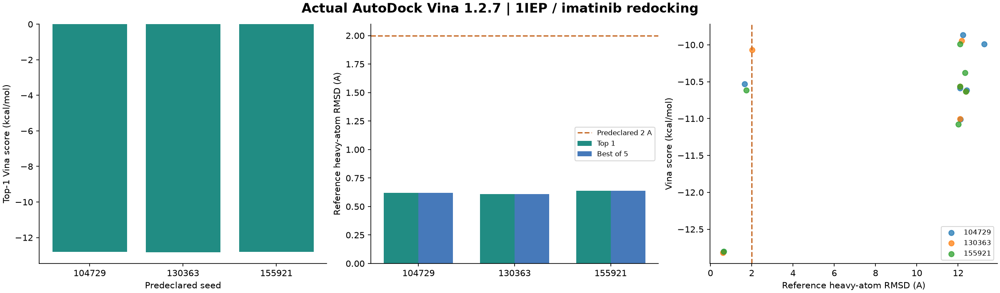
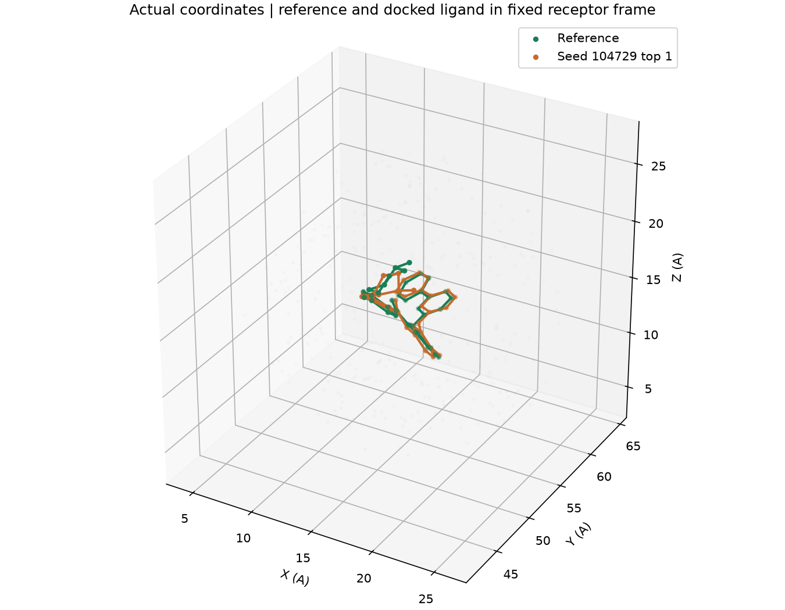

# 1IEP / Imatinib 真实重对接结果

2026-11-17在本机完成开源工具部署、公开案例准备、真实Vina搜索、姿态恢复和参考分析。数据来源为官方教程输入与本次真实计算。

## 结果

| 种子 | top1评分，kcal/mol | top1参考RMSD，Å | best-of-5参考RMSD，Å | 输出姿态数 | 运行分钟 |
|---|---|---|---|---|---|
| 104729 | -12.807 | 0.620 | 0.620 | 7 | 10.44 |
| 130363 | -12.817 | 0.610 | 0.610 | 6 | 10.34 |
| 155921 | -12.803 | 0.637 | 0.637 | 7 | 9.53 |

三个预定种子共输出20个姿态。top1有3/3个达到2 Å目标，best-of-5有3/3个达到。当前案例达到求解前声明的top1至少2/3点估计目标。

该结果支持当前受体、配体化学态和协议下的参考姿态恢复。三个种子构成小规模方法验证，实验亲和力和不同靶标/分子的预测能力仍需相应验证材料。



## 工具部署

Vina为1.2.7，RDKit为2026.09.2，Meeko为0.8.0，Gemmi为0.7.5。Vina采用Apache-2.0，RDKit采用BSD-3-Clause，Meeko采用LGPL-2.1，Gemmi采用MPL-2.0。

Python环境位于 `C:\Users\redmaple\AppData\Local\RedMaple\simulation-envs\docking-v1`。Vina可执行文件位于 `C:\Users\redmaple\AppData\Local\RedMaple\simulation-envs\docking-v1\bin\vina_1.2.7_win.exe`。21个安装wheel摘要逐项匹配PyPI官方元数据，环境依赖检查通过。版本、许可和下载来源均有本地记录。[开源核对](OPEN_SOURCE_AUDIT.md) [版本锁](requirements.lock.txt) [安装回执](evidence/deployment.json) [wheel核对](evidence/wheel-integrity.json)

## 真实流程如何落实

| 环节 | 实际操作 | 工件 |
|---|---|---|
| 问题与方案 | 明确重对接、三个种子、预算及2 Å判据 | SIMULATION_SCHEME.md |
| 知识与原始案例 | 读取领域包与官方参考，按固定提交下载教程输入 | evidence/downloads.json |
| 受体准备 | 原子记录排序修复，Meeko生成PDBQT与结构 | evidence/preparation.json |
| 配体准备 | 原始图结构→ETKDG新构象→MMFF优化→Meeko PDBQT | inputs/prepared/ligand-initial.sdf |
| 预检 | 化学身份、参考位点覆盖、重原子坐标和工具依赖 | evidence/preparation.json及receptor-heavy-atom-audit.json |
| 执行 | 真实进程，三预定种子，最多两个并行，单次4线程 | runs/*/run.json与vina.log |
| 姿态恢复 | Meeko恢复SDF，核37个重原子和化学身份 | runs/*/poses.sdf |
| 计量 | 固定受体框架中的对称重原子RMSD、逐模式分数 | analysis/all-poses.csv |
| 交付 | 种子汇总、所有模式、坐标叠加和复现脚本 | analysis与figures目录 |

执行使用案例脚本直接调用工具。生产级通用内核集成和独立科学审查留有待完成项，当前回执如实记录实际命令和程序检查。

## 输入、模型和参考

公开受体与配体取自官方AutoDock-Vina的basic_docking数据目录，固定提交为`bb64e5e26b520569a86360d69248069b5e665b3f`。公开教程将其关联到PDB 1IEP中的ABL/Imatinib参考体系。[原始受体](inputs/raw/1iep_receptorH.pdb) [原始参考配体](inputs/raw/1iep_ligand.sdf)

参考配体有37个重原子、69个总原子，形式电荷为+1。搜索初态从分子图重新嵌入，采用ETKDGv3种子20261117和收敛的MMFF初态优化。初态与参考的原位RMSD为58.347 Å。

搜索框中心为(15.190,53.903,16.917) Å，尺寸为20×20×20 Å，覆盖参考配体全部重原子。评分为vina，exhaustiveness=32，最多20模式，energy_range=3。实际写出的模式数量以各输出文件为准。[方案](SIMULATION_SCHEME.md) [求解前运行计划](evidence/run-plan.json)

## 参考比较和结构核验

用RDKit CalcRMS在固定受体坐标系内匹配化学对称重原子。对top1另用枚举化学映射的直接坐标公式独立核算RMSD，保留原子索引映射。

受体共享重原子数为2229，准备前后最大坐标位移为0.000000 Å。按配体与受体重原子距离小于1.2 Å的粗筛，共有0个输出姿态触发提示；该提示需结合原子类型和局部几何解释。

绿色是原始参考，橙色是预定第一个种子的top1，灰色是附近受体重原子。叠加保留真实坐标框架。[原子映射](analysis/atom-maps.json) [全部姿态指标](analysis/all-poses.csv)



## 实际失败和修复

部署阶段的TLS/代理差异和下载迟缓留有日志，随后通过镜像和官方wheel摘要核对完成安装。Meeko0.8.0的`-i`入口需要ProDy，按本版本帮助切换到`--read_pdb`。

教程PDB的SER438一条氢原子记录位于开头，导致残基中断。按已有原子记录排序后，原子记录集合保持一致，新增和删除原子数均为0。准备后2229个共享受体重原子坐标一致。失败输入和日志保留，搜索使用修复后的已检查工件。[记录修复](evidence/receptor-record-grouping.json) [初次错误](logs/receptor-preparation.attempt01.log) [格式错误](logs/receptor-preparation.attempt02.log)

## 复现入口

在当前机器使用PowerShell，从案例目录执行下列脚本。已有完成回执时运行脚本会核对输出并复用，避免重复提交相同种子。若改变模型或搜索协议，建立新案例版本并保留本次输入与结果。

```powershell
$dockingPython = 'C:\Users\redmaple\AppData\Local\RedMaple\simulation-envs\docking-v1\Scripts\python.exe'
& $dockingPython .\scripts\run_docking.py
& $dockingPython .\scripts\analyze.py
& $dockingPython .\scripts\report.py
```

新环境依赖使用requirements.lock.txt固定，Vina二进制与数据的地址/摘要在downloads.json。`scripts/deploy.py`记录部署方法，`scripts/prepare.py`记录输入准备。

## 适用范围

本次采用官方已加氢受体、单一配体+1化学态和刚性受体。关键水、不同质子化/互变异构体、受体构象和不同评分模型尚待敏感性研究。亲和力测量、活性筛选富集和现实应用范围依赖相应实验数据。

审查由实际程序检查和当前助手复核完成，独立科学审查尚待执行。所报告姿态和数值都关联真实输出、输入摘要和实际命令。[结果JSON](analysis/results.json) [验证回执](evidence/result-validation.json)
