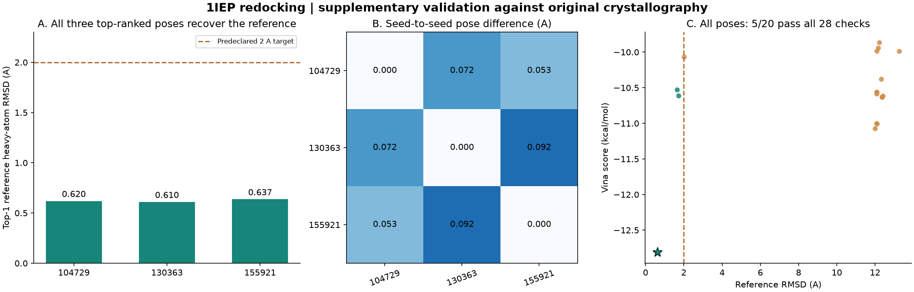
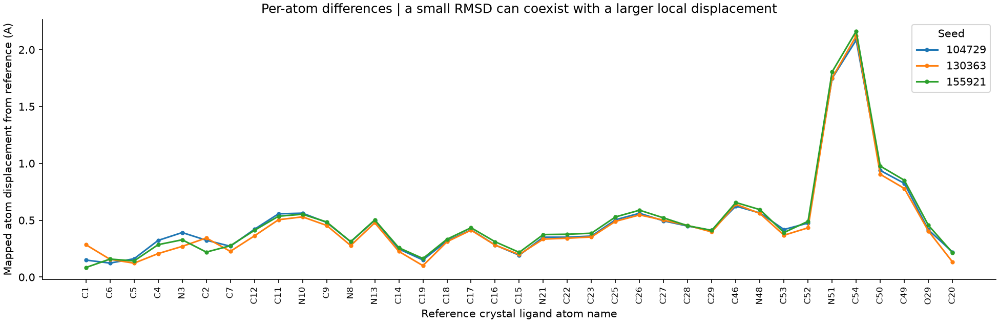

# 小分子对接结果复核与通俗解读

复核日期为2026-11-17。本轮重新检查已保存的原始输出，取得RCSB原始晶体结构，并用PoseBusters0.6.5增加几何和化学合理性检查。

**结论为当前已知体系的重对接验证通过。** 三个首选姿态都接近实验参考，化学身份和标准姿态检查通过，随机种子结果一致。下一步面向新化合物的活性预测，需要相应实验数据和独立测试集合。

## 用日常语言理解本次计算

小分子对接是在给定蛋白质结构里，搜索药物分子可能占据的位置和摆放方式。程序会尝试许多姿态并评分。本次使用实验已经观察过的ABL与Imatinib体系，重新生成药物初始构象后搜索，再检查能否恢复实验位置。

参考数据来自PDB1IEP，实验方法为X射线衍射，结构分辨率为2.10 Å。这里的RMSD量化预测姿态与给定参考坐标的整体差异，越小表示位置越接近。三个首选姿态约0.6 Å，即约0.06 nm。

Vina的约−12.8 kcal/mol是当前模型的评分。对亲和力、抑制活性和药效的判断，还需要与相应实验结果和适用模型比较。

## 本轮具体校验了什么

| 检查 | 结果 | 对本次结论的意义 |
|---|---|---|
| 参考来源 | 教程配体37个重原子与RCSB的A链STI201坐标逐一对应，RMSD=0 | 原始实验位置获得额外核对 |
| 求解器原始输出 | PDBQT与恢复SDF的重原子坐标逐一匹配 | 计算数据传递可追踪 |
| 实际求解器受体输入 | 2,229个重原子与检查用受体对应，坐标变化0 | 几何检查与求解使用同一结构 |
| 化学身份与原子对应 | 三个首选均保持37个重原子、分子连接和当前化学态 | RMSD比较对应同一个分子 |
| 参考RMSD | 三个首选0.610–0.637 Å | 达到预先采用的2 Å目标 |
| 分子内部与蛋白接触 | PoseBusters按默认redock配置检查通过 | 支持当前模型下的姿态合理性 |
| 随机搜索重复性 | 首选姿态两两差异0.053–0.092 Å | 三次找到接近的结合姿态 |
| 口袋近邻 | 参考21个4 Å近邻残基中均恢复20个 | 三个首选保持大部分参考口袋近邻 |

参考来源和交叉计算保存为机器可读结果。[原始PDB数据](1iep.cif) [RCSB元数据](1iep-entry.json) [坐标与种子交叉核对](cross-checks.json)

## 首选姿态的结果

| 种子 | 整体参考RMSD，Å | 最大单原子偏移，Å | 参考口袋近邻恢复率 | PoseBusters |
|---|---|---|---|---|
| 104729 | 0.620 | 2.085 | 95.2% | 通过 |
| 130363 | 0.610 | 2.121 | 95.2% | 通过 |
| 155921 | 0.637 | 2.163 | 95.2% | 通过 |

RMSD汇总全部重原子的差异，个别原子仍有约2.1 Å偏移，逐原子图中可以定位。4 Å近邻表示几何接近，氢键等相互作用还需结合供受体身份和角度判断。

## 20个输出姿态怎样看

三个运行共输出20个候选姿态。PoseBusters的默认redock配置本次报告28项布尔检查，全部20个姿态通过了其中的化学、几何、应变和接触检查。

综合参考位置检查，5/20通过全部项目。其余15个失败项均为参考RMSD超出2 Å。三个种子的排名第一姿态全部通过。应保留这些备用姿态和失败项，以便回查搜索、评分和参考比较的关系。

本模型采用已处理的蛋白受体，水和辅因子没有包含在模型中。对应类别的缺省检查结果适用于当前输入范围，其对真实结合的影响尚待验证。第三方工具采用默认阈值，原始配置与逐项结果均已保存。[逐姿态检查表](posebusters-all-poses.csv) [默认配置](posebusters-config.json) [检查摘要](posebusters-summary.json) [参考自身检查](posebusters-reference.csv)

## 对之前判断的补充

之前的碰撞检查使用固定1.2 Å阈值，主要覆盖非常严重的原子接近。本轮增加按原子半径计算的距离和体积重叠检查，以及键长、键角、内部冲突、环平面性和构象应变检查。三个首选姿态均通过这些补充检查。

独立取得原始晶体和直接核算坐标后，0.620、0.610、0.637 Å的原报告数值在导出精度内重现。PoseBusters是另一套验证工具，底层同样使用RDKit。本次复核包含原始实验数据核对、直接坐标公式和第三方规则，人工独立专家审查仍待开展。

## 结果的适用范围

当前证据支持这套工具链在ABL/Imatinib已知位点、单一受体构象和所选+1配体化学态下恢复参考姿态。三种种子反映同一体系的搜索重复性。新靶标、新分子、受体柔性、不同质子化状态和水介导作用需要各自的验证。

已有复合物结构和口袋信息参与了本次方案。若评估未知分子的筛选效果，需要独立的活性/非活性集合、统一准备流程和对应实验条件。药效判断还涉及选择性、细胞暴露和其它生物学证据。

## 复核来源与复现

PoseBusters使用官方默认redock配置，完整保留全部20个姿态的通过/失败状态。0.6.5安装包的LICENSE为MIT，已随本目录保存。新增验证环境依赖写入本目录的requirements.lock.txt，原求解环境锁继续保存于案例根目录。新增安装的3个wheel与PyPI官方摘要一致。[验证版本锁](requirements.lock.txt) [新增依赖核对](wheel-integrity.json)

本轮可用scripts/review_science.py、scripts/run_posebusters.py和scripts/render_review.py复现补充检查。原始求解参数和输出继续以案例目录中的方案及运行回执为依据。

方法文献和结构来源可进一步查看。[RCSB结构页面](https://www.rcsb.org/structure/1IEP) [PoseBusters论文](https://doi.org/10.1039/D3SC04185A) [PoseBusters检查文档](https://posebusters.readthedocs.io/en/latest/checks.html)
