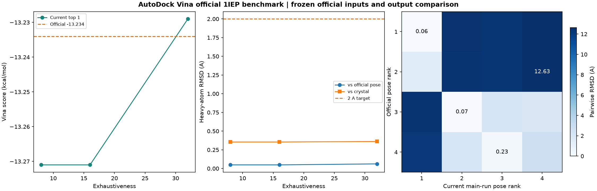
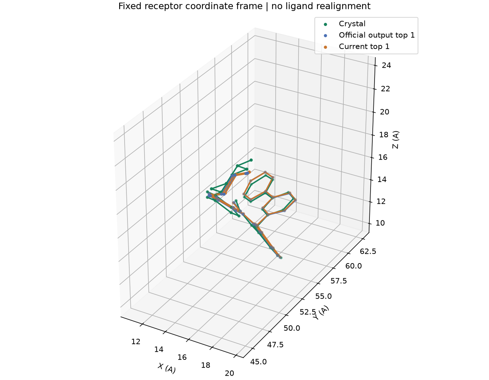

# 官方典型案例复现：ABL–Imatinib（1IEP）

2026-11-18。采用AutoDock Vina官方basic_docking教程的Vina评分分支，复现结论为 **主结果对照已完成，存在分项差异**。

本案例面向结构导向药物设计中常见的蛋白质—小分子重对接。官方同时给出已准备输入、搜索框和可下载的输出姿态，适合做输入输出明确的工具链对照。主结果采用官方参数重新求解，另做8/16/32三档搜索预算研究。

阅读时主要看两件事：评分差表示当前评分器给出的数值是否接近官方；RMSD表示分子在口袋中的位置和形状偏差，单位Å，1 Å=0.1 nm，越小越接近参考。评分是模型估计，不能直接作为实验结合强度或药效。

## 最直接的数值比对

| 项目 | 官方参考 | 本次主运行 | 对照结果 |
|---|---|---|---|
| 首选评分，kcal/mol | −13.234 | -13.229 | 绝对差0.0050 |
| 首选相对官方首选的RMSD，Å | 参考姿态自身为0 | 0.0620 | 预设目标≤2 |
| 首选相对晶体配体的RMSD，Å | 官方输出为0.3791 | 0.3612 | 预设目标≤2 |
| 实际写出的姿态数 | 4 | 4 | 全部保留并建立对应 |
| 参考4姿态的可匹配数 | 4 | 3 | 一对一RMSD≤2 Å |
| 主运行首选的PoseBusters | 官方教程未提供此报告 | 28项配置检查 | 失败项0 |

主判据达到。当前Vina对固定官方首选姿态重新评分为-13.236 kcal/mol，与文件参考差-0.0020。这项检查把评分实现差异与重新搜索引起的姿态差异分别量化。[直接数值结果](analysis/metrics.json) [固定姿态重新评分日志](runs/fixed-score/vina.log)

## 输入明细

上游固定为AutoDock-Vina v1.2.7所指提交 `8eb40404f4f45608acb3b01427587ac049f27c1f`。以下3个文件按原始字节直接绑定到实际进程，参数和化学态均可从文件中复查。

| 实际求解输入 | 字节数 | SHA-256 |
|---|---|---|
| [inputs/official/1iep_receptor.pdbqt](inputs/official/1iep_receptor.pdbqt) | 216160 | `f13cf3b36f61d87c3b58983e0b8ecf1c3456a685eb86dfe9ccfb139c7bdc2586` |
| [inputs/official/1iep_ligand.pdbqt](inputs/official/1iep_ligand.pdbqt) | 3841 | `15fb35648d8c18c70317842f3a0631b73a19429c710a037ab07310084d579bb8` |
| [inputs/official/1iep_receptor.box.txt](inputs/official/1iep_receptor.box.txt) | 101 | `3dff08200b5b9c2ca0932c832c9dffc5823b39caec6c92f76be5f7c5ea49d8de` |

输入配体为37个重原子、+1形式电荷的官方化学态。起始坐标沿用官方准备文件，与晶体坐标几乎相同，因此本例不满足独立随机初态的预测能力验证条件。这里为了与官方输入逐字节对照，保留此限制，并在工作流阶段记录中显式降级资格结论。pH枚举在本次固定化学态复现中记为不适用。

实际受体与PoseBusters条件受体的2229个重原子，按链、残基、原子名和坐标逐项核对，完全一致。[受体分析输入核验](evidence/receptor-analysis-input-audit.json)

计算参数为scoring=vina、exhaustiveness=32、种子−1622165383、spacing=0.375 Å、num_modes=9、energy_range=3 kcal/mol、min_rmsd=1 Å、每任务4线程。搜索框中心为(15.190,53.903,16.917) Å，尺寸为20×20×20 Å。[任务JSON](task.json) [参数逐项台账](ledgers/parameter_ledger.csv) [求解前方案](SIMULATION_SCHEME.md) [输入核验](evidence/input-chemical-audit.json)

## 参考输出的准确来源

参考文件来自同一固定提交的solution目录，文件名为1iep_ligand_vina_out.pdbqt，包含4个MODEL。教程终端展示9行搜索候选，文件根据energy_range写出4个模式，比较对象以实际文件为准。教程文本中的−13.23为展示精度，机器对照使用PDBQT的−13.234。

官方Vina分支的种子为−1622165383，AD4分支另有种子和分数。本案例的对照始终使用Vina分支。[官方参考PDBQT](reference/official-vina-output.pdbqt) [恢复的参考SDF](reference/official-output.sdf) [教程原文](sources/official-tutorial.rst) [来源及摘要](sources/source-lock.json)

## 全部参考姿态怎样匹配

RMSD在同一受体坐标系内计算，对称原子依据分子连接关系匹配，配体坐标保持原位。对官方4个姿态与本次所有姿态计算矩阵，再采用最小总RMSD的一对一匹配，表中同时保留输出排名和分数差。

| 官方排名 | 官方评分 | 本次候选对应排名 | 本次评分 | 分数差 | 姿态RMSD，Å | 一对一≤2 Å |
|---|---|---|---|---|---|---|
| 1 | -13.234 | 1 | -13.229 | +0.0050 | 0.0620 | 通过 |
| 2 | -11.293 | 4 | -10.622 | +0.6710 | 12.6279 | 未通过 |
| 3 | -11.281 | 2 | -11.223 | +0.0580 | 0.0739 | 通过 |
| 4 | -11.146 | 3 | -11.173 | -0.0270 | 0.2293 | 通过 |

未匹配项、额外模式和排序变化保留在数据文件中。逐模式几何匹配与主运行最低能姿态的验收分别记录。[逐姿态对照CSV](analysis/official-output-comparison.csv) [完整RMSD矩阵](analysis/pose-rmsd-matrix.csv) [所有实际输出指标](analysis/all-poses.csv)

一对一匹配要求每个计算姿态只使用一次。CSV另列每个参考姿态的最近邻及其RMSD；即使两个参考姿态都靠近同一个计算姿态，也不能重复计作两个独立模式恢复。本次官方第2姿态在最小总RMSD分配中未达标，故全模式覆盖只记为3/4。该项是次要模式的部分复现，首选的验收独立裁定。其余本次输出在PoseBusters中失败的都是晶体位置恢复项，详细逐项记录保留于CSV。

具体而言，官方第2姿态的最近邻也是本次第1姿态，RMSD为1.4499 Å；该计算姿态已用于对应官方第1，因此不重复计数。这里未达到的是四个独立输出模式的覆盖目标。

验收RMSD从原始PDBQT恢复的坐标重算；用于查看和分析的SDF保留四位小数，其化学身份和坐标导出精度另行核验。

另按任务表单报告best-of-up-to-5：当前实际前4个输出中，对晶体最小RMSD为0.3612 Å，对应排名1。首选结构的受体重原子4 Å邻近对共111对，按距离逐项列出；该列表表示几何邻近，化学相互作用类型需要另行判定。[邻近原子与残基CSV](analysis/main-top1-contacts.csv)

## 搜索预算研究

| exhaustiveness | 首选评分 | 对官方分数差 | 对官方姿态RMSD，Å | 对晶体RMSD，Å | 写出模式数 | 耗时，分钟 |
|---|---|---|---|---|---|---|
| 8 | -13.271 | -0.0370 | 0.0486 | 0.3546 | 3 | 6.32 |
| 16 | -13.271 | -0.0370 | 0.0486 | 0.3546 | 4 | 22.99 |
| 32 | -13.229 | +0.0050 | 0.0620 | 0.3612 | 4 | 21.13 |

各档采用相同官方输入和同一种子，只有搜索投入变化。这组结果描述当前单体系的预算敏感性，广泛随机可靠性需要更大的案例与种子集合。运行时间反映当前机器负载。[预算对照CSV](analysis/search-budget-comparison.csv)

本次32档评分比8/16档略高，结果按原值保留。搜索投入增加不保证单次最终输出评分严格单调变好，这三档不能作为确定性数值收敛证明。

首次e32搜索在原1800秒资源时限下超时，完整失败日志和回执保留于[初次超时记录](runs/attempts/e32-timeout-01/run.json)。随后将e32时限延长为5400秒，其余科学参数及判据保持不变，e8/e16和固定姿态评分的完成结果核验后复用。[求解前资源修订](evidence/resource-amendment.json) [首次完整运行汇总](evidence/run-summary-attempt01.json)



## 三份结构直接叠加

绿色为晶体参考，蓝色为官方参考输出首选，橙色为本次主运行首选。所有结构保留原受体坐标系。[本次主运行全部姿态](runs/e32/poses.sdf) [本次首选SDF](analysis/main-top1.sdf) [晶体配体](reference/crystal-ligand.sdf)



## 工作流落点与验收记录

| 阶段 | 本案例落实内容 | 工件 |
|---|---|---|
| 问题与依据 | 固定官方案例、Vina分支、参考输出及预设判据 | SIMULATION_SCHEME.md、source-lock.json |
| 准备 | 核官方PDBQT身份、坐标、化学态和搜索框，保持字节一致 | input-chemical-audit.json、输入摘要 |
| 协议 | 官方种子和参数，明确线程/版本来源差异 | task.json、run-plan.json |
| 资格与控制 | 固定参考姿态在当前评分器上重新计算 | fixed-score/vina.log |
| 真实执行 | 三档预算、PID、输入摘要、命令、退出与耗时 | runs/*/run.json和vina.log |
| 计量 | 固定框架重原子RMSD、全部模式匹配及评分差 | analysis目录 |
| 几何检查 | 主运行全部姿态按PoseBusters默认redock检查 | posebusters-main.csv |
| 交付 | 参数、结论和图表覆盖，输入输出对照与复算入口 | ledgers、figures、验证回执 |

全部主张逐项给出match、partial、contradicted或not_tested。[结论台账](ledgers/conclusion_ledger.csv) [图表台账](ledgers/figure_ledger.csv) [验证回执](evidence/case-validation.json)

本次由案例脚本调用真实工具，并把证据映射回领域包九阶段；平台全部适配器的自动编排认证仍待单独验收。领域包的unverified状态保留。[各阶段输入、输出及资格限制](evidence/workflow-stage-record.json)

## 复现程度与来源限制

记录为method_reproduction。官方参考输出的实际生成版本和硬件未报告，官方CPU参数为自动检测，本次明确4线程。这些差异限制逐字节一致性判断，原始分数和坐标差仍可直接量化。

本次属于已知位点、单一受体和化学态的官方方法案例。实验亲和力、筛选富集和新化合物活性需要相应数据。PoseBusters对水/辅因子的缺省检查按照当前输入范围解释。

领域包更新到0.1.1-draft以表达官方有符号随机种子，以及固定已有化学态下不适用的pH字段。旧示例继续通过Schema检查，零种子、越界种子和不一致的pH模式被反例检查拒绝。[领域Schema回归](evidence/domain-schema-regression.json) [本案例领域包快照](sources/domain-pack/README.md)

## 复算

在案例目录，用当前已部署Python环境运行以下命令。已有完成回执会核对并复用，修改输入或种子后使用新的案例版本。

```powershell
$casePython = Join-Path $env:LOCALAPPDATA 'RedMaple\simulation-envs\docking-v1\Scripts\python.exe'
& $casePython .\scripts\run_case.py
& $casePython .\scripts\compare_case.py
& $casePython .\scripts\write_report.py
& $casePython .\scripts\validate_case.py
```

依赖精确版本见requirements.lock.txt，Vina二进制摘要见run-plan.json。官方完整输入和参考输出已包含在本案例，来源链接和文件摘要均随包交付。

当前环境为Windows x64、Python 3.11.4；Vina及分析依赖的版本和来源保存在[环境回执](evidence/environment.json)。ZIP交付包含本案例工件及脚本，计算环境使用本机已部署的docking-v1。独立机器需按锁定依赖准备Python环境，并从环境回执中的官方发布链接取得Vina可执行文件、校验摘要后放到脚本约定的环境路径。
